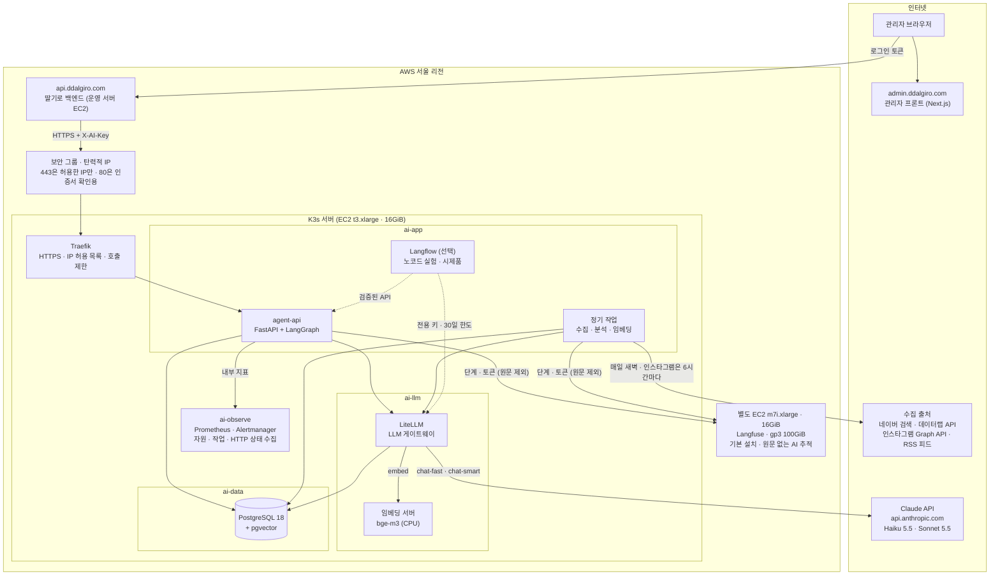

# 전체 구성 한눈에 보기

> **이 문서는 언제 보나요?** 설치를 시작하기 전에 "무엇을, 어디에 올리고 무엇을 바깥 서비스에 맡기는지"를 먼저 잡을 때. 설치 중에 "이 부품이 왜 있지?" 싶을 때 다시 돌아와 봅니다.

---

## 1. 만들려는 것

딸기로 관리자 화면에서 **입점업체에 줄 AI 정보 두 가지**를 볼 수 있게 합니다.

| 기능 | 하는 일 | 기획 원문 |
|---|---|---|
| 트렌드 분석·추천 (안건 1) | 업체별로 "지금 준비할 만한 아이템"을 골라 근거가 붙은 브리핑과 함께 보여 줍니다 | [기획 02](../../../ddalgiro-tips-task/docs/02_트렌드분석추천시스템_기획.md) |
| 자연어 추천·랭킹 (안건 2) | 말로 물으면 조건을 뽑아, 맞는 업체를 순위·견적·추천 사유와 함께 돌려줍니다 | [기획 03](../../../ddalgiro-tips-task/docs/03_자연어추천랭킹시스템_기획.md) |

- **트렌드 분석·추천 (안건 1)**: 디저트 키워드의 언급·검색 추이를 매일 모아 점수와 확산 단계를 계산하고, 그 결과로 아이템을 고릅니다.
- **자연어 추천·랭킹 (안건 2)**: "다음 주 금요일 임직원 200명 간식, 1인 8천 원, 강남"처럼 묻습니다. 돌려주는 업체는 조건을 모두 지키고 실제로 공급할 수 있는 곳입니다.

두 기능은 연구개발계획서의 두 **안건**입니다. 계획서의 어느 쪽이 이 저장소의 어디에 있는지, 아직 만들지 않은 것은 어떻게 만들지는 [연구개발계획서와 구현 대응](03-연구개발계획서-구현-대응.md)에 정리했습니다.

대화 모델은 **Claude API**를 부르고, 나머지(수집·DB·점수·순위·근거 검사·임베딩)는 **AWS의 AI용 K3s 서버 한 대**에서 직접 돌립니다. 연구개발계획서가 정한 방식("Claude API + 모델 티어링")과 같습니다. 구조는 [타사솔루션 아키텍처 참고 자료](../../../msa-task/docs/04.프로젝트-분석/01.모니모/README.md)의 역할 구분을 따르되, AI 업무 클러스터 한 대에 맞게 줄였습니다([6장](#6-타사솔루션과의-대응)).

기본 설치는 **AI용 K3s 서버 1대 + Langfuse 서버 1대 + Claude API**입니다. 운영 지표·장애 알림은 AI 서버의 Prometheus·Alertmanager가 맡고, **AI 처리 추적용 Langfuse도 처음부터 별도 서버에 설치**합니다. 설치·확인은 [모니터링과 AI 추적](../07-운영/02-모니터링과-AI-추적.md)을 봅니다.

## 2. 서버 두 대와 Claude API

| 무엇 | 어디에 | 맡는 일 |
|---|---|---|
| **K3s 서버** | AWS EC2 인스턴스 한 대 — 서울 리전, `t3.xlarge`(4 vCPU · 메모리 16GiB) | 쿠버네티스(K3s) 한 대짜리 클러스터. AI 쪽 부품이 모두 이 서버에서 실행됩니다 |
| **별도 Langfuse 서버 (기본 설치)** | AWS EC2 한 대 — 서울 리전, **`m7i.xlarge`(4 vCPU · 메모리 16GiB)**, Docker Compose | 단계·모델·토큰·오류 종류 추적. 문의·근거·응답 원문은 수집하지 않음 |
| **Claude API** | Anthropic이 운영하는 서비스(인터넷) | 대화 모델. 게이트웨이가 일의 무게에 따라 두 모델로 나눠 부릅니다 |

- **K3s 서버**: 디스크는 gp3 100GiB, OS는 Ubuntu 24.04입니다. DB, LLM 게이트웨이, 임베딩 서버, 직접 만든 에이전트, 바깥 요청을 받는 문지기(Traefik), 운영 지표·알림(Prometheus·Alertmanager)이 모두 이 서버에서 실행됩니다.
- **별도 Langfuse 서버 (기본 설치)**: 디스크는 **gp3 100GiB**, OS는 **Ubuntu 24.04 x86_64**입니다. 웹·워커와 전용 DB·Redis·ClickHouse·MinIO를 이 서버에 함께 설치합니다.
- **Claude API**: 감성 분류·조건 뽑기는 Claude Haiku 5.5, 브리핑·추천 사유는 Claude Sonnet 5.5가 맡습니다.
- **K3s**: 쿠버네티스(컨테이너를 띄우고 죽으면 되살리는 관리 프로그램)를 서버 한 대에도 가볍게 올릴 수 있게 만든 배포판입니다.
- **EC2**: AWS에서 빌려 쓰는 서버입니다. 딸기로의 운영 서버도 같은 방식이라([빈 서버에서 전체 구축](../../../ddalgiro-guide/docs/03-서버/01-빈-서버에서-전체-구축.md)), 계정·보안 그룹·탄력적 IP를 다루는 방법이 같습니다.
- **왜 AI 서버를 따로 두나**: AI 쪽 부품만 메모리를 약 5GiB 쓰고 CPU를 3코어 넘게 요청합니다(Langflow를 넣으면 약 6.3GiB). 쇼핑몰과 자원을 다투지 않도록 서버를 나눕니다. 사양의 근거와 실제 EC2에서 더 확인할 것은 [K3s 서버 문서](../01-K3s-서버/01-EC2-인스턴스와-K3s.md#이-사양으로-충분한가)에 있습니다. AI 서버가 멈춰도 쇼핑몰과 관리자 화면의 다른 기능은 영향을 받지 않습니다.
- **왜 Claude API인가**: 모델이 하는 일이 작습니다(분류·조건 뽑기·근거 문장 고르기). 숫자·순위·견적은 코드가 정하므로 호출량이 적고, 요금이 GPU 장비 값보다 훨씬 작습니다. 설치하고 지켜볼 모델 서버도 없습니다. 계산한 금액은 [월 비용 계산](04-월-비용-계산.md)에 있습니다.
- **왜 임베딩은 서버에서 돌리나**: Claude API에는 임베딩이 없고, 임베딩 모델(`bge-m3`)은 작아서 CPU로 충분합니다.
- **왜 Langfuse 서버를 따로 두나**: 추적용 DB·저장소가 AI 요청 처리와 메모리·디스크를 다투지 않게 합니다. 공식 VM 권장치에 맞춘 4 vCPU·16GiB에 CPU 크레딧이 없는 `m7i.xlarge`를 씁니다. 서버·디스크·스냅샷·IP·호스트 경보를 합해 **월 약 $195.01**, 두 서버 고정비는 **약 $360.97**입니다. Claude API까지 더한 기본 사용량은 **약 $581.40/월**이며, [단가·가정·증설 기준](04-월-비용-계산.md#2-aws-요금-고정비)을 확인합니다.
- ⚠️ **대화 호출의 글은 서버 밖으로 나갑니다.** 문의 글과 근거 문장(메뉴·가격·공급 조건)이 Anthropic으로 전달됩니다. 무엇이 나가고 무엇을 넣지 말아야 하는지는 [Claude API 문서 5장](../02-Claude-API/01-Claude-API-키와-모델.md#5-무엇이-서버-밖으로-나가나)에 있습니다.

## 3. 구성도

점선은 넣었을 때만 있는 길입니다. Langflow는 바깥에 열지 않고, 서버에 접속한 사람이 SSH 터널로만 엽니다([노코드 도구 Langflow](../04-에이전트/05-노코드-도구-Langflow.md)).

## 4. 요청 한 건이 지나가는 길

관리자가 화면에서 "비건 케이크 5만 원 이하, 강남"을 물었을 때입니다.

1. **브라우저 → 딸기로 백엔드**: 평소처럼 로그인 토큰을 실어 `api.ddalgiro.com`의 관리자 API를 부릅니다. 브라우저는 AI 서버를 직접 부르지 않습니다.
2. **백엔드 → AI 서버**: 백엔드가 관리자 권한을 확인한 뒤, AI 서버 도메인으로 HTTPS 요청을 보냅니다. 약속한 키(`X-AI-Key`)를 헤더에 넣습니다.
3. **보안 그룹 → Traefik**: AWS의 보안 그룹이 허용한 IP에서 온 443 포트 요청만 K3s 서버에 들여보냅니다. Traefik이 인증서로 HTTPS를 풀고, 보낸 쪽 IP가 허용 목록(백엔드 서버)에 있는지 한 번 더 확인합니다.
4. **agent-api**: 키를 확인하고 추천 그래프를 돌립니다 — 조건 뽑기(LLM) → 검색(SQL + 벡터 + 키워드) → 순위·견적(코드) → 추천 사유(LLM, 근거 검사).
5. **LiteLLM → Claude API / 임베딩 서버**: 에이전트는 `chat-fast` 같은 이름표만 붙여 게이트웨이에 보냅니다. 게이트웨이가 대화 호출은 Claude API로(인터넷), 임베딩은 같은 서버의 임베딩 서버로 넘깁니다.
6. 결과가 같은 길을 거꾸로 돌아가 화면에 표시됩니다.

트렌드 랭킹은 새벽에 저장한 점수를 읽고, 업체 맞춤 추천은 그 점수와 업체 프로필로 조회할 때 순위를 계산합니다. 둘 다 모델을 부르지 않습니다. Claude API 요금은 새벽 분석·수동 재분석·자연어 추천·대체 공급자 찾기와, 선택 설치한 Langflow의 모델 호출에서 듭니다.

## 5. 바깥에서 들어올 때 통과하는 문

인터넷에 열린 서버이므로 문을 여러 겹 둡니다. 설정은 [외부 공개](../05-외부-공개/01-보안-그룹과-HTTPS.md)에서 합니다.

| 순서 | 문 | 막는 것 |
|---|---|---|
| 1 | AWS 보안 그룹: 22는 내 IP만, 80은 누구나, 443은 허용한 IP만 | DB·쿠버네티스 관리 포트는 인터넷에서 아예 닿지 않음 |
| 2 | Traefik: HTTPS만, `/v1` 경로만 | 평문 접속, 관리용 경로(`/docs`·`/healthz`) |
| 3 | Traefik: IP 허용 목록 | 백엔드 서버가 아닌 곳에서 온 모든 요청 (403) |
| 4 | Traefik: 호출 제한 | 짧은 시간의 과도한 호출 (429) |
| 5 | agent-api: `X-AI-Key` 확인 | 키를 모르는 요청 (401) |

- **AWS 보안 그룹**: 80은 인증서 확인용이며 나머지 경로는 404입니다. HTTPS 자동 이동은 설정하지 않습니다.

Langfuse 서버에도 보안 그룹을 따로 둡니다. 22는 운영자 IP, 443은 AI 서버와 운영자 IP만, 80은 인증서 확인용으로 엽니다([모니터링 4-1](../07-운영/02-모니터링과-AI-추적.md#4-1-자원접근)).

나가는 쪽에서 요금이 걸린 열쇠는 Claude API 키입니다. 게이트웨이의 Secret에만 두고 에이전트·백엔드·화면에는 주지 않습니다. 새어 나가면 남이 우리 요금으로 모델을 쓰게 되므로, Claude Console에서 월 지출 한도를 걸어 둡니다([Claude API 문서 4장](../02-Claude-API/01-Claude-API-키와-모델.md#4-지출-한도와-알림)). 그 밖에 서버가 바깥 서비스에 내는 값(수집용 네이버·인스타그램 키, Langfuse 프로젝트 키, 알림 메일의 SMTP 인증 값)의 보관 위치는 [준비물 4장](02-준비물과-정할-값.md#4-비밀값은-어디에-두나)에 있습니다.

## 6. 타사솔루션과의 대응

타사솔루션은 여러 클러스터·GPU 서버·이중화를 전제로 한 금융권 플랫폼입니다. **역할은 남기고 규모와 이중화를 뺐습니다.** 타사솔루션 문서의 최소 구성 원칙("작은 클러스터, 데이터 단일 인스턴스, 관측·보안·CI/CD 최소")과 같은 방향입니다.

| 타사솔루션 | 여기서는 | 이유 |
|---|---|---|
| 에이전트(LangGraph·LangChain), "에이전트만 직접 만든다" | **그대로** — `agent-api` (FastAPI + LangGraph) | 핵심 원칙 |
| Flowise (노코드 빌더) | 같은 자리에 **Langflow**를 보조 도구로 둠(넣지 않아도 됨). 운영 흐름은 코드(`agent-api`)가 맡음 | 숫자·순위와 근거 검사는 코드로 시험해야 함 |
| LiteLLM 게이트웨이, 이름표로 호출 | **그대로** — 1개 파드 | 모델을 바꿔도 에이전트 코드가 그대로 |
| vLLM (GPU 서버 여러 대에서 모델을 직접 서빙) | 두지 않음. 게이트웨이의 이름표가 Claude API를 가리킴 | 호출량이 적어 장비·모델 운영이 필요 없음 |
| 벡터 DB (Oracle 23ai) · 메타 DB (PostgreSQL ×2) · 정본 DB (MariaDB) | PostgreSQL 1대 + pgvector | 한 대에 DB 2개(`agent`·`litellm`) |
| 수집·적재는 에이전트와 분리된 배치 | **그대로** — 쿠버네티스 CronJob | 예약 수집·분석을 API 요청 처리와 분리. API는 조회 외에도 추천·프로필·거래 기록을 저장함 |
| gateway-api · Istio(mTLS·멀티클러스터) | Traefik(K3s 내장) + AWS 보안 그룹 + IP 허용 목록 + 키 | 클러스터가 하나 |
| 로그인·권한 | 딸기로 백엔드가 맡음(중계) | 이미 있는 관리자 로그인을 그대로 씀 |
| Redis · RabbitMQ · Celery · Temporal | AI 업무 처리용으로는 두지 않음. Langfuse 전용 Redis는 별도 서버에 포함 | AI 업무의 스트리밍·대량 비동기 작업이 아직 없음. Langfuse 저장 대기열은 업무 처리와 분리 |
| Prometheus · Langfuse | AI 서버에 지표·알림, 별도 서버에 Langfuse 추적. 기존 DB 기록도 유지 | 장애 자동 알림과 AI 단계·토큰 분석. 무거운 관측 저장소는 AI 서버에서 분리 |
| Jaeger · EFK | 현재 두지 않음 | 서비스 간 상세 추적·로그 통합 검색의 필요성이 커질 때 검토 |
| 이중화(Primary-Replica·Quorum 3대) | 하지 않음. 매일 백업과 디스크 스냅샷 | 요구 사항 |

- **Flowise (노코드 빌더)**: Langflow는 실험·시제품·내부 도구용입니다. 파이썬 기반이라 에이전트와 언어가 같고, 게이트웨이를 전용 키로 부르며 바깥에 열지 않습니다([문서](../04-에이전트/05-노코드-도구-Langflow.md)).

## 7. 구현한 것과 아직 아닌 것

연구개발계획서 11~26쪽의 **일부 기능을 연결한 시제품**입니다. 연구 기능의 남은 일은 [대응 문서 8장](03-연구개발계획서-구현-대응.md#8-다음-단계--만들-것과-만드는-방법), 29~30쪽 성능지표 25개의 구현·평가 상태는 [9장](03-연구개발계획서-구현-대응.md#9-성능지표-25개와-평가-방법-2930쪽), 예산·근거·수집 등 보완한 동작은 [10장](03-연구개발계획서-구현-대응.md#10-구현에서-확인한-결함과-보완)에 있습니다. 아래의 "구현함"은 코드 경로가 있다는 뜻이며 성능 목표 달성을 뜻하지 않습니다.

| 안건 | 구현함 | 아직 아님 |
|---|---|---|
| 1 수집 | 네이버 블로그·뉴스 검색, 데이터랩 검색 관심도(91일), 인스타그램, RSS·웹 피드 | 실제 계정·선정 피드의 운영 검증, 사이트별 크롤러, 유튜브·구글 트렌드, 자사 주문 데이터 연동 |
| 1 분석 | 감성 분류, 트렌드 점수 v1, 확산 단계 판정, 시간창 두 개(7일·약 3개월) | 신조어 자동 탐지, 수명 예측, 계절·지역 보정, 출처별 신뢰 가중 학습, 24시간 창 |
| 1 검증 | 백테스팅(첫 신호일·정점일·리드타임, 단순 기준과 비교, 결과 보관) | 실제 데이터랩 자료로 돌린 결과, 제3자 검증 |
| 1 인사이트 | 근거 안에서만 쓰는 브리핑 + 근거 원문 일치 검사 | 자유로운 바꿔 쓰기를 허용할 때의 의미 검사 |
| 1 추천 | 업체 분류·확산 단계로 맞춤 순위, 채택·성과 기록 | 권장 생산량, 알림 발송, 채택 기록으로 다시 학습 |
| 2 이해 | 조건 16칸 + 문의 글과 대조하는 코드 검사 + 날짜·예산 계산 + 되묻기 | 여러 차례 대화 기억(서버가 대화를 저장하지 않음) |
| 2 검색·순위 | 의미 검색 + 키워드 검색 합치기, 정확 조건 SQL(공급·보관·배송 지역), 다섯 신호 가중 순위 | 전국 업체 자동 수집·중복 병합·폐업 대조, 순위 학습(LTR), 광고 칸 |
| 2 공급 조건 | 메뉴별 공급 조건, 확인 날짜·유효기간에 따른 확인 상태, 막힌 조건 알리기, 대체 공급자 찾기 | 공급자가 직접 조건을 고치는 화면, 여러 날에 나눠 만드는 주문 |
| 2 근거·제안 | 추천 사유 + 출처, 견적 합계(코드 계산), 값이 없으면 "담당자 확인 필요", 제안서 초안 | 상품 소개 문구·옵션 비교 자동 작성 |
| 2 거래 기록 | 고객 선택·공급자 수락/거절·주문·납품·클레임 기록과 운영 지표 | 기록으로 순위를 다시 학습 |
| 화면 | 백엔드 중계와 관리자 화면 추가 방법([문서](../06-관리자-화면-연동/01-백엔드-중계와-관리자-화면.md)) | `ddalgiro-backend`·`ddalgiro-admin-front`에 실제로 넣는 일(추후 진행 예정) |

- **1 수집**: 인스타그램은 겹친 조회·하루 관측 완료 판정, RSS·웹 피드는 이동 경로별 robots.txt 검사까지 구현했습니다. 광고·체험단 글 표시와 RSS+SNS 대체 분석도 구현했습니다.
- **1 분석**: 트렌드 점수 v1은 가속 기반이며 가중치는 조정값입니다. 신호 계열(글·검색·SNS)끼리의 교차검증과 출처별 증가율 기록도 구현했습니다.
- **2 이해**: 조건 16칸은 목적·인원·예산·수령일·보관·포장·세금계산서 등입니다.
- **2 검색·순위**: 입점사 가산 상한과 보존율 기록도 구현했습니다.

> ⚠️ **지금은 입점업체 계정이 없습니다.** 딸기로 시스템에는 업체 로그인·업체 DB 테이블이 없고, 업체는 상품명 앞의 `[업체명]`으로만 구분됩니다. 그래서 이 구성은 **직원이 관리자 화면에서 업체별 정보를 보고 전달하는** 형태입니다. 입점업체가 직접 로그인해 보는 것은 추후 진행할 예정이며, 그때 바꿔야 할 것은 [연동 문서 5장](../06-관리자-화면-연동/01-백엔드-중계와-관리자-화면.md#5-입점업체가-직접-로그인하게-될-때)에 정리해 두었습니다.

## 8. 이중화하지 않는다는 것

AI 서버와 Langfuse 서버는 역할이 다른 두 대이며 서로의 예비 서버가 아닙니다. AI 서버가 서면 AI 기능 전부가 멈춥니다. Claude API만 서면 자연어 추천이 오류로 안내되고, 계산해 둔 트렌드 랭킹은 계속 보이며 새 브리핑·추천 사유는 코드가 만든 글로 대신 나갑니다. Langfuse만 서면 추적 저장이 중단되고 AI 업무 요청은 계속 처리합니다. 관리자 화면의 다른 기능은 영향을 받지 않습니다.

| 고장 | 멈추는 것 | 대비 |
|---|---|---|
| Claude API 장애 · 호출 한도 초과 · 크레딧 소진 | 자연어 추천(조건을 뽑지 못해 오류 안내) | 게이트웨이가 한 번 더 시도. 크레딧 자동 충전과 지출 알림([Claude API 문서 4장](../02-Claude-API/01-Claude-API-키와-모델.md#4-지출-한도와-알림)) |
| K3s 서버(EC2 인스턴스) | AI 기능 전부 | 재부팅하면 K3s와 파드가 스스로 다시 뜸. 인스턴스가 망가지면 디스크 스냅샷으로 새 인스턴스를 만듦 |
| K3s 서버의 디스크(EBS) | AI 업무 DB·지표 자료 | 매일 디스크 스냅샷과 DB 백업([운영](../07-운영/01-점검-백업-문제-해결.md#4-백업)) |
| Langfuse 서버·디스크 | AI 처리 추적 저장·조회. AI 업무 요청은 계속 처리 | 서버 밖 EC2 경보, 별도 디스크 스냅샷과 암호화된 `.env` 보관([관측 서버의 백업·보관](../07-운영/02-모니터링과-AI-추적.md#7-자원비용보관)) |
| AWS 서울 리전·가용 영역 장애 | AI 기능 전부 | 따로 없음. 딸기로 운영 서버도 같은 리전에 있음 |

- **Claude API 장애 · 호출 한도 초과 · 크레딧 소진**: 새 브리핑과 추천 사유는 코드가 근거만으로 만든 글로 대신 나갑니다. 이미 계산해 둔 트렌드 랭킹은 계속 보입니다.

## 9. 따라 하는 순서

위에서 아래로 한 번에 하나씩 합니다. 각 문서 끝의 **확인**이 통과해야 다음으로 넘어갑니다.

| 순서 | 문서 | 끝나면 되는 것 |
|---|---|---|
| — | [연구개발계획서와 구현 대응](03-연구개발계획서-구현-대응.md) | (설치 순서와 별개) 계획서의 어느 쪽이 어디에 구현됐는지, 다음에 무엇을 만들지 |
| — | [월 비용 계산](04-월-비용-계산.md) | (설치 순서와 별개) 한 달 요금과 그 계산, 줄이는 방법 |
| 1 | [준비물과 정할 값](02-준비물과-정할-값.md) | 계정·도메인·IP가 정해지고 값 파일이 준비됨 |
| 2 | [EC2 인스턴스와 K3s](../01-K3s-서버/01-EC2-인스턴스와-K3s.md) | 서버에서 `kubectl get nodes`가 Ready |
| 2-1 | [별도 Langfuse 서버 설치](../07-운영/02-모니터링과-AI-추적.md#4-langfuse-별도-서버-준비) | `m7i.xlarge`에 Compose 설치, HTTPS·프로젝트 키 준비(기본 설치 단계) |
| 3 | [Claude API 키와 모델](../02-Claude-API/01-Claude-API-키와-모델.md) | API 키가 발급되고 지출 한도가 걸림 |
| 4 | [데이터베이스·임베딩·LLM 게이트웨이](../03-플랫폼/01-데이터베이스-임베딩-LLM-게이트웨이.md) | 게이트웨이 이름표로 대화·임베딩이 됨 |
| 5 | [에이전트 구조와 배포](../04-에이전트/01-에이전트-구조와-배포.md) | 샘플 데이터로 API가 답함 |
| 6 | [트렌드 분석·추천](../04-에이전트/02-트렌드-분석-추천.md) | 실제 키워드 수집과 브리핑 |
| 6-1 | [수집 출처 고르기와 추천 목록](../04-에이전트/04-수집-출처-고르기와-추천-목록.md) | 네이버 말고 붙일 사이트·피드·API가 정해짐 |
| 7 | [자연어 추천·랭킹](../04-에이전트/03-자연어-추천-랭킹.md) | 실제 카탈로그로 추천 |
| 7-1 | [노코드 도구 Langflow](../04-에이전트/05-노코드-도구-Langflow.md) | (선택) 화면에서 흐름을 만들어 게이트웨이의 모델과 에이전트 API를 써 봄 |
| 8 | [보안 그룹과 HTTPS](../05-외부-공개/01-보안-그룹과-HTTPS.md) | 허용한 IP에서만 HTTPS로 접근됨 |
| 9 | [백엔드 중계와 관리자 화면](../06-관리자-화면-연동/01-백엔드-중계와-관리자-화면.md) | 관리자 화면에서 AI 정보가 보임 |
| 10 | [점검·백업·문제 해결](../07-운영/01-점검-백업-문제-해결.md) | 매일 볼 것과 고장 대처 |
| 10-1 | [모니터링과 AI 추적](../07-운영/02-모니터링과-AI-추적.md) | 운영 이메일 알림·두 EC2의 외부 경보·추적 저장·백업 확인 |
