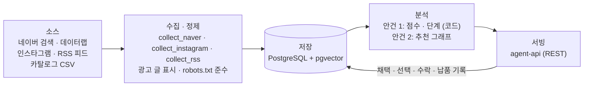

# 연구개발계획서와 구현 대응

> **이 문서는 언제 보나요?** 연구개발계획서(TIPS)의 11~26쪽 기능과 29~30쪽 성능지표가 어느 문서·코드·DB 테이블에 들어 있는지 찾을 때, 아직 만들지 않은 항목을 **어디에 어떻게 만들지** 정할 때.
>
> 계획서 원본은 로컬 `BOX/` 폴더에 보관하는 `(수정반영)딸기로컴퍼니_TIPS_연구개발계획서_신서식 0727_성능지표정리반영.pptx`입니다. Git에서 제외하므로 공개 저장소에는 원본이 없습니다(같은 파일은 `ddalgiro-tips-task`의 `BOX/`에도 있습니다). 같은 내용을 글로 풀어 쓴 것이 [기획 02](../../../ddalgiro-tips-task/docs/02_트렌드분석추천시스템_기획.md)·[기획 03](../../../ddalgiro-tips-task/docs/03_자연어추천랭킹시스템_기획.md)입니다.
>
> ⚠️ **현재 가이드를 따라 설치하면 두 안건의 시제품을 구성할 수 있습니다. 계획서 전체 기능 완성이나 성능 목표 달성을 뜻하지는 않습니다.** "구현함"은 해당 코드 경로가 있다는 뜻이며, 기존 시험 통과만으로 정식 평가를 대신할 수 없습니다. [9장](#9-성능지표-25개와-평가-방법-2930쪽)에 지표별 남은 일, [10장](#10-구현에서-확인한-결함과-보완)에 보완한 동작과 회귀 검증 범위를 둡니다. 실제 기기 검증 범위는 [버전 고정표](02-준비물과-정할-값.md#5-버전-고정표)가 기준입니다.
>
> 쪽 번호는 **PPT 파일의 슬라이드 순서**입니다. 29·30번째 슬라이드의 본문 아래에는 둘 다 `27`이라고 인쇄되어 있지만, 여기서는 각각 안건 1·2의 성능지표 평가표를 가리킵니다.

---

## 1. 두 안건과 이 저장소 (11쪽)

계획서는 연구개발을 두 **안건**(과제 단위)으로 나눕니다. 이 저장소의 에이전트 하나(`agent-api`)가 둘을 모두 맡습니다.

| 안건 | 계획서의 세 동작 | 이 저장소 | 따라 하는 문서 |
|---|---|---|---|
| ① AI 트렌드 분석·수요예측 엔진 | **포착**(신호를 모아 한곳에) → **예측**(성장 곡선·단계 점수) → **추천**(업체에 맞는 아이템) | `agent/app/trend/`, `agent/app/collecting.py`, `agent/app/jobs/`의 수집·분석 작업 | [트렌드 분석·추천](../04-에이전트/02-트렌드-분석-추천.md) |
| ② 단체주문 매칭·랭킹 시스템 | **이해**(문의를 조건으로) → **탐색**(의미+키워드 검색, 공급 조건 거르기) → **랭킹**(여러 신호로 순위, 근거·견적) | `agent/app/reco/`, `agent/app/jobs/import_catalog.py`·`embed_catalog.py` | [자연어 추천·랭킹](../04-에이전트/03-자연어-추천-랭킹.md) |

- **① AI 트렌드 분석·수요예측 엔진**: 수집·분석 작업은 `agent/app/jobs/collect_naver.py`·`collect_instagram.py`·`collect_rss.py`·`run_trend.py`·`backtest.py`입니다.

두 안건이 함께 쓰는 것은 다음과 같습니다.

| 계획서의 공통 기반 | 이 저장소 |
|---|---|
| 하나의 데이터 저장소 | PostgreSQL + pgvector 한 대의 `agent` DB([DB 테이블 정의](../../agent/sql/schema.sql)) |
| 공통 AI 인프라 | LLM 게이트웨이의 이름표 `chat-fast`·`chat-smart`·`embed`(`agent/app/llm.py`), LangGraph |
| 환각 통제·근거 강제 | `agent/app/grounding.py` — 브리핑과 추천 사유가 같은 검사를 거칩니다 |
| 서로 강화 | 안건 1 트렌드 점수가 안건 2 순위의 트렌드 신호로 쓰이고, 반응·거래 기록이 다시 학습 자료로 쌓입니다 |

## 2. 다섯 계층과 부품 (12쪽)

계획서는 전체를 **소스 → 수집·정제 → 저장 → 분석 → 서빙** 다섯 계층과, 결과가 다시 자료로 돌아오는 **환류**로 그립니다.

| 계층 | 계획서 | 이 저장소 | 상태 |
|---|---|---|---|
| 소스 | 무료 공식 API 3종 + 자사 3종으로 시작 | 네이버 검색(블로그·뉴스)·데이터랩, 인스타그램 해시태그, RSS·웹 피드, 카탈로그 CSV, 추천 반응 기록 | 일부 — [4장](#4-데이터-소스-13쪽) |
| 수집·정제 | 주기별 수집, 디저트 글만 거르기, 광고·중복 처리, 원문 대신 집계 지표 | 출처마다 수집 작업 하나, **광고·체험단 글 표시**, 제목·주소·요약과 집계 숫자만 보관 | 디저트 글 분류기는 다음 단계 |
| 저장 | 시계열 + 벡터 + 단체주문을 한 DB에 | 그대로 | 구현함 — [5장](#5-데이터-모델-25쪽) |
| 분석 | 점수는 코드, 글은 LLM, 출처 강제 | `trend/scoring.py`, `reco/ranking.py`, `grounding.py` | 구현함 |
| 서빙 | 웹 대시보드, 급상승 알림, 추천·검색 API, 챗 UI | REST API. 화면은 [관리자 화면 연동](../06-관리자-화면-연동/01-백엔드-중계와-관리자-화면.md)의 방법으로 붙입니다 | 알림·챗 UI는 다음 단계 |
| 환류·관측 | 단계별 실행 기록으로 지표를 실측, 반응 기록을 다시 학습 | `agent_runs`, `GET /v1/kpi`, `quote_outcomes`, `trend_adoptions` | 기록·집계까지 구현함. 재학습은 다음 단계 |

- **수집·정제**: 수집 주기는 인스타그램 6시간, 나머지 매일입니다. 키워드별로 URL 중복을 막고, 웹을 읽을 때 robots.txt·호출 간격을 지킵니다.

## 3. 쪽별 대응 (11~26쪽)

상태 표시: ✅ 구현함 · 🔶 일부만 구현 · ⬜ 다음 단계([8장](#8-다음-단계--만들-것과-만드는-방법)).

| 쪽 | 계획서의 내용 | 이 저장소에서 | 상태 |
|---|---|---|---|
| 11 | 두 안건의 정의와 공통 기반 | [1장](#1-두-안건과-이-저장소-11쪽) | ✅ |
| 12 | 다섯 계층 아키텍처 | [2장](#2-다섯-계층과-부품-12쪽) | 🔶 |
| 13 | 데이터 소스와 세 원칙 | [4장](#4-데이터-소스-13쪽) | 🔶 |
| 14 | 안건 1의 여섯 단계와 "추천 → 채택·성과" 되돌림 | 수집 → 분석 → 업체 맞춤 추천, 채택 기록 `POST /v1/vendors/adoptions` | 🔶 권장 생산량·알림 ⬜ |
| 15 | 양이 아니라 증가율·가속으로 성장기를 잡기, 시간창 세 개, 신조어 탐지 | 증가율·가속·단계 판정, 시간창 `7d`·`3m`([트렌드 2장](../04-에이전트/02-트렌드-분석-추천.md#2-점수와-확산-단계)) | 🔶 24시간 창·신조어 탐지 ⬜ |
| 16 | 헛신호를 거르는 세 가지: 출처 융합, 수명 예측, 계절·지역 보정 | 광고 글 제외, 신호 계열(글·검색·SNS)끼리의 교차검증, 출처별 증가율 기록 | 🔶 신뢰도 가중 학습·수명·계절 ⬜ |
| 17 | 점수 계산 순서(입력 → 증가율·가속 → 가중 융합 → 단계 → 시간창) | `agent/app/trend/scoring.py`. 가중치·단계 기준은 바꿔 넣을 수 있는 조정값 | 🔶 기본 계산만 구현. 24시간 창·계절 보정·수명 매칭은 없음 |
| 18 | 백테스팅(미래 정보를 막고 하루씩 전진, 리드타임 = 정점일 − 신호일) | `agent/app/trend/backtest.py`, `python -m app.jobs.backtest`([트렌드 8장](../04-에이전트/02-트렌드-분석-추천.md#8-백테스팅--정점보다-며칠-앞서-잡는지-재기)) | 🔶 운영과 같은 일별 다중 출처 재생 구현. 정식 지표·실자료 검증은 남음 |
| 19 | 안건 2의 다섯 단계, 비입점 업체까지 추천하는 정책, 입점사 우대의 상한 | 추천 그래프, `shops.is_partner`, 가산 상한 `PARTNER_BOOST_CAP` | 🔶 전국 업체 자동 수집 ⬜ |
| 20 | 되묻기와 다시 검색이 있는 상태 그래프, 단계별 지표 | `agent/app/reco/graph.py`, [7장](#7-단계별-지표와-재는-곳-20쪽) | 🔶 재검색 분기는 있음. 되묻기 답은 새 요청이며 대화 연결·노드 재시도 정책·단계별 정식 평가는 없음 |
| 21 | 일반 LLM+RAG와 다른 점 여섯 가지 | [아래 표](#일반-llmrag와-다른-점-21쪽) | 🔶 |
| 22 | 핵심 기술 넷: 조건 카드, 같은 가게 묶기와 신선도, 다신호 순위와 상업 가산 분리, 근거 생성 | `reco/slots.py`, `reco/capacity.py`, `reco/ranking.py`, `reco/explain.py` | 🔶 같은 가게 묶기·폐업 대조·순위 학습 ⬜ |
| 23 | 의미 검색과 키워드 검색을 나란히 → 합치기 → 조건 거르기 → 가중 점수 → 상업 가산은 따로 | `reco/search.py`(RRF로 합치기), `reco/ranking.py`(가중치 묶음·보존율) | 🔶 순위 학습·광고 칸 ⬜ |
| 24 | 환각 통제 세 장치, 모델 나눠 쓰기, 수집 규칙 | `grounding.py`, 이름표 `chat-fast`·`chat-smart`, 공식 API와 RSS·웹 수집 도구 | 🔶 근거 문장 그대로 선택·출처 보존·이동 주소별 robots 검사 구현. 원자료 정확도와 실수집 검증은 남음 |
| 25 | 핵심 DB 테이블과 공급 조건의 최신성 규칙 | [5장](#5-데이터-모델-25쪽) | ✅ 추천 시점 스냅샷·최종 수락 이후 주문과 납품 연결. 공급 조건은 수동 확인 |
| 26 | 한눈에 보는 목표와 "추천 → 채택·거절 → 견적 → 주문 → 재학습"의 고리 | 반응·납품·채택 기록과 집계 | 🔶 재학습 ⬜ |

### 일반 LLM+RAG와 다른 점 (21쪽)

| 구분 | 계획서 | 이 저장소 | 상태 |
|---|---|---|---|
| 요청 이해 | 단체주문 조건 8개 이상을 칸으로 | 조건 16칸, 문의 글과 대조하는 코드 검사 | ✅ |
| 공급 여부 | 공급 조건으로 정확히 거르기 | `supplier_capacity`를 SQL 조건으로 적용 + [최신성 규칙](../04-에이전트/03-자연어-추천-랭킹.md#공급-조건의-최신성) | 🔶 계산된 총예산까지 SQL 필터에 반영. 실시간 공급 시스템 연동은 없음 |
| 검색 | 벡터 + 키워드 + DB 조건 | 벡터 + 이름 낱말 일치 + SQL 조건 | 🔶 통계 가중 키워드 검색(BM25) ⬜ |
| 순위 | 적합도 + 품질 + 지역 + 트렌드 + 공급 능력 | 다섯 신호의 가중합 + 입점사 가산(상한) | ✅ |
| 학습 | 수락·거절·납품·재주문 결과 | `order_conversion_logs`·`delivery_cs_logs` → `quote_outcomes` | 🔶 기록까지. 학습 ⬜ |
| 실패 처리 | 맞는 곳 없음 / 되묻기 / 대체 공급자 | `empty`와 막힌 조건, `reask`, `POST /v1/recommend/{요청번호}/reroute` | ✅ |

- **요청 이해**: 조건 16칸에는 목적·인원·1인 예산·총예산·수령일·지역·포장 2종·보관·세금계산서 등이 있습니다.

## 4. 데이터 소스 (13쪽)

계획서의 세 원칙은 **공식 API 우선 / 원문 대신 집계 지표 / 값싼 신호부터 확대**입니다. 현재 구현은 감성 분류와 근거 추적을 위해 **글의 제목·주소·짧은 요약도 저장**합니다. 본문 전체와 SNS 게시물의 내용·작성자는 저장하지 않습니다. 집계 숫자만 저장하는 구성과는 구분하며, 보관 범위는 출처별 이용 조건을 확인합니다.

수집은 네이버에만 묶지 않습니다. **네이버 + 인스타그램 API + RSS·크롤링**을 함께 쓰는 것이 정해진 방향이고, 출처마다 수집 작업을 하나씩 둡니다. 출처 목록과 신호 계열(글·검색·SNS)은 `agent/app/trend/sources.py`에, 쓰는 법은 [트렌드 문서 5장](../04-에이전트/02-트렌드-분석-추천.md#5-수집-출처-넓히기--인스타그램rss크롤링)에, **무엇을 붙일지 고르는 기준과 점검해 둔 추천 목록**은 [수집 출처 고르기와 추천 목록](../04-에이전트/04-수집-출처-고르기와-추천-목록.md)에 있습니다.

| 소스 | 알려 주는 것 | 계획서의 단계 | 이 저장소 | 약관·규칙 확인 |
|---|---|---|---|---|
| 네이버 데이터랩 | 검색 관심도 = 실제 수요 | MVP | ✅ 매일, 최근 91일 (기본 출처) | 공식 API |
| 네이버 뉴스·블로그 | 언급량과 글 제목·요약(감성의 재료) | MVP | ✅ 매일 (기본 출처) | 공식 API. 제목·주소·요약만 보관 |
| 인스타그램 해시태그 | 게시물 수·좋아요·댓글 = 확산 속도 | 2차 | 🔶 6시간 겹친 조회·중복 제거·하루 전체 관측 확인. 실제 계정 미확인 | 공식 Graph API. 앱 심사 필요, 7일에 해시태그 30개 |
| RSS·웹 피드 (국내 식품 업계지, 해외 디저트 매체 등) | 언급량, 6~12개월 앞선 신호 | 1차 확대 | ✅ 수집기·점검 명령과 시험. 피드 설정은 비어 있음 | robots.txt는 작업이 확인. **약관은 피드마다 사람이 확인해 이 표에 줄을 더합니다** |
| 카카오(다음) 검색 API (블로그·카페) | 네이버 블로그의 대체 출처, 카페 글 수 | (대체 소스) | ⬜ 추천 1순위 — 수집기를 써야 합니다 | 공식 API |
| 그 밖의 웹 페이지 크롤링 (편의점 신상품 안내, 배달앱 인기 메뉴 등) | 현장 인기 | 1차 확대 | 🔶 공용 도구(`PoliteFetcher`)와 절차까지 | 사이트마다 약관·robots.txt 확인 뒤 편입 |
| 구글 트렌드 | 국내외 관심도 | MVP | ⬜ | — |
| 유튜브 Data API | 영상 조회·댓글 | 1차 확대 | ⬜ | — |
| 자사 실거래 | 판매·재구매 = 정답 | Phase 0부터 | ⬜ 운영 DB에 연결하지 않았습니다 | — |
| 공동연구 PoC 자료 | 검증된 v1 기법 | Phase 0부터 | ⬜ 자료를 받지 않았습니다 | — |
| 단체주문 운영 기록 | 상담·견적·수락/거절·전환 = 단체주문의 정답 | Phase 0부터 | 🔶 이 에이전트를 거친 요청·반응은 쌓입니다. 손으로 처리한 과거 기록은 없습니다 | 자사 자료 |

- **인스타그램 해시태그**: 중복 제거용 해시·시각·반응 수는 8일, 일별 집계는 계속 보관합니다.
- **RSS·웹 피드**: 후보 25개 주소를 점검해 통과한 11곳을 [추천 목록](../04-에이전트/04-수집-출처-고르기와-추천-목록.md#2-2-설정만-넣으면-되는-것--매체-피드)에 두었습니다.
- **그 밖의 웹 페이지 크롤링**: 사이트별 해석 함수는 대상이 정해지면 만듭니다. 커뮤니티 글은 직접 모으지 않습니다([추천 목록 2-4](../04-에이전트/04-수집-출처-고르기와-추천-목록.md#2-4-웹-페이지-크롤링-후보--다른-길부터)).
- **자사 실거래**: 새 RDS 가이드에는 읽기 전용 계정 계획이 있지만, 실제 계정·접근 범위와 개인정보 제외 방법은 미확인입니다.

**완료된 출처를 계열별로 사용합니다.** 최근 10일이 모두 완료된 출처를 고정하고 출처별 평균을 100으로 맞춘 뒤 계열별 평균을 냅니다. 두 계열 이상이면 점수를 계산하며, 네이버 전체가 없어도 RSS(글)+Instagram(SNS)으로 동작합니다. 검색 계열이 없으면 검색값은 비워 두고 실제 사용 계열을 `by_source.basis`에 기록합니다. 상세 규칙은 [트렌드 2장](../04-에이전트/02-트렌드-분석-추천.md#2-점수와-확산-단계)에 있습니다.

**소스를 하나 더 붙일 때 고칠 곳**

1. 공식 API가 있으면 그것만 씁니다. 없으면 약관·robots.txt·호출 한도를 확인해 위 표에 줄을 더합니다.
2. `agent/app/jobs/collect_<소스>.py`를 만듭니다. 웹을 직접 읽으면 `agent/app/collecting.py`의 `PoliteFetcher`로 받고, 하루치 집계와 저장은 같은 파일의 `complete_day_counts`·`save_day_counts`·`save_documents`를 씁니다(온전히 받은 날만 `is_complete=true`).
3. `agent/app/trend/sources.py`에 출처 한 줄을 더합니다(이름·계열). 계열은 글·검색·SNS 가운데 하나로 정합니다. 그러면 분석 그래프(`pipeline.py`)는 고치지 않아도 그 출처의 증가율과 교차검증이 계산됩니다. 새 계열(예: 구매 관심)을 만들려면 `agent/app/trend/signals.py`의 계열 순서와 읽는 칸도 함께 고쳐야 판정과 점수에 쓰입니다.
4. `k8s/31-agent-jobs.yaml`에 CronJob을 더하고, 비밀값이 필요하면 `scripts/k3s-server/create-secrets.sh`에 옵션을 더합니다.
5. [트렌드 문서 5장](../04-에이전트/02-트렌드-분석-추천.md#5-수집-출처-넓히기--인스타그램rss크롤링)의 표와 [운영 문서](../07-운영/01-점검-백업-문제-해결.md#4-4-되살리기)의 작업 이름 목록을 고칩니다.

## 5. 데이터 모델 (25쪽)

| 계획서의 DB 테이블 | 이 저장소 | 다른 점 |
|---|---|---|
| `keywords` · `daily_metrics` | 같은 이름 | `is_sample`·`is_complete` 칸이 더 있습니다 |
| `documents` (+ 벡터) | `documents` | 벡터 칸이 없습니다. 브리핑 근거는 최근 글을 그대로 주고, 의미 검색의 벡터는 `menus.embedding`에 둡니다 |
| `group_order_requests` | 같은 이름 | 조건은 `slots`(JSON) 한 칸, 순위 감사 기록·막힌 조건은 `audit` |
| `supplier_capacity` | 같은 이름 | 상품(메뉴) 단위. 포장·세금계산서·배송 지역 칸의 이름과 형태가 다름 |
| `quote_options` | 같은 이름 | 수량·단가·합계, 공급 조건 확인 상태, 회차(`round`), 당시 근거(`citations`)·조건/결과 스냅샷(`snapshot`) |
| `proposal_logs` | 같은 이름 | 제안서 초안과 채택 여부 |
| `order_conversion_logs` | 같은 이름 | 고객·공급자의 의사, 주문 번호(`order_ref`)·재전송 식별자(`event_key`) |
| `delivery_cs_logs` | 같은 이름 | 납품·지연·클레임·재주문 의향과 주문 번호·재전송 식별자 |

- **`supplier_capacity`**: 계획서의 `packaging_type`은 `individual_packaging`·`gift_packaging` 두 칸, `invoice_available`은 `tax_invoice`, `delivery_area`는 `delivery_areas`(목록)입니다.

계획서에 이름이 없지만 필요한 것: `trend_scores`·`trend_insights`(점수·브리핑), `vendor_profiles`·`trend_adoptions`(업체 프로필·채택 기록), `backtest_runs`(백테스팅 결과 보관), `shops`·`menus`(카탈로그), `agent_runs`(단계별 실행 기록), `instagram_hashtags`(7일 한도 안에서 조회 중인 해시태그), `instagram_observations`·`instagram_windows`(8일 보관하는 관측값·완료 구간), `quote_outcomes`(옵션별 거래 결과를 한 줄로 모은 보기).

**거래 가능 공급자(정답)의 정의.** `quote_outcomes.tradable`은 추천 당시 제약 통과 스냅샷 + 공급자의 최종 수락 + 그 수락 뒤 확정한 주문 + 같은 주문 번호의 납품 완료가 모두 있어야 참입니다. 과거 수락 후 최종 거절이면 거짓이며, API는 순서·주문 번호·재전송을 검증합니다. 스냅샷 없는 옛 제안은 학습 정답으로 인정하지 않습니다.

**공급 조건의 최신성 규칙.** 유효기간 안이면 바로 제안하고, 지났으면 공급자에게 다시 확인하며, 대량 주문은 최신이어도 견적 전에 확인받습니다. 판정은 `agent/app/reco/capacity.py`, 쓰는 법은 [자연어 추천 문서](../04-에이전트/03-자연어-추천-랭킹.md#공급-조건의-최신성)에 있습니다.

## 6. 계획서와 다르게 정한 것

| 항목 | 계획서 | 이 저장소 | 이유 |
|---|---|---|---|
| 모델을 부르는 길 | Claude API를 작업별로 나눠 씀(저가 모델로 분류, 고급 모델로 브리핑) | 같은 방식이되 게이트웨이(LiteLLM)를 사이에 둠. 에이전트는 이름표 `chat-fast`·`chat-smart`로만 부름 | 계획서의 "호출 추상화 계층으로 모델 교체 가능"을 게이트웨이로 구현 |
| 운영 비용 장치 | 모델 티어링, 배치 API, 프롬프트 캐싱, 월 토큰 상한 | 모델 티어링과 월 지출 한도(Claude Console)만 둠. 배치 API·프롬프트 캐싱은 쓰지 않음 | 호출량이 적어 아낄 금액이 작습니다 |
| 스케줄러 | APScheduler | 쿠버네티스 CronJob | 예약 수집·분석을 API 요청 처리와 분리. API 자체는 추천·프로필·거래 기록도 저장합니다 |
| 수집 주기 | 뉴스 하루, SNS 6시간 | 인스타그램 6시간(00·06·12·18시 10분), 네이버 03:00, RSS 03:20 | SNS는 겹친 관측 구간을 합쳐 하루 집계의 누락을 검사합니다 |
| 임베딩 | 384~768차원 다국어 모델 | `bge-m3` 1,024차원 | 한국어 검색 품질. 차원은 `EMBED_DIM`과 `vector(1024)`에 있습니다 |
| 벡터 색인 | ivfflat | hnsw | 자료가 적을 때도 미리 학습할 필요가 없습니다 |
| 키워드 검색 | BM25 | 메뉴·업체 이름의 낱말이 문의에 들어 있는 개수 | 한국어 조사 때문에 문의의 낱말로는 이름을 찾기 어렵습니다. 확장 모듈 없이 SQL로 됩니다 |
| 공급 조건 | 실시간 | 저장한 값 + 확인 날짜·유효기간 + 사람의 공급자 확인 | 공급자가 쓰는 시스템이 없어 실시간으로 받을 곳이 없습니다 |
| 쓰는 사람 | 입점사가 직접 쓰는 웹 서비스 | 직원이 관리자 화면에서 보고 전달 | 딸기로 시스템에 입점업체 계정이 없습니다([전체 구성 7장](01-전체-구성-한눈에-보기.md#7-구현한-것과-아직-아닌-것)) |

- **모델을 부르는 길**: `chat-fast`는 Claude Haiku 5.5(분류·조건 뽑기), `chat-smart`는 Claude Sonnet 5.5(브리핑·추천 사유)입니다. 모델은 [버전 고정표](02-준비물과-정할-값.md#5-버전-고정표) 기준입니다. 모델을 바꿀 때는 게이트웨이의 모델 표만 고치고 에이전트 코드는 그대로 둡니다.
- **운영 비용 장치**: 되풀이되는 앞부분이 가장 긴 조건 뽑기도 값싼 모델을 씁니다. 요금이 커지면 새벽의 감성 분류부터 배치로 옮깁니다([Claude API 문서 4장](../02-Claude-API/01-Claude-API-키와-모델.md#4-지출-한도와-알림)).

## 7. 단계별 지표와 재는 곳 (20쪽)

계획서는 그래프의 단계마다 목표 지표를 둡니다. **목표치를 정식으로 재려면 정답을 붙인 문의 묶음(골든셋)이 필요하고, 아직 없습니다.** 지금은 운영 기록에서 아래 값을 볼 수 있습니다. 운영 장애·시간 지표는 Prometheus·Alertmanager로, 요청·단계·모델·토큰은 별도 Langfuse로 추적합니다([설치·검증](../07-운영/02-모니터링과-AI-추적.md)). 원문을 수집하지 않으며, 이 운영 관측은 정답셋을 사용한 정식 성능 평가와 별개입니다.

| 단계 | 계획서의 목표 | 지금 볼 수 있는 값 | 정식으로 재려면 |
|---|---|---|---|
| 이해 | 조건 추출 F1 ≥ 0.85, 되묻기 적중 ≥ 0.80 | `GET /v1/kpi`의 `reco.requests`(ok·reask·empty 수), `nodes`의 understand 성공 수 | 골든셋의 정답 조건과 비교 |
| 검색 | 후보 재현율, 조건 위반 0 | 계산 총예산·수량을 포함한 SQL 필터와 회귀 시험 | 골든셋의 정답 업체가 후보에 드는 비율 |
| 순위 | nDCG@10 +20%, 상위 보존율 ≥ 95% | `reco.preservation_avg`(입점사 가산 뒤에도 남은 상위 결과의 비율) | 골든셋으로 nDCG, 규칙 순위와 비교 |
| 답변 | 사실 오류율 ≤ 1%, 출처 100% | `reco.reason_llm_rate`는 모델 글 사용 비율입니다 | 주장 단위로 DB 값과 대조 |
| 안건 1 예측 | 리드타임 ≥ 14일, 반짝 유행 오탐 ≤ 20% | `backtest_runs`의 결과표 | 검증셋 확대, 제3자 검증 |
| 사업 | 채택률, 견적 → 주문 전환율, 공급 가능 추천 정확도 | `trend.adoption_rate`, `reco.request_to_order_rate`, `reco.supplier_accept_rate`, `reco.outcomes.tradable` | 기록이 충분히 쌓인 뒤 분기별로 |

- **답변**: 원자료 정확도는 별도 평가하며 원문 일치 검사·출처 보존을 적용합니다.

## 8. 다음 단계 — 만들 것과 만드는 방법

[10장의 검증 조건](#10-구현에서-확인한-결함과-보완)을 유지하며, 연구 기능은 자료→학습 순서로 구현하고 [9장의 고정 평가셋](#9-성능지표-25개와-평가-방법-2930쪽)에서 판정합니다.

### 안건 1

| 만들 것 | 방법 | 끝 기준 |
|---|---|---|
| 신조어·신메뉴 탐지 | 갑자기 늘어난 낱말을 후보로 모아 `chat-fast`로 가린 뒤 `keywords`에 넣어 추적합니다 | 신조어 탐지 F1 ≥ 0.80, 포착 지연 ≤ 7일 |
| 소스 확장과 24시간 시간창 | [4장의 절차](#4-데이터-소스-13쪽)와 [추천 목록 2-1](../04-에이전트/04-수집-출처-고르기와-추천-목록.md#2-1-먼저-붙일-것--공식-api)의 순서로 붙이고, `scoring.windows`에 짧은 창을 더합니다 | 같은 신호를 주는 소스 2개 이상 |
| 출처별 실자료 검증 | 실제 승인받은 출처들의 `by_source`와 운영 재생 결과를 비교합니다 | 고정 평가셋에서 도움이 확인되고 장애 때 두 계열 이상 유지 |
| 출처 신뢰도 가중 | `ScoreWeights`를 출처별로 나누고, 출처마다 "얼마나 맞았는지"로 가중치를 정합니다 | 가장 좋은 단일 출처보다 적중률 +15%p |
| 수명 예측 | 닮은 과거 곡선을 찾아 남은 기간과 유형을 붙입니다(새 파일 `trend/lifespan.py`) | 반짝/지속 분류 정확도 ≥ 0.80 |
| 계절·지역 보정 | 데이터랩을 1년 넘게 받아 작년 같은 시기의 값을 빼고, 지역별 관심도를 따로 받습니다 | 반짝 유행 오탐률 ≤ 20% |
| 권장 생산량·준비 안내 | 자사 주문 자료가 필요합니다. 운영 DB를 어떻게 읽을지부터 정합니다 | 사용자 결정 대기 |
| 급상승 알림 | `run_trend` 뒤에 "새로 성장기에 든 키워드"를 찾아 알리는 작업. 보내는 길(메일·메신저)을 먼저 정합니다 | — |
| 채택 기록으로 다시 맞추기 | `trend_adoptions`가 쌓이면 `recommend.py`의 시기·적합도 값을 조정합니다 | 채택률 분기 실측 |

- **신조어·신메뉴 탐지**: ① `documents`의 제목·요약에서 낱말별 날짜 수를 세어 "어제까지 없다가 갑자기 늘어난 낱말"을 후보로 모읍니다(새 DB 테이블 `keyword_candidates`, 새 작업 `jobs/detect_newwords.py`). ② `chat-fast`에게 구조화 출력으로 "디저트 신메뉴인가·같은 말의 다른 표기인가"를 묻습니다. ③ 확정한 말을 `keywords`에 넣어 다음 수집부터 추적합니다.
- **소스 확장과 24시간 시간창**: 붙이는 순서는 카카오 검색 → 인스타그램 실계정 확인 → 유튜브 → 쇼핑인사이트이고, 구글 트렌드는 열리면 붙입니다. 웹 페이지 크롤링은 공식 API·피드가 없을 때만 검토합니다. `scoring.windows`의 짧은 창은 하루에 여러 번 모으는 소스가 생기면 더합니다.
- **출처별 실자료 검증**: `signals.py`의 계열별 정규화·대체 운용을 사용합니다.
- **출처 신뢰도 가중**: "얼마나 맞았는지"는 `backtest_runs`와 `by_source` 기록으로 계산합니다.
- **수명 예측**: 백테스팅에 쓴 과거 곡선을 정점·반감기와 함께 저장하고(새 DB 테이블), 지금 곡선과 모양이 닮은 과거 곡선을 찾습니다. 붙이는 유형은 반짝·지속·계절·지역입니다.
- **채택 기록으로 다시 맞추기**: 조정의 기준은 채택·성과가 좋았던 추천의 단계·점수 분포입니다.

### 안건 2

| 만들 것 | 방법 | 끝 기준 |
|---|---|---|
| 평가용 문의 묶음(골든셋) | 대표 문의 50~100건에 정답을 붙이고, 조건 F1·nDCG@10·조건 위반율을 내는 평가기를 만듭니다 | [7장](#7-단계별-지표와-재는-곳-20쪽)의 값을 숫자로 냄 |
| 전국 카탈로그 수집과 같은 가게 묶기 | 지도·공공데이터(식품위생업소)를 받아 상호+주소+좌표로 같은 가게를 묶습니다 | 병합 정확도 ≥ 0.95, 폐업 오추천 ≤ 1% |
| 식이 표시 자동 추출 | 메뉴 설명에서 `chat-fast`로 비건·저당 등을 뽑되, 직원이 확인한 것만 `diet_tags`에 넣습니다 | 조건 위반 추천율 ≤ 1% |
| 순위 학습 | `quote_outcomes`를 정답으로 가중치를 학습해 `reco/ranking.py`의 `rank`만 바꿉니다 | nDCG@10이 규칙 순위보다 +20% |
| 광고 칸 | 일반 결과와 섞지 않는 별도 목록, "광고" 표시, 노출 기록 | 표시·기록 준수 100% |
| 제안 자료 자동화 | 상품 소개 문구·옵션 비교·자주 묻는 질문을 근거 검사를 거치는 글쓰기로 더합니다 | 견적 제안에 걸리는 시간 50% 단축 |
| 대화 기억과 챗 화면 | 서버가 요청 번호로 앞선 문의를 이어 받게 하고, 화면은 관리자 프론트에 붙입니다 | 되묻기 적중 ≥ 0.80 |
| 여러 날에 나눠 만드는 주문 | 하루 생산량과만 비교하는 지금의 조건을, 수령일까지의 날수와 생산 일정으로 넓힙니다 | — |

- **평가용 문의 묶음(골든셋)**: 정답 조건·정답 업체는 사람이 붙여 [9장 "정식 평가를 구현하는 순서"](#정식-평가를-구현하는-순서)의 위치에 둡니다.
- **전국 카탈로그 수집과 같은 가게 묶기**: 지도·공공데이터를 받는 작업을 만들고, `shops`에 주소 좌표·인허가 번호를 더합니다. 폐업은 공공데이터와 주기적으로 대조해 `is_open`을 고칩니다.
- **식이 표시 자동 추출**: 틀린 표시는 조건 위반으로 이어집니다.
- **순위 학습**: 그래프와 나머지 단계는 그대로입니다.
- **제안 자료 자동화**: 지금의 제안서 초안(`reco/proposal.py`)은 견적과 추천 사유를 묶는 데까지입니다.
- **대화 기억과 챗 화면**: 대화의 흐름은 [Langflow](../04-에이전트/05-노코드-도구-Langflow.md)에서 `agent-api`를 부르는 시제품으로 먼저 만들어 볼 수 있습니다.

### 두 안건 공통

| 만들 것 | 방법 |
|---|---|
| 문장의 뜻까지 대조하는 근거 검사 | 속성·단위·부정까지 검증하는 의미 검사를 만들고 고정 평가셋으로 먼저 확인합니다 |
| 한글로 쓴 수량·날짜 | "이백 개"·"일주일 뒤"를 숫자·날짜로 바꾸는 규칙을 `reco/slots.py`의 `normalize`에 더합니다 |
| Claude API로 나가는 글 줄이기 | 조건 뽑기 전 개인정보를 가리고, 모델용 근거와 응답용 근거를 나눕니다 |
| 실제 Claude API로 평가 | 실제 모델로 `tests/test_live.py`와 [운영 전 평가](../02-Claude-API/01-Claude-API-키와-모델.md#6-운영-전-평가와-합격-기준)를 돌려 조건 추출 정확도·응답 시간·요금을 잽니다 |

- **문장의 뜻까지 대조하는 근거 검사**: 현재는 근거 문장 전체를 그대로 선택하는 방식입니다. 이 의미 검사는 자유로운 바꿔 쓰기를 허용하려면 필요합니다.
- **한글로 쓴 수량·날짜**: 지금은 그 값을 인정하지 않습니다 — 단체주문으로 인식된 문의면 되묻고, 그렇지 않으면 그 조건 없이 추천합니다.
- **Claude API로 나가는 글 줄이기**: ① 조건 뽑기 전에 문의 글의 개인정보를 가립니다(`reco/slots.py`의 `extract` 앞). ② `reco/explain.py`의 공급 조건 F7을 모델에 보내는 근거에서 제외하고, 답을 검사한 뒤 코드로 붙입니다. 현재 `required_sources`는 빠진 근거를 답에 넣는 기능이며 **전송을 차단하지는 않습니다**. 모델용 근거와 응답용 근거를 나눠야 합니다. 메뉴 설명 F4와 고객 조건 Q1에도 민감한 글이 들어갈 수 있습니다([밖으로 나가는 글](../02-Claude-API/01-Claude-API-키와-모델.md#5-무엇이-서버-밖으로-나가나)).
- **실제 Claude API로 평가**: 시험과 로컬 확인은 작은 로컬 모델로 했습니다.

## 9. 성능지표 25개와 평가 방법 (29~30쪽)

**두 평가표의 25개 지표는 모두 정식 평가 전입니다.** 코드가 있거나 샘플 시험을 통과해도 목표 달성으로 표시하지 않습니다. 아래 번호의 마지막 숫자는 원문 평가항목 안의 세부 순서입니다. 비중은 원문의 세부비중이며, 안건별로 100%입니다. `분기 실측`은 고정 합격 숫자가 없는 사업 지표입니다.

### 안건 1 — 11개 지표

| 번호 | 지표 · 목표 | 비중 | 현재 구현과 정식 평가에 필요한 것 |
|---|---|---|---|
| A1-01-1 | 성장기 탐지 정밀도·재현율 각각 ≥ 0.70 | 11.7% | 🔶 `backtest`는 첫 신호·놓침·헛신호 수만 냅니다 |
| A1-01-2 | 리드타임 평균 ≥ 14일 | 11.7% | 🔶 운영 공통 계산기로 재생하고 같은 항목끼리 리드타임을 비교함 |
| A1-01-3 | 반짝유행 오탐률 ≤ 20% | 11.6% | 🔶 현재 `false_signals`는 건수 |
| A1-02-1 | 신조어·신메뉴 탐지 F1 ≥ 0.80 | 7.5% | ⬜ 자동 후보 발굴·확정·탐지 평가기 없음. 과거 신조어 검증셋과 범용 NER·고정 사전 비교 필요 |
| A1-02-2 | 신조어 평균 포착 지연 ≤ 7일 | 7.5% | ⬜ 최초 등장일·시스템 포착일 기록과 평균 지연 계산 필요. 놓친 신조어 수를 따로 공개 |
| A1-03-1 | 융합 적중률이 최량 단일 소스 대비 +15%p 이상 | 15.0% | 🔶 출처별 정규화·대체 분석·교차검증 구현 |
| A1-04-1 | 브리핑 수치·사실 오류율 ≤ 1% | 7.5% | 🔶 `grounding.check`는 근거 원문 그대로 선택했는지 검사 |
| A1-04-2 | 주장 출처 추적률 100% | 7.5% | 🔶 `trend_insights.citations` 저장·문장별 번호 검사는 있음 |
| A1-05-1 | 반짝형·지속형 분류 정확도 ≥ 0.80 | 6.7% | ⬜ 수명·유형 분류기와 정답 검증셋 없음. 현재 성장기·정점 등 확산 단계는 이 유형 분류와 다른 값 |
| A1-05-2 | 추천 트렌드 상품화율·채택률 분기 실측 | 6.7% | 🔶 `trend_adoptions` 이벤트 있음. 현재 `adoption_rate`는 반응 건수 비율 |
| A1-05-3 | 추천 상품 주문 전환율 분기 실측 | 6.6% | 🔶 `sold` 수량 기록만 있음 |

- **A1-01-1**: 발생·성공 트렌드 라벨과 신호를 매칭해 TP·FP·FN(정탐·오탐·놓침)을 집계하는 평가기가 필요합니다.
- **A1-01-2**: 동결한 실자료로 정식 평가가 필요합니다. 표제는 언론 보도 대비이지만 원문 산식은 `정점일 − 최초 성장신호일`이므로 보도일과 정점일을 별도 보관하고 혼용하지 않습니다.
- **A1-01-3**: 지속형 반례·반짝 아이템 오판의 분모와 유형 정의를 고정하고 비율을 계산해야 합니다.
- **A1-03-1**: 동일 기간·라벨에서 출처별 모델과 융합 모델을 비교하는 평가기가 필요합니다.
- **A1-04-1**: 주장별 원천값·뜻·단위를 대조하는 정답과 평가가 필요합니다.
- **A1-04-2**: 복합 문장을 개별 주장으로 나누고 각 출처가 실제 주장을 뒷받침하는지 전수 검사가 필요합니다.
- **A1-05-2**: 추천 노출·업체·아이템을 연결할 식별자, 중복 방지, 출시까지의 분모가 필요합니다.
- **A1-05-3**: 추천 → 출시 상품 → 실제 주문 연결과 분모가 필요하며, 안건 2의 요청→주문 비율로 대신할 수 없습니다.

### 안건 2 — 14개 지표

| 번호 | 지표 · 목표 | 비중 | 현재 구현과 정식 평가에 필요한 것 |
|---|---|---|---|
| A2-01-1 | 핵심 슬롯 추출 F1 ≥ 0.85 | 10.0% | 🔶 조건 16칸 추출·정리는 있음 |
| A2-01-2 | 모호 질의 되묻기 적중률 ≥ 0.80 | 10.0% | 🔶 지역·수량·날짜·보관 되묻기 있음 |
| A2-02-1 | nDCG@10 규칙기반 대비 +20% 이상 | 10.0% | ⬜ 현재도 규칙 가중합이며 LTR·평가기 없음 |
| A2-02-2 | 하드제약 위반 추천율 ≤ 1% | 10.0% | 🔶 SQL 필터 있음. 계산 총예산까지 반영 |
| A2-03-1 | 중복 병합 정확도 ≥ 0.95 | 7.5% | ⬜ 상호·주소·좌표 기반 병합과 검증셋 없음. `UNIQUE(name, region)`은 엔티티 병합기가 아님 |
| A2-03-2 | 폐업·휴업 오추천율 ≤ 1% | 7.5% | 🔶 `is_open` 필터만 있음. 공공데이터 대조·휴업 반영·재검증 날짜와 추천 시점 정답 필요 |
| A2-04-1 | 부스트 후 적합도 상위 보존율 ≥ 95% | 5.0% | 🔶 적합도 우선·가산 상한·상위 95% 보존 제약 구현 및 반례 회귀 시험 통과 |
| A2-04-2 | 상한·광고 라벨·감사로그 준수율 100% | 5.0% | 🔶 입점사 가산 값·요청 감사 기록은 있음. 광고 슬롯·표시·전건 검사 없음 |
| A2-05-1 | 추천 이유 사실 오류율 ≤ 1% | 7.5% | 🔶 근거 원문 일치 검사로 가격·생산량 교환과 무근거 주장을 차단 |
| A2-05-2 | 출처 추적률 100% | 7.5% | 🔶 추천 응답·DB 저장·제안서·재조회에 당시 근거와 출처를 보존 |
| A2-06-1 | 운영 요청조건 슬롯 추출 정확도 ≥ 0.85 | 5.0% | 🔶 문의·추출 조건만 저장 |
| A2-06-2 | 공급 가능 브랜드 추천 정확도 ≥ 0.90 | 5.0% | 🔶 수락·거절·납품 이벤트 있음 |
| A2-06-3 | 견적 제안 리드타임 단축률 ≥ 50% | 5.0% | ⬜ 요청·제안 생성 시각은 있으나 수작업 비교 로그·평가기 없음 |
| A2-06-4 | 옵션 선택률·견적→주문 전환율 분기 실측 | 5.0% | 🔶 선택·주문 건수와 요청→주문 비율 있음 |

- **A2-01-1**: 50~100건 골든셋, 슬롯별 정답·값 정규화·F1 평가기와 키워드/정규식 비교군이 필요합니다.
- **A2-01-2**: 실제 빠진 핵심 조건과 질문한 항목을 비교하는 평가기·대화 연결이 필요합니다.
- **A2-02-1**: 기본 응답은 5개이므로 평가에서는 가능한 후보의 상위 10개까지 받도록 설정하고, 두 방식에 같은 관련도 정답을 사용합니다.
- **A2-02-2**: 정식 평가에서는 추천 결과마다 식이·지역·수량·납기·예산 등을 정답 조건과 대조합니다.
- **A2-04-1**: 정식 평가셋에서 전건 보존율 측정이 필요합니다.
- **A2-04-2**: 광고 미사용을 광고 준수 검증 완료로 세지 않습니다.
- **A2-05-1**: 정식 평가에서는 원자료 자체의 사실 정확도도 대조합니다.
- **A2-05-2**: 저장·제안서·재조회 전 구간의 추적 검사가 필요합니다.
- **A2-06-1**: 담당자가 확정한 정답 조건과 연결해 비교해야 합니다. 오프라인 F1과 별도의 실거래 평가입니다.
- **A2-06-2**: 마지막 의사와 제약 확인을 반영하는 정답이 필요합니다. 현재 `supplier_accept_rate`는 응답한 옵션만의 비율이며, 미응답·상반된 반응도 구분해야 합니다.
- **A2-06-3**: `agent_runs.elapsed_ms`(운영 지표 `nodes`의 `avg_ms`)는 노드 실행 시간이라 상담→견적 시간 대신 쓸 수 없습니다.
- **A2-06-4**: 견적 제시의 분모, 되묻기·대체 제안의 요청 연결, 중복 이벤트 제거, 실제 주문 연결이 필요합니다.

### 정식 평가를 구현하는 순서

1. **정답과 분모를 먼저 고정합니다.** 트렌드 발생·성공·정점·유형, 신조어 최초 등장, 문의별 정답 조건·관련 업체 순위, 업체 병합·영업 상태, 주장별 근거를 사람이 확정합니다. 성공 트렌드는 원문 18쪽처럼 일정 기간 유지와 검색·언급·거래 중 두 계열 이상의 확산 증거를 요구하며, 기간·일치 허용 범위도 평가 전에 정합니다.
2. **튜닝용 자료와 최종 시험 자료를 분리합니다.** 시계열은 시간 순으로 나누고 최종 시험의 시작일·정점 라벨을 결과를 본 뒤 바꾸지 않습니다. 비교 기준도 같은 자료에서 실행합니다. 융합의 최량 단일 소스 선정, 분류 기준·가중치 조정은 튜닝용 자료에서 끝냅니다.
3. **평가 코드와 자료 형식을 추가합니다.** `agent/evaluation/`에 지표 계산·실행 코드를, `agent/tests/fixtures/evaluation/`에 비식별 고정 검증셋을 둘 수 있습니다(두 경로 모두 아직 없음). 기존 `tests/test_rules.py`·`test_db.py`·`test_live.py`는 동작 회귀용으로 유지하고 정식 성능 평가는 별도로 실행합니다.
4. **같은 대상을 비교합니다.** 정밀도·재현율·F1은 정탐·오탐·놓침에서 계산하고, nDCG 개선율은 `(새 점수 / 기준 점수 − 1) × 100`, 융합 개선폭은 적중률의 `%p` 차이입니다. 리드타임 단축률은 `(수작업 시간 − 시스템 시간) / 수작업 시간 × 100`입니다. 기준값·분모가 0이거나 자료가 없으면 미측정으로 남깁니다. 누락·실패·미응답도 함께 보고합니다.
5. **제3자가 같은 결과를 낼 자료를 보관합니다.** 평가셋 버전·해시, 코드 버전, 모델·프롬프트·설정, 출처별 수집 시각·범위, 정답, 항목별 예측, 집계 분자·분모, 실행 명령을 결과와 함께 보관합니다. 실제 비밀값·개인정보는 넣지 않습니다. 원문 29~30쪽의 공인시험에 넘길 때도 동일 시험셋·평가 코드를 사용합니다. 현재 저장소에는 공인시험 결과가 없습니다.

## 10. 구현에서 확인한 결함과 보완

아래 9개 항목은 실행 코드에 반영하고 회귀 시험으로 확인합니다. 실패 사례와 실행 이력은 `PROJECT_STATE.md`, 전체 검증 환경은 [버전 고정표](02-준비물과-정할-값.md#5-버전-고정표)에 둡니다. 실제 서비스 성능 달성과는 구분합니다.

### 10-1. 추천·근거·정답 자료

| 항목 | 현재 동작 | 검증 |
|---|---|---|
| 계산 총예산 | [price_cap](../../agent/app/reco/slots.py)이 명시·계산 총예산 모두 수량으로 나눠 SQL 상한에 반영 | 100명·200개·1인 8천 원에서 140만원 후보 제외, 80만원 후보만 통과 |
| 입점사 가산 | [ranking](../../agent/app/reco/ranking.py)은 적합도 우선, 같은 적합도 안에서만 최대 0.03 가산 | 적합도 역전 방지, 6개 동점 후보의 Top-5 경계 보존 |
| 문장 사실 보존 | [grounding](../../agent/app/grounding.py)은 근거 전체 문장과 일치하는 선택만 허용. 대체 문장도 검사 | 숫자 속성 바꾸기·숫자 없는 주장·부정 반전 차단, 필수 재확인 문구 유지 |
| 근거 저장·제안서 | [graph](../../agent/app/reco/graph.py)에서 조건/결과 스냅샷·근거·URL 저장, [proposal](../../agent/app/reco/proposal.py)에서 출처 유지. 인증된 옵션 조회 API 제공 | 카탈로그 이름·가격 변경 뒤에도 당시 근거 유지. 근거 없는 옛 제안은 409로 재추천 요청 |
| 거래 상태·중복 | [events](../../agent/app/reco/events.py)가 옵션 잠금·최종 의사·주문/납품 순서·주문 번호·재시도 식별자를 검증 | 수락 뒤 거절 제외, 주문 없는/다른 주문 납품 차단, 재전송은 같은 사건 번호 반환 |

- **계산 총예산**: 0원 상한도 유지하고 저장 직전에 예산을 다시 검사합니다.
- **입점사 가산**: 표시 결과 보존율이 95% 미만이면 가산을 철회합니다.
- **문장 사실 보존**: 가격·견적·공급 확인·지역·종류 확대 안내는 반드시 넣습니다.
- **거래 상태·중복**: [quote_outcomes](../../agent/sql/schema.sql)는 스냅샷까지 확인합니다.

### 10-2. 여러 출처 수집과 백테스팅

| 항목 | 현재 동작 | 검증 |
|---|---|---|
| Instagram 완료 판정 | [수집기](../../agent/app/jobs/collect_instagram.py)가 6시간마다 겹쳐 조회하고, 확인한 구간의 합집합으로 하루 전체 관측을 확인 | 00:10 앞 10분 누락·잘못된 시각·페이지 잘림·중복을 시험. 겹친 두 조회는 완전한 하루로 인정 |
| 네이버 없는 분석 | [signals](../../agent/app/trend/signals.py)가 최근 10일 완료 출처를 고정하고 출처별 평균 100→계열별 평균으로 정규화 | RSS+SNS만 있는 DB 운영 결과와 과거 재생 일치. 부분 출처 추가·출처별 단위 배수에 흔들리지 않음 |
| robots 이동 경로 | [PoliteFetcher](../../agent/app/collecting.py)가 각 도착 주소의 호스트·경로 규칙과 호출 간격 확인 | 같은/다른 호스트의 금지 경로에 HTTP 요청이 나가지 않음 |
| 운영 백테스트 | [backtest](../../agent/app/trend/backtest.py)가 운영과 같은 `signals.prepare/compute`를 하루씩 재생 | 10일 미만·달력 누락은 판정 보류. 매일 운영 결과 일치. 같은 평가 항목끼리의 개선 일수만 평균 |

- **Instagram 완료 판정**: 번호 해시로 중복을 제거하고, 모든 페이지·시각·번호를 확인한 구간만 합집합에 넣습니다. 최소 관측값은 8일 보관하고, 관측 근거 없는 옛 완료 표시는 해제합니다.
- **네이버 없는 분석**: 두 계열 이상이면 판정합니다. 검색 부재는 검색값 `null`과 실제 사용 계열로 표시합니다.
- **robots 이동 경로**: 자동 이동은 비활성화하고, 이동은 최대 5회까지이며 순환을 차단합니다.
- **운영 백테스트**: [실행 명령](../../agent/app/jobs/backtest.py)의 `--input`으로 다중 출처 자료를 보관·평가합니다. 비교 쌍과 놓침·라벨 불일치는 별도로 집계합니다.

Instagram 권한·한도는 [Meta 공식 Hashtag Search](https://developers.facebook.com/documentation/instagram-platform/instagram-api-with-facebook-login/hashtag-search)의 앱 심사와 7일 내 고유 해시태그 30개 조건을 기준으로 확인합니다(2026-11-15). 실제 앱 승인·토큰·응답 검증은 남아 있습니다. 최근 24시간 관측 구간은 수집기의 API 전제를 기준으로 시험했습니다. 사이트별 크롤링 추출기·대체 검색 API는 실제 대상을 정해 추가하며, RSS와 Instagram의 두 계열만으로도 대체 분석은 동작합니다.

### 10-3. 배포와 정식 평가 조건

1. 새 이미지와 6시간 수집 매니페스트를 반영합니다. 시작 시 스키마를 갱신하고, 인스타그램 관측 구간과 새로운 계산 버전의 트렌드 결과를 다시 쌓습니다.
2. 주문/납품 호출자는 `order_ref`와 재전송용 `event_key`를 보냅니다. 근거 없는 옛 옵션은 다시 추천받습니다.
3. 실제 승인된 수집 계정·선정한 사이트와 AWS의 K3s 서버·실제 Claude API에서 연결을 확인합니다. RSS 설정과 HTML 사이트별 추출기 구현은 구분합니다.
4. 25개 지표의 고정 평가셋·비교군·분모를 갖추고 정식 평가를 수행합니다. 현재 회귀 시험 통과를 목표 수치 달성으로 바꾸지 않습니다.
