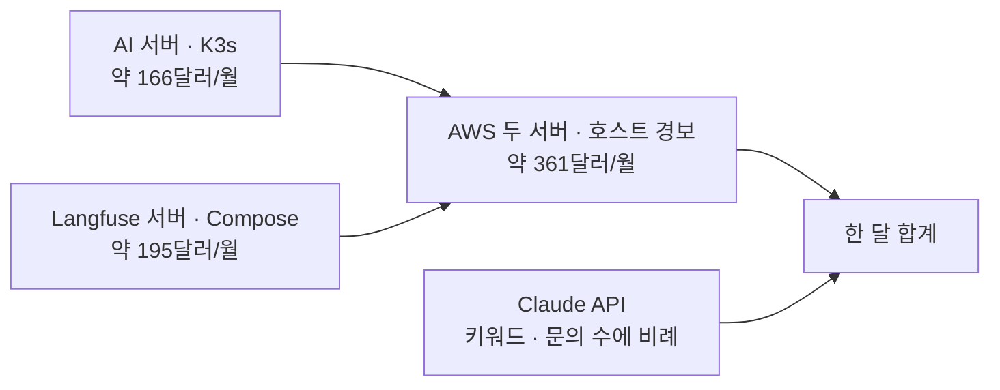

# 월 비용 계산

> **이 문서는 언제 보나요?** 이 시스템을 돌리는 데 한 달에 얼마가 드는지 알고 싶을 때, 예산을 잡을 때, 키워드 수·문의 수·모델을 바꾸면 요금이 어떻게 달라지는지 볼 때, 1년 약정으로 서버 요금을 얼마나 줄일 수 있는지 볼 때, 실제 청구서와 견줄 때.
>
> 기준일 **2026-11-16**(AWS 온디맨드·1년 약정 단가 재확인, Claude API 단가·토큰 가정은 2026-11-15 기준). 금액은 미국 달러이고 부가세를 뺀 값입니다. 원화는 **1달러 = 1,350원**으로 환산했습니다(예산 계산용 가정이며 실제 결제 환율은 별도).
>
> ⚠️ **AWS 요금은 공식 가격표의 단가로 계산했고, Claude API 요금은 토큰 수를 실제로 재지 못한 어림입니다.** 어림에 쓴 가정은 [3장](#3-claude-api-요금-변동비)에 모두 적었습니다. 실제 Claude API를 붙인 뒤 [6장](#6-실제-값으로-바꾸기)의 방법으로 이 문서의 숫자를 바꿉니다. 1년 약정을 사는 AWS 콘솔 화면과 예산 화면은 실제 계정에서 확인하지 못했습니다.

---

## 1. 한눈에 보기

기본 설치는 **AI 서버 1대 + Langfuse 서버 1대 + Claude API**입니다. 두 서버를 처음부터 함께 쓰며, 아래의 모든 합계에 Langfuse를 포함합니다. 서버·디스크·백업·공인 IP·호스트 경보는 **AWS 고정비**, 모델 호출은 **Claude API 변동비**로 나눠 계산합니다.



| 쓰는 양 | 감시 키워드 | 자연어 추천 | AWS (두 서버·경보) | Claude API | 합계 | 원화 |
|---|---|---|---|---|---|---|
| 시작 | 50개 | 하루 10건 | $360.97 | $47.19 | **$408.16** | 약 55만 원 |
| 기본 | 200개 | 하루 50건 | $360.97 | $220.43 | **$581.40** | 약 78만 원 |
| 확장 | 500개 | 하루 200건 | $360.97 | $788.58 | **$1,149.56** | 약 155만 원 |

- 지금의 설정(분류·조건 뽑기는 Claude Haiku 5.5, 브리핑·추천 사유는 Claude Sonnet 5.5, 생각 깊이는 모델 기본값) 기준입니다. 모델 설정별 차이는 [3-4](#3-4-설정에-따른-차이)를 봅니다.
- 위 표는 약정 없이 쓴 만큼 내는 **온디맨드** 요금입니다. 두 서버를 **1년 약정**(선결제 없음)으로 바꾸면 AWS 고정비가 월 $360.97에서 $238.31로 34% 줄고, 기본 사용량 합계는 **약 62만 원**($458.74)이 됩니다. 1년에 약 $1,472(약 199만 원)를 아끼며, 사는 시기·방식·주의는 [1년 약정으로 줄이기](#1년-약정으로-줄이기)에 있습니다.
- 별도 서버를 포함해도 Langfuse에 모델 제공자 키를 넣거나 유료 모델 자동 평가를 켜지 않습니다. Langfuse 자체 때문에 Claude 호출이 늘지는 않습니다.
- 중간값은 반올림하지 않습니다. 예를 들어 확장 사용량은 AWS 산식 $360.974에 API 산식 $788.5815를 더한 $1,149.5555를 반올림해 **$1,149.56**입니다. 표에 보이는 두 금액($360.97 + $788.58)을 다시 더하면 $1,149.55로 1센트 차이가 납니다.
- SNS·SMTP·자료 전송·세금 등은 [5장](#5-포함하지-않은-것)에 따로 적었습니다. 사는 장비는 없습니다.

## 2. AWS 요금 (고정비)

**서울 리전 `ap-northeast-2`, Linux, 공유 인스턴스, 온디맨드(약정 없음)** 기준입니다. 1년 약정을 했을 때의 금액은 [이 장의 마지막 절](#1년-약정으로-줄이기)에 있습니다. EC2·EBS는 AWS [서울 리전 공식 가격표](https://pricing.us-east-1.amazonaws.com/offers/v1.0/aws/AmazonEC2/current/ap-northeast-2/index.csv)의 2026-11-14 발행분을 2026-11-16에 다시 확인했습니다. 공인 IP는 [VPC 요금](https://aws.amazon.com/vpc/pricing/), 경보는 [CloudWatch 서울 가격표](https://pricing.us-east-1.amazonaws.com/offers/v1.0/aws/AmazonCloudWatch/current/ap-northeast-2/index.json)를 확인했습니다.

| 항목 | 단가·계산 | AI 서버 | Langfuse 서버 | 두 서버 합계 |
|---|---|---|---|---|
| EC2 `t3.xlarge` (4 vCPU·16GiB) | 시간당 $0.2080 × 730시간 | $151.84 | — | $151.84 |
| EC2 `m7i.xlarge` (4 vCPU·16GiB) | 시간당 $0.2478 × 730시간 | — | $180.89 | $180.89 |
| EBS gp3 (각 100GiB) | GB당 월 $0.0912 × 100 × 2대 | $9.12 | $9.12 | $18.24 |
| EBS 스냅샷 (각 약 25GB) | GB당 월 $0.05 × 25 × 2대 | $1.25 | $1.25 | $2.50 |
| 공인 IPv4 (각 1개) | 시간당 $0.005 × 730 × 2개 | $3.65 | $3.65 | $7.30 |
| EC2 상태 경보 (각 1개) | 표준 경보 월 $0.10 × 2개 | $0.10 | $0.10 | $0.20 |
| **합계** | 반올림 전 금액으로 합산 | **$165.96** (약 22만 원) | **$195.01** (약 26만 원) | **$360.97** (약 49만 원) |

- **730시간**은 연간 시간을 12개월로 나눈 예산용 평균입니다(365일 × 24시간 ÷ 12). 실제 청구는 해당 달의 실행 시간과 사용량을 따릅니다.
- EBS는 AWS 콘솔에서 각 **100GiB**를 지정하며, 가격표의 `GB-Mo` 단가에 용량 100을 곱합니다. gp3 기본 IOPS·처리량을 쓰고 추가 성능을 구매하지 않는 가정입니다.
- **스냅샷 각 25GB**는 두 서버 각각의 보관량 가정입니다. 사용 중인 블록과 보관 기간의 변경분에 따라 늘어납니다. Langfuse의 여러 저장소는 쓰기를 멈추고 일관된 백업을 해야 합니다([백업·보관](../07-운영/02-모니터링과-AI-추적.md#7-자원비용보관)). 스냅샷 10GB가 늘면 월 $0.50가 더 듭니다.
- Prometheus·Alertmanager의 PVC 11GiB는 AI 서버의 같은 gp3 100GiB 안에서 씁니다. 별도 EBS가 자동으로 생기는 것은 아닙니다.
- 경보 두 개는 [`host-alarms.yaml`](../../deploy/monitoring/host-alarms.yaml)의 EC2별 `StatusCheckFailed`입니다. 무료 한도·크레딧은 차감하지 않았습니다. SNS 게시·이메일 전달은 사용량에 따라 별도이며 SMTP도 회사 요금을 따릅니다.
- 서버를 **중지**하면 EC2 요금은 멈추지만 디스크·스냅샷·공인 IP 요금은 계속 나옵니다.
- **AI 서버의 CPU 크레딧 추가 요금**: `t3.xlarge`의 기준 사용률은 40%(1.6 vCPU)입니다. Unlimited 모드에서 적립 크레딧 없이 4 vCPU를 10시간 모두 쓰면 기준 초과분은 `(4 − 1.6) × 10 × $0.05 = $1.20`입니다. 실제 정산은 적립·사용량을 따릅니다. 이 표는 추가 요금이 없다고 가정합니다([AWS CPU 크레딧](https://docs.aws.amazon.com/AWSEC2/latest/UserGuide/burstable-credits-baseline-concepts.html), [T3 요금](https://aws.amazon.com/ec2/instance-types/t3/)). **Langfuse의 `m7i.xlarge`에는 이 크레딧 요금이 없습니다.**
- K3s·PostgreSQL·LiteLLM·임베딩·Langfuse의 공개 소프트웨어 기능과 Let's Encrypt 인증서는 별도 라이선스 비용을 넣지 않았습니다. Langfuse Enterprise 기능은 포함하지 않습니다.

### Langfuse 사양과 증설 비용

기본값은 **`m7i.xlarge`·16GiB·gp3 100GiB**입니다. 공식 Compose 가이드의 VM 권장치(최소 4코어·16GiB, 디스크 예시 100GiB)를 따르면서, DB·추적 저장이 계속되는 서버에는 CPU 크레딧이 없는 유형을 선택한 것입니다. 처리량을 보장하는 시험 결과는 아닙니다([Langfuse 공식 가이드](https://langfuse.com/self-hosting/deployment/docker-compose), [AWS M7i 사양](https://aws.amazon.com/ec2/instance-types/m7i/)).

| 상태 | 사양·조치 | 서버 한 대 월 비용 (디스크·스냅샷·IP·경보 포함) |
|---|---|---|
| **기본 설치** | `m7i.xlarge`, 4 vCPU·16GiB, gp3 100GiB | **$195.01** |
| 지속적인 CPU·메모리 부족 또는 컨테이너 OOM | 원인을 확인한 뒤 `m7i.2xlarge`, 8 vCPU·32GiB 검토. Compose 메모리 한도도 함께 조정 | **$375.91** (EC2 시간당 $0.4956 가정) |
| 디스크 부족 | 보관 자료를 정리하거나 gp3 용량 확장 | 100GiB 추가 시 **+$9.12/월**, 스냅샷 증가분 별도 |

8개 서비스의 현재 Compose 메모리 한도 합계는 **9GiB**입니다. 호스트 16GiB 중 나머지는 OS·Docker·파일 캐시·여유 공간에 필요합니다. 한도 합계는 실제 사용량이나 공식 부품별 권장치를 뜻하지 않습니다. 처음 한 주는 자원과 디스크 증가량을 재고, 여유 메모리 15% 미만·OOM·처리 대기가 이어지면 용량과 부품별 한도를 다시 정합니다. 자동 기간 삭제는 이 무료 구성에 포함돼 있지 않습니다.

### AI 서버 요금을 줄이는 선택지

| 선택지 | 서버 한 달 | 지금과의 차이 | 바꿀 것 |
|---|---|---|---|
| `t3.xlarge` 필요할 때 쓰는 요금 (지금) | $151.84 | — | — |
| `t3a.xlarge` (AMD CPU, 같은 x86_64 · 4 vCPU · 16GiB) | $136.66 | −$15 | 인스턴스 유형만 바꿉니다. 코어가 조금 느립니다 |
| `t4g.xlarge` (ARM CPU · 4 vCPU · 16GiB) | $121.47 | −$30 | 컨테이너 이미지를 ARM용으로 바꿔야 합니다 |
| `t3.xlarge` 1년 약정 (Savings Plans, 선결제 없음) | $91.76 ~ $105.49 | −$46 ~ −$60 | 1년 쓸 유형이 정해진 뒤 AWS 콘솔에서 삽니다. 방식별 금액과 주의는 [아래 절](#1년-약정으로-줄이기) |
| `m7i.xlarge` (CPU 크레딧이 없는 유형) | $180.89 | +$29 | AI 서버의 CPU 크레딧 초과가 이어질 때 검토. Langfuse는 처음부터 이 유형 |

- **`t4g.xlarge`**: ARM용으로 바꿀 곳은 `scripts/build-and-load.sh`의 빌드 대상과 `site.env`의 `TEI_IMAGE`(`cpu-arm64-1.9`)입니다. 내 맥의 확인은 ARM에서 했습니다.

### 1년 약정으로 줄이기

두 서버를 1년 내내 켜 둘 것과 인스턴스 유형이 정해지면 **1년 [약정 할인](../../../ddalgiro-guide/docs/00-개요/02-용어집.md)**으로 EC2 요금을 줄입니다. 약정은 "1년 동안 시간당 이만큼(또는 이 서버를) 쓰겠다"는 약속이고, 그 대가로 시간 요금을 깎아 줍니다.

- **깎이는 것은 EC2 인스턴스의 시간 요금뿐입니다.** 디스크·스냅샷·공인 IP·경보(두 서버 합계 월 $28.24)는 그대로입니다. AI 서버의 CPU 크레딧 추가 요금(위 2장)도 시간 요금과 따로 청구되며, 이 계산에서는 할인하지 않았습니다.
- 단가는 서울 리전 공식 가격표에서 뽑았습니다. 예약 인스턴스는 위 [EC2 가격표](https://pricing.us-east-1.amazonaws.com/offers/v1.0/aws/AmazonEC2/current/ap-northeast-2/index.csv)(2026-11-14 발행분), Savings Plans는 [Savings Plans 가격표](https://pricing.us-east-1.amazonaws.com/savingsPlan/v1.0/aws/AWSComputeSavingsPlan/current/region_index.json)의 서울 리전 파일(2026-11-13 발행분)이며 2026-11-16에 확인했습니다.

#### 약정 방식

| 방식 | 무엇을 약속하나 | 바꿔도 할인이 이어지는 범위 | 이 구성에서 쓰는 법 |
|---|---|---|---|
| **EC2 Instance Savings Plans** | 한 리전의 한 인스턴스 계열(`t3`, `m7i` 등)에 시간당 쓸 금액 | 같은 계열 안의 크기 변경(예: `m7i.xlarge` → `m7i.2xlarge`) | 계열마다 하나씩, 두 개를 삽니다 |
| **Compute Savings Plans** | 시간당 쓸 EC2 금액(리전·계열을 묻지 않음) | 계열·리전 변경까지(예: `t3` → `m7i`·`t4g`) | 두 서버를 하나로 묶어 삽니다 |
| 예약 인스턴스(Reserved Instances) | 특정 인스턴스 유형 | Standard는 같은 계열의 크기, Convertible은 다른 유형으로 교환 | 관리가 단순한 Savings Plans를 씁니다 |

- **계열**(family)은 인스턴스 이름의 점 앞부분입니다. `t3.xlarge`의 계열은 `t3`, 크기는 `xlarge`입니다.
- Savings Plans의 약정 금액은 **할인된 시간 요금 기준**입니다. 예를 들어 `t3.xlarge` 한 대를 EC2 Instance Savings Plans로 덮으려면 시간당 $0.1257을 약정합니다. 약정보다 더 쓴 시간은 온디맨드 요금으로 청구됩니다.
- **예약 인스턴스**: 선결제 없음 단가가 Standard는 EC2 Instance Savings Plans와, Convertible은 Compute Savings Plans와 같습니다.

#### 서버별 금액 (선결제 없음, 월 730시간)

| 항목 | 온디맨드 (지금) | Compute Savings Plans | EC2 Instance Savings Plans |
|---|---|---|---|
| AI 서버 `t3.xlarge` | 시간당 $0.2080 → $151.84 | 시간당 $0.1445 → **$105.49** (−$46.36, −30.5%) | 시간당 $0.1257 → **$91.76** (−$60.08, −39.6%) |
| Langfuse 서버 `m7i.xlarge` | 시간당 $0.2478 → $180.89 | 시간당 $0.1775 → **$129.58** (−$51.32, −28.4%) | 시간당 $0.16207 → **$118.31** (−$62.58, −34.6%) |
| 두 서버 EC2 | $332.73 | $235.06 | $210.07 |
| 디스크·스냅샷·IP·경보 | $28.24 | $28.24 | $28.24 |
| **AWS 고정비 한 달** | **$360.97** (약 49만 원) | **$263.30** (약 36만 원, −27.1%) | **$238.31** (약 32만 원, −34.0%) |
| 한 달 절감 | — | $97.67 (약 13만 원) | $122.66 (약 17만 원) |
| 1년 절감 | — | $1,172.09 (약 158만 원) | $1,471.94 (약 199만 원) |

- 계산: `시간당 단가 × 730`. 다른 표와 같이 중간값을 반올림하지 않고 합산했으므로 칸의 금액을 다시 더하면 1센트 차이가 날 수 있습니다.
- 두 방식을 섞어 살 수도 있습니다. 예를 들어 AI 서버는 Compute, Langfuse 서버는 EC2 Instance Savings Plans로 사면 고정비는 **$252.04**입니다(아래 "언제·무엇을 사나" 3번).

#### 선결제를 하면

1년치의 일부나 전부를 처음에 내면 조금 더 쌉니다. EC2 Instance Savings Plans 기준이며, 한 달 금액은 `1년 총액 ÷ 12`입니다.

| 선결제 | AI 서버 `t3` | Langfuse `m7i` | 두 서버 EC2 한 달 | 선결제 없음보다 | 처음에 내는 돈 |
|---|---|---|---|---|---|
| 없음 | $91.76 | $118.31 | $210.07 | — | 없음 (매달 냄) |
| 일부 | $87.38 | $112.68 | $200.06 | −$10.02/월 | 1년치의 일부, 나머지는 매달 |
| 전체 | $85.63 | $110.42 | $196.05 | −$14.02/월 | 1년치 $2,352.59 (약 318만 원) |

선결제로 더 아끼는 돈은 한 달 $10~14입니다. 돈이 1년 동안 묶이고 중간에 유형을 바꾸면 돌려받지 못하므로, 시제품 단계에서는 **선결제 없음**을 권합니다.

#### 언제·무엇을 사나

1. **처음 1~2개월은 온디맨드로 씁니다.** 그동안 AI 서버의 CPU 크레딧 초과(2장)와 Langfuse 서버의 자원·디스크 증가량([사양과 증설 비용](#langfuse-사양과-증설-비용))을 재서 1년 쓸 유형을 정합니다.
2. **Langfuse 서버**: 증설해도 같은 `m7i` 계열(`m7i.2xlarge`)이므로 **EC2 Instance Savings Plans(`m7i`, 1년, 선결제 없음)**을 시간당 $0.16207 근처로 삽니다. 증설 뒤 늘어난 시간 요금은 온디맨드로 나오며, 필요하면 약정을 하나 더 삽니다.
3. **AI 서버**: `t3.xlarge`로 1년 쓸 것이 정해지면 **EC2 Instance Savings Plans(`t3`)**을 시간당 $0.1257 근처로 삽니다. CPU 크레딧 초과로 `m7i`로 옮기거나 ARM `t4g`로 바꿀 가능성이 남아 있으면 **Compute Savings Plans**를 시간당 $0.1445 근처로 삽니다(월 약 $14 더 비쌈).
4. 같은 AWS 계정에 딸기로 운영 서버(`t3.large`)가 있으면 `t3` 약정은 그 서버의 사용 시간에도 적용됩니다. 두 서버 몫을 함께 계획하고, 운영 서버의 약정은 [딸기로 가이드의 운영 서버 비용 5-2](../../../ddalgiro-guide/docs/03-서버/06-운영-서버-비용.md#5-2-약정-할인--1년-쓸-크기가-정해지면)를 봅니다. 이 문서의 금액은 AI·Langfuse 두 서버 몫만 계산했습니다.

사는 곳은 AWS 콘솔의 **결제 및 비용 관리(Billing and Cost Management) → Savings Plans → Savings Plans 구매**입니다. 종류(EC2 Instance / Compute)·기간(1년)·리전(서울)·인스턴스 계열·시간당 약정 금액·결제 옵션(선결제 없음)을 고르고, 같은 메뉴의 **추천** 화면이 지난 사용량에서 계산한 값과 위 표를 견줍니다. ⚠️ 이 화면은 실제 계정에서 확인하지 못했습니다.

#### 주의

- ❌ **약정 요금은 서버를 중지하거나 지워도 1년 동안 매시간 청구됩니다.** 선결제 없음 기준으로 EC2 Instance Savings Plans는 약 7~8개월(`t3` 7.3개월, `m7i` 7.8개월), Compute Savings Plans는 약 8~9개월(8.3개월, 8.6개월) 넘게 켜 둬야 온디맨드보다 쌉니다. 그보다 일찍 그만둘 가능성이 있으면 사지 않습니다.
- ⚠️ 산 뒤에는 취소·환불이 되지 않습니다. 예외로 **시간당 약정이 $100 이하이고, 산 지 7일 안이며, 산 달(UTC 기준)이 지나지 않았으면** 반품할 수 있습니다([Savings Plans 반품](https://docs.aws.amazon.com/savingsplans/latest/userguide/return-sp.html)). 이 구성의 약정은 시간당 $1보다 작아 금액 조건에 들어갑니다.
- 약정은 산 시각부터 적용되고, 1년이 끝나면 그 뒤의 사용분은 온디맨드 요금으로 돌아갑니다. 계속 쓰려면 끝나기 전에 새 약정을 사거나 구매 화면의 갱신 설정을 확인합니다.
- 3년 약정은 더 싸지만 시제품 단계에서 3년 쓸 유형을 정하기 어려워 이 문서에서는 계산하지 않습니다.

## 3. Claude API 요금 (변동비)

### 3-1. 단가

확인일 **2026-11-15**, 100만 토큰당. Haiku는 입력 100,000토큰 이하의 단가입니다. [Claude 요금표](https://platform.claude.com/docs/en/about-claude/pricing)에서 다시 확인합니다. **토큰**은 모델이 글을 세는 단위이고, 모델이 답하기 전의 **생각 과정**도 출력 토큰으로 계산됩니다.

| 모델 | 이름표 | 입력 | 출력 |
|---|---|---|---|
| Claude Haiku 5.5 (`claude-haiku-5-5`) | `chat-fast` | $0.10 | $0.50 |
| Claude Sonnet 5.5 (`claude-sonnet-5-5`) | `chat-smart` | $2 | $10 |
| Claude Opus 5.5 (`claude-opus-5-5`) | (올려 쓸 때) | $4 | $20 |

### 3-2. 호출 한 번의 크기와 요금

모델을 부르는 곳은 네 군데입니다. 입력 글자 수는 **실제 코드가 만드는 지시문·양식·근거의 길이를 잰 값**이고, 토큰 수와 생각 과정의 크기는 가정입니다.

| 호출 | 모델 | 입력 글자 | 입력 토큰 | 출력 토큰 (답 + 생각) | 한 번 요금 |
|---|---|---|---|---|---|
| 감성 분류 (글 20건 묶음) | Haiku | 약 4,300 | 약 5,200 | 780 + 300 | $0.001060 (약 1.4원) |
| 브리핑 | Sonnet | 약 2,650 | 약 3,200 | 940 + 1,000 | $0.025800 (약 35원) |
| 조건 뽑기 | Haiku | 약 4,600 | 약 5,500 | 385 + 300 | $0.0008925 (약 1.2원) |
| 추천 사유 (결과 1건) | Sonnet | 약 1,650 | 약 2,000 | 340 + 1,000 | $0.017400 (약 23원) |

어림에 쓴 가정:

1. **글자 1자 = 1.2토큰.** 한글(지시문·근거)과 영문 JSON(양식)이 섞인 글의 평균으로 잡은 값이며 재지 않았습니다. Claude Haiku 5.5·Sonnet 5.5는 같은 글을 이전 세대 모델보다 약 30% 많은 토큰으로 세므로([모델 안내](https://platform.claude.com/docs/en/about-claude/models/overview)), 실제 값이 이보다 클 수 있습니다.
2. **생각 과정의 출력: Haiku 300토큰, Sonnet 1,000토큰.** 생각 깊이를 정하지 않아 모델 기본값으로 도는 경우의 가정이며, **이 어림에서 가장 불확실한 값**입니다.
3. 수집한 글 한 건은 제목 40자 + 요약 130자.
4. 브리핑은 성장기·정점인 키워드만 만듭니다. 전체 키워드의 30%로 잡았고, 근거 검사에 걸려 다시 쓰는 경우를 넣어 1.2번 부르는 것으로 봤습니다.
5. 자연어 추천 한 건은 조건 뽑기 1.3번(되묻고 다시 보내는 경우 포함), 결과 5건의 사유를 각각 1.2번(다시 쓰기 포함)으로 봤습니다.
6. 감성 분류는 키워드마다 매일 미분류 글 20건이 있다고 가정합니다. 없으면 호출하지 않습니다. 구조화 출력의 대체 요청·통신 재시도·수동 재분석·대체 공급자 찾기·Langflow 호출은 별도입니다. 이 가정은 요금의 최댓값이 아닙니다.

각 호출 요금은 `(입력 토큰 × 입력 단가 + 출력 토큰 × 출력 단가) ÷ 1,000,000`으로 계산합니다. **중간값을 반올림하지 않고 합산한 뒤 월 금액만 소수 둘째 자리로 반올림**합니다.

### 3-3. 단위 요금과 계산식

| 단위 | 계산 | 요금 |
|---|---|---|
| 키워드 1개를 한 달 감시 | (감성 1번 + 브리핑 0.36번) × 30일 | **$0.310440** (약 419원) |
| 자연어 추천 1건 | 조건 뽑기 1.3번 + 추천 사유 6번 | **$0.10556025** (약 143원) |

```text
한 달 Claude API 요금 = 키워드 수 × $0.310440 + 하루 추천 건수 × 30 × $0.10556025
```

- 예: 키워드 200개, 추천 하루 50건 → 200 × 0.310440 + 50 × 30 × 0.10556025 = 62.088 + 158.340375 = **$220.43**.
- 관리자 화면에서 트렌드 랭킹을 보는 것은 모델을 부르지 않으므로 요금이 없습니다.
- 추천이 되묻기로 끝나면(조건이 모자람) 조건 뽑기 한 번 값만 듭니다.

### 3-4. 설정에 따른 차이

같은 사용량에서 설정만 바꿨을 때의 한 달 Claude API 요금입니다.

| 설정 | 키워드 1개·월 | 추천 1건 | 시작 | 기본 | 확장 |
|---|---|---|---|---|---|
| A. 지금 설정 — Haiku + Sonnet, 생각 깊이 기본 | $0.310440 | $0.10556025 | $47.19 | $220.43 | $788.58 |
| B. 생각 깊이를 낮춤 (`effort: low`) | $0.221040 | $0.05743025 | $28.28 | $130.35 | $455.10 |
| C. 글 쓰는 단계도 Haiku로 | $0.041952 | $0.00428025 | $3.38 | $14.81 | $46.66 |
| D. 글 쓰는 단계를 Opus 5.5로 | $0.589080 | $0.20996025 | $92.44 | $432.76 | $1,554.30 |

- **요금의 대부분은 `chat-smart`(Sonnet)의 출력입니다.** 전체 요금의 절반쯤이 생각 과정이라는 가정이므로, 실제 생각 과정의 크기를 재는 것이 먼저입니다.
- B는 생각 과정을 Haiku 100토큰·Sonnet 200토큰으로 가정한 값입니다. 바꾸는 방법은 [Claude API 문서 7장](../02-Claude-API/01-Claude-API-키와-모델.md#7-모델을-바꿀-때)에 있습니다.
- C는 모든 호출의 생각 과정을 300토큰, D는 글 쓰는 단계의 생각 과정을 1,000토큰으로 가정했습니다. C의 비용은 A보다 사용량에 따라 약 14~17배 작습니다. 글 쓰는 단계가 지금은 근거 문장을 **그대로 고르는** 일이라 Haiku로도 될 가능성이 있습니다. 다만 품질을 잰 적이 없으므로 [운영 전 평가](../02-Claude-API/01-Claude-API-키와-모델.md#6-운영-전-평가와-합격-기준)로 견준 뒤에 정합니다.
- 연구개발계획서의 배치 API(절반 요금)를 우선 검토할 곳은 감성 분류이고, 기본 사용량에서 아끼는 금액이 한 달 약 $3이라 지금은 쓰지 않습니다.

## 4. 합계

**두 서버·호스트 경보의 AWS 산식 $360.974**에 3-4의 Claude API 요금을 더한 한 달 합계입니다. 모든 설정에 별도 Langfuse를 포함하며 중간값을 반올림하지 않습니다.

| 설정 | 시작 (키워드 50 · 추천 10건/일) | 기본 (200 · 50건/일) | 확장 (500 · 200건/일) |
|---|---|---|---|
| A. 지금 설정 | $408.16 (약 55만 원) | $581.40 (약 78만 원) | $1,149.56 (약 155만 원) |
| B. 생각 깊이를 낮춤 | $389.26 (약 53만 원) | $491.33 (약 66만 원) | $816.08 (약 110만 원) |
| C. 글 쓰는 단계도 Haiku로 | $364.36 (약 49만 원) | $375.78 (약 51만 원) | $407.63 (약 55만 원) |
| A + 1년 약정 (EC2 Instance Savings Plans, 선결제 없음) | $285.50 (약 39만 원) | $458.74 (약 62만 원) | $1,026.89 (약 139만 원) |
| A + 1년 약정 (Compute Savings Plans, 선결제 없음) | $310.49 (약 42만 원) | $483.73 (약 65만 원) | $1,051.88 (약 142만 원) |

- 1년으로는 12를 곱합니다. 기본·A는 약 **$6,977(약 942만 원)**, 기본·A에 EC2 Instance Savings Plans를 더하면 약 **$5,505(약 743만 원)**입니다.
- 약정 두 줄은 AWS 산식을 [1년 약정](#1년-약정으로-줄이기) 값($238.3121·$263.30)으로 바꾼 것입니다. 약정은 AWS 고정비만 줄이므로 EC2 Instance Savings Plans의 전체 절감률은 시작 30.1%·기본 21.1%·확장 10.7%로, 사용량이 많을수록 작아집니다. B·C 설정과 약정은 함께 쓸 수 있으며, 그때는 각 설정의 금액에서 EC2 Instance Savings Plans는 $122.66, Compute Savings Plans는 $97.67을 뺍니다.
- 사용량이 적으면 AWS 두 서버가, 많으면 Claude API가 요금을 좌우합니다. Langfuse는 기본 설치에 포함하고, 원문 비수집·모델 제공자 키 미등록·유료 모델 자동 평가 비활성화를 유지합니다.

## 5. 포함하지 않은 것

| 항목 | 설명 |
|---|---|
| 부가세 | AWS는 한국 계정에 10%를 더해 청구합니다(사업자는 매입세액으로 공제) |
| SNS·회사 SMTP | 경보의 SNS 게시·이메일 전달은 실제 건수와 무료 한도를 따릅니다([SNS 요금](https://aws.amazon.com/sns/pricing/)) |
| 자료 전송 | 경로·사용량에 따라 별도입니다 |
| 환율과 해외 결제 수수료 | 두 곳 모두 달러로 청구됩니다 |
| 딸기로 운영 서버 | 이미 쓰고 있는 서버입니다. 이 시스템 때문에 늘지 않습니다 |
| 사람의 일 | 백엔드 중계·관리자 화면 개발, 운영, 평가 묶음 만들기 |
| 개발 도구 구독 | 이 시스템이 도는 데 드는 요금이 아닙니다 |
| 노코드 도구 Langflow를 넣었을 때 | 같은 인스턴스·100GiB 디스크 안에서 쓰면 기본 임대료는 같습니다 |
| 시험·평가 때의 Claude API 요금 | `tests/test_live.py`는 실제 호출 수에 따라 별도 비용, [운영 전 평가](../02-Claude-API/01-Claude-API-키와-모델.md#6-운영-전-평가와-합격-기준) 한 바퀴(문의 100건 안팎)에 약 $10 |

- **부가세**: Claude API의 세금은 Claude Console의 결제 화면에서 확인합니다.
- **SNS·회사 SMTP**: 회사 SMTP는 기존 계약 요금을 확인합니다. CloudWatch 표준 경보 두 개의 $0.20는 이미 고정비에 포함했습니다.
- **자료 전송**: AI 서버→Langfuse의 HTTPS 전송, 다른 가용 영역·공인 IP 간 전송, 백업 내려받기 등이 해당합니다. 인터넷 전송 무료 한도는 계정의 다른 사용량과 함께 확인하며 0원으로 보장하지 않습니다.
- **노코드 도구 Langflow를 넣었을 때**: 스냅샷 변경량·CPU 크레딧·전송량은 늘 수 있습니다. 모델 호출은 별도이며 전용 키에 기본 $20/30일의 차단 기준을 둡니다. 실행 중인 호출까지 포함한 청구액 보장값은 아닙니다. 한도는 [Langflow 문서 4장](../04-에이전트/05-노코드-도구-Langflow.md#4-게이트웨이-전용-키-만들기)에서 정합니다.

## 6. 실제 값으로 바꾸기

실제 Claude API를 붙여 며칠 돌린 뒤 이 문서의 어림을 실제 값으로 바꿉니다.

| 볼 것 | 어디서 | 이 문서의 어디를 고치나 |
|---|---|---|
| 호출 종류별 입력 토큰·출력 토큰 | 별도 Langfuse의 단계별 기록 | 3-2의 토큰 수(특히 출력) |
| 이름표별 호출 수·토큰·금액 | 게이트웨이 관리 화면([운영 문서 6장](../07-운영/01-점검-백업-문제-해결.md#6-자주-쓰는-명령)) | 3-3의 단위 요금 |
| 이번 달 쓴 금액과 남은 크레딧 | Claude Console의 사용량·결제 화면 | 1장·4장의 Claude API 금액 |
| 브리핑 대상 비율·논리 요청당 실제 호출 수 | 대상 키워드 수와 게이트웨이 호출 기록을 대조 | 3-2의 가정 4·5 |
| AWS 청구 금액 | AWS 콘솔의 결제(Billing) → 청구서. 두 인스턴스·EBS·공인 IP·경보를 함께 봄 | 2장의 표 |

- **호출 종류별 입력 토큰·출력 토큰**: `ddalgiro.trend.sentiment`·`ddalgiro.trend.insight`·`ddalgiro.reco.understand`·`ddalgiro.reco.explain` 아래의 모델 호출을 봅니다. 이름표 하나를 두 종류가 함께 쓰므로 이름표별 합계로는 나눌 수 없습니다.
- **브리핑 대상 비율·논리 요청당 실제 호출 수**: `insights_by_writer`·`reco.reason_llm_rate`는 최종 글의 작성 방식 비율로, 재시도 횟수는 알 수 없습니다.

요금이 넘치지 않게 미리 걸어 둘 것:

- **Claude API**: Claude Console의 월 지출 한도를 "기본·A"($220.43)보다 조금 크게 잡습니다([Claude API 문서 4장](../02-Claude-API/01-Claude-API-키와-모델.md#4-지출-한도와-알림)).
- **AWS**: 콘솔의 결제 → 예산(Budgets)에서 이 구성의 월 고정비 약 $361에 여유를 둔 **$450 예산**을 만들고, 80%에 닿으면 메일이 오게 합니다. 다른 딸기로 서버 비용까지 계정 전체로 감시한다면 그 비용도 더해 별도 예산을 정합니다. 1년 약정을 샀다면 고정비가 약 $238(EC2 Instance Savings Plans)로 줄므로 예산을 다시 정하고, 약정을 다 쓰고 있는지 보는 Savings Plans 사용률(utilization) 예산도 만듭니다. ⚠️ 이 화면은 실제 계정에서 확인하지 못했습니다.

단가가 바뀌거나 인스턴스 유형·모델·지시문 길이를 바꾸면 이 문서의 표를 다시 계산합니다.

## 7. 요금이 예상과 다를 때

| 증상 | 원인과 해결 |
|---|---|
| Claude API 요금이 어림의 몇 배 | 호출 수·입력 길이·출력 길이·재시도를 먼저 확인합니다 |
| 호출 수가 어림보다 많음 | 근거 검사에 걸려 다시 쓰는 경우가 많습니다 |
| 쓰지 않은 시간에 호출이 있음 | API 키가 샌 것일 수 있습니다. Claude Console에서 그 키를 지우고 새 키를 넣습니다 |
| 새벽 분석 요금이 큼 | 키워드 수와, 성장기·정점인 키워드의 비율(가정 30%)을 확인합니다 |
| 두 EC2 요금이 월 약 $333보다 큼 | 달의 실행 시간·다른 인스턴스 비용·AI 서버의 CPU 크레딧·사양 변경을 확인합니다 |
| 1년 약정을 샀는데 EC2 요금이 그대로 | 약정한 계열과 실제 인스턴스 계열이 다른지, 리전이 서울인지, 약정 시작 전의 사용분인지 봅니다 |
| 스냅샷 요금이 계속 늚 | 수명 주기 관리자의 보관 개수(14개)가 지켜지는지, 손으로 뜬 스냅샷이 남았는지 봅니다([운영 문서 4-2](../07-운영/01-점검-백업-문제-해결.md#4-2-백업을-서버-밖에-두기--디스크-스냅샷)) |
| 서버를 중지했는데 요금이 나옴 | 디스크·스냅샷·공인 IP 요금은 중지해도 나옵니다(2장) |

- **Claude API 요금이 어림의 몇 배**: 생각 과정이 가정(Haiku 300·Sonnet 1,000토큰)보다 크면 깊이를 낮춘 설정을 비교합니다(3-4의 B).
- **호출 수가 어림보다 많음**: `GET /v1/status`의 `insights_by_writer`에서 `template` 비율을 봅니다. 높으면 API 오류 또는 근거 검사 실패가 잦다는 뜻입니다. 결제된 호출 수와 재시도는 게이트웨이 기록으로 따로 확인합니다.
- **쓰지 않은 시간에 호출이 있음**: 새 키는 `bash scripts/k3s-server/create-secrets.sh --anthropic`으로 넣습니다.
- **두 EC2 요금이 월 약 $333보다 큼**: AI 서버의 크레딧 초과가 이어지면 2장의 선택지를 봅니다. 1년 약정(EC2 Instance Savings Plans)을 샀다면 기준은 약 $210입니다.
- **1년 약정을 샀는데 EC2 요금이 그대로**: 계열이 다른 예는 `t3`를 약정하고 AI 서버를 `m7i`로 바꾼 경우입니다. 시간당 약정보다 더 쓴 부분은 온디맨드로 나옵니다. 결제 및 비용 관리 → Savings Plans의 사용률·적용 범위(coverage) 보고서로 확인합니다([1년 약정으로 줄이기](#1년-약정으로-줄이기)).
