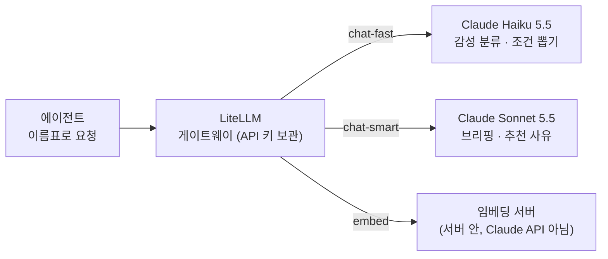

# Claude API 키와 모델

> **이 문서는 언제 보나요?** 대화 모델로 쓸 Claude API를 준비할 때 — 계정을 만들고, 키를 받고, 지출 한도를 걸 때. 어떤 글이 서버 밖으로 나가는지, 운영 전에 무엇을 재야 하는지, 모델을 바꾸는 방법도 여기에 있습니다. 끝나면 [플랫폼 문서](../03-플랫폼/01-데이터베이스-임베딩-LLM-게이트웨이.md)에서 넣을 API 키가 준비됩니다.
>
> 앞 단계: [EC2 인스턴스와 K3s](../01-K3s-서버/01-EC2-인스턴스와-K3s.md).
>
> ⚠️ **실제 Claude API 계정과 키로는 확인하지 못했습니다.** Claude Console의 화면 이름은 바뀔 수 있습니다. 게이트웨이가 Claude API로 보내는 요청의 모양은 가짜 서버로 확인했습니다([버전 고정표](../00-개요/02-준비물과-정할-값.md#5-버전-고정표)). 3장의 확인 명령이 처음으로 실제 API를 부르는 자리입니다.

---

## 1. Claude API가 맡는 일

**Claude API**는 Anthropic의 대화 모델을 인터넷으로 부르는 서비스입니다. 모델을 내 서버에 설치하지 않고, 글을 보내면 답을 돌려받습니다. 요금은 주고받은 글의 양(**토큰** — 모델이 글을 세는 단위, 한글 한 글자가 대략 1~2토큰)만큼 냅니다.



모델을 부르는 곳은 네 군데뿐입니다. 점수·순위·견적은 코드가 계산하므로 모델에 맡기지 않습니다. 문의에서 뽑는 조건(수량·금액·날짜)은 모델이 뽑되 코드가 문의 글과 대조해 걸러 내고, `12월 10일`·`다음 주 금요일`처럼 코드가 읽을 수 있는 날짜 표현은 코드가 계산한 값으로 바꿉니다([자연어 추천 문서](../04-에이전트/03-자연어-추천-랭킹.md)).

| 하는 일 | 이름표 | 언제, 몇 번 | 코드 |
|---|---|---|---|
| 감성 분류 | `chat-fast` | 분석할 때 미분류·비광고 글이 있으면 최대 20건을 한 묶음으로 한 번 | `agent/app/trend/pipeline.py` |
| 브리핑 | `chat-smart` | 매일 새벽, 성장기·정점인 키워드마다 1~2번 | `agent/app/grounding.py` |
| 조건 뽑기 | `chat-fast` | 자연어 추천을 부를 때마다 한 번 | `agent/app/reco/slots.py` |
| 추천 사유 | `chat-smart` | 자연어 추천의 결과마다 1~2번(결과 5건이면 동시에 5건) | `agent/app/reco/explain.py` |

- API 키는 게이트웨이(LiteLLM)만 갖습니다. 에이전트·백엔드·화면은 키를 모릅니다.
- 화면에서 트렌드 랭킹을 볼 때는 모델을 부르지 않습니다. 새벽에 계산해 둔 값을 읽습니다.
- 표의 횟수는 정상 처리 때의 논리 호출 수입니다. 구조화 출력 실패 시 다른 방식으로 다시 요청하고, 클라이언트와 게이트웨이도 재시도하므로 실제 HTTP 호출 수는 더 많을 수 있습니다. 수동 재분석과 대체 공급자 찾기도 요금이 듭니다.

## 2. 어떤 모델을 쓰나

가격 확인일 **2026-11-15**. 100만 토큰당 미국 달러이고, [Claude 요금표](https://platform.claude.com/docs/en/about-claude/pricing)의 기본 단가입니다. Haiku 5.5는 입력 100,000토큰 이하일 때의 값입니다.

| 이름표 | 모델 ID | 입력 / 출력 요금 | 왜 이 모델인가 |
|---|---|---|---|
| `chat-fast` | `claude-haiku-5-5` | $0.10 / $0.50 | 건수가 많고 단순한 일(분류·조건 뽑기). 가장 값싸고 빠른 모델 |
| `chat-smart` | `claude-sonnet-5-5` | $2 / $10 | 건수가 적고 글을 다루는 일(브리핑·추천 사유) |

- 일의 무게에 따라 모델을 나누는 것이 연구개발계획서의 **모델 티어링**입니다.
- 모델 ID는 `site.env`의 `CHAT_FAST_MODEL`·`CHAT_SMART_MODEL`에 있고, `scripts/render.sh`가 `k8s/22-litellm.yaml`의 모델 표에 채웁니다.
- 모델이 답하기 전에 하는 **생각 과정**도 출력 토큰으로 계산됩니다.
- `chat-smart`의 품질이 모자라면 한 단계 위인 `claude-opus-5-5`($4 / $20)로 바꿔 비교합니다. 바꾸는 방법은 [7장](#7-모델을-바꿀-때), 판단 기준은 [6장](#6-운영-전-평가와-합격-기준)입니다.

**요금 어림.** 호출 한 번의 크기를 잡아 계산하면 키워드 1개를 한 달 감시하는 데 약 $0.31, 자연어 추천 한 건에 약 $0.106가 듭니다. 토큰 수를 재지 못한 어림이며, 가정과 계산식, 설정을 바꿨을 때의 금액은 [월 비용 계산 3장](../00-개요/04-월-비용-계산.md#3-claude-api-요금-변동비)에 있습니다.

## 3. API 키 만들기

1. <https://platform.claude.com> 에 회사 메일로 가입하고 조직(Organization)을 만듭니다. 개인 계정이 아니라 회사가 관리하는 계정으로 만듭니다.
2. **결제 수단과 크레딧**: 결제(Billing) 화면에서 카드를 등록하고 크레딧을 삽니다. Claude API는 먼저 사 둔 크레딧에서 요금이 빠져나가는 방식입니다. 처음에는 적은 금액으로 시작합니다.
3. **(권장) 운영용 워크스페이스**: 워크스페이스(Workspaces) 화면에서 `ddalgiro-ai`를 하나 만듭니다. 키와 지출 한도를 이 묶음 단위로 관리할 수 있습니다([워크스페이스 설명](https://platform.claude.com/docs/en/manage-claude/workspaces)).
4. **API 키**: API 키(API Keys) 화면 → 키 만들기 → 이름 `ddalgiro-ai-gateway`, 워크스페이스 `ddalgiro-ai`.

   - 키는 `sk-ant-`로 시작하고 **만든 직후 한 번만 보입니다.**
   - 이 키는 [플랫폼 2장](../03-플랫폼/01-데이터베이스-임베딩-LLM-게이트웨이.md#2-비밀값-만들기)에서 서버에 바로 넣습니다. ⚠️ 채팅·메일·문서·git에 붙이지 않습니다. 파일로 저장해 두지도 않습니다(다시 필요하면 새 키를 만듭니다).

### 확인

내 맥에서 실행합니다. 아래 묶음은 기본 셸이 zsh여도 Bash로 실행하며, 키는 터미널에서 숨겨 입력받습니다. 실제 API 요금이 들며 토큰 수는 응답의 `usage`로 확인합니다.

```bash
bash <<'BASH'
read -r -s -p 'Claude API 키: ' ANTHROPIC_API_KEY </dev/tty
echo
trap 'unset ANTHROPIC_API_KEY' EXIT
curl -sS --max-time 120 https://api.anthropic.com/v1/messages \
  -H "x-api-key: $ANTHROPIC_API_KEY" -H "anthropic-version: 2023-06-01" -H "content-type: application/json" \
  -d '{"model":"claude-haiku-5-5","max_tokens":1024,"messages":[{"role":"user","content":"한 낱말로 인사해줘"}]}'; echo
BASH
```

- `Claude API 키:`가 보이면 키를 붙여 넣고 `Enter`를 누릅니다(글자가 보이지 않습니다). 명령 기록에 키가 남지 않게 하려는 것입니다.
- 이어서 나오는 `curl`의 결과에 `"type":"message"`와 `"text":"안녕"` 같은 답이 들어 있으면 성공입니다.
- `"type":"error"`가 나오면 [8장](#8-문제-해결)에서 `error`의 `type`을 찾습니다.
- 묶음이 끝나면 별도 Bash가 종료되고 그 안의 키 변수도 사라집니다. 화면에 오류가 나도 API 키를 함께 복사하지 않습니다.

## 4. 지출 한도와 알림

API 키가 새거나 프로그램이 잘못 돌면 요금이 한꺼번에 나갈 수 있습니다. **운영에 넣기 전에** 아래를 해 둡니다.

| 장치 | 어디서 | 정할 값 |
|---|---|---|
| 월 지출 한도 | Claude Console의 한도(Limits) 화면. 워크스페이스를 만들었으면 그 워크스페이스에 | [월 비용 계산 3-4](../00-개요/04-월-비용-계산.md#3-4-설정에-따른-차이)의 표에서 내 사용량에 해당하는 Claude API 금액보다 조금 크게 |
| 지출 알림 메일 | 같은 화면 | 한도의 절반쯤에서 알림 |
| 크레딧 자동 충전 | 결제(Billing) 화면 | 켜면 잔액이 떨어질 때 스스로 채워 서비스가 끊기지 않습니다. 위의 월 한도와 **함께** 켭니다 |
| (Langflow를 넣었을 때) Langflow 전용 키의 30일 한도 | 게이트웨이의 Langflow 전용 키([Langflow 문서 4장](../04-에이전트/05-노코드-도구-Langflow.md#4-게이트웨이-전용-키-만들기)) | 기본 $20. 한도에 닿으면 이 키의 새 호출을 막습니다 |
| 실제 사용량 보기 | 게이트웨이 관리 화면과 Claude Console의 사용량 화면 | [운영 문서 6장](../07-운영/01-점검-백업-문제-해결.md#6-자주-쓰는-명령)의 게이트웨이 관리 화면 |

- **월 지출 한도**: 기준 금액은 AWS 요금을 뺀 Claude API 금액입니다. 한도에 닿으면 그 달의 호출이 거절됩니다.
- **Langflow 전용 키의 30일 한도**: Claude 계정 전체의 한도·잔액이 소진되면 에이전트도 영향을 받습니다.
- **호출 한도(rate limit)**는 지출 한도와 다른 것입니다. 1분 동안 보낼 수 있는 요청·토큰 수이며, 계정의 사용 등급에 따라 정해집니다([호출 한도 설명](https://platform.claude.com/docs/en/api/rate-limits)). 넘으면 `429`가 돌아오고 게이트웨이가 한 번 더 시도합니다. 새벽 분석은 키워드를 하나씩 차례로 부르므로 잘 걸리지 않습니다.
- 한도에 닿아 호출이 거절돼도 화면은 멈추지 않습니다. 브리핑·추천 사유는 코드가 만든 글로 대신 나가고, 자연어 추천의 조건 뽑기만 오류로 안내됩니다.

**연구개발계획서의 비용 장치와 견주면**

| 계획서 | 지금 | 비고 |
|---|---|---|
| 모델 티어링 | ✅ 이름표 두 개로 나눔 | 2장 |
| 월 토큰 상한 | 🔶 Claude Console의 금액 한도로 대체 | 모델별 단가가 달라 토큰 개수 상한과 같지는 않습니다 |
| 배치 API(절반 요금, 결과를 나중에 받음) | ⬜ 쓰지 않음 | 새벽 분석이 답을 바로 받아 다음 단계로 넘기는 구조입니다. 요금이 커지면 감성 분류부터 옮깁니다 |
| 프롬프트 캐싱(되풀이되는 앞부분을 싸게) | ⬜ 쓰지 않음 | 되풀이되는 앞부분이 가장 긴 조건 뽑기도 값싼 모델(`chat-fast`)이라 입력 요금이 작아 아낄 것이 적습니다 |

## 5. 무엇이 서버 밖으로 나가나

대화 호출의 글은 HTTPS로 Anthropic의 서버에 전달됩니다. 무엇이 실리는지 알고 써야 합니다.

| 호출 | 실리는 글 | 살필 점 |
|---|---|---|
| 감성 분류 | 키워드, 수집한 글의 제목·요약 | 공개된 글입니다 |
| 브리핑 | 키워드, 코드가 계산한 지표 문장, 수집한 글의 출처 이름·게시 날짜·제목·요약 | 공개된 글과 우리가 계산한 점수입니다 |
| 조건 뽑기 | **직원이 입력한 문의 글 전체**, 오늘 날짜 | ⚠️ 고객사 이름·담당자 이름·연락처를 함께 붙여 넣으면 그대로 나갑니다 |
| 추천 사유 | 업체·메뉴 정보, **메뉴 설명**(F4), **공급 조건**(F7), 견적, 고객 조건 요약(Q1) | ⚠️ 입점사의 공급 조건은 영업 정보입니다. 메뉴 설명과 고객 목적에도 개인정보·비밀값을 넣지 않습니다 |

- **브리핑**: 지표 문장에는 점수·단계·증가율·언급 수·출처 수·긍정 비율이 들어갑니다.
- **추천 사유**: 실리는 글 전체는 업체·메뉴 이름, **메뉴 설명**(F4), 가격, 평점·후기 수, 지역·배송 지역, 식이·보관 표시, 입점 여부, **공급 조건**(F7: 최소 주문 수량·하루 최대 생산량·준비 기간·포장·세금계산서), 공급 조건의 확인 상태·확인 날짜, 견적, 고객 조건 요약(Q1)입니다.

[Langflow](../04-에이전트/05-노코드-도구-Langflow.md)를 넣었다면 그 화면에서 만든 흐름이 모델에 보내는 글(지시문, 놀이터에 친 말, 흐름이 불러온 자료)도 같은 길로 나갑니다.

**임베딩 호출 자체**는 서버 안의 TEI에서 처리합니다. 다만 같은 문의 글은 조건 뽑기에, 같은 메뉴 설명은 추천 사유에 쓰여 **별도의 대화 호출로 Anthropic에 전달됩니다**. 현재 코드의 대화 근거에 넣지 않는 거래 기록·업체 프로필은 자동으로 전송되지 않습니다. Claude API 키는 인증 헤더로 Anthropic에 전달하며, DB 비밀번호·AI 서버 키·게이트웨이 키는 모델에 보내는 글에 넣지 않습니다.

기본 설치의 [별도 Langfuse](../07-운영/02-모니터링과-AI-추적.md) 서버에는 단계·모델·토큰·오류 종류·요청 번호가 전달됩니다. 문의·근거·응답 원문과 비밀값은 추적에 넣지 않습니다. 이 제한은 Claude 대화 호출 자체로 나가는 위 표의 내용과 별개입니다.

지킬 것:

- ❌ 문의 입력란에 **이름·전화번호·메일·회사명**을 넣지 않습니다. 조건(인원·예산·날짜·지역·포장 등)만 적습니다. 관리자 화면의 입력란에 이 안내를 둡니다([연동 문서 3-3](../06-관리자-화면-연동/01-백엔드-중계와-관리자-화면.md#3-3-화면에-담을-것)).
- ❌ 추천 사유의 근거 문장(`agent/app/reco/explain.py`)에 공급가(원가)나 고객 연락처를 더하지 않습니다.
- Anthropic의 [상업용 약관](https://www.anthropic.com/legal/commercial-terms)은 API로 받은 고객 자료로 모델을 학습시키지 않는다고 밝힙니다(2026-11-15 확인). 보관 기간과 처리 위치는 약관과 데이터 처리 부속서에서 확인합니다 — 이 저장소에서는 확인하지 못했습니다.
- 문의 글에 개인정보가 섞일 수 있다면, 개인정보 처리방침의 처리 위탁·국외 이전 고지 대상인지 법무 검토를 받습니다.
- 입점사와의 계약이 공급 조건을 외부 처리자에게 넘기는 것을 막고 있는지 확인합니다. 막혀 있으면 공급 조건 문장을 모델에 주지 않고 코드가 사유 끝에 붙이게 바꿉니다([대응 문서 8장](../00-개요/03-연구개발계획서-구현-대응.md#두-안건-공통)).

## 6. 운영 전 평가와 합격 기준

지금까지의 시험은 로컬의 작은 모델로 했고, 실제 Claude API로는 한 번도 돌려 보지 않았습니다. 운영에 넣기 전에 아래 순서로 확인합니다.

**먼저 알아 둘 것**

- 한국어 문장이 자연스러워도 조건을 잘못 읽을 수 있습니다. 코드와 SQL은 **뽑힌 조건**을 검사하므로, 모델이 빠뜨리거나 뒤집은 조건까지 잡아 주지는 않습니다. 양식에 맞는 답을 받았다는 것이 뜻이 맞다는 보장도 아닙니다.
- 모델을 바꿔도 남는 제약이 있습니다. [조건 정리 코드](../../agent/app/reco/slots.py)는 숫자로 적힌 수량만 인정하므로 `이백 개`를 모델이 `200`으로 뽑아도 지웁니다. `일주일 뒤`도 날짜 표현 검사에 걸리지 않아 지웁니다. [근거 검사](../../agent/app/grounding.py)는 모델이 근거 문장을 그대로 골랐는지 확인하지만, 근거 원자료가 맞는지는 따로 평가해야 합니다.

**순서**

1. **실제 호출 시험**: 연습용 DB에 붙여 `agent/tests/test_live.py`를 Claude API로 돌립니다(머리말의 실행 방법, 요금 몇백 원). 11개가 통과해야 합니다.
2. **평가 묶음 만들기**: 이름을 가린 실제 문의·기사·상품 정보로 정답을 먼저 만듭니다. 지시문을 고치는 데 쓰지 않은 자료를 따로 남깁니다.
3. **아래 표로 재기**. 모델 ID·지시문·설정·날짜·실패율을 함께 기록합니다.

| 평가 | 넣을 사례 | 초기 합격 기준 |
|---|---|---|
| 주문 조건 100건 이상 | 한글 수량, 총예산과 개당 가격, 식이 조건의 부정, 상대 날짜, 추가 답에서 조건 수정, 200개 선물·행사 | 가격·식이·수량·납기·포장·세금계산서 위반 0건. 애매하면 되묻기 |
| 브리핑·추천 사유 50건 이상 | 한국어 기사, 부정·반어 표현, 근거가 부족한 사례 | 직원이 근거와 대조해 허위 주장 0건. 불필요한 다른 언어 혼입 0건 |
| 형식·실패 처리 | 양식에 맞는 답, 빈 응답, 길이 초과, API 오류(429·529) | 양식 실패·재시도·대체 문장 비율을 각각 기록. 대체 문장을 모델의 성공으로 세지 않음 |
| 응답 시간 | 실제 길이의 문의와 근거, 동시 요청 1·2·4개 | 전체 추천 API의 95%가 45초 이내. [백엔드의 55초 제한](../06-관리자-화면-연동/01-백엔드-중계와-관리자-화면.md#시간-제한에-대해)을 넘긴 비율도 따로 기록 |
| 요금 | 위 평가를 돌리는 동안의 토큰 수 | 호출 한 건의 입력·출력 토큰(생각 과정 포함)을 재서 [월 비용 계산](../00-개요/04-월-비용-계산.md#6-실제-값으로-바꾸기)의 어림값을 실제 값으로 바꿈 |

- 이 기준은 이 프로젝트의 초기 기준이며 공개 시험의 합격선이 아닙니다. 연구개발계획서의 성능지표는 [대응 문서 9장](../00-개요/03-연구개발계획서-구현-대응.md#9-성능지표-25개와-평가-방법-2930쪽)의 방법으로 따로 잽니다.
- 기준을 통과하면 **생각 깊이**를 낮춰 같은 묶음으로 다시 잽니다([7장](#7-모델을-바꿀-때)). 품질이 그대로면 응답이 빨라지고 요금이 줄어듭니다.
- 시험 통과 수나 `insights_by_writer`의 `llm` 비율만으로 한국어 운영 합격을 선언하지 않습니다.

## 7. 모델을 바꿀 때

Anthropic이 새 모델을 내거나 쓰던 모델의 종료를 예고하면 모델 ID를 바꿉니다. 쓸 수 있는 모델은 [모델 목록](https://platform.claude.com/docs/en/about-claude/models/overview)에서 봅니다.

1. 내 맥에서 `site.env`의 `CHAT_FAST_MODEL`·`CHAT_SMART_MODEL`을 고치고, [버전 고정표](../00-개요/02-준비물과-정할-값.md#5-버전-고정표)와 2장의 표를 함께 고칩니다. 단가가 달라지므로 [월 비용 계산](../00-개요/04-월-비용-계산.md#3-claude-api-요금-변동비)의 단가와 금액도 다시 계산합니다.
2. [저장소를 서버로 다시 보냅니다](../01-K3s-서버/01-EC2-인스턴스와-K3s.md#4-1-내-맥에서-저장소-폴더-보내기).
3. K3s 서버에서 게이트웨이에 반영합니다.

```bash
cd ~/ddalgiro-ai-agent
bash scripts/render.sh
kubectl apply -f rendered/22-litellm.yaml
kubectl -n ai-llm rollout restart deployment/litellm
```

- 게이트웨이는 시작할 때만 모델 표를 읽으므로 마지막 줄이 필요합니다.
- 에이전트는 이름표만 쓰므로 다시 배포하지 않습니다.
- 바꾼 뒤 [플랫폼 5장의 확인](../03-플랫폼/01-데이터베이스-임베딩-LLM-게이트웨이.md#5-litellm)과 6장의 평가를 다시 합니다. 모델이 바뀌면 답도 달라집니다.

**생각 깊이 바꾸기.** 모델이 답하기 전에 얼마나 깊이 생각할지는 정하지 않았으므로 모델의 기본값으로 돕니다. 낮추려면 내 맥에서 `k8s/22-litellm.yaml`의 해당 이름표에 한 줄을 더하고, 위 2~3번(서버로 다시 보내기 → 반영)을 합니다.

```yaml
      - model_name: chat-fast
        litellm_params:
          model: anthropic/${CHAT_FAST_MODEL}
          api_key: os.environ/ANTHROPIC_API_KEY
          max_tokens: 16000
          timeout: 120
          output_config: { effort: low }
```

- 마지막 줄이 더한 것입니다. 값은 `low`·`medium`·`high` 가운데 고릅니다. 게이트웨이가 이 값을 Claude API 요청에 그대로 실어 보내는 것까지 가짜 서버로 확인했고([버전 고정표](../00-개요/02-준비물과-정할-값.md#5-버전-고정표)), 품질에 미치는 영향은 6장의 묶음으로 재야 합니다. 바꾼 뒤 [월 비용 계산 3-4](../00-개요/04-월-비용-계산.md#3-4-설정에-따른-차이)에서 해당 설정의 금액을 봅니다.
- 에이전트 설정의 `LLM_EXTRA_BODY`는 Claude API에서는 비워 둡니다.

## 8. 문제 해결

Claude API의 오류는 게이트웨이 로그(`kubectl -n ai-llm logs deployment/litellm --tail=50`)와 3장 확인 명령의 응답에 `error`의 `type`으로 나옵니다([오류 설명](https://platform.claude.com/docs/en/api/errors)).

| 증상 | 원인과 해결 |
|---|---|
| `401` · `authentication_error` | 키가 틀렸거나 Console에서 지워졌습니다 |
| `402` · `billing_error`, 또는 `credit balance is too low`라는 안내 | 크레딧이 떨어졌거나 결제에 문제가 있습니다. 결제 화면에서 채우고 자동 충전을 켭니다(4장) |
| 월 한도에 닿았다는 안내(`400`·`402`) | 4장의 지출 한도입니다. 사용량이 정상인지 먼저 보고 한도를 올립니다. 키가 샌 것 같으면 지웁니다 |
| `429` · `rate_limit_error` | 1분 호출 한도를 넘었습니다. 잠시 뒤 다시 됩니다 |
| `529` · `overloaded_error`, `500` · `api_error` | Anthropic 쪽이 잠시 바쁘거나 장애입니다. 게이트웨이가 한 번 더 시도합니다 |
| `404` · `not_found_error` | 모델 ID가 틀렸거나 종료된 모델입니다. `site.env`의 모델 ID를 [모델 목록](https://platform.claude.com/docs/en/about-claude/models/overview)과 견줍니다 |
| `does not support temperature` | 게이트웨이 설정의 `drop_params: true`가 빠졌습니다. `k8s/22-litellm.yaml`을 되돌립니다 |
| 답이 중간에 끊김(`finish_reason`이 `length`) | 출력 한도(`max_tokens: 16000`)를 넘겼습니다. 생각 깊이를 낮추거나 한도를 올립니다 |
| `Connection error` · 시간 초과 | K3s 서버에서 `curl -s -o /dev/null -w '%{http_code}\n' -m 10 https://api.anthropic.com/`을 실행합니다 |

- **`401` · `authentication_error`**: 새 키를 만들어 `bash scripts/k3s-server/create-secrets.sh --anthropic`으로 넣습니다.
- **`429` · `rate_limit_error`**: 자주 나면 추천 결과 수 `RECO_RESULTS`(기본 5)를 줄이거나 Console에서 사용 등급을 확인합니다. `RECO_RESULTS`는 `agent-config`에 항목을 더해 바꿉니다([환경 변수 설정만 바꿀 때](../04-에이전트/01-에이전트-구조와-배포.md#환경-변수-설정만-바꿀-때)).
- **`529` · `overloaded_error`, `500` · `api_error`**: 게이트웨이가 다시 시도해도 실패하면 브리핑·추천 사유는 코드가 만든 글로 대신 나가고, 조건 뽑기는 오류로 안내됩니다(4장).
- **`Connection error` · 시간 초과**: `000`이 아닌 숫자가 나오면 Anthropic까지 닿는 것이고, `000`(시간 초과)이면 보안 그룹의 아웃바운드 규칙을 확인합니다.

다음: [데이터베이스·임베딩·LLM 게이트웨이](../03-플랫폼/01-데이터베이스-임베딩-LLM-게이트웨이.md)
