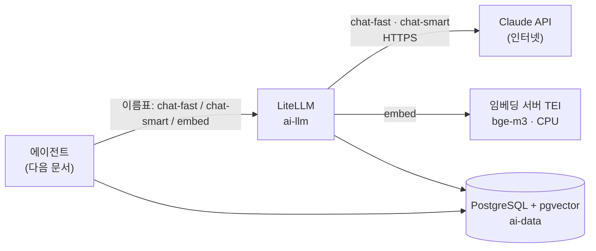

# 데이터베이스·임베딩·LLM 게이트웨이

> **이 문서는 언제 보나요?** K3s 서버에 에이전트가 기대어 쓰는 부품 세 가지(DB, 임베딩 서버, LLM 게이트웨이)를 올릴 때. 끝나면 게이트웨이의 이름표(`chat-fast`·`embed`)로 대화와 임베딩이 됩니다.
>
> 앞 단계: [EC2 인스턴스와 K3s](../01-K3s-서버/01-EC2-인스턴스와-K3s.md), [별도 Langfuse 서버 설치](../07-운영/02-모니터링과-AI-추적.md#4-langfuse-별도-서버-준비), [Claude API 키와 모델](../02-Claude-API/01-Claude-API-키와-모델.md). 모든 명령은 **K3s 서버**의 `~/ddalgiro-ai-agent`에서 실행합니다(내 맥에서 `ssh ddalgiro-ai`로 들어갑니다).
>
> ⚠️ 5장의 대화 호출은 실제 Claude API로 확인하지 못했습니다. 게이트웨이가 Claude API로 보내는 요청의 모양만 가짜 서버로 확인했습니다([버전 고정표](../00-개요/02-준비물과-정할-값.md#5-버전-고정표)).

---

## 1. 올리는 것



| 부품 | 파일 | 하는 일 |
|---|---|---|
| PostgreSQL + pgvector | `k8s/10-postgres.yaml` | DB 서버 한 대에 DB 두 개 — `agent`(에이전트 자료·벡터), `litellm`(게이트웨이 기록). **pgvector**는 PostgreSQL에 벡터 검색을 더하는 확장입니다 |
| 임베딩 서버 (TEI) | `k8s/20-tei.yaml` | 글을 1024칸 숫자 벡터로 바꿉니다. 뜻이 비슷한 글은 벡터도 가까워서 의미 검색에 씁니다 |
| LiteLLM | `k8s/22-litellm.yaml` | LLM 게이트웨이. 이름표를 보고 대화 호출은 Claude API로, 임베딩은 임베딩 서버로 넘깁니다. Claude API 키를 가진 유일한 부품입니다 |
| DB 백업 | `k8s/50-backup.yaml` | 매일 02:00에 DB를 파일로 뜹니다 |

## 2. 비밀값 만들기

```bash
bash scripts/k3s-server/create-secrets.sh
```

- DB 비밀번호·게이트웨이 키·AI 서버 키를 무작위로 만들고, 입력받은 Claude API 키와 함께 쿠버네티스 Secret 3개에 넣습니다.
- `Claude API 키`를 물으면 [Claude API 문서 3장](../02-Claude-API/01-Claude-API-키와-모델.md#3-api-키-만들기)에서 만든 키(`sk-ant-…`)를 붙여 넣습니다(화면에 보이지 않습니다). 나중에 키를 바꿀 때는 `bash scripts/k3s-server/create-secrets.sh --anthropic`을 씁니다.
- 네이버 키는 있으면 넣고, 없으면 `Enter`로 넘어갑니다. 나중에 `bash scripts/k3s-server/create-secrets.sh --naver`로 넣을 수 있습니다.
- 인스타그램 수집에 쓰는 계정 번호와 토큰은 여기서 묻지 않습니다. 준비되면 `bash scripts/k3s-server/create-secrets.sh --instagram`으로 넣습니다([트렌드 문서 5장](../04-에이전트/02-트렌드-분석-추천.md#5-수집-출처-넓히기--인스타그램rss크롤링)).
- 노코드 도구 Langflow의 Secret과 전용 키는 여기서 만들지 않습니다. 넣을 때 [Langflow 문서](../04-에이전트/05-노코드-도구-Langflow.md)의 명령으로 만듭니다.
- Langfuse 프로젝트 키와 알림 메일 설정도 여기서 만들지 않습니다. 프로젝트 키는 [에이전트 배포 3장](../04-에이전트/01-에이전트-구조와-배포.md#3-배포)에서, 알림 메일 Secret은 [모니터링 2장](../07-운영/02-모니터링과-AI-추적.md#2-ai-서버에-지표알림-올리기)에서 넣습니다.
- 다시 실행해도 이미 있는 Secret은 바꾸지 않습니다. ⚠️ DB를 만든 뒤에 Secret을 지우고 다시 만들면 DB에 저장된 비밀번호와 어긋나 접속·백업이 안 됩니다([7장](#7-문제-해결)).

### 확인

```bash
kubectl get secret -A | grep -E 'postgres-secret|litellm-secret|agent-secret'
```

- 세 줄이 보이면 성공입니다.

## 3. PostgreSQL

```bash
kubectl apply -f rendered/10-postgres.yaml
kubectl -n ai-data rollout status statefulset/postgres --timeout=10m
```

- 첫 기동 때 계정 2개(`agent`·`litellm`)와 DB 2개, `vector` 확장을 만듭니다. 이 초기화는 **데이터 폴더가 비어 있을 때 한 번만** 실행됩니다.
- 데이터는 서버의 `/var/lib/rancher/k3s/storage/` 아래 폴더에 저장됩니다.

### 확인

```bash
kubectl -n ai-data exec postgres-0 -- psql -U postgres -Atc \
  "SELECT datname FROM pg_database WHERE datname IN ('agent','litellm') ORDER BY 1"
kubectl -n ai-data exec postgres-0 -- psql -U postgres -d agent -Atc \
  "SELECT extname || ' ' || extversion FROM pg_extension WHERE extname = 'vector'"
```

- 첫 명령: `agent`, `litellm` 두 줄.
- 둘째 명령: `vector 0.8.7`.

## 4. 임베딩 서버

```bash
kubectl apply -f rendered/20-tei.yaml
kubectl -n ai-llm rollout status deployment/tei --timeout=30m
```

- 첫 기동 때 Hugging Face에서 `BAAI/bge-m3` 모델(약 2.3GB)을 내려받습니다. 몇 분 걸리며, 그동안 파드는 `0/1 Running`으로 보입니다. 진행은 `kubectl -n ai-llm logs deployment/tei -f`로 봅니다.
- 한 번 받은 모델은 디스크에 남아 다음부터는 바로 뜹니다.
- 실제로 쓰는 메모리는 약 2.7GB입니다. 내려받은 모델 파일을 읽어 둔 캐시까지 합치면 약 4.8GB로 보입니다(한도 8GB). 매니페스트의 `--max-batch-tokens 2048`은 지우지 않습니다 — 기본값으로 두면 시작할 때 메모리 한도를 넘겨 죽습니다.

### 확인

```bash
kubectl -n ai-llm run curl-check --rm -i --restart=Never --image=curlimages/curl:8.11.1 -- \
  curl -s http://tei.ai-llm.svc/v1/embeddings -H 'Content-Type: application/json' \
  -d '{"input":"두바이 초콜릿","model":"bge-m3"}' | head -c 200; echo
```

- 임시 파드 하나를 띄워 클러스터 안에서 임베딩 서버를 부릅니다. `"embedding":[0.0…` 처럼 숫자 목록이 든 JSON이 보이면 성공입니다.

## 5. LiteLLM

```bash
kubectl apply -f rendered/22-litellm.yaml
kubectl -n ai-llm rollout status deployment/litellm --timeout=10m
```

- 첫 기동 때 `litellm` DB에 테이블을 만드느라 1~2분 걸립니다.
- 모델 표는 `k8s/22-litellm.yaml` 안의 `config.yaml`입니다. 이름표 `chat-fast`는 Claude Haiku 5.5로, `chat-smart`는 Claude Sonnet 5.5로, `embed`는 임베딩 서버로 갑니다. 모델 ID는 `site.env`의 `CHAT_FAST_MODEL`·`CHAT_SMART_MODEL`이 채웁니다.
- 에이전트는 OpenAI 형식으로 게이트웨이를 부르고, 게이트웨이가 Claude API 형식으로 바꿔 `https://api.anthropic.com`으로 보냅니다. 서버가 인터넷으로 나갈 수 있어야 합니다(보안 그룹의 아웃바운드 기본값이면 됩니다).
- ⚠️ 모델 표의 `drop_params: true`는 지우지 않습니다. 에이전트가 보내는 `temperature=0`을 Claude의 최신 모델은 거절하는데, 이 설정이 그 옵션을 빼고 보내 줍니다.

### 확인

⚠️ 아래 대화 호출은 실제 Claude API를 부르며 요금이 듭니다. 고급 모델은 생각 과정의 토큰에 따라서도 비용이 달라집니다.

서버 터미널 하나에서 아래 연결을 켜 두고 `Forwarding from 127.0.0.1:4000`을 확인합니다. 키를 임시 파드의 실행 인자에 넣지 않도록, 두 번째 서버 터미널에서 뒤의 `curl` 명령을 실행합니다.

```bash
kubectl -n ai-llm port-forward service/litellm 4000:4000
```

```bash
KEY=$(kubectl -n ai-llm get secret litellm-secret -o jsonpath='{.data.LITELLM_MASTER_KEY}' | base64 -d)
curl -sS -m 120 http://localhost:4000/v1/chat/completions \
  -H "Authorization: Bearer $KEY" -H 'Content-Type: application/json' \
  -d '{"model":"chat-fast","messages":[{"role":"user","content":"한 낱말로 인사해줘"}]}'; echo
curl -sS -m 120 http://localhost:4000/v1/chat/completions \
  -H "Authorization: Bearer $KEY" -H 'Content-Type: application/json' \
  -d '{"model":"chat-smart","messages":[{"role":"user","content":"한 낱말로 인사해줘"}]}'; echo
curl -sS -m 60 http://localhost:4000/v1/embeddings \
  -H "Authorization: Bearer $KEY" -H 'Content-Type: application/json' \
  -d '{"model":"embed","input":"두바이 초콜릿"}' | head -c 200; echo
```

- 첫 줄은 게이트웨이 키를 Secret에서 읽어 변수에 담습니다(화면에 출력하지 않습니다).
- 둘째·셋째 명령(대화): `"content":"안녕"` 같은 답이 든 JSON. 둘째는 `chat-fast`(Haiku), 셋째는 `chat-smart`(Sonnet)를 부릅니다.
- 넷째 명령(임베딩): 숫자 목록이 든 JSON.
- 모두 되면 **게이트웨이 → Claude API·임베딩 서버** 연결이 확인된 것입니다. 에이전트에서 부르는 것은 다음 문서에서 확인합니다.
- 끝나면 `unset KEY`로 키 변수를 지우고 첫 터미널에서 `Ctrl+C`로 연결을 닫습니다.
- 대화 호출이 오류면 `error`의 글을 [Claude API 문서 8장](../02-Claude-API/01-Claude-API-키와-모델.md#8-문제-해결)에서 찾습니다.

## 6. DB 백업

```bash
kubectl apply -f rendered/50-backup.yaml
kubectl -n ai-data create job --from=cronjob/pg-backup pg-backup-manual
kubectl -n ai-data wait --for=condition=complete job/pg-backup-manual --timeout=5m
kubectl -n ai-data logs job/pg-backup-manual
sudo ls -la /var/backups/ddalgiro-ai/
```

- 첫 줄은 매일 02:00에 도는 백업을 등록하고, 둘째 줄은 지금 한 번 돌려 봅니다. 나중에 다시 돌릴 때는 먼저 `kubectl -n ai-data delete job pg-backup-manual`로 앞의 것을 지웁니다(같은 이름으로는 다시 만들 수 없습니다).
- 로그에 `백업 완료: agent-….dump`, `백업 완료: litellm-….dump`가 나오고, 마지막 줄에서 두 파일이 보이면 성공입니다.
- ⚠️ 이 파일은 같은 서버의 같은 디스크에 있습니다. 디스크 스냅샷으로 서버 밖에 두는 일과 되살리는 방법은 [운영 문서](../07-운영/01-점검-백업-문제-해결.md#4-백업)에 있습니다.

## 7. 문제 해결

| 증상 | 원인과 해결 |
|---|---|
| `postgres-0`이 `CrashLoopBackOff`·`CreateContainerConfigError` | `CreateContainerConfigError`는 `postgres-secret`이 없다는 뜻이므로 2장부터 다시 합니다. `CrashLoopBackOff`면 `kubectl -n ai-data logs postgres-0`을 봅니다 |
| LiteLLM 파드가 `Init:0/1`에서 오래 머묾 | DB를 기다리는 중입니다. `kubectl -n ai-data get pods`로 `postgres-0`이 `1/1`인지 확인 |
| LiteLLM 로그에 `password authentication failed` | DB에 저장된 비밀번호와 `litellm-secret`의 접속 주소(`DATABASE_URL`) 속 비밀번호가 어긋났습니다 — DB 디스크는 그대로 두고 Secret을 새로 만들었거나 그 반대입니다. 게이트웨이가 쓰는 값은 `kubectl -n ai-llm get secret litellm-secret -o jsonpath='{.data.DATABASE_URL}' \| base64 -d; echo`의 `litellm:` 뒤, `@` 앞입니다(⚠️ 화면에 비밀번호가 보이므로 화면 공유 중에는 하지 않습니다). DB를 그 값으로 맞춥니다: `kubectl -n ai-data exec -it postgres-0 -- psql -U postgres` → `\password litellm`로 숨겨 입력합니다. SQL에 값을 직접 적지 않습니다. 에이전트가 같은 오류를 내면 `ai-app`의 `agent-secret`과 `\password agent`로, 백업이 실패하면 `postgres-secret`의 `POSTGRES_PASSWORD`와 `\password postgres`로 같은 일을 합니다 |
| 대화 호출이 `401`·`AuthenticationError` | 게이트웨이가 가진 Claude API 키가 틀렸거나 지워졌습니다. `bash scripts/k3s-server/create-secrets.sh --anthropic`으로 다시 넣습니다 |
| 대화 호출이 `402`·`credit balance is too low`·`429`·`529` | Claude API 쪽의 크레딧·호출 한도·과부하입니다. [Claude API 문서 8장](../02-Claude-API/01-Claude-API-키와-모델.md#8-문제-해결) |
| 대화 호출이 `Connection error`·시간 초과 | 서버가 인터넷으로 나가지 못합니다. `curl -s -o /dev/null -w '%{http_code}\n' -m 10 https://api.anthropic.com/`이 `000`이면 보안 그룹의 아웃바운드 규칙을 확인합니다 |
| 임베딩 서버가 `OOMKilled`로 재시작 반복 | `kubectl -n ai-llm describe pod -l app=tei`의 `Last State`가 `OOMKilled`인 경우. `k8s/20-tei.yaml`의 실행 옵션에 `--max-batch-tokens 2048`이 있는지 확인합니다 |
| 임베딩 서버가 30분 넘게 준비 안 됨 | `kubectl -n ai-llm logs deployment/tei`에서 내려받기 오류를 봅니다. 서버가 `huggingface.co`에 닿는지 `curl -I https://huggingface.co` |
| 모델 표를 고쳤는데 반영이 안 됨 | `kubectl apply` 뒤 `kubectl -n ai-llm rollout restart deployment/litellm`. 게이트웨이는 시작할 때만 표를 읽습니다 |

다음: [에이전트 구조와 배포](../04-에이전트/01-에이전트-구조와-배포.md)
