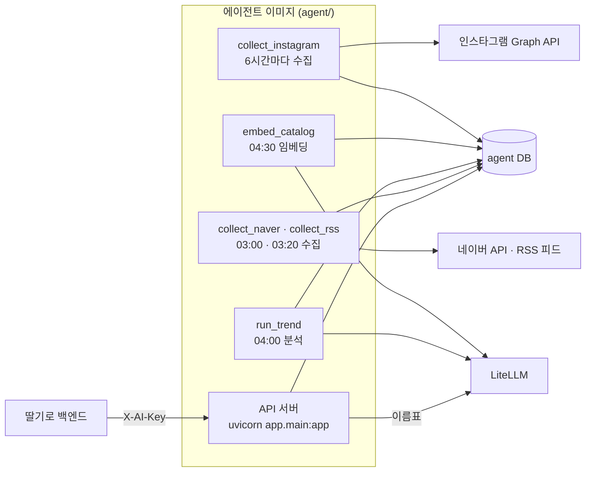

# 에이전트 구조와 배포

> **이 문서는 언제 보나요?** 직접 만든 에이전트(`agent/`)가 어떻게 생겼는지 알고 싶을 때, 그리고 이미지를 만들어 K3s 서버에 올릴 때. 끝나면 샘플 데이터로 API가 답합니다.
>
> 앞 단계: [데이터베이스·임베딩·LLM 게이트웨이](../03-플랫폼/01-데이터베이스-임베딩-LLM-게이트웨이.md), [별도 Langfuse 서버 설치](../07-운영/02-모니터링과-AI-추적.md#4-langfuse-별도-서버-준비). Langfuse는 기본 설치에 포함하며 HTTPS·프로젝트 키를 준비합니다.
>
> ⚠️ 실제 EC2와 Claude API에서의 배포·응답은 확인하지 못했습니다. 샘플의 기대 결과는 로컬 모델로 확인했으며, 검증 범위는 [버전 고정표](../00-개요/02-준비물과-정할-값.md#5-버전-고정표)에 있습니다.

---

## 1. 에이전트가 하는 일

`agent-api` 하나가 연구개발계획서의 두 안건(① 트렌드 분석·추천, ② 단체주문 매칭·랭킹)을 모두 맡습니다. 같은 이미지로 **API 서버**와 **정기 작업**을 돌립니다. 계획서의 어느 쪽이 어느 파일에 있는지는 [연구개발계획서와 구현 대응](../00-개요/03-연구개발계획서-구현-대응.md)에 있습니다.



### 지키는 원칙 세 가지

| 원칙 | 뜻 | 코드 |
|---|---|---|
| 숫자는 코드, 글은 LLM | 점수·순위·조건 충족 여부·견적 합계·날짜 계산은 코드와 SQL이 정합니다. LLM은 문의에서 조건을 뽑고, 확정된 사실을 문장으로 옮기는 일만 합니다 | `trend/scoring.py`, `reco/ranking.py`, `reco/search.py`, `reco/capacity.py`, `reco/slots.py` |
| 근거 안에서만 쓴다 | LLM에게 번호가 붙은 근거만 주고 문장마다 출처 번호를 적게 합니다. 출처가 없거나 선택한 근거 원문과 다른 글은 내보내지 않고, 코드가 근거만으로 만든 글로 바꿉니다 | `grounding.py` |
| 모델을 직접 부르지 않는다 | `chat-fast`·`chat-smart`·`embed` 이름표만 붙여 게이트웨이에 보냅니다. 모델을 바꿔도 코드가 그대로입니다 | `llm.py` |

### 폴더

| 위치 | 내용 |
|---|---|
| `agent/app/main.py` | HTTP API (FastAPI) |
| `agent/app/trend/` | 트렌드 점수·시간창·교차검증(`scoring.py`), 수집 출처 목록(`sources.py`), 백테스팅 계산(`backtest.py`), 분석 그래프(`pipeline.py`), 업체 맞춤 추천(`recommend.py`) |
| `agent/app/reco/` | 조건 뽑기(`slots.py`), 후보 검색(`search.py`), 순위(`ranking.py`), 공급 조건 최신성·견적(`capacity.py`), 추천 사유(`explain.py`), 제안서 초안(`proposal.py`), 추천 그래프(`graph.py`) |
| `agent/app/jobs/` | 정기 작업(수집 `collect_naver.py`·`collect_instagram.py`·`collect_rss.py`, 분석, 임베딩)과 샘플·CSV 넣기, 백테스팅 실행(`backtest.py`) |
| `agent/app/collecting.py` | 수집 작업이 함께 쓰는 것 — 하루치 집계, DB 넣기, robots.txt를 지키는 웹 읽기 |
| `agent/app/grounding.py` · `llm.py` · `db.py` · `settings.py` · `dates.py` | 근거 검사, LLM 호출, DB 연결, 환경 변수, 한국 업무 날짜 |
| `agent/sql/schema.sql` | DB 테이블 정의. 에이전트가 시작할 때 없으면 만듭니다 |
| `agent/tests/` | 규칙 시험(`test_rules.py`), DB 회귀 시험(`test_db.py`), 실제 DB·LLM에 붙이는 시험(`test_live.py`) |

**LangGraph**: 처리 단계를 "노드", 단계 사이의 갈림길을 "조건부 간선"으로 적어 그래프로 실행하는 라이브러리입니다. 되묻기나 다시 검색 같은 갈림길이 있는 흐름을 표현하고, 단계마다 실행 기록을 남기려고 씁니다.

### API

모든 `/v1` 주소는 요청 헤더 `X-AI-Key`가 맞아야 합니다.

| 주소 | 하는 일 |
|---|---|
| `GET /v1/trends` | 키워드별 최신 트렌드 점수(높은 순). `?stage=성장기`로 단계 고르기 |
| `GET /v1/trends/{키워드번호}` | 점수·30일 추이·브리핑(출처 포함)·최근 글 |
| `POST /v1/trends/{키워드번호}/analyze` | 지금 다시 분석(LLM 호출, 수십 초) |
| `GET` · `POST /v1/keywords` | 감시 키워드 목록·추가(분류, 외국 매체용 다른 표기 `aliases`) |
| `PUT /v1/vendors/profile?vendor=업체명` | 업체 프로필 저장. 업체명은 URL 인코딩 |
| `GET /v1/vendors/recommendations?vendor=업체명` | 업체 맞춤 트렌드 추천 |
| `POST /v1/vendors/adoptions?vendor=업체명` | 추천에 대한 업체의 채택·보류·출시·판매 기록 |
| `POST /v1/recommend` | 자연어 추천(견적·공급 조건 확인 상태 포함) |
| `GET /v1/recommend/options/{옵션번호}` | 추천 당시 조건·결과·근거 재조회 |
| `POST /v1/recommend/{요청번호}/reroute` | 공급자가 거절한 요청의 대체 공급자 찾기(LLM 호출) |
| `POST /v1/recommend/{요청번호}/proposal` | 제안서 초안 만들기 |
| `POST /v1/recommend/proposals/{제안서번호}/outcome` | 제안서 채택 여부 기록 |
| `POST /v1/recommend/feedback` | 제안 옵션에 대한 반응 기록(고객 선택·공급자 수락/거절·주문) |
| `POST /v1/recommend/delivery` | 납품·클레임·재주문 의향 기록 |
| `POST /v1/suppliers/capacity/confirm` | 공급 조건을 공급자에게 확인했다는 표시 |
| `GET /v1/status` | 쌓인 자료 수와 단계별 실행 결과 |
| `GET /v1/kpi?days=90` | 쌓인 기록으로 계산한 운영 지표 |
| `GET /v1/whoami` | 서버가 본 요청자의 IP(접근 제한 확인용) |
| `GET /healthz` · `/readyz` | 상태 확인(키 없음, 바깥에 공개하지 않음) |

## 2. 이미지 만들어 서버로 보내기

### 2-1. 내 맥에서

Docker Desktop을 켜고 저장소 루트에서 실행합니다.

```bash
cd ~/workspace/workspace-vscode/ddalgiro-ai-agent
bash scripts/build-and-load.sh ddalgiro-ai
```

- 서버 CPU(x86_64)용으로 이미지를 빌드하고, 파일로 떠서 서버의 `/tmp`로 복사합니다. 처음에는 몇 분 걸립니다. `ddalgiro-ai`는 [K3s 서버 문서 2-1](../01-K3s-서버/01-EC2-인스턴스와-K3s.md#2-1-내-맥에서-접속하기)에서 만든 SSH 접속 이름입니다.
- 이미지 이름은 `site.env`의 `AGENT_IMAGE`(예: `ddalgiro/agent-api:0.4.0`)입니다.
- 끝나면 서버에서 실행할 명령을 화면에 알려 줍니다.

### 2-2. 서버에서

```bash
sudo k3s ctr images import /tmp/ddalgiro-agent-api-0.4.0.tar && rm /tmp/ddalgiro-agent-api-0.4.0.tar
sudo k3s ctr images ls | grep ddalgiro/agent-api
```

- 받은 파일을 K3s의 이미지 보관소에 넣고 파일을 지웁니다.
- 둘째 줄에 `docker.io/ddalgiro/agent-api:0.4.0`이 보이면 성공입니다.

## 3. 배포

내 맥의 `site.env`는 `LANGFUSE_ENABLED=true`와 실제 `LANGFUSE_BASE_URL`을 채워 서버에 보냅니다. **AI 서버**의 `~/ddalgiro-ai-agent`에서 실행합니다. 기본 `agent-secret`은 앞 단계의 비밀값 만들기에서 생성되어 있어야 합니다.

```bash
bash scripts/render.sh
python3 scripts/observability/create-secrets.py --langfuse
kubectl apply -f rendered/30-agent-api.yaml -f rendered/31-agent-jobs.yaml
kubectl -n ai-app rollout status deployment/agent-api --timeout=5m
kubectl -n ai-app get pods,cronjobs
kubectl -n ai-app exec deployment/agent-api -- python -m app.observability --check
```

- 첫 줄은 실제 도메인·추적 설정을 채우고, 둘째 줄은 Langfuse 초기화에서 만든 프로젝트 공개·비밀 키를 숨겨 입력받습니다. 기존 DB·AI 키는 보존하며 추적 키는 K3s Secret에만 넣습니다.
- `kubectl apply`는 API 서버와 정기 작업 5개를 등록합니다. `get` 결과에서 `agent-api-…` 파드가 `1/1 Running`, CronJob 5개(`collect-instagram`·`collect-naver`·`collect-rss`·`run-trend`·`embed-catalog`)가 보이면 성공입니다. 인스타그램·RSS 수집은 [설정을 넣기 전](02-트렌드-분석-추천.md#5-수집-출처-넓히기--인스타그램rss크롤링)에는 아무것도 하지 않고 끝납니다.
- 마지막 줄은 모델 요금 없이 Langfuse 인증·추적 저장·원문 비수집을 확인합니다. `인증·저장·원문 비수집 확인`을 확인해야 기본 연결이 끝난 것입니다.

## 4. 샘플 데이터로 처음부터 끝까지 확인

네이버 키나 실제 카탈로그가 없어도 전체 흐름을 볼 수 있게 샘플을 넣습니다. ⚠️ 샘플의 숫자는 지어낸 것입니다. 이름이 `(샘플)`로 시작합니다. 셋째 명령과 아래의 추천 호출은 Claude API를 부릅니다(합쳐서 요금 몇십 원).

```bash
kubectl -n ai-app exec deployment/agent-api -- python -m app.jobs.seed_sample
kubectl -n ai-app exec deployment/agent-api -- python -m app.jobs.embed_catalog
kubectl -n ai-app exec deployment/agent-api -- python -m app.jobs.run_trend
```

| 줄 | 하는 일 | 성공 기준 |
|---|---|---|
| 1 | 샘플 키워드 4개(91일치 지표)·업체 6곳을 넣음 | `샘플 데이터를 넣었습니다: 키워드 4개, 업체 6곳` |
| 2 | 메뉴를 벡터로 바꿈(임베딩 서버 사용) | `메뉴 10건 임베딩 완료` |
| 3 | 감성 → 점수 → 브리핑(Claude API 사용) | 키워드 4개가 각각 `성장기`·`정점`·`쇠퇴기`·`태동기`, 끝에 `실패 0개` |

### API 확인용 연결

서버에 SSH로 접속한 터미널 두 개를 씁니다. **첫 터미널**에서 아래 명령을 실행하고 `Forwarding from 127.0.0.1:8000`이 보일 때까지 기다린 뒤 켜 둡니다. 오류가 나오면 다음으로 넘어가지 않습니다.

```bash
kubectl -n ai-app port-forward service/agent-api 8000:8000
```

**둘째 서버 터미널**에서 키를 변수에 담고 API를 부릅니다. 이후 문서의 `localhost:8000` 명령도 이 연결을 켜 둔 상태에서 실행합니다.

```bash
AIKEY=$(kubectl -n ai-app get secret agent-secret -o jsonpath='{.data.AI_API_KEY}' | base64 -d)

curl -s localhost:8000/v1/trends -H "X-AI-Key: $AIKEY" | python3 -m json.tool | head -20
curl -s localhost:8000/v1/recommend -H "X-AI-Key: $AIKEY" -H 'Content-Type: application/json' \
  -d '{"text":"비건 케이크 5만 원 이하로 추천해줘. 강남에서 받을게요"}' | python3 -m json.tool | head -60
curl -s -o /dev/null -w '%{http_code}\n' localhost:8000/v1/trends

unset AIKEY
```

- 연결은 서버의 루프백 주소에서만 열립니다. 다 쓴 뒤 첫 터미널의 `Ctrl+C`로 닫습니다. 둘째 터미널의 `unset AIKEY`는 키 변수를 지웁니다.
- API 파드를 재시작하면 포트 연결도 끊길 수 있습니다. 이후 호출 전에는 첫 터미널에서 연결을 다시 열고 `Forwarding` 표시를 확인합니다.
- 트렌드 호출: `(샘플) 피스타치오 크림빵`이 `성장기`로 맨 위에 나옵니다.
- 추천 호출: `"status": "ok"`이고 1위가 `(샘플) 초록오븐`의 `비건 초코 케이크`입니다. `reason`에 `[출처:F1,…]`이 붙어 있습니다. 영업을 끝낸 `(샘플) 문닫은집`은 조건이 맞아도 나오지 않습니다.
- 키 없는 호출: `401`.
- 단체주문의 견적·공급 조건 확인 상태·되묻기는 [자연어 추천 5장](03-자연어-추천-랭킹.md#5-불러-보기와-응답-읽기)의 문의로 확인합니다.

샘플은 실제 자료를 넣기 전에 지웁니다.

```bash
kubectl -n ai-app exec deployment/agent-api -- python -m app.jobs.seed_sample --clear
```

0.4.0부터 내부 `/metrics/`에서 API 지표를 내주고, 설정을 켜면 별도 Langfuse로 단계·모델·토큰 수를 보냅니다. 원문은 보내지 않습니다. 실제 수집·알림·추적 저장은 [모니터링과 AI 추적](../07-운영/02-모니터링과-AI-추적.md)에서 확인합니다.

## 5. 코드를 고쳤을 때

1. 내 맥에서 고치고 시험합니다.

   ```bash
   cd ~/workspace/workspace-vscode/ddalgiro-ai-agent/agent
   python3.12 -m venv .venv && source .venv/bin/activate
   pip install -r requirements.txt pytest PyYAML==6.0.3
   python -m pytest tests/test_rules.py tests/test_observability.py tests/test_observability_setup.py -q
   ```

   - DB·LLM 없이 도는 규칙 시험입니다. 모두 통과해야 합니다. 실제 DB·LLM에 붙이는 시험은 `tests/test_live.py` 머리말을 봅니다(게이트웨이가 Claude API를 가리키면 요금이 듭니다).

2. 주문·납품 호출에는 `order_ref`와 재전송용 `event_key`를 적용합니다. 근거 없는 옛 옵션은 새로 추천받습니다. 인스타그램은 관측 근거 없는 옛 완료 표시를 해제하고 6시간 수집으로 다시 쌓습니다.
3. `site.env`의 `AGENT_IMAGE` 태그를 올립니다(현재 견본 `0.4.0`, 다음 변경은 `0.4.1`). 같은 태그로 덮어쓰면 서버가 옛 이미지를 계속 쓸 수 있습니다.
4. [K3s 서버 문서 4-1](../01-K3s-서버/01-EC2-인스턴스와-K3s.md#4-1-내-맥에서-저장소-폴더-보내기)의 `rsync`로 저장소를 서버에 다시 보냅니다.
5. 2장(이미지 보내기) → 서버에서 `bash scripts/render.sh && kubectl apply -f rendered/30-agent-api.yaml -f rendered/31-agent-jobs.yaml`.

### 환경 변수 설정만 바꿀 때

`agent-config`의 `RECO_RESULTS`·`RECO_ASK_STORAGE`·`LLM_EXTRA_BODY` 등을 바꿀 때도 내 맥의 원본을 고쳐 서버로 보낸 뒤 반영합니다. **K3s 서버**의 저장소 폴더에서 실행합니다.

```bash
bash scripts/render.sh
kubectl apply -f rendered/30-agent-api.yaml
kubectl -n ai-app rollout restart deployment/agent-api
kubectl -n ai-app rollout status deployment/agent-api --timeout=5m
```

- ConfigMap을 적용하는 것만으로 이미 실행 중인 파드의 환경 변수는 바뀌지 않습니다. API 파드를 다시 띄워야 합니다.
- 새로 시작하는 정기 작업은 새 설정을 읽습니다. 실행 중인 작업은 기존 설정으로 끝나므로 작업 상태를 확인한 뒤 다음 실행을 기다립니다.

### 기존 DB가 있는 경우

- 에이전트와 작업이 시작할 때 `schema.sql`을 적용합니다. 필요한 칸·DB 테이블·집계 보기를 갱신하고 기존 행과 번호는 유지합니다. 관측 증거 없는 인스타그램 집계는 완료 표시만 해제합니다. 여러 번 적용해도 같은 상태입니다.
- **공급 조건은 업체 단위에서 메뉴(상품) 단위로 옮겨집니다.** 업체에 적혀 있던 조건을 그 업체의 메뉴마다 복사하고, 확인 날짜를 알 수 없으므로 모두 "확인 전"이 됩니다. 추천에서는 `reconfirm`(공급자 재확인)으로 표시되므로, 공급자에게 확인한 뒤 [확인 표시](03-자연어-추천-랭킹.md#공급-조건의-최신성)를 하거나 확인 날짜를 넣은 CSV로 다시 넣습니다.
- 메뉴의 보관 방법(`storage`)은 비어 있습니다. 고객이 보관 조건을 건 문의에는 보관 방법을 모르는 메뉴가 나오지 않으므로 CSV로 채웁니다.
- 정기 작업이 3개에서 5개로 늘었습니다. `rendered/31-agent-jobs.yaml`을 다시 적용하고, [복원 절차](../07-운영/01-점검-백업-문제-해결.md#4-4-되살리기)처럼 작업 이름을 나열하는 명령은 새 목록을 씁니다.
- 수집 완료 여부를 알 수 없는 기존 지표는 `is_complete=false`입니다. [수집·분석 수동 실행](02-트렌드-분석-추천.md#4-네이버-키-넣고-수집-돌리기)을 차례로 실행해 현재 근거로 점수를 다시 계산합니다. 최근 10일이 모두 확인되지 않으면 `자료부족`으로 둡니다. 다시 수집하면 광고·체험단 글이 글 수에서 빠지고, 데이터랩은 91일치를 받습니다.
- 업체 API를 부르는 코드도 위 API 표의 쿼리 인자 방식으로 맞춥니다. 업체명을 경로 안에 넣던 주소는 쓰지 않습니다([백엔드 중계](../06-관리자-화면-연동/01-백엔드-중계와-관리자-화면.md#2-2-ai-서버를-부르는-서비스)).
- 단체주문 문의는 보관 방법을 말하지 않으면 되묻습니다. 추천을 부르는 화면이 `reask`를 처리하는지 확인합니다.
- DB 회귀 시험은 연습용 DB에서 `DB_TEST=1 DATABASE_URL=… python -m pytest tests/test_db.py -q`로 실행합니다. 수집 누락·기사 중복·공급 조건 갱신과 확인 표시·검색 조건(보관·배송 지역·예산)·대체 공급자·제안서·납품 기록·운영 지표·업체명 특수문자를 확인하며 LLM은 쓰지 않습니다.
- 업무 날짜는 `app/dates.py`가 항상 한국 시간으로 계산합니다. 컨테이너 로그의 시간대도 `TZ=Asia/Seoul`입니다.

## 6. 문제 해결

| 증상 | 원인과 해결 |
|---|---|
| 파드가 `ErrImageNeverPull` | 서버에 그 이름·태그의 이미지가 없습니다. 2-2의 둘째 명령으로 이름을 확인하고 `site.env`의 `AGENT_IMAGE`와 맞춥니다 |
| 파드가 `0/1`에서 재시작 반복 | `kubectl -n ai-app logs deployment/agent-api`. `vector 확장이 없습니다`면 DB 초기화가 안 된 것([플랫폼 3장](../03-플랫폼/01-데이터베이스-임베딩-LLM-게이트웨이.md#3-postgresql)), 접속 실패면 `agent-secret`의 `DATABASE_URL` 확인 |
| `run_trend`가 `분석 실패 … Connection error` | 게이트웨이가 안 닿거나, 게이트웨이에서 Claude API로 나가지 못합니다. [플랫폼 5장](../03-플랫폼/01-데이터베이스-임베딩-LLM-게이트웨이.md#5-litellm)의 확인을 다시 합니다 |
| 브리핑이 `template`으로만 만들어짐 | 모델의 글이 근거 검사를 통과하지 못해 코드가 만든 글로 바뀐 것입니다. `GET /v1/status`의 `insights_by_writer`로 비율을 보고, 게이트웨이 로그에 Claude API 오류(크레딧·호출 한도)가 없는지 확인합니다. 오류가 없는데 계속 그러면 [모델을 바꿔 비교합니다](../02-Claude-API/01-Claude-API-키와-모델.md#7-모델을-바꿀-때) |
| 응답이 너무 느림 | 모델이 답하기 전의 생각 과정이 긴 경우입니다. 게이트웨이의 모델 표에서 생각 깊이를 낮추고 같은 문의로 품질을 비교합니다([Claude API 문서 7장](../02-Claude-API/01-Claude-API-키와-모델.md#7-모델을-바꿀-때)). 추천 결과 수(`RECO_RESULTS`)를 줄이는 방법도 있습니다 |
| `임베딩 길이 … 가 설정 EMBED_DIM … 과 다릅니다` | 임베딩 모델을 바꾼 경우. `agent/sql/schema.sql`의 `vector(1024)`와 `EMBED_DIM`을 새 길이로 바꾸고 `menus.embedding`을 다시 만들어야 합니다 |

다음: [트렌드 분석·추천](02-트렌드-분석-추천.md) · [자연어 추천·랭킹](03-자연어-추천-랭킹.md) · (선택) [노코드 도구 Langflow](05-노코드-도구-Langflow.md)
