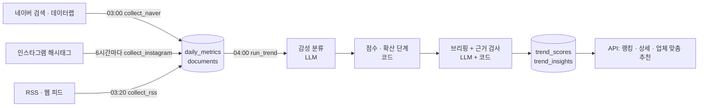
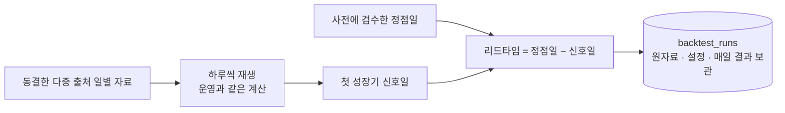

# 트렌드 분석·추천

> **이 문서는 언제 보나요?** 실제 디저트 키워드를 넣어 매일 수집·분석이 돌게 할 때, 점수와 확산 단계가 어떻게 계산되는지 알고 싶을 때, 업체별 추천을 볼 때, 점수 기준이 과거 유행을 얼마나 일찍 잡는지 재 볼 때. 연구개발계획서의 **안건 1**([기획 02](../../../ddalgiro-tips-task/docs/02_트렌드분석추천시스템_기획.md))이며, 계획서의 어느 쪽이 어디에 구현됐는지는 [연구개발계획서와 구현 대응](../00-개요/03-연구개발계획서-구현-대응.md)에 있습니다.
>
> 앞 단계: [에이전트 구조와 배포](01-에이전트-구조와-배포.md). 명령은 **K3s 서버**에서 실행합니다. `localhost:8000` 호출 전에는 [API 확인용 연결](01-에이전트-구조와-배포.md#api-확인용-연결)을 켜고, 명령을 실행할 서버 터미널에서 아래처럼 키를 읽습니다.
>
> ⚠️ 실제 수집 계정·운영 카탈로그·EC2·Claude API로 끝까지 확인하지 못했습니다. 로컬 시험 범위는 [버전 고정표](../00-개요/02-준비물과-정할-값.md#5-버전-고정표)를 봅니다.

---

## 1. 매일 일어나는 일



| 단계 | 누가 | 무엇을 |
|---|---|---|
| 수집 | `collect_naver` | 블로그·뉴스의 **날짜별 새 글 수**와 데이터랩의 **검색 관심도**(0~100)를 모읍니다 |
| 수집(추가 출처) | `collect_instagram` · `collect_rss` | 인스타그램 해시태그의 어제 게시물 수, RSS·웹 피드의 날짜별 글 수를 모읍니다 |
| 감성 | LLM (`chat-fast`) | 글 제목·요약을 호감(pos)·불만(neg)·중립(neu)으로 분류합니다. 광고·체험단 글은 분류하지 않습니다 |
| 점수 | 코드 | 아래 2장의 계산. LLM을 쓰지 않습니다 |
| 브리핑 | LLM (`chat-smart`) + 코드 검사 | 성장기·정점인 키워드만 4~6문장 브리핑을 만듭니다 |

- **수집**: 키워드마다 최신 블로그·뉴스 글을 받아 글 수와 함께 글의 제목·주소·짧은 요약을 저장합니다. 글의 본문은 저장하지 않습니다. 데이터랩에서는 최근 91일의 검색 관심도를 받습니다. **광고·체험단 글은 글 수에서 빼고 따로 셉니다**(2-3).
- **수집(추가 출처)**: 설정을 넣기 전에는 아무것도 하지 않습니다(5장).
- **브리핑**: 코드가 계산한 지표(M1…)와 수집한 글(D…)만 근거로 줍니다.
- 감성과 브리핑 단계는 게이트웨이를 거쳐 Claude API를 부릅니다. 키워드 수만큼 요금이 들고(어림은 [Claude API 문서 2장](../02-Claude-API/01-Claude-API-키와-모델.md#2-어떤-모델을-쓰나)), 수집한 글의 제목·요약이 서버 밖으로 전달됩니다([같은 문서 5장](../02-Claude-API/01-Claude-API-키와-모델.md#5-무엇이-서버-밖으로-나가나)).
- Claude API가 실패해도 분석은 멈추지 않습니다. 감성은 다음 실행에서 다시 시도하고, 브리핑은 코드가 근거만으로 만든 글로 대신 나갑니다.

## 2. 점수와 확산 단계

"얼마나 많이 언급됐나"가 아니라 **"얼마나 빨리 늘고 있나, 그 증가가 더 빨라지나"**를 봅니다. 양이 눈에 띄게 커졌을 때는 이미 정점이기 때문입니다(기획 02 §5.3.2).

| 값 | 계산 | 뜻 |
|---|---|---|
| 증가율 | (최근 3일 평균 − 그 직전 4일 평균) ÷ 그 직전 4일 평균 | 0.25면 25% 증가 |
| 가속 | 지금의 증가율 − 3일 전 시점의 증가율 | 양수면 증가가 빨라지는 중 |

**트렌드 점수(0~100)** = 주 계열 지수의 증가율 40 + 보조 계열 지수의 가속 30 + 긍정 비율 20 + 출처 수 10. 증가율과 가속은 0~1로 잘라서 넣습니다. 긍정 비율을 모르면 0.5로 봅니다(10점). 출처 수는 신호가 잡힌 출처가 4곳 이상이면 만점이고, 네이버 세 출처만 쓰면 7.5점입니다. 글 → 검색 → SNS 순서로 사용 가능한 첫 두 계열을 고릅니다. 기본은 글·검색이고, RSS·인스타그램만 있으면 글·SNS입니다.

| 확산 단계 | 조건 | 업체에 주는 말 |
|---|---|---|
| 태동기 | 증가율 5% 이하 | 지켜보는 단계 |
| **성장기** | 증가율 5% 초과 + 가속 중 | **지금 시험 판매를 검토할 때** |
| 정점 | 증가율 30% 초과 + 가속 멈춤 | 새로 시작하면 재고 최소로 |
| 쇠퇴기 | 그 밖 | 새 투자는 권하지 않음 |
| 자료부족 | 최근 10일이 연속 완료된 출처로 두 계열 이상을 구성하지 못함 | 판단 보류 (점수 0) |

단계는 **주 계열** 지수의 증가율과 가속으로 정합니다. 응답의 `momentum` 칸은 점수에 쓰는 **보조 계열** 지수의 가속이라, 성장기여도 0이나 음수일 수 있습니다. 단계에 쓴 가속은 `windows`의 `7d` 안 `momentum`에 있습니다.

- **최근 10일이 연속으로 완료된 출처를 고정하고, 두 계열 이상이 있을 때 점수를 계산합니다.** 각 출처의 10일 평균을 100으로 맞춘 뒤 같은 계열끼리 평균합니다. 서로 단위가 다른 원값을 더하지 않습니다. DB 행의 `is_complete`가 완료 표시이며, 빠진 날은 0건으로 추측하지 않습니다. 출처 목록·주/보조/장기 계열·계산 버전은 `score.by_source.basis`에 남습니다.
- 검색 결과를 끝까지 받은 경우 글 없는 날은 확인된 0건으로 기록합니다. 건수 한도에 걸리면 잘린 가장 오래된 날과 그 이전은 미확인입니다. 날짜를 읽지 못한 글이 섞여도 집계를 완료로 표시하지 않습니다.
- 처음 수집했더라도 과거 10일을 온전히 조회했다면 바로 계산할 수 있습니다. 자료가 부족하면 기간이 오래 지났어도 `자료부족`입니다. 데이터랩이 값을 주지 않은 날도 임의로 0으로 만들지 않습니다.
- 이 계산식은 ddalgiro-tips-task의 [가이드 09](../../../ddalgiro-tips-task/docs/guides/09_트렌드스코어링_백테스팅.md)의 "트렌드 스코어 v1"을 옮긴 것입니다.
- **가중치(40·30·20·10)와 단계 기준(5%·30%)은 고정된 답이 아니라 조정값입니다.** `agent/app/trend/scoring.py`의 `ScoreWeights`·`StageThresholds`에 있고, [8장의 백테스팅](#8-백테스팅--정점보다-며칠-앞서-잡는지-재기) 결과를 보고 고칩니다.

### 2-1. 교차검증 — 서로 다른 신호가 함께 오르나

글이나 SNS 게시물은 홍보로 한꺼번에 늘 수 있지만, 검색은 실제로 궁금해하는 사람이 있어야 늡니다. 그래서 출처를 **신호 계열**(글·검색·SNS)로 묶어 계열마다 증가율을 내고, 몇 계열이 함께 오르는지 봅니다.

| `signal_check` | 조건 | 뜻 |
|---|---|---|
| 일치 | 두 계열 이상의 증가율이 5% 초과 | 함께 오르는 믿을 만한 신호 |
| 불일치 | 한 계열만 5% 초과 | 판단을 미룹니다. 성장기여도 업체 추천의 시기 점수를 태동기 수준(0.5)으로 낮춥니다 |
| 약함 | 모두 5% 이하 | 아직 잠잠함 |

- **불일치**: 이 결과를 브리핑 근거(M8)에도 넣습니다.
- 계열별·출처별 증가율은 `score.by_source`에 남습니다(`families`: 계열별, `sources`: 출처별 증가율과 7일 합계).
- 출처마다 최근 10일이 온전해야 그 출처의 증가율을 냅니다. 인스타그램을 붙인 지 며칠 안 됐으면 SNS 계열은 아직 없습니다.
- 인스타그램을 붙이면 "검색과 SNS가 함께 오르면 믿고, SNS만 터지면 미룬다"가 됩니다.

### 2-2. 시간창 — 지금 뜨나, 오래 가나

같은 계산을 길이가 다른 두 창으로 나란히 합니다. 결과는 `windows`에 들어 있습니다.

| 창 | 재료 | 답하는 질문 |
|---|---|---|
| `7d` | 하루 단위 주 계열 지수(10일 자료 필요) | 지금 뜨고 있나 |
| `3m` | 장기 계열 지수 최대 91일을 **한 주 평균**으로 묶은 13칸 | 약 3개월 흐름으로도 오르고 있나. 주 단위 10칸(70일)이 안 되면 `null` |

- 긴 창은 검색 계열을 우선하고, 없으면 주 계열을 씁니다. 같은 출처 묶음이 기준일까지 70일 이상 이어져야 판정합니다.
- 인스타그램은 6시간마다 수집하지만 분석은 하루 단위입니다. 계획서의 24시간 분석 창은 아직 없습니다.

### 2-3. 광고·체험단 글 거르기

블로그 글의 제목·요약에 `체험단`·`협찬`·`원고료`·`제공받`·`소정의`·`유료광고`·`#광고` 같은 표기가 있으면 광고 글로 표시합니다(`documents.is_ad`).

- 광고 글은 **글 수(`mention_count`)에서 빠지고**, 그날 빠진 수는 `daily_metrics.extra`의 `ad_count`에 남습니다. 감성 비율과 브리핑 근거에도 쓰지 않습니다.
- 뉴스에는 적용하지 않습니다(기사 내용에 '광고'라는 말이 흔합니다).
- ⚠️ 표기가 본문 끝에만 있는 글은 요약에 드러나지 않아 잡지 못합니다. 같은 문구를 되풀이해 올리는 글이나 자동 계정은 가려내지 않습니다.
- 표기 목록은 `agent/app/jobs/collect_naver.py`의 `AD_MARKS`입니다.

## 3. 키워드 넣기

감시할 키워드를 넣습니다. `category`(분류)는 업체 맞춤 추천에서 "이 업체가 만드는 종류인가"를 가릴 때 쓰므로, 업체 프로필과 같은 말(빵·케이크·쿠키·떡·초콜릿…)을 씁니다.

```bash
AIKEY=$(kubectl -n ai-app get secret agent-secret -o jsonpath='{.data.AI_API_KEY}' | base64 -d)

curl -s localhost:8000/v1/keywords -H "X-AI-Key: $AIKEY" -H 'Content-Type: application/json' \
  -d '{"term":"두바이초콜릿","category":"초콜릿"}'; echo
curl -s localhost:8000/v1/keywords -H "X-AI-Key: $AIKEY" -H 'Content-Type: application/json' \
  -d '{"term":"소금빵","category":"빵"}'; echo
curl -s localhost:8000/v1/keywords -H "X-AI-Key: $AIKEY" | python3 -m json.tool --no-ensure-ascii
```

- 키워드마다 `{"id":…,"term":…,"category":…,"aliases":[]}`가 돌아오고, 마지막 명령에 넣은 키워드가 모두 보이면 성공입니다.
- `aliases`(다른 표기)는 외국 매체의 피드를 읽을 때 씁니다. `{"term":"두바이초콜릿","aliases":["Dubai chocolate"]}`처럼 넣습니다.
- 한도: 키워드 하나에 하루 검색 API 6회 + 데이터랩 1회를 씁니다. 네이버 한도(검색 하루 25,000회, 데이터랩 하루 1,000회 — 개발자 센터 기준이며 바뀔 수 있음)로는 데이터랩 쪽이 먼저 차서 **키워드 1,000개 이하**로 둡니다.

## 4. 네이버 키 넣고 수집 돌리기

[준비물 2장](../00-개요/02-준비물과-정할-값.md#2-미리-받아-둘-계정권한)에서 받은 Client ID·Secret을 넣습니다([플랫폼 2장](../03-플랫폼/01-데이터베이스-임베딩-LLM-게이트웨이.md#2-비밀값-만들기)에서 이미 넣었으면 건너뜁니다).

```bash
cd ~/ddalgiro-ai-agent
bash scripts/k3s-server/create-secrets.sh --naver
```

수집과 분석을 지금 한 번 돌려 봅니다.

```bash
kubectl -n ai-app create job --from=cronjob/collect-naver collect-manual
kubectl -n ai-app wait --for=condition=complete job/collect-manual --timeout=30m
kubectl -n ai-app logs job/collect-manual | tail -5

kubectl -n ai-app create job --from=cronjob/run-trend trend-manual
kubectl -n ai-app wait --for=condition=complete job/trend-manual --timeout=60m
kubectl -n ai-app logs job/trend-manual | tail -5
```

- 수집 로그: 키워드마다 `수집 완료: …`, 끝에 `키워드 N개 중 실패 0개`.
- 분석 로그: 최근 10일이 모두 확인됐으면 점수·단계가 나옵니다. 그렇지 않으면 `분석 완료: … — 0.0점 자료부족 (브리핑: 없음)`입니다(2장). 수집된 지표가 하나도 없는 키워드는 `지표 없음(건너뜀): …`으로 나옵니다.
- 작업이 실패하면 `wait`는 제한 시간까지 기다리기만 합니다. 몇 분이 지나도 돌아오지 않으면 `Ctrl+C`로 멈추고 `kubectl -n ai-app get job collect-manual`의 상태와 로그를 봅니다.
- 같은 이름의 작업을 다시 만들려면 먼저 지웁니다: `kubectl -n ai-app delete job collect-manual trend-manual`.
- 이후로는 매일 03:00·04:00에 스스로 돕니다. 어제 결과는 `kubectl -n ai-app get jobs`와 `kubectl -n ai-app logs job/<이름>`으로 봅니다.

### 확인

```bash
curl -s localhost:8000/v1/status -H "X-AI-Key: $AIKEY" | python3 -m json.tool --no-ensure-ascii | head -15
```

- `counts.last_metric_date`가 어제 날짜인지, `counts.keywords`가 넣은 개수인지 봅니다. 최신 날짜는 전체 자료의 최댓값이므로 이것만으로 모든 키워드의 수집 성공을 판단하지 않습니다. 작업 로그와 키워드별 상세의 `series.is_complete`도 확인합니다.

## 5. 수집 출처 넓히기 — 인스타그램·RSS·크롤링

수집 대상은 **네이버·Instagram API·RSS·일반 웹 크롤링**입니다. 출처마다 수집 작업을 하나씩 두고 **신호 계열**(글·검색·SNS)로 나눠 씁니다. 출처 목록은 `agent/app/trend/sources.py` 한곳에 있습니다. 일반 웹 페이지의 사이트별 추출기는 대상에 맞게 추가해야 합니다. 네이버가 없어도 RSS(글)와 인스타그램(SNS)이 10일 이상 완료되면 점수를 계산합니다.

**어떤 사이트·피드·API를 붙일지**(고르는 순서, 점수 기준, 점검해 둔 추천 목록)는 [수집 출처 고르기와 추천 목록](04-수집-출처-고르기와-추천-목록.md)에 있습니다. 이 장은 붙이는 방법입니다.

| 출처 | 계열 | 받는 방법 | 작업 | 점수에서의 쓰임 |
|---|---|---|---|---|
| 네이버 블로그·뉴스 | 글 | 공식 검색 API | `collect_naver` | 글 계열 |
| 네이버 데이터랩 | 검색 | 공식 API | `collect_naver` | 검색 계열 |
| 인스타그램 해시태그 | SNS | 공식 Graph API | `collect_instagram` | SNS 계열 |
| RSS·웹 피드(`rss:매체이름`) | 글 | 공개 피드, robots.txt 준수 | `collect_rss` | 글 계열 |

어느 회사의 API인지보다 **완료된 날짜와 신호 계열**을 기준으로 출처를 고릅니다. 10일 안에 하루라도 빠진 출처는 이번 계산에서 제외하고, 남은 출처가 두 계열이면 계속 계산합니다. 예를 들어 뉴스가 끊겨도 블로그+검색으로, 네이버 전체가 끊겨도 RSS+SNS로 계산합니다. 두 계열을 확보하지 못하면 `자료부족`입니다. 실제 검색 계열이 없을 때 `search_growth`는 `null`이고 SNS를 검색량으로 표시하지 않습니다. `sources.py`의 `core`는 기본 설치 안내이며 계산의 필수 조건이 아닙니다.

### 5-1. 인스타그램 해시태그

> ⚠️ 실제 계정·토큰으로 확인하지 못했습니다. 요청·응답의 모양은 Meta 개발자 문서(2026-11-15 확인, Graph API `v27.0`)를 따랐고, 가짜 응답으로 시험했습니다.

키워드에서 띄어쓰기를 뺀 말을 해시태그로 삼아, **어제 올라온 공개 게시물의 수와 좋아요·댓글 합**을 저장합니다. 겹친 조회를 합치기 위해 게시물 번호의 해시·시각·좋아요·댓글만 8일 보관합니다. 글·사진·주소·작성자는 저장하지 않습니다. 일별 집계 숫자는 계속 보관합니다.

[준비물 2장](../00-개요/02-준비물과-정할-값.md#2-미리-받아-둘-계정권한)의 계정 번호와 접근 토큰을 넣고 한 번 돌려 봅니다.

```bash
cd ~/ddalgiro-ai-agent
bash scripts/k3s-server/create-secrets.sh --instagram
kubectl -n ai-app create job --from=cronjob/collect-instagram instagram-manual
kubectl -n ai-app wait --for=condition=complete job/instagram-manual --timeout=30m
kubectl -n ai-app logs job/instagram-manual | tail -5
```

- 로그: 해시태그마다 `수집 완료: #…`, 끝에 `해시태그 N개 조회(한도 30개/7일, 후보 M개), 실패 0개`.
- 이후로는 00:10·06:10·12:10·18:10(한국 시각)에 스스로 돕니다.

| 알아 둘 것 | 내용 |
|---|---|
| 7일에 해시태그 30개 | 계정 하나가 7일 동안 조회할 수 있는 해시태그는 30개입니다(Meta의 한도) |
| 관측 구간과 완료 판정 | 구간들의 합집합이 한국 날짜 하루 전체를 덮을 때만 `is_complete=true`입니다 |
| 조회당 300건까지 | 한 해시태그에 300건(50건 × 6쪽)까지 받습니다. `MAX_PAGES`로 한도를 늘립니다 |
| 갱신 후 기존 집계 | 관측 구간 확인 표시(`extra.coverage_version=v2`)가 없는 옛 인스타그램 집계는 완료 표시를 해제합니다 |
| 조회할 수 없는 말 | 이모지·기호가 든 키워드, 인스타그램이 민감하다고 본 해시태그 |
| 토큰 기한 | 접근 토큰은 기한이 있습니다. 만료되면 `수집 실패: … 400`이 나오므로 새 토큰을 같은 명령으로 넣습니다 |

- **7일에 해시태그 30개**: 이미 조회 중인 키워드를 계속 잇고, 남은 자리만 트렌드 점수가 높은 키워드로 채웁니다. 조회 중인 목록은 DB 테이블 `instagram_hashtags`에 있습니다.
- **관측 구간과 완료 판정**: 모든 페이지·식별자·시각을 확인한 조회만 구간으로 남깁니다. 여러 페이지를 받는 동안 흐른 시간도 제외해 `[조회 종료−24시간, 조회 시작]`을 씁니다. 00:10 한 번만 조회하면 앞 10분이 빠져 미완료입니다.
- **조회당 300건까지**: 다음 쪽이 남거나 위치표가 없거나 날짜·번호가 잘못되면 그 조회는 완료 구간으로 인정하지 않습니다.
- **갱신 후 기존 집계**: 수집을 시작해 확인된 구간을 다시 쌓습니다.

### 5-2. RSS·웹 피드

디저트 매체나 뉴스 검색의 **피드**(새 글 목록을 기계가 읽게 내주는 주소)를 읽어, 키워드의 날짜별 글 수와 글 제목·주소·요약 앞부분을 저장합니다. 본문은 저장하지 않습니다.

내 맥에서 `k8s/30-agent-api.yaml`의 `agent-config`에 `RSS_FEEDS`를 채우고 [저장소를 서버로 보냅니다](../01-K3s-서버/01-EC2-인스턴스와-K3s.md#4-1-내-맥에서-저장소-폴더-보내기). 서버에서만 고치면 다음 동기화 때 사라집니다.

```yaml
  RSS_FEEDS: '[{"name": "디저트매체", "url": "https://example.com/feed.xml"}, {"name": "뉴스검색", "url": "https://example.com/search.rss?q={keyword}"}]'
```

| 피드 종류 | 주소 | 세는 방법 |
|---|---|---|
| 매체 피드 | 고정 주소 | 한 번 받아, 제목·요약에 키워드가 든 글만 그 키워드의 글로 셉니다 |
| 검색 피드 | `{keyword}`가 든 주소 | 키워드마다 그 자리에 넣어 부르고, 받은 글을 모두 그 키워드의 글로 셉니다 |

```bash
cd ~/ddalgiro-ai-agent
bash scripts/render.sh && kubectl apply -f rendered/30-agent-api.yaml
kubectl -n ai-app rollout restart deployment/agent-api
kubectl -n ai-app rollout status deployment/agent-api --timeout=5m
kubectl -n ai-app create job --from=cronjob/collect-rss rss-manual
kubectl -n ai-app wait --for=condition=complete job/rss-manual --timeout=30m
kubectl -n ai-app logs job/rss-manual | tail -5
```

- 넣기 전에 피드를 점검합니다: `kubectl -n ai-app exec deployment/agent-api -- python -m app.jobs.collect_rss --check "피드 주소"`. 결과 읽는 법과 점검해 둔 피드 목록은 [추천 목록 문서](04-수집-출처-고르기와-추천-목록.md#1-3-기계로-점검하기)에 있습니다.
- 로그: 피드마다 `수집 완료: rss:디저트매체`, 끝에 `피드 N개 중 실패 0개`. DB에는 출처 이름 `rss:디저트매체`로 들어갑니다.
- 매체 피드는 띄어쓰기·영문 대소문자를 무시하고 견줍니다. 외국 매체는 키워드에 다른 표기(`aliases`)를 넣어야 셉니다([추천 목록 2-2](04-수집-출처-고르기와-추천-목록.md#2-2-설정만-넣으면-되는-것--매체-피드)).
- RSS 2.0·RSS 1.0(RDF)·Atom을 읽습니다. 시간대 없이 적은 날짜는 한국 시각으로 봅니다.
- 작업은 처음 주소와 **모든 리다이렉트 도착 주소**의 robots.txt를 먼저 검사하고, 같은 사이트에 2초 간격으로 `CRAWL_USER_AGENT` 이름표를 붙여 요청합니다. 금지 경로는 요청하지 않습니다. 반복 이동·5회를 넘는 이동은 실패로 처리합니다. robots.txt의 404·410만 규칙 없음으로 보고, 인증·한도·서버 오류와 robots 파일 자체의 이동은 확인 불가로 중단합니다.
- ⚠️ **약관은 사람이 확인합니다.** 피드를 넣기 전에 그 사이트의 이용 약관이 자동 수집과 사업 목적의 이용을 허용하는지 읽고, 확인한 날짜와 함께 [대응 문서 4장](../00-개요/03-연구개발계획서-구현-대응.md#4-데이터-소스-13쪽)의 표에 적습니다. 허용이 분명하지 않으면 넣지 않습니다.

### 5-3. 피드가 없는 사이트를 크롤링해야 할 때

**크롤링**은 사람이 보는 웹 페이지를 프로그램이 받아 필요한 부분을 뽑는 일입니다. 순서를 지킵니다.

1. **공식 API나 피드가 있는지 먼저 봅니다.** 있으면 그것만 씁니다. 후보별 권하는 길은 [추천 목록 2-4](04-수집-출처-고르기와-추천-목록.md#2-4-웹-페이지-크롤링-후보--다른-길부터)에 있습니다.
2. 약관과 robots.txt를 확인합니다. 로그인해야 보이는 화면, 개인이 쓴 글의 본문·작성자 정보는 모으지 않습니다.
3. `agent/app/jobs/collect_<이름>.py`를 만듭니다. 받는 일은 `agent/app/collecting.py`의 `PoliteFetcher`에 맡기고(robots.txt·호출 간격·이름표), 그 사이트의 화면에서 "제목·주소·날짜"를 뽑는 함수만 새로 씁니다. 집계와 저장은 `collect_rss.py`처럼 `complete_day_counts`·`save_day_counts`·`save_documents`를 씁니다.
4. `agent/app/trend/sources.py`에 출처 한 줄을 더합니다(이름과 계열 — 계열은 글·검색·SNS 가운데 하나).
5. `k8s/31-agent-jobs.yaml`에 CronJob을 더하고(비밀값이 필요하면 `scripts/k3s-server/create-secrets.sh`에 옵션도), 이 장의 표·[대응 문서 4장](../00-개요/03-연구개발계획서-구현-대응.md#4-데이터-소스-13쪽)의 표·[운영 문서](../07-운영/01-점검-백업-문제-해결.md#4-4-되살리기)의 작업 이름 목록에 적습니다. 목록에 빠지면 되살리기 때 그 작업이 멈추지 않습니다.

## 6. 결과 읽기

### 랭킹과 상세

```bash
curl -s "localhost:8000/v1/trends?limit=10" -H "X-AI-Key: $AIKEY" | python3 -m json.tool --no-ensure-ascii
curl -s localhost:8000/v1/trends/1 -H "X-AI-Key: $AIKEY" | python3 -m json.tool --no-ensure-ascii
```

상세 응답의 주요 칸입니다.

| 칸 | 뜻 |
|---|---|
| `score.score` · `score.stage` | 트렌드 점수와 확산 단계 |
| `score.growth_rate` · `momentum` | 주 계열 지수의 증가율, 보조 계열 지수의 가속(2장) |
| `score.search_growth` · `signal_check` | 검색 관심도 증가율과 교차검증 결과(2-1) |
| `score.by_source` | 계열별(`families`)·출처별(`sources`) 증가율과 7일 합계 |
| `score.windows` | 시간창별 증가율·가속·단계(2-2) |
| `score.mentions_7d` · `n_sources` · `sentiment_pos` | 최근 7일 글 수 합계, 신호가 잡힌 출처 수, 긍정 비율 |
| `series` | 30일의 날짜별 글 수·검색 관심도·SNS 수(`social`)·`is_complete` |
| `insight.briefing` | 브리핑. 문장마다 `[출처:M3]` 형식의 번호가 붙습니다 |
| `insight.citations` | 번호별 근거 원문과 글 주소 |
| `insight.generated_by` | `llm`(모델이 쓰고 검사 통과) / `template`(검사에 걸려 코드가 만든 글) |
| `documents[].is_ad` | 광고·체험단으로 표시된 글이면 `true`(2-3) |

- **`score.by_source`**: 선택 출처와 주/보조/장기 계열·계산 버전은 `basis`에 있습니다(5장).
- **`score.mentions_7d`**: 최근 10일이 완료된 글 계열 출처(네이버 블로그·뉴스·RSS)의 글 수만 더합니다. 검색·SNS 값은 합계에 넣지 않으며, 완료된 글 계열 출처가 없으면 합계는 0입니다.
- **`series`**: 미확인 값은 `null`이므로 그래프에서도 선을 잇지 않습니다.

### 업체 맞춤 추천

업체 프로필을 저장하고 추천을 받습니다. 업체 이름은 상품명 앞 `[업체명]`의 업체명을 그대로 씁니다.

```bash
curl -s -X PUT localhost:8000/v1/vendors/profile --url-query 'vendor=달콤공방' -H "X-AI-Key: $AIKEY" -H 'Content-Type: application/json' \
  -d '{"categories":["빵","케이크"],"region":"서울 마포구","note":"오븐 2대"}'; echo
curl -s -G localhost:8000/v1/vendors/recommendations --data-urlencode 'vendor=달콤공방' -H "X-AI-Key: $AIKEY" | python3 -m json.tool --no-ensure-ascii
```

- 순위 점수(`final_score`) = 트렌드 점수 × 적합도(`fit`) × 시기(`timing`).
- 적합도: 업체가 만드는 분류면 1.0, 다른 분류면 0.4, 프로필이 없으면 0.7.
- 시기: 성장기 1.0, 태동기 0.5, 정점 0.4, 쇠퇴기 0.1. 성장기라도 교차검증이 `불일치`면 0.5입니다(2-1).
- 이 요청은 모델을 부르지 않고 저장해 둔 값으로 계산하므로 바로 응답합니다.

### 채택 기록

업체가 추천을 보고 어떻게 했는지 남깁니다. "추천 → 채택 → 성과"를 다시 배우는 자료입니다.

```bash
curl -s localhost:8000/v1/vendors/adoptions --url-query 'vendor=달콤공방' -H "X-AI-Key: $AIKEY" -H 'Content-Type: application/json' \
  -d '{"keyword_id":1,"action":"adopted","note":"다음 달 시험 판매"}'; echo
```

- `action`: `adopted`(상품화하기로 함) · `dismissed`(하지 않기로 함) · `launched`(출시함) · `sold`(판매 성과 — `quantity`에 판매 수량).
- 응답에 그때의 기준일·단계·점수가 함께 돌아옵니다. 점수는 매일 바뀌므로 기록할 때의 값을 같이 저장해 둡니다.
- 쌓인 수와 채택률은 `GET /v1/kpi`의 `trend`에서 봅니다([운영 문서](../07-운영/01-점검-백업-문제-해결.md#주마다-보는-지표)).

끝나면 `unset AIKEY`로 키 변수를 지우고, 연결을 켜 둔 첫 터미널에서 `Ctrl+C`를 누릅니다.

## 7. 브리핑을 믿을 수 있게 하는 장치

1. 코드가 계산한 지표(M1~M9)와 광고 표시가 없는 수집 글(D…)을 근거 목록으로 만듭니다.
2. 모델은 필요한 **근거 문장 전체를 그대로 선택**하고 순서를 정합니다. 문장마다 근거 번호 하나를 붙입니다.
3. 코드가 출처와 원문 일치를 검사합니다. 줄바꿈·연속 공백만 정리하며, 숫자·단위·속성·부정·숫자 없는 주장도 바꿔 쓸 수 없습니다.
4. 불합격이면 한 번 다시 요청하고, 다시 실패하면 근거를 나열한 대체 글을 같은 검사에 통과시킵니다. 점수·단계·주의 문구는 모델이 빠뜨려도 코드가 넣습니다.

이 방식은 모델의 자유로운 바꿔 쓰기를 제한합니다. 원자료 자체의 오류·최신성까지 증명하는 것은 아니므로 공식 성능 평가는 별도로 합니다. 추천은 당시 조건·근거·출처를 함께 저장하며 제안서에서도 출처를 유지합니다.

## 8. 백테스팅 — 정점보다 며칠 앞서 잡는지 재기

> ⚠️ 로컬 규칙·DB 시험으로 운영과 동일한 계산 결과를 확인했습니다. 실제 관측 자료와 검수한 정점 정답을 사용한 정식 성능 평가는 아직 하지 않았습니다.

**백테스팅**은 과거 자료를 하루씩 재생해 그날 사용 가능한 신호로 언제 성장기를 잡았는지 재는 일입니다. `trend/signals.py`의 출처 선택·정규화·10일 연속 완료·교차검증·점수·단계 계산을 운영과 함께 씁니다. 기준일 이후 값은 계산에 넣지 않습니다.



평가 입력은 JSON 목록입니다. 각 항목에 `term`, 검수한 정점일 `peak`(`YYYY-MM-DD`, 지속형은 `null`), `metrics`를 둡니다. 지표 행은 `metric_date`, `source`, `mention_count`, `search_ratio`, `is_complete`로 구성합니다. `source`는 `naver_blog`·`naver_news`·`naver_datalab`·`instagram`·`rss:이름` 가운데 하나로 적고(목록에 없는 이름은 계산에서 빠집니다), 검색 계열(`naver_datalab`)은 `search_ratio`에, 나머지는 `mention_count`에 값을 넣습니다. `평가 실패: KeyError`·`ValueError`가 나오면 칸 이름과 날짜 형식을 확인합니다. 출처별 최소 10일, 두 계열 이상의 **실제 원자료**가 필요합니다. 과거 자료를 나중에 조회해 복원한 값과 당시 관측 자료는 구분해 보관합니다. 결과를 보고 정점 라벨이나 평가 기간을 바꾸지 않습니다.

내 맥에서 `scp ./cases.json ddalgiro-ai:/tmp/cases.json`으로 준비한 파일을 보낸 뒤, **K3s 서버**에서 실행합니다.

```bash
POD=$(kubectl -n ai-app get pod -l app=agent-api -o jsonpath='{.items[0].metadata.name}')
kubectl -n ai-app cp /tmp/cases.json "$POD":/tmp/cases.json
kubectl -n ai-app exec "$POD" -- python -m app.jobs.backtest --input /tmp/cases.json
```

- `production-replay` 모드와 계산 버전이 출력되며, 원자료·설정·매일 점수와 최종 결과가 `backtest_runs`에 저장됩니다. 화면만 보려면 `--no-save`를 붙입니다.
- 비교 기준은 같은 날 사용 가능한 같은 주 계열 창에서 직전 7일 평균보다 50% 이상 뛴 첫날입니다.
- **개선 일수는 두 방법 모두 검출하고 정점 라벨이 일치하는 같은 항목끼리의 차이를 평균**합니다. `paired_items`(비교 쌍 수)·`missed`·`baseline_missed`·`label_mismatches`를 함께 봅니다. 비교 쌍이 없으면 평균은 `null`입니다.
- 지속형의 성장기 신호와 정점 이후 첫 검출은 `false_signals`로 셉니다. 이 수는 정식 오탐률 평가의 분모를 대신하지 않습니다.
- 성장기 신호가 지나치게 이르면 기간 초반 출렁임을 잡았는지 매일 결과를 검토합니다. 기준 조정은 튜닝 자료에서만 합니다.

`--input` 없이 실행하면 네이버 데이터랩의 하루 단위 검색값만 평가하는 `single-source-exploration` 모드입니다(네이버 키 필요). 이 모드는 과거 곡선 탐색용이며 운영 다중 출처 성능의 증거로 사용하지 않습니다. 주 단위 입력은 받지 않습니다. 정식 25개 지표의 평가셋·공인시험은 [대응 문서 9장](../00-개요/03-연구개발계획서-구현-대응.md#9-성능지표-25개와-평가-방법-2930쪽)에 따릅니다.

## 9. 문제 해결

| 증상 | 원인과 해결 |
|---|---|
| 수집 로그가 `NAVER_CLIENT_ID … 이 없어 수집을 건너뜁니다` | 4장의 `--naver`로 키를 넣습니다 |
| `수집 실패: … 401` | 키가 틀렸거나, 개발자 센터 애플리케이션의 사용 API에 검색·데이터랩이 빠졌습니다 |
| `수집 실패: … 429` | 하루 한도 초과. 키워드 수를 줄입니다 |
| 며칠이 지나도 `자료부족` | 상세의 `series`에서 `is_complete=false`와 `null`을 봅니다 |
| 인기 키워드의 언급 수가 실제보다 적음 | 하루 글이 300건을 넘는 키워드는 온전한 하루를 세지 못합니다 |
| 분석이 오래 걸림 | 키워드 수 × 모델 응답 시간입니다. `GET /v1/status`의 `runs_24h`에서 단계별 평균 시간을 봅니다 |
| `windows`의 `3m`이 계속 `null` | 선택한 장기 계열이 기준일까지 같은 출처 묶음으로 70일 이상 이어져야 합니다 |
| 성장기인데 추천 순위가 낮음 | `signal_check`가 `불일치`인지 봅니다(2-1). 한 계열(글이나 SNS)만 늘고 나머지는 그대로인 상태입니다 |
| `INSTAGRAM_USER_ID … 이 없어 인스타그램 수집을 건너뜁니다` | 5-1의 `--instagram`으로 계정 번호와 토큰을 넣습니다 |
| 인스타그램 `수집 실패: … 400` | 응답의 설명을 봅니다. 토큰 만료면 새 토큰을 넣고, 한도 초과면 7일 한도(30개)를 넘긴 것입니다 |
| `by_source`에 인스타그램·RSS가 없음 | 그 출처의 최근 10일이 온전하지 않습니다 |
| `RSS_FEEDS 가 비어 있어 피드 수집을 건너뜁니다` | 5-2처럼 피드 목록을 넣고 다시 적용합니다 |
| RSS `robots.txt 가 이 주소의 자동 수집을 막았습니다` | 그 사이트가 자동 수집을 막은 것입니다. 피드 목록에서 뺍니다 |
| `NAVER_CLIENT_ID / NAVER_CLIENT_SECRET이 없습니다` | 단일 출처 탐색은 키를 넣고, 운영 재생은 `--input`으로 동결 자료를 줍니다 |

- **며칠이 지나도 `자료부족`**: 수집 실패·조회 건수 한도·날짜 해석 실패·데이터랩 값 누락을 확인합니다. 확인된 0건 자체는 자료부족의 이유가 아닙니다.
- **인기 키워드의 언급 수가 실제보다 적음**: 수집은 키워드마다 블로그·뉴스 각각 최신 300건만 받기 때문입니다. `agent/app/jobs/collect_naver.py`의 `PAGES`를 늘립니다(한도 함께 증가).
- **`windows`의 `3m`이 계속 `null`**: 새 키워드는 첫 수집에서 91일치를 한 번에 받으므로 다음 분석부터 채워집니다. 데이터랩이 값을 주지 않은 날이 중간에 있으면 그 뒤 구간만 씁니다.
- **인스타그램 `수집 실패: … 400`**: 권한 오류면 앱 심사(Instagram Public Content Access)를 확인합니다.
- **`by_source`에 인스타그램·RSS가 없음**: 붙인 지 10일이 안 됐거나, 인스타그램 수집을 하루 놓쳤거나, 하루 300건을 넘겨 미완료로 저장된 날이 있습니다.

다음: [자연어 추천·랭킹](03-자연어-추천-랭킹.md)
