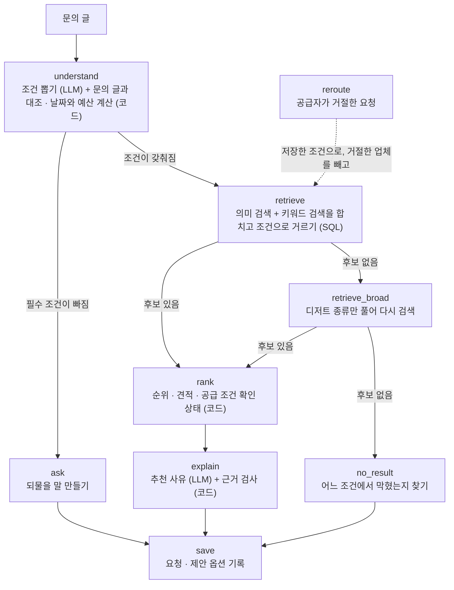
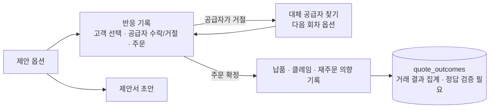

# 자연어 추천·랭킹

> **이 문서는 언제 보나요?** 실제 업체·메뉴 자료를 넣어 "말로 물으면 조건에 맞는 업체를 순위와 견적으로 돌려주는" 기능을 쓸 때, 순위가 어떻게 정해지는지 알고 싶을 때, 공급자가 거절했을 때 대체 공급자를 찾거나 거래 결과를 남길 때. 연구개발계획서의 **안건 2**([기획 03](../../../ddalgiro-tips-task/docs/03_자연어추천랭킹시스템_기획.md))이며, 계획서의 어느 쪽이 어디에 구현됐는지는 [연구개발계획서와 구현 대응](../00-개요/03-연구개발계획서-구현-대응.md)에 있습니다.
>
> 앞 단계: [에이전트 구조와 배포](01-에이전트-구조와-배포.md). 명령은 **K3s 서버**에서 실행합니다. `localhost:8000` 호출 전에는 [API 확인용 연결](01-에이전트-구조와-배포.md#api-확인용-연결)을 켜고, 명령을 실행할 서버 터미널에서 아래처럼 키를 읽습니다.
>
> ⚠️ 실제 수집 계정·운영 카탈로그·EC2·Claude API로 끝까지 확인하지 못했습니다. 로컬 시험 범위는 [버전 고정표](../00-개요/02-준비물과-정할-값.md#5-버전-고정표)를 봅니다.

---

## 1. 문의 한 건이 처리되는 순서



| 단계 | 누가 | 핵심 |
|---|---|---|
| 조건 뽑기 | LLM + 코드 | 문장을 조건 카드로 바꿉니다(2장). 모델이 말하지 않은 값을 채워 넣는 일이 있어, **문의 글에 근거가 없는 값은 코드가 버립니다**. 날짜와 예산 계산은 코드가 합니다 |
| 되묻기 | 코드 | 지역은 항상 필요합니다. 단체주문이면 수량(또는 인원)·받을 날짜·보관 방법도 필요합니다. **수량 20개 이상은 선물·행사도 단체주문**으로 봅니다 |
| 검색 | SQL | 뜻이 가까운 순서와 이름이 문의에 나온 순서를 따로 뽑아 합칩니다. **어기면 안 되는 조건은 두 검색 모두 SQL로 정확히 거릅니다**(3장) |
| 순위 | 코드 | 다섯 신호의 가중합(5장). 결과마다 견적과 공급 조건 확인 상태를 붙입니다 |
| 추천 사유 | LLM + 코드 | DB에서 읽은 사실과 코드가 계산한 값(F1…)만 근거로 2~3문장. [트렌드 브리핑과 같은 검사](02-트렌드-분석-추천.md#7-브리핑을-믿을-수-있게-하는-장치)를 거칩니다 |

## 2. 조건 카드

문의 한 건에서 뽑는 칸입니다. 응답의 `slots`에 그대로 들어 있습니다.

| 칸 | 뜻 | 예 |
|---|---|---|
| `dessert` · `taste` · `diet` | 종류, 맛·식감 표현, 식이 제약(비건·글루텐프리·저당·견과류없음) | `케이크`, `["부드러운"]`, `["비건"]` |
| `region` | 받을 지역 | `강남` |
| `occasion` · `purpose` | 용도(개인·선물·행사·단체주문), 목적(문의에 나온 말 그대로) | `단체주문`, `임직원 간식` |
| `quantity` · `headcount` | 개수, 인원. 개수를 말하지 않았으면 **한 사람에 하나**로 보고 인원을 수량으로 씁니다 | `200` |
| `max_price` · `budget_per_person` · `total_budget` | 1개 가격 상한, 1인 예산, 총예산(원) | `8000` |
| `due_date` | 받을 날짜 | `2026-11-20` |
| `storage` | 받는 곳에서 가능한 보관 방법(상온·냉장·냉동·무관) | `냉장` |
| `individual_packaging` · `gift_packaging` · `tax_invoice` | 개별 포장·선물 포장·세금계산서가 필요한지 | `true` |

**코드가 하는 확인과 계산** (`agent/app/reco/slots.py`)

- **날짜**: 문의에 `2026년 12월 10일`·`12월 10일`·`내일`·`다음 주 금요일` 같은 표현이 하나만 있으면 코드가 계산한 날짜를 씁니다. 모델은 연도를 바꿔 적거나 요일을 틀리게 세는 일이 있기 때문입니다. 한 주는 월요일에 시작한다고 보고, 연도가 없는 날짜가 이미 지났으면 내년으로 봅니다. 날짜가 둘 이상이거나 "다음 주 금요일 전날까지"처럼 추가 계산이 필요하면, 문의에 날짜 표현이 있고 미래의 올바른 날짜 형식일 때만 모델의 답을 남깁니다. **"일주일 뒤"만 적으면 현재 날짜 표현 검사에 걸리지 않아 날짜를 비우고 되묻습니다.**
- **가격 상한**: 1개 가격 상한·1인 예산·(계산한 총예산 ÷ 수량) 중 가장 작은 값을 씁니다. 총예산은 명시값 또는 1인 예산×인원입니다. 예를 들어 100명·200개·1인 8천 원은 총 80만 원이므로 개당 4천 원 이하만 통과합니다. 정수 나눗셈 결과가 0원이어도 상한을 해제하지 않습니다. 저장 직전에도 총예산 초과를 검사합니다.
- **총예산**: 말하지 않았으면 1인 예산 × 인원으로 코드가 계산합니다. 모델이 스스로 곱해 채운 값은 문의에 그 금액이 없으면 버립니다.
- **버리는 값**: 문의에 없는 수량·인원, 돈 이야기가 없는데 뽑힌 가격·예산, 지난 날짜, 문의에 그 말이 없는 보관·포장·세금계산서·목적, 표준 표기 밖의 식이 조건.
- "안 단"처럼 **맛의 취향은 `taste`에 넣어 의미 검색으로** 찾고, "비건"·"저당"처럼 **어기면 안 되는 제약만 `diet`에 넣어 정확히** 거릅니다.

단체주문에서 보관 방법을 묻지 않으려면 `k8s/30-agent-api.yaml`의 `agent-config`에 `RECO_ASK_STORAGE: "false"`를 넣고 [설정 반영·API 재시작](01-에이전트-구조와-배포.md#환경-변수-설정만-바꿀-때)을 합니다.

## 3. 검색 — 어기면 안 되는 조건

| 조건 | 거르는 기준 |
|---|---|
| 영업 여부 | `shops.is_open`이 참인 업체만 |
| 지역 | 업체 지역에 요청한 지역 낱말이 들어 있거나(`강남` → `서울 강남구`), 그 메뉴의 **배송 가능 지역**에 요청 지역이나 `전국`이 있어야 함 |
| 식이 | 요청한 표시를 메뉴가 **모두** 갖고 있어야 함 |
| 가격·예산 | 메뉴 가격이 2장의 가격 상한 이하. 가격을 모르는 메뉴는 빠짐 |
| 보관 | 메뉴에 필요한 설비가 고객 쪽 설비 이하(상온 < 냉장 < 냉동). 상온만 되는 곳에는 냉장 제품과 **보관 방법을 모르는 제품**을 내놓지 않음. `무관`이면 거르지 않음 |
| 선물 포장 | 필요하다고 했으면 가능해야 함 |
| 단체주문: 수량 | 최소 주문 수량 ≤ 수량 ≤ 하루 최대 생산량 |
| 단체주문: 날짜 | 준비 기간(일) ≤ 받을 날까지 남은 날수 |
| 단체주문: 개별 포장·세금계산서 | 필요하다고 했으면 가능해야 함 |

- 공급 조건은 **메뉴(상품)마다** 따로 있습니다. 단체주문에서 **공급 조건이 등록되지 않은 메뉴는 후보에서 빠집니다.** 확인할 수 없는 것을 "가능하다"고 내놓지 않기 위해서입니다.
- 후보가 하나도 없을 때 넓히는 것은 **디저트 종류뿐**입니다. 위 조건은 풀지 않습니다. 넓혀 찾은 결과는 응답의 `broadened`가 `true`이고, 추천 사유에 그 점을 반드시 알립니다.

**의미 검색과 키워드 검색을 합치는 방법** (`agent/app/reco/search.py`)

| 검색 | 줄 세우는 기준 | 잘하는 것 |
|---|---|---|
| 의미 검색 | 문의와 메뉴의 뜻이 가까운 정도(벡터 유사도) | "입에서 녹는 부드러운" 같은 표현 |
| 키워드 검색 | 메뉴·업체 이름과 분류의 낱말(2글자 이상)이 문의 글에 들어 있는 개수 | 업체·메뉴 이름을 콕 집어 말한 문의 |

두 순위표를 **RRF**(순위표마다 `1 ÷ (60 + 순위)`를 더하는 방법)로 합쳐 위에서부터 `RECO_CANDIDATES`개(기본 30)를 후보로 삼습니다. 두 표에 모두 있는 메뉴가 위로 오고, 한쪽에만 있어도 후보에는 듭니다.

### 맞는 업체가 없을 때

조건을 어기는 업체를 대신 보여 주지 않습니다. `status`가 `empty`이고, `blockers`에 **조건 하나만 뺐을 때 맞는 업체 수**가 들어 있습니다.

```json
"blockers": [
  {"condition": "due_date", "label": "받을 날짜(준비 기간)", "shops_if_relaxed": 1},
  {"condition": "tax_invoice", "label": "세금계산서", "shops_if_relaxed": 0}
]
```

- 위 예는 "날짜만 늦추면 한 곳이 맞는다"는 뜻입니다. 고객에게 무엇을 조정할 수 있는지 되물을 때 씁니다.
- 고객이 걸지 않은 조건은 나오지 않습니다. 모두 0이면 조건 여러 개가 함께 막고 있는 것입니다.

## 4. 카탈로그 넣기

추천은 `shops`(업체)·`menus`(메뉴)·`supplier_capacity`(메뉴별 단체주문 공급 조건)에 든 자료 안에서만 합니다. CSV 파일로 넣습니다.

### 4-1. CSV 만들기

저장소의 `agent/catalog.example.csv`를 복사해 채웁니다. 한 줄이 메뉴 하나이고, 같은 업체의 메뉴가 여러 줄이면 업체 칸을 줄마다 똑같이 적습니다.

| 칸 | 필수 | 내용 |
|---|---|---|
| `shop_name` · `region` · `menu_name` | ✅ | 업체 이름, 지역(예: `서울 강남구`), 메뉴 이름 |
| `is_partner` | | 딸기로 입점사면 `Y` |
| `is_open` | | 영업을 끝냈으면 `N` (비우면 영업 중) |
| `rating` · `review_count` · `source_url` | | 평점(0~5), 후기 수, 출처 주소 |
| `category` · `price` · `description` | | 분류(케이크·쿠키…), 1개 가격(원), 설명 |
| `diet_tags` | | `비건;글루텐프리`처럼 `;`로 구분. 쓸 수 있는 값: 비건·글루텐프리·저당·견과류없음 |
| `storage` | | 보관 방법: `상온`·`냉장`·`냉동` 중 하나 |
| `moq` · `max_qty_per_day` · `lead_time_days` | | 그 메뉴의 최소 주문 수량, 하루 최대 생산량, 준비 기간(일) |
| `individual_packaging` · `gift_packaging` · `tax_invoice` | | 가능하면 `Y`, 불가면 `N`, 모르면 비움 |
| `delivery_areas` | | 업체 지역 밖으로 보내 줄 수 있는 지역. `서울;경기 성남시`처럼 `;`로 구분, 어디든 보내면 `전국` |
| `capacity_verified_on` | | 공급자가 위 공급 조건을 확인해 준 날짜(`2026-11-10`). 비우면 "확인 전" |
| `capacity_valid_until` | | 그 값을 믿을 마지막 날짜. 비우면 확인한 날 + 30일 |

- 설명(`description`)이 의미 검색의 재료입니다. "쌀가루로 만든 진한 초콜릿 케이크"처럼 맛·재료·특징을 적을수록 잘 찾습니다.
- ⚠️ 입점사의 공급가·생산량은 영업비밀입니다. CSV 파일을 메일·메신저로 돌리지 않고, 넣은 뒤 서버의 임시 파일을 지웁니다.
- 입점사 목록은 관리자 화면의 상품 목록에서 상품명 앞 `[업체명]`을 기준으로 정리합니다. 비입점 업체를 자동으로 수집·병합하는 기능은 아직 없습니다([대응 문서 8장](../00-개요/03-연구개발계획서-구현-대응.md#8-다음-단계--만들-것과-만드는-방법)).

### 4-2. 넣기

내 맥에서 CSV를 서버로 보냅니다.

```bash
scp ~/Downloads/catalog.csv ddalgiro-ai:/tmp/catalog.csv
```

서버에서 파드 안으로 넣고 실행합니다.

```bash
POD=$(kubectl -n ai-app get pod -l app=agent-api -o jsonpath='{.items[0].metadata.name}')
kubectl -n ai-app cp /tmp/catalog.csv "$POD":/tmp/catalog.csv
kubectl -n ai-app exec "$POD" -- python -m app.jobs.import_catalog /tmp/catalog.csv
kubectl -n ai-app exec "$POD" -- python -m app.jobs.embed_catalog
kubectl -n ai-app exec "$POD" -- rm /tmp/catalog.csv
rm /tmp/catalog.csv
```

- 셋째 줄: `N줄을 넣었습니다`. 형식이 틀린 줄이 있으면 `…번 줄: …`이라고 알리고 **아무것도 넣지 않습니다**. 고쳐서 다시 실행합니다.
- 넷째 줄: `메뉴 N건 임베딩 완료`. 벡터가 있어야 검색에 나옵니다(매일 04:30에도 스스로 채웁니다).
- 마지막 두 줄은 파드 안과 서버의 임시 CSV를 각각 지웁니다. 실패한 경우에도 작업을 마치면 두 위치를 정리합니다.
- 같은 업체·메뉴를 다시 넣으면 새 값으로 덮어씁니다.
- 공급 조건의 빈 칸도 '모름'으로 덮어씁니다. 전부 비워 넣으면 이전 생산량·포장 가능 표시가 남지 않으며, 그 메뉴는 단체주문 후보에서 빠집니다. **확인 날짜를 비우고 다시 넣으면 "확인 전"으로 돌아갑니다.**

### 확인

```bash
AIKEY=$(kubectl -n ai-app get secret agent-secret -o jsonpath='{.data.AI_API_KEY}' | base64 -d)
curl -s localhost:8000/v1/status -H "X-AI-Key: $AIKEY" | python3 -m json.tool | head -12
```

- 응답의 `counts.open_shops`·`counts.menus`가 넣은 수와 맞고 `counts.menus_without_embedding`이 `0`이면 준비된 것입니다.

### 공급 조건의 최신성

생산량·최소 수량·준비 기간은 수시로 바뀝니다. DB의 값이 오래됐으면 실제로는 못 만드는 업체를 제안하게 되므로, **언제 확인한 값인지**를 함께 두고 결과마다 확인 상태(`capacity_check`)를 붙입니다. 단체주문에만 붙습니다.

| `capacity_check.status` | 조건 | 할 일 |
|---|---|---|
| `auto` | 확인됨 + 유효기간 안 | 바로 제안할 수 있습니다 |
| `reconfirm` | 유효기간이 지났거나 확인 전 | 제안하기 전에 공급자에게 다시 확인합니다 |
| `confirm` | 조건은 최신이지만 **대량 주문** | 최종 견적 전에 공급자 확인을 반드시 받습니다 |

- 대량 주문의 기준: 수량이 `CONFIRM_QUANTITY`(기본 100) 이상이거나, 그 메뉴 하루 최대 생산량의 `CONFIRM_LOAD_RATIO`(기본 0.5) 이상. 유효기간의 기본 길이는 `CAPACITY_VALID_DAYS`(기본 30일)입니다. 셋 다 처음 정한 값이며 `agent-config`에서 바꿉니다.
- `reconfirm`인 메뉴는 후보에서 빼지 않습니다. 대신 순위의 공급 능력 점수를 절반만 믿습니다(5장).
- 공급자에게 확인했으면 표시합니다. 그 업체의 모든 메뉴가 오늘 날짜로 "확인됨"이 되고 유효기간이 새로 잡힙니다.

  ```bash
  curl -s localhost:8000/v1/suppliers/capacity/confirm -H "X-AI-Key: $AIKEY" -H 'Content-Type: application/json' \
    -d '{"shop_id":5}'; echo
  ```

  - `menu_id`를 함께 주면 그 메뉴만, `valid_days`를 주면 그 날수만큼 유효합니다. `"status":"pending"`은 "재확인을 요청해 둠"만 표시합니다(유효기간은 그대로).
  - 생산량·준비 기간 같은 **값이 바뀌었으면** CSV로 다시 넣습니다. 이 호출은 확인 날짜만 고칩니다.

## 5. 불러 보기와 응답 읽기

```bash
curl -s localhost:8000/v1/recommend -H "X-AI-Key: $AIKEY" -H 'Content-Type: application/json' \
  -d '{"text":"다음 주 금요일 임직원 200명 간식, 1인 8천 원, 개별 포장, 세금계산서 필요, 강남 수령. 냉장 보관 가능합니다"}' \
  | python3 -m json.tool
```

| 칸 | 뜻 |
|---|---|
| `status` | `ok`(결과 있음) / `reask`(되묻기) / `empty`(조건에 맞는 업체 없음) |
| `slots` | 뽑은 조건(2장). 화면에 "이렇게 이해했습니다"로 보여 주면 잘못 이해한 것을 바로 알 수 있습니다 |
| `question` | `reask`일 때 되물을 말 |
| `blockers` | `empty`일 때 막힌 조건(3장) |
| `broadened` | 종류 조건을 풀어 찾았으면 `true` |
| `round` | 제안 회차. 처음은 1, 대체 공급자를 찾을 때마다 1씩 늘어납니다 |
| `audit` | 쓴 가중치 묶음(`profile`)과 입점사 가산 뒤 상위 보존율(`preservation`) |
| `results[].score` · `score_detail` | 최종 점수(0~1)와 신호별 점수·가중치·입점사 가산. 순위의 이유를 그대로 확인할 수 있습니다 |
| `results[].quote` | 견적: 수량 × 1개 가격 = 합계, 총예산과 그 안에 드는지. 수량이나 가격을 모르면 `null` |
| `results[].capacity_check` | 공급 조건 확인 상태와 안내 문장(4장) |
| `results[].region_match` | 지역이 맞은 방식: `local`(그 지역 업체) / `delivery`(그 지역으로 배송) / `nationwide`(전국 배송뿐) |
| `results[].reason` · `citations` | 추천 사유와 근거. 값이 DB에 없으면 "확인된 값 없음(담당자 확인 필요)"로 나옵니다 |
| `results[].quote_option_id` | 이 제안 옵션의 번호. 반응을 기록할 때 씁니다 |

위 문의를 샘플 데이터에 물으면 `(샘플) 떡하니`의 과일 찹쌀떡 한 건이 나오고, `quote`는 `200개 × 3500원 = 700000원`(총예산 `1600000`원 이내), `capacity_check.status`는 `confirm`(200개는 대량 주문)입니다.

### 되물음에 답하기

서버는 대화를 기억하지 않습니다. `reask`를 받으면 **원래 문의 뒤에 답을 이어 붙여** 다시 보냅니다.

```bash
curl -s localhost:8000/v1/recommend -H "X-AI-Key: $AIKEY" -H 'Content-Type: application/json' \
  -d '{"text":"다음 주 금요일 임직원 200명 간식, 1인 8천 원, 강남 수령"}' | python3 -m json.tool | head -8
curl -s localhost:8000/v1/recommend -H "X-AI-Key: $AIKEY" -H 'Content-Type: application/json' \
  -d '{"text":"다음 주 금요일 임직원 200명 간식, 1인 8천 원, 강남 수령. 냉장 보관 가능합니다"}' | python3 -m json.tool | head -8
```

- 첫 호출: `"status": "reask"`, `"question": "받으시는 곳에서 냉장 보관이 가능한가요? (상온만 가능 / 냉장 가능 / 냉동 가능 / 상관없음)"`
- 둘째 호출: `"status": "ok"`.

### 순위 계산

`점수 = 적합도×w + 품질×w + 지역·배송×w + 공급 능력×w + 트렌드×w (+ 입점사 가산)`

| 신호 | 계산 | 기본 | 선물 | 단체주문 |
|---|---|---|---|---|
| 적합도 | 벡터 유사도 + 이름이 문의에 나온 낱말 하나에 0.1(세 낱말까지) | 0.50 | 0.45 | 0.40 |
| 품질·평판 | 평점. 후기가 적으면 기준 평점(3.5) 쪽으로 당김 | 0.25 | 0.35 | 0.15 |
| 지역·배송 | 그 지역 업체 1.0 / 그 지역으로 배송 0.8 / 전국 배송뿐 0.6 | 0.10 | 0.10 | 0.15 |
| 공급 능력 | 단체주문에서 하루 생산량 대비 여유. 공급 조건이 오래됐으면 절반. 그 밖에는 모두 1 | 0.05 | 0.05 | 0.20 |
| 트렌드 | 메뉴 이름·설명에 든 키워드의 [트렌드 점수](02-트렌드-분석-추천.md#2-점수와-확산-단계) | 0.10 | 0.05 | 0.10 |

- **적합도 높은 순서를 먼저 지키고**, 같은 적합도 안에서 다섯 신호의 가중 점수로 정렬합니다. 동점은 고정 번호로 정하므로 입력 순서에 흔들리지 않습니다.
- **입점사 가산**은 최대 `+0.03`이며 점수 내역에 따로 남깁니다. 적합도 순서를 뒤집지 못하고, 표시할 상위 결과의 보존율이 95%보다 낮아지면 그 요청의 가산을 철회합니다(`boost_withheld=true`). 결과 5개에서는 다섯 업체 모두 보존해야 합니다.
- **상위 보존율**(`audit.preservation`): 같은 적합도 우선 정렬에서 가산 전 상위 업체가 가산 후에도 남은 비율입니다. 요청마다 기록하고 평균은 `GET /v1/kpi`에서 봅니다.
- 업체마다 적합도·가중 점수 순서로 가장 앞선 메뉴 하나만 남깁니다.
- 가중치는 `agent/app/reco/ranking.py`, 가산 상한은 `agent/app/settings.py`의 `PARTNER_BOOST_CAP`에 있습니다. 가중치는 처음 정한 규칙값이며, 거래 기록이 쌓이면 그 자료로 다시 맞춥니다.

## 6. 제안한 뒤 — 반응·대체 공급자·제안서·납품



### 반응 기록

```bash
curl -s localhost:8000/v1/recommend/feedback -H "X-AI-Key: $AIKEY" -H 'Content-Type: application/json' \
  -d '{"quote_option_id":1,"action":"supplier_declined","reason":"그 주 휴무"}'; echo
```

| `action` | 누가 | 뜻 |
|---|---|---|
| `selected` · `rejected` | 고객 | 옵션을 고름 · 버림 |
| `supplier_accepted` · `supplier_declined` | 공급자 | 공급 가능 · 불가(사유는 `reason`) |
| `ordered` | — | 주문 확정 |

응답의 `request_id`는 그 옵션이 속한 요청 번호입니다.

### 대체 공급자 찾기

공급자가 거절했으면, 저장해 둔 조건으로 **거절했거나 고객이 버린 업체를 빼고** 다시 찾습니다. 조건을 다시 뽑지 않으므로 문의를 다시 보낼 필요가 없습니다.

```bash
curl -s -X POST localhost:8000/v1/recommend/1/reroute -H "X-AI-Key: $AIKEY" | python3 -m json.tool | head -20
```

- 응답은 처음 추천과 같은 모양이고 `round`가 1 늘어납니다. 남은 업체가 없으면 `empty`와 `blockers`가 돌아옵니다.
- 추천 결과가 있던 요청만 됩니다. 되묻기·결과 없음으로 끝난 요청은 `409`입니다.

### 제안서 초안

- 추천 당시의 조건·사실·URL은 `quote_options.snapshot`·`citations`에 저장하고 제안서에 출처를 유지합니다. `GET /v1/recommend/options/{옵션번호}`로 다시 읽습니다. 카탈로그가 바뀌어도 당시 값이 유지되며, 근거 없는 옛 옵션의 제안서는 409로 거절하므로 새로 추천받습니다.

가장 최근 회차의 옵션을 고객에게 보낼 글 하나로 묶습니다. 모델을 부르지 않고, 저장해 둔 견적과 추천 사유를 그대로 씁니다.

```bash
curl -s -X POST localhost:8000/v1/recommend/1/proposal -H "X-AI-Key: $AIKEY" | python3 -c "import sys,json; print(json.load(sys.stdin)['body'])"
curl -s localhost:8000/v1/recommend/proposals/1/outcome -H "X-AI-Key: $AIKEY" -H 'Content-Type: application/json' \
  -d '{"outcome":"adopted"}'; echo
```

- 첫 줄: 옵션마다 `견적: 200개 × 3,500원 = 700,000원`, 공급 조건 안내, 추천 사유가 든 초안. 견적 값이 없는 옵션은 "담당자 확인이 필요합니다"라고 나옵니다. 담당자가 다듬어 보냅니다.
- 둘째 줄: 고객이 채택했는지(`adopted`·`not_adopted`)를 남깁니다.

### 납품·CS 기록

```bash
curl -s localhost:8000/v1/recommend/feedback -H "X-AI-Key: $AIKEY" -H 'Content-Type: application/json' \
  -d '{"quote_option_id":2,"action":"supplier_accepted","event_key":"accept-001"}'; echo
curl -s localhost:8000/v1/recommend/feedback -H "X-AI-Key: $AIKEY" -H 'Content-Type: application/json' \
  -d '{"quote_option_id":2,"action":"ordered","order_ref":"ORDER-001","event_key":"order-001"}'; echo
curl -s localhost:8000/v1/recommend/delivery -H "X-AI-Key: $AIKEY" -H 'Content-Type: application/json' \
  -d '{"quote_option_id":2,"event":"delivered","order_ref":"ORDER-001","event_key":"delivery-001"}'; echo
unset AIKEY
```

- `event`: `delivered`(납품 완료) · `delayed`(지연) · `claim`(클레임) · `reorder_intent`(재주문 의향).
- `quote_outcomes.tradable`은 추천 당시 제약 통과 기록 + 최종 공급자 수락 + 그 수락 이후 주문 확정 + 같은 주문 번호의 납품 완료가 모두 있어야 참입니다. 수락 뒤 거절은 거래 가능으로 세지 않습니다.

반응과 납품 API의 상태 규칙입니다.

- 고객 선택·거절과 공급자 수락·거절은 각 범주의 **마지막 의사**를 사용합니다.
- `ordered`에는 최종 공급자 수락과 `order_ref`가 필요합니다. 납품·CS 기록은 수락 이후 확정된 같은 `order_ref`에만 붙일 수 있습니다. 순서·주문 번호가 틀리면 409입니다.
- `event_key`는 같은 전송을 재시도할 때 유지합니다. 같은 키·같은 내용은 기존 번호를 반환하고 다른 내용은 409입니다. 키가 없어도 같은 최종 의사·주문·납품 완료의 단순 반복은 중복 저장하지 않습니다.
- 제안서는 공급자 확인이 필요한 옵션을 명시한 **초안**입니다. 주문 확정 API에서 공급자의 최종 수락을 확인합니다.

## 7. 알아 둘 한계

| 한계 | 영향 | 지금 할 수 있는 것 |
|---|---|---|
| 조건 뽑기는 모델의 이해력에 달려 있음 | 드물게 조건을 놓치거나 다른 칸에 넣음 | 화면에 `slots`를 보여 주고 직원이 확인 |
| 문의 글과 근거 문장이 Claude API로 전달됨 | 문의에 적은 이름·연락처·회사명, 추천 사유에 쓰는 공급 조건이 서버 밖으로 나감 | 문의에는 조건만 적음. 나가는 글과 지킬 것은 [Claude API 문서 5장](../02-Claude-API/01-Claude-API-키와-모델.md#5-무엇이-서버-밖으로-나가나) |
| Claude API가 멈추거나 한도에 걸리면 조건을 뽑지 못함 | 추천이 `502`로 실패. 추천 사유는 코드가 만든 글로 대신 나감 | 잠시 뒤 다시 시도. 원인은 [Claude API 문서 8장](../02-Claude-API/01-Claude-API-키와-모델.md#8-문제-해결) |
| 추천 사유는 근거 문장을 그대로 선택 | 자유로운 요약·바꿔 쓰기는 허용하지 않음. 원자료 자체가 틀릴 수 있음 | 원자료의 최신성과 정확도를 직원이 확인 |
| 지역은 낱말 포함으로 비교 | 거리를 계산하지 않음. 배송 가능 지역이 `서울`인 메뉴는 요청이 `강남`이면 맞지 않고 `서울 강남구`면 맞음 | 지역 표기를 `시 구` 형식으로 통일 |
| 수량은 하루 생산량과만 비교 | 여러 날에 나눠 만드는 경우를 모름 | 큰 주문은 직원이 업체에 확인 |
| 인원만 말하면 한 사람에 하나로 봄 | 한 사람에 여러 개가 필요한 주문은 수량이 모자람 | 개수를 함께 말함 |
| 한글로 쓴 수량·금액("이백 개", "팔천 원") | 수량은 인정하지 않고 되물음. 한글 금액은 모델의 답을 그대로 씀 | 숫자로 다시 답함 |
| 공급 조건은 DB에 적힌 값 | 공급자의 실제 사정과 다를 수 있음 | `capacity_check`가 `reconfirm`·`confirm`이면 공급자에게 확인 |
| 키워드 검색은 낱말이 그대로 들어 있는지만 봄 | 줄임말·오타는 못 잡음(의미 검색이 일부 메움) | 메뉴 이름을 고객이 부르는 말로 적음 |

## 8. 문제 해결

| 증상 | 원인과 해결 |
|---|---|
| 항상 `empty` | `blockers`에서 어느 조건이 막는지 봅니다. `GET /v1/status`의 `menus_without_embedding`이 0인지(4-2의 임베딩), 지역 표기가 맞는지도 확인 |
| 영업 중인 업체가 안 나옴 | CSV의 `is_open`이 `N`이거나, 단체주문인데 그 메뉴의 공급 조건이 비어 있거나, 보관 조건을 걸었는데 `storage`가 비어 있습니다 |
| 결과마다 `reconfirm` | 공급 조건의 확인 날짜가 없거나 유효기간이 지났습니다. 공급자에게 확인하고 4장의 확인 표시를 합니다 |
| 받을 날짜가 엉뚱함 | 문의에 날짜가 둘 이상이거나 "전날까지"처럼 한 번 더 계산해야 하는 표현이면 모델의 답을 씁니다. `2026-12-10`처럼 날짜 하나를 분명히 적어 다시 보냅니다 |
| `502 문의를 이해하지 못했습니다` | 모델이 양식에 맞는 답을 내지 못했습니다. 다시 시도하고, 반복되면 `kubectl -n ai-app logs deployment/agent-api`와 게이트웨이 상태를 봅니다 |
| 추천 사유가 `template`으로만 나옴 | 모델의 글이 근거 검사에 계속 걸리는 것입니다. 사실만 나열한 글이 대신 나가지만 원자료의 오류까지 막지는 못합니다. API 장애·근거 검사 실패를 구분하고 모델을 바꿔 비교합니다 |
| 응답이 수십 초 걸림 | 결과마다 추천 사유를 만드느라 모델을 여러 번 부릅니다. 결과 수 설정 `RECO_RESULTS`(기본 5 — `k8s/30-agent-api.yaml`의 `agent-config`에 `RECO_RESULTS: "3"`처럼 넣음)를 줄이거나 [배포 문서 6장](01-에이전트-구조와-배포.md#6-문제-해결)의 생각 과정 옵션을 봅니다 |

다음: [보안 그룹과 HTTPS](../05-외부-공개/01-보안-그룹과-HTTPS.md)
