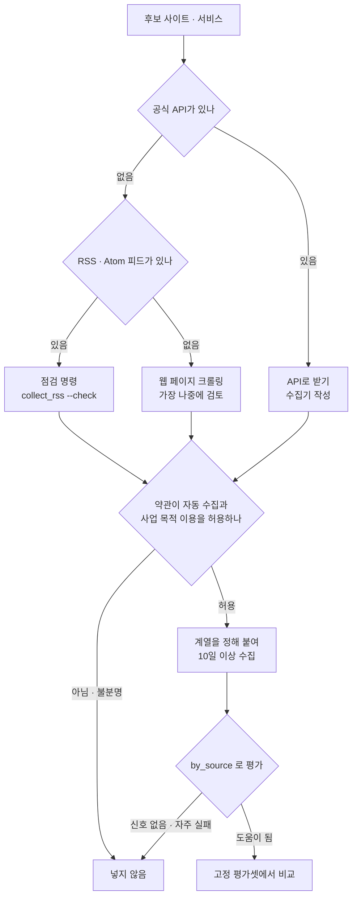

# 수집 출처 고르기와 추천 목록

> **이 문서는 언제 보나요?** 네이버 말고 어떤 사이트·피드·API를 더 모을지 정할 때, 후보 하나를 넣어도 되는지 따져 볼 때, 붙여 둔 출처를 계속 쓸지 판단할 때. 붙이는 명령은 [트렌드 분석·추천 5장](02-트렌드-분석-추천.md#5-수집-출처-넓히기--인스타그램rss크롤링)에 있습니다.
>
> ⚠️ 2장 추천 목록의 "점검 결과"는 **2026-11-15에 내 맥에서 후보 25개 주소를 한 번씩 본 값**입니다(robots.txt 허용 여부, 날짜가 읽히는지, 하루치를 셀 수 있는지). **이용 약관은 확인하지 않았습니다.** 목록에 있다고 바로 넣지 말고 1-4의 약관 확인을 거칩니다.

---

## 1. 고르는 순서



### 1-1. 받는 방법의 우선순위

| 순위 | 방법 | 이유 |
|---|---|---|
| 1 | **공식 API** | 허용 범위와 한도가 문서에 있고, 형식이 갑자기 바뀌지 않습니다 |
| 2 | **RSS·Atom 피드** | 사이트가 기계에게 읽으라고 내주는 새 글 목록입니다. 설정만 넣으면 됩니다 |
| 3 | 웹 페이지 크롤링 | 위 둘이 없을 때만 검토합니다 |
| ✗ | 로그인해야 보이는 화면, 앱이 내부적으로 쓰는 주소, 개인이 쓴 글의 본문·작성자 | 모으지 않습니다 |

- **웹 페이지 크롤링**: 사람이 보는 화면은 수시로 바뀌어 수집기가 자주 깨지고, 약관이 막는 경우가 많습니다.

### 1-2. 후보를 점수로 견주기

후보마다 여섯 가지를 0~2점으로 매겨 더합니다. **"날짜별로 셀 수 있나"와 "허용이 분명한가"가 0점이면 합계와 상관없이 뺍니다.**

| 기준 | 2점 | 1점 | 0점 |
|---|---|---|---|
| 새 신호인가 | 지금 없는 계열의 신호(SNS·영상·구매·해외) | 같은 계열의 다른 출처(한쪽이 끊길 때의 대체) | 이미 모으는 것과 거의 같음 |
| 날짜별로 셀 수 있나 | 모든 글에 날짜가 있고 최신순으로 빠짐없이 줌 | 날짜는 있지만 하루 이틀치만 담김 | 날짜가 없거나, 관련도순으로 일부만 줌 → **제외** |
| 허용이 분명한가 | 공식 API의 허용 범위 또는 약관이 이 수집·보관·사업 이용을 허용 | robots.txt는 허용, 약관은 확인 중 → **도입 보류** | robots.txt나 약관이 금지 → **제외** |
| 디저트 신호가 진한가 | 키워드로 골라 받거나, 디저트·베이커리 전문 | 식품·외식 전반 | 일반 |
| 안정적인가 | 한도·형식이 문서로 공개됨 | 문서는 없지만 오래 유지된 피드 | 자주 바뀜 |
| 드는 수고 | 설정만 넣으면 됨 | 수집기를 새로 써야 함 | 심사·제휴가 먼저 필요 |

- **이용 허용이 확인된 후보 중에서** 합계 9점 이상을 먼저 붙이고, 6~8점이면 다음 차례로 둡니다. 약관 확인 중이면 점수가 높아도 도입을 보류합니다. 점수가 비슷하면 대체 출처가 되는 것을 먼저 둡니다.
- 출처를 늘리는 목적은 두 가지입니다. ① 네이버가 끊겨도 같은 신호를 받을 **대체 출처** ② 글·검색 말고 **다른 계열의 신호**. 둘 다 아니면 붙일 이유가 약합니다.

### 1-3. 기계로 점검하기

피드 주소를 넣으면 "읽어도 되는지, 하루치를 셀 수 있는지"를 봅니다. DB에 아무것도 넣지 않습니다. **K3s 서버**에서 실행합니다.

```bash
kubectl -n ai-app exec deployment/agent-api -- python -m app.jobs.collect_rss --check \
  "https://example.com/feed.xml" "https://example.com/search.rss?q=소금빵"
```

- 검색 피드(`{keyword}`가 든 주소)는 그 자리에 실제 키워드를 넣은 주소로 점검합니다.
- 후보마다 `[사용 가능]`·`[사용 불가]`와 글 수·날짜 범위·온전한 날수·하루 평균 글 수가 나옵니다. 사용 불가인 후보가 하나라도 있으면 명령이 종료 코드 1로 끝나 `command terminated with exit code 1`이 붙는데, 점검 결과를 알리는 정상 동작입니다.

| 나오는 말 | 뜻 | 할 일 |
|---|---|---|
| `하루 한 번 수집으로 충분하다` | 피드에 이틀 이상의 기간이 담겨 있습니다 | 약관 확인으로 넘어갑니다 |
| `담긴 기간이 이틀이 안 된다` | 하루라도 수집을 놓치면 그날이 빕니다 | 넣더라도 실패 알림을 챙깁니다 |
| `온전한 하루의 글이 없다` | 글이 너무 많아 최근 몇 시간만 담기는 피드입니다 | 넣지 않습니다(하루 한 번으로는 셀 수 없음) |
| `날짜를 읽을 수 없는 글이 있어…` | 글에 날짜가 없거나 모르는 형식입니다 | 넣지 않습니다 |
| `robots.txt 가 자동 수집을 막았거나…` | 사이트가 자동 수집을 막았거나 robots.txt를 받지 못했습니다 | 넣지 않습니다. 일시 오류로 보이면 나중에 다시 점검합니다 |
| `피드로 읽을 수 없거나 글이 없다` | 주소가 피드가 아니거나 비어 있습니다 | 주소를 다시 확인합니다 |
| `받지 못했다 — …` | 연결·응답 오류입니다 | 주소와 사이트 상태를 확인하고 다시 점검합니다 |

기계가 확인하지 못하는 것이 둘 있습니다.

- **약관** — 1-4에서 사람이 봅니다.
- **최신순으로 빠짐없이 주는지** — 검색 결과를 관련도순으로 몇 건만 주는 피드는 `[사용 가능]`으로 나와도 하루치를 셀 수 없습니다. 글이 열 건 남짓인데 날짜 범위가 몇 달~몇 해면 이런 피드입니다.

### 1-4. 약관에서 볼 것

| 볼 것 | 넣으면 안 되는 경우 |
|---|---|
| 자동 수집(크롤링·스크래핑·로봇) 조항 | 자동화된 수단의 접근을 금지 |
| 이용 목적 | 개인적·비영리 이용만 허용(이 수집은 사업 목적입니다) |
| 피드 이용 조건 | 피드를 다른 서비스의 자료로 쓰는 것을 금지 |
| 저작권 | 제목·주소·요약 일부의 보관도 허락을 요구 |
| 개인정보 | 글쓴이 정보가 함께 내려와 지울 수 없음 |

확인한 날짜와 판단을 [대응 문서 4장](../00-개요/03-연구개발계획서-구현-대응.md#4-데이터-소스-13쪽)의 표에 한 줄로 적습니다. 판단이 서지 않으면 넣지 않거나 그 매체에 문의합니다.

### 1-5. 붙인 뒤 — 계속 쓸지 정하기

새 출처는 최근 10일 수집이 완료되면 정규화한 계열 지수에 포함됩니다. 원래 건수를 곧바로 더하지 않고 같은 기간의 출처 묶음을 고정합니다. [트렌드 상세](02-트렌드-분석-추천.md#6-결과-읽기)의 `score.by_source`에서 사용 출처·계열과 증가율을 확인합니다. 두 계열이 남으면 네이버 장애 때도 계속 계산하며, RSS+Instagram만 있는 경로도 시험했습니다.

| 볼 것 | 계속 쓰는 경우 | 그만두는 경우 |
|---|---|---|
| 그 출처가 `sources`에 나오나 | 대부분의 키워드에 나옴 | 10일이 지나도 안 나옴(수집이 자주 빠짐) |
| `total_7d` | 키워드에 걸리는 글이 꾸준히 있음 | 한 달 내내 0에 가까움(그 매체는 디저트를 거의 다루지 않음) |
| 증가율이 움직이는 때 | 기본 출처보다 먼저, 또는 함께 움직임 | 무관하게 출렁임 |
| 작업 로그 | 실패 없음 | robots.txt·약관이 바뀌어 막힘 → 바로 뺌 |

출처별 기여도를 정식으로 평가하는 방법은 [대응 문서 8장](../00-개요/03-연구개발계획서-구현-대응.md#8-다음-단계--만들-것과-만드는-방법)에 있습니다.

## 2. 추천 목록

### 2-1. 먼저 붙일 것 — 공식 API

1-2의 기준으로 1~4번은 9점 이상이고, 5번은 쓸 수 있게 열리면 다시 매깁니다. 순서는 "끊겼을 때의 대체 출처 → 새 계열의 신호 → 문서 확인이나 신청이 남은 것"입니다.

| 순위 | 출처 | 계열 | 주는 신호 | 확인한 것 (2026-11-15, 공식 문서) | 할 일 |
|---|---|---|---|---|---|
| 1 | **카카오(다음) 검색 API** — 블로그·카페 | 글 | 네이버 블로그의 **대체 출처**이자, 네이버 API로는 날짜를 못 받는 카페 글 | 글마다 작성 시각(`datetime`)이 있고 최신순 정렬 가능. 한 쪽 50건·50쪽까지 | 카카오 개발자 앱의 REST API 키를 받고, 네이버 수집기와 같은 모양으로 `collect_kakao.py`를 씁니다 |
| 2 | **인스타그램 해시태그** | SNS | 게시물 수·좋아요·댓글 = 확산 속도 | 수집기 있음([트렌드 5-1](02-트렌드-분석-추천.md#5-1-인스타그램-해시태그)). 7일에 해시태그 30개 | Meta 앱 심사를 신청하고 실제 계정으로 확인합니다 |
| 3 | **유튜브 Data API** | SNS(영상) | 키워드의 새 영상 수·조회 수 | [공식 쿼터](https://developers.google.com/youtube/v3/determine_quota_cost): `search.list`는 기본 하루 100회, 추가 페이지도 각각 1회 소모 | 키워드마다 한 페이지만 받을 때 최대 100개입니다 |
| 4 | 네이버 데이터랩 **쇼핑인사이트** | 구매 관심(클릭) | 쇼핑 분야·키워드의 클릭 추이. 실제 주문·매출은 아님 | [공식 문서](https://developers.naver.com/docs/serviceapi/datalab/shopping/shopping.md): 하루 1,000회, `period`·`ratio`(상대 비율). 문서만 확인, 실제 호출은 미확인 | 애플리케이션의 쇼핑인사이트 이용 설정·키를 확인하고 별도 수집기를 만듭니다 |
| 5 | 구글 트렌드 API | 검색 | 국내외 검색 관심도(해외에서 먼저 뜨는 것) | 알파 단계이며 신청해서 뽑힌 개발자만 씁니다 | 신청해 두고, 열리면 데이터랩의 대체 출처로 붙입니다 |

- **카카오(다음) 검색 API**: 하루 한도는 블로그·카페 각 30,000건입니다. 다음 검색 전체 50,000건이라는 줄과의 관계는 문서에서 분명하지 않습니다.
- **유튜브 Data API**: 하루 전체를 세려면 페이지 수와 재시도 여유를 반영해 키워드를 줄이고, 잘린 날은 완료로 세지 않습니다.
- **쇼핑인사이트**: 응답은 JSON이며, `ratio`는 조회 구간 최댓값을 100으로 둔 상대 비율입니다.
  - 조회 범위가 바뀌면 상대 척도도 달라지므로 원요청 범위를 함께 보관합니다.
  - 지금의 계산은 글·검색·SNS 세 계열만 쓰므로, 구매 관심을 새 계열로 넣으려면 `agent/app/trend/signals.py`도 고칩니다.

### 2-2. 설정만 넣으면 되는 것 — 매체 피드

모두 점검 명령에서 `[사용 가능]`이 나온 피드입니다. **약관을 확인한 것만** [`RSS_FEEDS`](02-트렌드-분석-추천.md#5-2-rss웹-피드)에 넣습니다. 1-2의 기준으로 국내 업계지는 8점, 해외 디저트 전문 매체는 10점이며, 약관이 허용으로 확인되면 1점씩 오릅니다.

| 묶음 | 매체 | 피드 주소 | 점검 결과 (2026-11-15) |
|---|---|---|---|
| 국내 식품·외식 업계지 | 식품음료신문 | `https://www.thinkfood.co.kr/rss/allArticle.xml` | 50건, 온전한 날 5일, 하루 7.6건 |
| | 식품외식경제 | `https://www.foodbank.co.kr/rss/allArticle.xml` | 50건, 16일, 하루 2.8건 |
| | 식품저널 | `https://www.foodnews.co.kr/rss/allArticle.xml` | 50건, 3일, 하루 13.7건 |
| | 소믈리에타임즈 | `https://www.sommeliertimes.com/rss/allArticle.xml` | 50건, 10일, 하루 4.7건 |
| | 푸드아이콘 | `https://www.foodicon.co.kr/rss/allArticle.xml` | 50건, 3일, 하루 12.0건 |
| 해외 디저트·베이커리 전문 | Pastry Arts Magazine | `https://pastryartsmag.com/feed/` | 10건, 24일, 하루 0.3건 |
| | so good.. magazine | `https://www.sogoodmagazine.com/feed/` | 10건, 17일, 하루 0.5건 |
| | bake magazine | `https://www.bakemag.com/rss/articles` | 30건, 8일, 하루 3.5건 |
| 해외 음식 매체 | Eater | `https://www.eater.com/rss/index.xml` | 10건, 9일, 하루 0.9건 |
| | Bon Appétit | `https://www.bonappetit.com/feed/rss` | 30건, 6일, 하루 4.7건 |
| 일본 식품 업계지 | 食品産業新聞社 | `https://www.ssnp.co.jp/feed/` | 30건, 3일, 하루 9.7건 |

- **국내 업계지**는 신제품 출시·업계 동향을 다룹니다. 소비자 글보다 수는 적지만 "업계가 다루기 시작했다"는 공급 쪽 신호입니다. 하루 글이 많은 식품저널·푸드아이콘은 담긴 기간이 3일뿐이라 수집을 이틀 놓치면 빕니다.
- **해외 매체**는 계획서가 기대하는 "6~12개월 앞선 신호"의 후보입니다. 실제 선행 기간은 아직 재지 않았습니다. 글이 외국어이므로 **키워드에 다른 표기를 넣어야** 셉니다.

  ```bash
  curl -s localhost:8000/v1/keywords -H "X-AI-Key: $AIKEY" -H 'Content-Type: application/json' \
    -d '{"term":"두바이초콜릿","aliases":["Dubai chocolate","ドバイチョコ"]}'; echo
  ```

  - 매체 피드는 제목·요약에 키워드나 다른 표기가 든 글만 셉니다. 띄어쓰기와 영문 대소문자는 무시합니다(`두바이 초콜릿`도 `두바이초콜릿`의 글).
  - 다른 표기를 보내지 않은 수정에서는 기존 값이 그대로 남습니다.
  - 위 명령은 K3s 서버에서 [API 확인용 연결](01-에이전트-구조와-배포.md#api-확인용-연결)과 `AIKEY` 변수를 준비한 뒤 실행합니다.
- 처음에는 **국내 업계지 2~3곳과 해외 디저트 전문 1~2곳**만 넣고, 1-5의 평가를 본 뒤 늘립니다. 피드가 많을수록 수집 시간과 관리할 약관이 늘어납니다.

### 2-3. 점검에서 빠진 것

| 후보 | 뺀 이유 (2026-11-15) |
|---|---|
| 구글 뉴스 검색 피드 (`news.google.com/rss/search`) | robots.txt가 자동 수집을 막음 |
| 뉴스와이어 (`www.newswire.co.kr/rss`) | robots.txt에 `Disallow: /rss` |
| Bing 뉴스 검색 피드 | 관련도순으로 11건만 주고 날짜가 2024~2026년에 흩어져 있어 하루치를 셀 수 없음 |
| The Kitchn, PR TIMES | 글이 너무 많아 최근 몇 시간만 담김 |
| Serious Eats | 403(자동 요청 거부) |
| `thebuyer.co.kr` | robots.txt가 막음 |
| `kfoodtimes.com` | 점검은 통과했지만 어떤 매체인지 확인하지 못해 목록에 올리지 않음 |
| `foodtoday.or.kr`, `cooknchefnews.com`, `bakery.co.kr`, `entabe.jp` | 흔한 피드 주소(`/rss/allArticle.xml`, `/feed`)에 피드가 없음. 사이트에서 피드 주소를 찾으면 다시 점검 |

- **뉴스와이어**: `api.` 주소의 피드는 열려 있지만 하루 남짓만 담기고, 같은 회사가 `www`에서는 막고 있어 약관·문의 확인이 먼저입니다.

### 2-4. 웹 페이지 크롤링 후보 — 다른 길부터

| 후보 | 주는 신호 | 권하는 길 |
|---|---|---|
| 편의점 신상품 안내(CU·GS25·세븐일레븐 등) | 유행이 대중 상품으로 넘어온 시점 | 약관 확인 뒤 [절차](02-트렌드-분석-추천.md#5-3-피드가-없는-사이트를-크롤링해야-할-때)대로 사이트별 수집기를 씁니다 |
| 배달앱 인기 메뉴 | 실제로 주문되는 현장 인기 | 화면 크롤링은 약관을 확인하기 전에는 하지 않습니다. 제휴나 사업자용 공식 자료를 먼저 알아봅니다 |
| 커뮤니티 게시판 | 입소문 | 개인이 쓴 글이라 직접 모으지 않습니다. 카카오 검색 API의 카페 글 수로 대신합니다 |
| 인스타그램·틱톡의 웹 화면 | 확산 속도 | 화면 크롤링은 하지 않습니다. 공식 API만 씁니다 |
| 지도·플레이스 화면 | 업체 정보(안건 2 카탈로그) | 카카오 로컬·네이버 지역 검색 같은 공식 API와 공공데이터(인허가)를 씁니다 |

- **편의점 신상품 안내**: 피드가 없어 크롤링이 필요합니다. 신상품 보도는 네이버 뉴스로도 잡히므로 급하지 않습니다.

## 3. 문제 해결

| 증상 | 원인과 해결 |
|---|---|
| 점검은 `[사용 가능]`인데 수집 뒤 글 수가 늘 0 | 그 매체가 키워드를 다루지 않거나, 표기가 다릅니다. 외국 매체면 다른 표기(`aliases`)를 넣습니다 |
| 점검 때와 달리 수집이 `robots.txt 가 … 막았습니다`로 실패 | 사이트가 규칙을 바꿨습니다. 피드 목록에서 뺍니다. 점검은 넣기 전뿐 아니라 가끔 다시 합니다 |
| 내 맥에서는 되는데 서버에서 403 | 사이트가 요청의 이름표(`CRAWL_USER_AGENT`)나 서버 IP를 막은 것입니다. 우회하지 않고 뺍니다 |
| 점검 결과의 날짜가 하루 어긋남 | 시간대 없이 날짜를 적는 피드는 한국 시각으로 봅니다. 그런 외국 피드는 하루까지 어긋날 수 있습니다 |

다음: [자연어 추천·랭킹](03-자연어-추천-랭킹.md)
