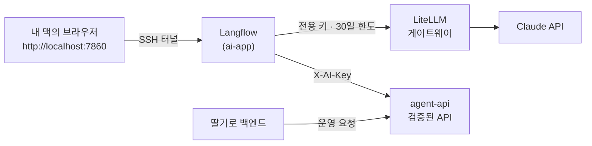

# 노코드 도구 Langflow

> **이 문서는 언제 보나요?** 코드를 짜지 않고 화면에서 블록을 이어 LLM 흐름을 만들어 보고 싶을 때 — 지시문과 모델을 견줘 보는 실험, 챗 화면 시제품, 직원용 내부 도구. **보조 도구**이며, 넣지 않아도 나머지는 그대로 돕니다. 끝나면 내 맥의 브라우저에서 Langflow를 열어, 게이트웨이의 모델과 에이전트 API를 쓰는 흐름을 돌릴 수 있습니다.
>
> 앞 단계: [에이전트 구조와 배포](01-에이전트-구조와-배포.md)까지 마쳐 게이트웨이와 `agent-api`가 떠 있어야 합니다. 명령은 따로 적지 않으면 **K3s 서버**의 `~/ddalgiro-ai-agent`에서 실행합니다.
>
> ⚠️ 매니페스트와 스크립트, 흐름의 실행·차단은 내 맥의 시험용 클러스터에서 Langflow의 API로 확인했습니다(로그인, 전역 변수, 흐름 만들기·실행, 막아 둔 주소와 코드). **Langflow 화면을 직접 눌러 보지는 못했습니다.** 화면의 이름은 1.13.2의 블록 정의에서 읽은 것이며, 메뉴 위치는 다를 수 있습니다. 실제 서버와 실제 Claude API로도 확인하지 못했습니다([버전 고정표](../00-개요/02-준비물과-정할-값.md#5-버전-고정표)).

---

## 1. Langflow가 맡는 일과 맡지 않는 일

**Langflow**는 블록(컴포넌트)을 끌어다 선으로 이으면 그대로 동작하는 흐름이 되는 공개 소프트웨어입니다. 파이썬으로 만들어졌고, 이 저장소의 에이전트와 같은 LangChain 계열 위에서 돕니다. 참고한 타사솔루션 구조의 노코드 빌더(Flowise) 자리에 둡니다.



| | agent-api (코드) | Langflow (노코드) |
|---|---|---|
| 맡는 일 | 트렌드 분석과 자연어 추천의 **운영 흐름** | 실험, 시제품, 직원용 내부 도구 |
| 숫자·순위·견적 | 코드와 SQL이 계산 | 계산하지 않음. 필요하면 `agent-api`를 불러 받아 옴 |
| 모델이 쓴 글의 검사 | 근거 검사를 거쳐야 나감 | **검사가 없음** |
| 시험 | 규칙·DB 회귀 시험 | 화면에서 손으로 확인 |
| 누가 부르나 | 딸기로 백엔드(관리자 화면) | 서버에 접속할 수 있는 사람만, 터널로 |

지킬 것:

- ❌ Langflow가 만든 글을 **업체·고객에게 그대로 내보내지 않습니다.** 근거 검사를 거치지 않은 글입니다. 쓸 만한 흐름은 `agent/`의 코드로 옮겨 시험을 붙입니다.
- ❌ Langflow에 **Claude API 키를 넣지 않습니다.** 모델은 게이트웨이를 전용 키로 부릅니다(4장). Anthropic·OpenAI 같은 블록으로 바깥 모델을 직접 부르지 않습니다.
- ❌ Langflow를 **인터넷에 열지 않습니다.** 화면에서 흐름을 바꿔 모델을 부를(요금) 수 있는 도구입니다.
- ⚠️ 흐름에 넣는 글도 Claude API로 나갑니다. 이름·연락처·회사명·공급가를 넣지 않습니다([Claude API 문서 5장](../02-Claude-API/01-Claude-API-키와-모델.md#5-무엇이-서버-밖으로-나가나)).
- ⚠️ `agent-api`는 **조회와 추천 주소만** 부릅니다(`GET /v1/trends`, `GET /v1/vendors/recommendations`, `POST /v1/recommend` 등). 반응·납품·확인 표시 주소는 실험 흐름에서 부르지 않습니다. `POST /v1/recommend`도 요청·옵션을 DB에 저장하므로 조회 전용은 아닙니다. 현재 `X-AI-Key`에는 주소별 권한 구분이 없으므로 이 제한은 운영 규칙입니다.

### 막아 둔 것

매니페스트(`k8s/60-langflow.yaml`)가 아래를 막습니다. 시험용 클러스터에서 하나씩 확인했습니다.

| 막는 것 | 설정 | 막혔을 때 보이는 글 |
|---|---|---|
| 로그인하지 않은 사람의 가입 | `LANGFLOW_ENABLE_SIGNUP=false`. 관리자 계정 하나만 둡니다 | `Public user registration is disabled.` |
| 흐름이 내부망 주소를 부르기 — 서버 자신, AWS가 서버 정보를 주는 주소(169.254.169.254), DB, 쿠버네티스 관리 주소 | `LANGFLOW_SSRF_PROTECTION_ENABLED=true`. 게이트웨이(`litellm.ai-llm.svc`)와 에이전트(`agent-api.ai-app.svc`)만 열어 둡니다. API Request 블록과 모델 블록의 주소 칸 모두에 걸립니다 | `SSRF Protection: Hostname … resolves to blocked IP address(es)` |
| 새로 짠 블록(파이썬 코드) | `LANGFLOW_ALLOW_CUSTOM_COMPONENTS=false` | `Custom component creation is disabled` |
| 내장 블록의 코드를 고쳐 돌리기 | 같은 설정. 고친 코드 대신 서버의 원래 코드로 돕니다 | (오류 없이 원래대로 돎. 서버 기록에 `ran this server's component code … instead of the code stored in the flow`) |
| 파이썬 실행 블록(Python Interpreter·Python REPL·Python Function) | `LANGFLOW_BLOCK_CODE_INTERPRETER_COMPONENTS=true` | `Flow build blocked: code-execution components are not allowed` |
| 사용 통계 보내기 | `LANGFLOW_DO_NOT_TRACK=true` | — |

## 2. 올리기

```bash
bash scripts/k3s-server/create-secrets.sh --langflow
bash scripts/render.sh
kubectl apply -f rendered/60-langflow.yaml
kubectl -n ai-app rollout status deployment/langflow --timeout=15m
```

- 첫 줄은 Secret `ai-app/langflow-secret`에 두 값을 무작위로 만들어 넣습니다 — 화면에서 저장한 키를 암호화하는 열쇠(`LANGFLOW_SECRET_KEY`), 관리자 비밀번호(`LANGFLOW_SUPERUSER_PASSWORD`). 다시 실행해도 이미 있는 것은 바꾸지 않습니다. ⚠️ 이 Secret을 지우고 다시 만들면 Langflow에 저장해 둔 키를 풀 수 없게 됩니다.
- 셋째 줄은 디스크(5GB)·Langflow·클러스터 안 주소(`langflow.ai-app.svc:7860`)를 만듭니다. 바깥으로 여는 규칙(Ingress)은 없습니다.
- 처음에는 이미지(압축 약 0.8GB, 풀면 약 3GB)를 받고 DB를 만드느라 몇 분 걸립니다. 다른 부품과 함께 처음 뜰 때 시험 환경에서 약 6분, 혼자 다시 뜰 때는 15초 안팎이었습니다.
- 첫 기동이 10분을 넘기면 [운영 알림](../07-운영/02-모니터링과-AI-추적.md#3-무엇이-경보가-되나)의 "준비되지 않은 Deployment" 메일이 올 수 있습니다. 준비되면 해제 메일이 옵니다. 8장의 "잠시 끄기"로 내린 동안에는 알림이 오지 않습니다.

### 확인

```bash
kubectl -n ai-app get pods -l app=langflow
kubectl -n ai-app run curl-check --rm -i --restart=Never --image=curlimages/curl:8.11.1 -- \
  curl -s -m 10 http://langflow.ai-app.svc:7860/health; echo
kubectl -n ai-app run curl-check --rm -i --restart=Never --image=curlimages/curl:8.11.1 -- \
  curl -s -o /dev/null -w '%{http_code}\n' -m 10 http://langflow.ai-app.svc:7860/api/v1/flows/
```

- 첫 줄: `langflow-…`가 `1/1 Running`.
- 둘째 명령: `{"status":"ok"}`.
- 셋째 명령: `403` — 로그인하지 않으면 흐름을 볼 수 없다는 뜻입니다.

## 3. 접속하고 로그인하기

Langflow는 서버 밖에 열려 있지 않으므로, SSH로 길을 내어 내 맥에서 엽니다. 터미널 두 개를 씁니다.

K3s 서버에서(켜 둔 채로 둡니다):

```bash
kubectl -n ai-app port-forward service/langflow 7860:7860
```

내 맥에서(켜 둔 채로 둡니다):

```bash
ssh -L 7860:localhost:7860 ddalgiro-ai
```

- 첫 명령은 서버의 7860 포트를 클러스터 안의 Langflow에 잇고, 둘째 명령은 내 맥의 7860 포트를 서버의 7860 포트에 잇습니다. 둘 다 떠 있는 동안만 열립니다.
- 내 맥의 브라우저에서 <http://localhost:7860> 을 열고 사용자 이름 `admin`과 아래 명령으로 읽은 비밀번호로 로그인합니다.

```bash
kubectl -n ai-app get secret langflow-secret -o jsonpath='{.data.LANGFLOW_SUPERUSER_PASSWORD}' | base64 -d; echo
```

- K3s 서버에서 실행합니다. ⚠️ 화면에 나온 값을 채팅·메일에 붙이지 않고, 딸기로의 비밀값 보관 매체에 둡니다.
- 이 비밀번호는 **디스크가 비어 있는 첫 기동 때만** 관리자 계정을 만드는 데 쓰입니다. 그 뒤 Secret의 값을 바꿔도 비밀번호는 바뀌지 않습니다. 비밀번호를 바꿨다면 보관 매체의 값도 함께 고칩니다.
- 비밀번호를 짧은 시간에 여러 번 틀리면 1분 동안 로그인이 막힙니다(같은 곳에서 1분에 5번까지).
- 다 쓰면 두 터미널에서 `Ctrl+C`로 길을 닫습니다.

## 4. 게이트웨이 전용 키 만들기

Langflow가 모델을 부를 때 쓸 키를 따로 만듭니다. 에이전트가 쓰는 키와 나누는 이유는 두 가지입니다 — Langflow에서 쓴 요금을 따로 세고, 한도를 넘으면 Langflow의 호출만 막기 위해서입니다.

```bash
bash scripts/k3s-server/create-secrets.sh --langflow-key 20
```

- 끝의 `20`은 **키 생성 시점부터 30일 단위의 예산(달러)**입니다(`budget_duration: "30d"`). 달력의 매월 1일에 초기화되는 한도가 아닙니다. 게이트웨이가 예산 초과를 확인하면 이 키의 새 호출을 거절합니다. 이미 진행 중인 호출과 사용량 반영 시차가 있어 실제 청구액이 정확히 $20 이하라고 보장하지는 않습니다.
- 화면에 `sk-`로 시작하는 키가 한 번 나옵니다. 바로 아래 5장에서 Langflow에 넣습니다. ⚠️ 다시 볼 수 없고, 채팅·메일·문서에 붙이지 않습니다.
- 이 키로는 이름표 `chat-fast`·`chat-smart`·`embed`만 부를 수 있고, 게이트웨이의 설정은 바꿀 수 없습니다.
- 같은 명령을 다시 실행하면 옛 키를 지우고 새 키를 만듭니다. **새 키는 사용액과 30일 주기도 새로 시작**합니다. 누적 지출을 유지하며 한도만 바꾸려면 게이트웨이 관리 화면에서 기존 키의 예산을 수정합니다. 재발급은 키 교체가 필요할 때 하고 새 키를 Langflow에 넣습니다.
- 전용 키의 한도와 별개로 Claude 조직·워크스페이스의 한도나 크레딧이 소진되면 에이전트도 호출하지 못합니다.
- 쓴 금액은 게이트웨이 관리 화면에서 `langflow`라는 이름으로 보입니다([운영 문서 6장](../07-운영/01-점검-백업-문제-해결.md#6-자주-쓰는-명령)).

## 5. 첫 흐름 — 게이트웨이의 모델 부르기

### 5-1. 키를 전역 변수로 넣기

Langflow 화면의 설정(Settings) → 전역 변수(Global Variables) → 추가에서 넣습니다. Langflow는 이 값을 암호화해 저장하고, 흐름에서는 이름으로 골라 씁니다.

| 칸 | 값 |
|---|---|
| 이름(Name) | `GATEWAY_KEY` |
| 종류(Type) | `Credential` — 저장한 뒤 값이 화면에 다시 보이지 않습니다 |
| 값(Value) | 4장에서 만든 키 |

### 5-2. 견본에서 시작하기

1. 새 흐름 → 견본(Templates)에서 **Basic Prompting**을 고릅니다. 블록이 네 개(Chat Input → Prompt Template → Language Model → Chat Output)인 가장 작은 흐름입니다.
2. **Language Model** 블록을 지우고, 블록 목록의 검색창에서 **OpenAI**를 찾아 그 자리에 놓습니다. Language Model 블록에는 모델 주소를 바꾸는 칸이 없어 게이트웨이를 부를 수 없습니다.
3. OpenAI 블록을 아래처럼 채웁니다. `OpenAI API Base`는 블록의 고급 설정(Controls)에 있습니다.

   | 칸 | 값 |
   |---|---|
   | OpenAI API Key | 전역 변수 `GATEWAY_KEY` |
   | Model Name | `chat-fast` 를 직접 입력 (글을 쓰게 하려면 `chat-smart`) |
   | OpenAI API Base | `http://litellm.ai-llm.svc:4000/v1` |
   | System Message | 예: "너는 디저트 가게 사장님을 돕는다. 짧게 답한다." |

4. 선을 Prompt Template → OpenAI의 `Input`, OpenAI → Chat Output으로 잇습니다.
5. 오른쪽 위의 놀이터(Playground)에서 말을 걸어 봅니다.

- 답이 오면 **Langflow → 게이트웨이 → Claude API** 사슬이 이어진 것입니다. 이때부터 요금이 듭니다(`chat-fast` 한 번에 1원 안팎).
- `Model Name`에는 Claude의 모델 ID가 아니라 **게이트웨이의 이름표**를 적습니다. 다른 이름을 적으면 `key_model_access_denied`로 거절됩니다.
- `Temperature`·`Seed`는 어떤 값을 넣어도 게이트웨이가 빼고 보냅니다(Claude의 최신 모델이 받지 않는 옵션입니다).

### 5-3. 에이전트 API를 불러 그 결과로 답하게 하기

숫자와 순위는 Langflow에서 계산하지 않고 `agent-api`에서 받아 옵니다.

1. **API Request** 블록을 놓고 채웁니다.

   | 칸 | 값 |
   |---|---|
   | Mode | `URL` |
   | Method | `GET` |
   | URL | `http://agent-api.ai-app.svc:8000/v1/trends` |
   | Headers (고급 설정) | Header `X-AI-Key`, Value 에 아래 명령으로 읽은 값 |

   ```bash
   kubectl -n ai-app get secret agent-secret -o jsonpath='{.data.AI_API_KEY}' | base64 -d; echo
   ```

2. **Parser** 블록을 놓고 `Mode`를 `Stringify`로 둡니다. API Request의 결과(JSON)를 모델에 넣을 글로 바꿉니다.
3. Prompt Template의 글을 아래처럼 바꿉니다. 중괄호로 쓴 `question`·`data`가 블록의 입력 칸으로 생깁니다.

   ```text
   질문: {question}

   에이전트 자료:
   {data}

   자료만 보고 답하라.
   ```

4. 선을 Chat Input → Prompt Template의 `question`, API Request → Parser, Parser → Prompt Template의 `data`로 잇습니다. Prompt Template → OpenAI → Chat Output은 5-2 그대로입니다.
5. 놀이터에서 "요즘 뜨는 키워드를 알려 줘"처럼 물어봅니다.

- 부를 수 있는 주소는 [에이전트 문서의 API 표](01-에이전트-구조와-배포.md#api)에 있습니다.
- 주소의 이름은 `agent-api.ai-app.svc`·`litellm.ai-llm.svc`로 **글자 그대로** 적습니다. 허용 목록이 이름을 그대로 비교하므로 `…svc.cluster.local`처럼 적으면 막힙니다.
- ⚠️ API Request 블록의 머리말에 넣은 `X-AI-Key` 값은 **흐름 안에 그대로 저장됩니다**(전역 변수로 가릴 수 없는 칸입니다). 흐름을 내보낼(Export) 때는 그 값을 지운 뒤 내보내고, 내보낸 파일을 공유하지 않습니다.

## 6. 쓸 만한 흐름이 나왔을 때

| 하려는 일 | 방법 |
|---|---|
| 흐름을 보관 | 흐름 화면의 내보내기(Export)로 JSON 파일을 받아 둡니다. 전역 변수의 값은 파일에 들어가지 않지만, 5-3의 `X-AI-Key`는 들어가므로 먼저 지웁니다 |
| 직원이 계속 쓰는 내부 도구로 | 그대로 둡니다. 쓰는 사람은 3장의 터널로 접속합니다 |
| 업체·고객에게 나가는 기능으로 | `agent/`의 코드로 옮깁니다 — 숫자는 코드와 SQL로, 모델의 글은 `grounding.py`의 근거 검사를 거치게, 규칙 시험을 붙여서([에이전트 문서의 원칙](01-에이전트-구조와-배포.md#지키는-원칙-세-가지)) |
| 관리자 화면에 붙이기 | 다루지 않습니다. Langflow를 바깥에 열어야 하므로, 위처럼 코드로 옮긴 뒤 [백엔드 중계](../06-관리자-화면-연동/01-백엔드-중계와-관리자-화면.md)로 붙입니다 |

## 7. 서버 용량

`t3.xlarge`(4 vCPU · 16GiB · 디스크 100GiB)에 Langflow를 더해도 여유가 있습니다. 메모리·대기 중 CPU·디스크는 내 맥의 시험용 클러스터(메모리 16GB · CPU 4개 제한)에 운영 지표·알림을 뺀 전체 구성과 함께 올려 잰 값이고(2026-11-15), CPU 요청량은 현재 매니페스트의 합계입니다.

| 항목 | Langflow가 더하는 양 | 더한 뒤 전체 | 서버 기준 |
|---|---|---|---|
| 메모리(실제 사용) | 약 1.3GiB (첫 기동·흐름 실행 때 최대 1.35) | 약 6.3GiB | 16GB의 40% |
| CPU 요청량 | 0.1코어 | 약 3.4코어 (운영 지표·알림 0.225 포함) | 4 vCPU에 들어감. 정기 작업이 도는 동안 하나에 0.1씩 더 |
| 대기 중 CPU | 약 0.01코어 | 약 0.14코어 | — |
| 디스크 | 약 3.2GB (이미지). 자료는 24MB에서 시작 | 약 10GB | 100GiB의 10% (우분투 자체와 운영 지표 보관분 최대 8GB는 별도) |

- "더한 뒤 전체"의 메모리는 [앞서 잰 전체 구성](../01-K3s-서버/01-EC2-인스턴스와-K3s.md#이-사양으로-충분한가) 약 5.0GiB에 Langflow를 더한 값입니다. 시험 중 서버 전체는 cert-manager를 포함해 약 6.3GiB였습니다.
- 처음 올릴 때 다른 부품과 함께 뜨면 CPU를 몇 분 동안 많이 씁니다. 다른 부품이 다 뜬 뒤에 올리면 빠릅니다(2장).
- CPU 요청량이 4코어 가운데 약 3.4코어라 남는 여유가 0.6코어쯤입니다. 여기에 부품을 **더** 올리려면 임베딩 서버의 요청량(2코어)을 줄이거나 인스턴스를 키워야 합니다.
- 같은 인스턴스·디스크 안에서는 기본 임대료가 같습니다. 스냅샷 변경량·CPU 크레딧·모델 호출은 늘 수 있고, 모델 비용은 4장의 예산으로 제한합니다([월 비용 계산](../00-개요/04-월-비용-계산.md#5-포함하지-않은-것과-견줄-것)).

[운영 지표·알림 부품](../07-운영/02-모니터링과-AI-추적.md#7-자원비용보관)(Prometheus 등)의 메모리 요청량은 448MiB이며 실제 사용량은 재지 않았습니다. 예약 작업이 동시에 뜰 때의 CPU 여유와 실제 메모리를 운영 서버에서 다시 확인합니다. Langfuse는 별도 서버에 둡니다.

## 8. 운영

| 하려는 일 | 방법 |
|---|---|
| 자료 백업 | 흐름·전역 변수·대화 기록은 디스크의 SQLite 파일에 있으며 PostgreSQL 덤프에는 없습니다. [디스크 스냅샷](../07-운영/01-점검-백업-문제-해결.md#4-2-백업을-서버-밖에-두기--디스크-스냅샷)에 담긴 파일의 복원은 별도 확인이 필요합니다. 이 가이드의 DB 복원 절차는 PostgreSQL만 다룹니다. Secret은 [비밀값 따로 보관하기](../07-운영/01-점검-백업-문제-해결.md#4-3-비밀값-따로-보관하기)에 넣습니다 |
| 새 설치로 흐름 복구 | 키를 뺀 Export JSON을 Langflow의 Import로 넣고, 전역 변수·API 헤더 키를 비밀값 보관본으로 다시 등록합니다. JSON 내보내기만으로 관리자 계정·대화 기록·저장 자료 전체가 복구되지는 않습니다 |
| 다시 시작 | `kubectl -n ai-app rollout restart deployment/langflow`. 흐름·전역 변수·관리자 비밀번호는 그대로입니다 |
| 버전 올리기 | `k8s/60-langflow.yaml`의 이미지 태그와 [버전 고정표](../00-개요/02-준비물과-정할-값.md#5-버전-고정표)를 고치고 `render.sh` → `kubectl apply`. 올리기 전에 키를 뺀 흐름을 내보내고, Langflow를 중지한 상태의 디스크 스냅샷과 기존 Secret을 함께 보관합니다. 해당 버전의 바뀐 점에서 막아 둔 설정(1장의 표)의 이름이 바뀌지 않았는지 봅니다 |
| 잠시 끄기 | `kubectl -n ai-app scale deployment/langflow --replicas=0` (자료는 남습니다). 다시 켜려면 `--replicas=1` |
| 지우기 | `kubectl delete -f rendered/60-langflow.yaml` — ⚠️ 디스크의 흐름과 전역 변수도 지워집니다. Secret은 `kubectl -n ai-app delete secret langflow-secret`, 게이트웨이 키는 게이트웨이 관리 화면에서 `langflow`를 지웁니다 |

## 9. 문제 해결

| 증상 | 원인과 해결 |
|---|---|
| 파드가 `CreateContainerConfigError` | Secret이 없습니다. 2장의 첫 명령(`--langflow`)을 실행합니다 |
| 파드가 오래 `0/1 Running` | 첫 기동은 몇 분 걸립니다(2장). `kubectl -n ai-app logs deployment/langflow -f`에서 `Running upgrade …`(DB 만들기)가 이어지면 기다립니다. 15분이 넘으면 재시작됩니다 |
| 전역 변수 저장이 `Fernet key must be 32 url-safe base64-encoded bytes` | Secret의 `LANGFLOW_SECRET_KEY`가 맞는 형식이 아닙니다(44자 base64여야 함). 저장해 둔 변수가 없을 때만, Secret을 지우고 2장의 첫 명령으로 다시 만든 뒤 `rollout restart` 합니다 |
| 로그인이 `401` | 비밀번호가 틀렸습니다. Secret의 값을 다시 읽습니다. Secret을 만든 뒤 처음 띄운 것이 아니라면(디스크에 이미 계정이 있었다면) 그때의 비밀번호가 그대로입니다(3장) |
| 로그인이 `429` | 1분 안에 5번 넘게 시도했습니다. 1분 기다립니다 |
| 브라우저가 `localhost:7860`에 닿지 않음 | 3장의 두 터미널이 모두 떠 있는지 확인합니다. 내 맥의 다른 프로그램이 7860을 쓰면 `ssh -L 7861:localhost:7860 ddalgiro-ai`로 열고 `localhost:7861`로 들어갑니다 |
| 흐름이 `SSRF Protection: Hostname … resolves to blocked IP` | 막아 둔 주소입니다(1장). 게이트웨이·에이전트 주소라면 이름을 `litellm.ai-llm.svc`·`agent-api.ai-app.svc`로 글자 그대로 적었는지 봅니다 |
| 흐름이 `Flow build blocked: code-execution components are not allowed` | 파이썬 실행 블록을 썼습니다. 막아 둔 블록이므로 다른 블록으로 바꿉니다 |
| 모델 호출이 `key_model_access_denied` | `Model Name`에 이름표(`chat-fast`·`chat-smart`)가 아닌 것을 적었습니다 |
| 모델 호출이 `Budget has been exceeded` | 4장의 30일 한도에 닿았습니다. 쓴 내역을 보고, 필요하면 관리 화면에서 기존 키의 예산을 조정합니다(4장). 재발급하면 사용액도 초기화됩니다 |
| 모델 호출이 `Invalid API key` | 키를 다시 만들었는데 Langflow의 전역 변수는 옛 키입니다. 5-1의 `GATEWAY_KEY`를 새 키로 고칩니다 |
| 에이전트 API가 `401` | 5-3의 머리말에서 Header가 `X-AI-Key`인지, Value가 지금의 키인지 확인합니다 |

다음: [보안 그룹과 HTTPS](../05-외부-공개/01-보안-그룹과-HTTPS.md)
