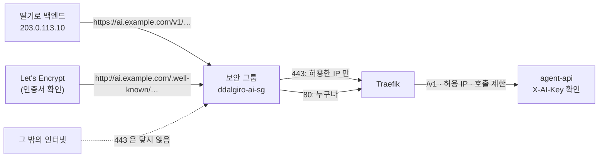

# 보안 그룹과 HTTPS

> **이 문서는 언제 보나요?** K3s 서버 안에서만 되던 AI 서버를, 딸기로 백엔드가 인터넷을 거쳐 부를 수 있게 열 때. 끝나면 **허용한 IP에서만, HTTPS로만, 키를 가진 요청만** 들어옵니다.
>
> 앞 단계: [에이전트 구조와 배포](../04-에이전트/01-에이전트-구조와-배포.md). 예시 값: 도메인 `ai.example.com`, K3s 서버의 탄력적 IP `203.0.113.20`, 백엔드 공인 IP `203.0.113.10`, 확인용 공인 IP `203.0.113.30`. K3s 서버의 명령 가운데 `scripts/`·`rendered/`를 쓰는 것은 `~/ddalgiro-ai-agent` 폴더에서 실행합니다.
>
> ⚠️ 보안 그룹·DNS 설정과 인증서 발급은 실제 AWS 계정과 도메인에서 확인하지 못했습니다. Traefik의 접근 제한(IP 허용 목록·경로·HTTPS·키)은 시험용 클러스터에서 확인했습니다.

---

## 1. 여는 것과 닫아 두는 것



| 포트 | 보안 그룹 | 이유 |
|---|---|---|
| 443 (HTTPS) | ✅ 백엔드 서버 IP와 확인용 IP만 | API 호출 |
| 80 (HTTP) | ✅ 누구나(`0.0.0.0/0`) | 인증서 발급·갱신 때 Let's Encrypt가 확인하러 옵니다. API는 80으로 받지 않습니다 |
| 22 (SSH) | 내 IP만 ([K3s 서버 문서 1장](../01-K3s-서버/01-EC2-인스턴스와-K3s.md#1-ec2-인스턴스-만들기)에서 넣음) | 서버 관리 |
| 6443 (쿠버네티스) · 5432 (DB) · 4000 (게이트웨이) | ❌ 넣지 않음 | 서버에 SSH로 들어가서만 씁니다 |

- **80 (HTTP)**: Let's Encrypt가 어느 IP에서 올지 정해져 있지 않습니다.

허용 IP는 **두 곳**에서 확인합니다. 보안 그룹이 먼저 막고, 통과한 요청을 Traefik의 IP 허용 목록이 한 번 더 확인합니다. 한 곳의 설정이 잘못돼도 다른 한 곳이 막습니다.

이 문서는 AI 서버의 문만 다룹니다. 별도 Langfuse 서버의 보안 그룹과 HTTPS는 [모니터링 4장](../07-운영/02-모니터링과-AI-추적.md#4-1-자원접근)에서 따로 설정합니다(인증서는 그 서버의 Caddy가 받습니다).

## 2. 탄력적 IP 확인

K3s 서버에서 실행합니다.

```bash
curl -s https://checkip.amazonaws.com
```

- 인터넷에서 보이는 이 서버의 IP가 나옵니다. [K3s 서버 문서 1장](../01-K3s-서버/01-EC2-인스턴스와-K3s.md#1-ec2-인스턴스-만들기)에서 붙인 **탄력적 IP와 같아야** 합니다.
- 다르면 탄력적 IP가 인스턴스에 붙지 않은 것입니다. 이 상태로는 서버를 껐다 켤 때 IP가 바뀝니다. EC2 → 탄력적 IP에서 연결합니다.

## 3. 도메인 연결

AI 서버 도메인이 탄력적 IP를 가리키게 합니다. 딸기로 도메인의 DNS 관리 화면(가비아)에서 레코드 하나를 더합니다.

| 종류 | 호스트 | 값 |
|---|---|---|
| `A` | `ai` | K3s 서버의 탄력적 IP (`203.0.113.20`) |

### 확인

K3s 서버나 내 맥에서 실행합니다.

```bash
dig +short ai.example.com
```

- 2장의 탄력적 IP가 나오면 성공입니다(반영에 몇 분 걸릴 수 있습니다). `dig`가 없으면 `sudo apt -y install dnsutils`.

## 4. 보안 그룹에 80·443 열기

AWS 콘솔의 EC2 → 보안 그룹 → `ddalgiro-ai-sg` → **인바운드 규칙 편집**에서 세 줄을 더합니다.

| 유형 | 포트 | 소스 | 설명 칸에 적을 말 |
|---|---|---|---|
| HTTP | 80 | `0.0.0.0/0` | 인증서 확인 |
| HTTPS | 443 | `203.0.113.10/32` | 딸기로 백엔드 |
| HTTPS | 443 | `203.0.113.30/32` | 확인용(없으면 넣지 않음) |

- 443의 소스에는 `site.env`의 `ALLOW_IP_1`·`ALLOW_IP_2`와 **같은 IP**를 넣습니다.
- ❌ 443을 `0.0.0.0/0`으로 열지 않습니다.
- 백엔드 서버가 같은 AWS 계정에 있어도 AI 서버를 도메인(공인 IP)으로 부르므로, 소스에는 백엔드의 **탄력적 IP**를 넣습니다.

### 확인

아무 곳에서나(내 맥) 실행합니다.

```bash
curl -s -o /dev/null -w '%{http_code}\n' -m 10 http://ai.example.com/
```

- `404`가 나오면 성공입니다 — 보안 그룹을 지나 Traefik까지 닿았고, 그 경로에 공개한 것이 없다는 뜻입니다.
- 시간 초과(`000`)면 80 규칙이 없거나, 3장의 DNS가 다른 IP를 가리키거나, 인스턴스가 꺼져 있는 것입니다.

## 5. 인증서 발급 준비 (cert-manager)

**cert-manager**: 쿠버네티스 안에서 HTTPS 인증서를 발급받고 만료 전에 스스로 갱신하는 프로그램입니다. K3s 서버에서 실행합니다.

```bash
kubectl apply -f https://github.com/cert-manager/cert-manager/releases/download/v1.21.3/cert-manager.yaml
kubectl -n cert-manager rollout status deployment/cert-manager-webhook --timeout=5m
cd ~/ddalgiro-ai-agent
kubectl apply -f rendered/40-cluster-issuer.yaml
```

- 첫 줄은 cert-manager를 설치하고, 둘째 줄은 준비될 때까지 기다립니다.
- 넷째 줄은 발급처 두 개(연습용 `letsencrypt-staging`, 실제용 `letsencrypt-prod`)를 등록합니다.

### 확인

```bash
kubectl get clusterissuer
```

- 두 줄 모두 `READY`가 `True`면 성공입니다(수십 초 걸립니다).
- `False`가 계속되면 `kubectl describe clusterissuer letsencrypt-staging`의 `Message`를 봅니다. `contact email has forbidden domain`이면 `site.env`의 `ACME_EMAIL`이 `example.com` 같은 가짜 주소인 것입니다. 실제 메일로 고치고 `bash scripts/render.sh` 후 다시 적용합니다.

## 6. 공개하기 — 먼저 연습용 인증서로

`site.env`의 `CLUSTER_ISSUER`가 `letsencrypt-staging`인 상태에서 K3s 서버의 `~/ddalgiro-ai-agent`에서 적용합니다.

```bash
kubectl apply -f rendered/41-ingress.yaml
kubectl -n ai-app get certificate -w
```

- 첫 줄은 접근 제한 두 가지(IP 허용 목록, 호출 제한)와 공개 규칙을 만듭니다.
- 둘째 줄을 보고 있다가 `READY`가 `True`가 되면(보통 1~2분) `Ctrl+C`로 빠져나옵니다.
- 연습용으로 먼저 하는 이유: 실제용은 실패가 쌓이면 한동안 발급이 막힙니다. 설정이 맞는지 연습용으로 확인한 뒤 바꿉니다.

`True`가 되지 않으면:

```bash
kubectl -n ai-app describe certificate agent-api-tls | tail -15
kubectl get challenges -A
```

- 대부분 Let's Encrypt가 `http://ai.example.com/.well-known/…`에 닿지 못한 경우입니다. 4장의 확인(80 포트)을 다시 합니다.

## 7. 실제 인증서로 바꾸기

내 맥의 `site.env`에서 `CLUSTER_ISSUER=letsencrypt-prod`로 고치고 [서버로 다시 보낸](../01-K3s-서버/01-EC2-인스턴스와-K3s.md#4-1-내-맥에서-저장소-폴더-보내기) 뒤, K3s 서버에서 실행합니다. 서버에서만 고치면 다음 동기화 때 덮어써집니다.

```bash
bash scripts/render.sh
kubectl apply -f rendered/41-ingress.yaml
kubectl -n ai-app delete secret agent-api-tls
kubectl -n ai-app get certificate -w
```

- 셋째 줄은 연습용 인증서를 지워 실제용으로 다시 발급받게 합니다.
- `READY`가 `True`가 되면 발급이 완료된 것입니다. 2026-11-15 기준 기본 인증서는 90일이지만 [발급 기관의 기간 단축 일정](https://letsencrypt.org/2025/12/02/from-90-to-45.html)에 따라 달라집니다. 실제 만료일·갱신 예정일은 `kubectl -n ai-app describe certificate agent-api-tls`의 `Not After`·`Renewal Time`으로 봅니다. **갱신 때도 80 포트가 열려 있어야** 하므로 HTTP 규칙을 지우지 않습니다.

## 8. 접근 제한이 실제로 동작하는지 확인

AI 서버 키는 K3s 서버에서 읽어 확인합니다. ⚠️ 화면에 출력된 키를 채팅·메일에 붙이지 않습니다. 호출 명령에 키를 직접 적으면 명령 기록에 남으므로, 아래 인증 호출은 숨겨 입력받습니다.

```bash
kubectl -n ai-app get secret agent-secret -o jsonpath='{.data.AI_API_KEY}' | base64 -d; echo
```

아래를 각각의 자리에서 확인합니다.

| # | 어디서 | 명령 | 기대 |
|---|---|---|---|
| 1 | 허용한 IP(`ALLOW_IP_1`·`ALLOW_IP_2`) | 아래의 인증 호출 묶음 | `200`과 JSON. **`x_forwarded_for`가 호출한 곳의 공인 IP** |
| 2 | 허용한 IP | `curl -s -o /dev/null -w '%{http_code}\n' https://ai.example.com/v1/whoami` (키 없음) | `401` |
| 3 | 보안 그룹에 없는 IP (휴대폰 테더링 등) | `curl -s -o /dev/null -w '%{http_code}\n' -m 10 https://ai.example.com/v1/whoami` | `000`(시간 초과) — 보안 그룹이 막음 |
| 4 | 허용한 IP | `curl -s -o /dev/null -w '%{http_code}\n' https://ai.example.com/docs` | `404` (공개한 경로는 `/v1`뿐) |

1번은 **허용한 IP의 컴퓨터**에서 실행합니다. 맥의 zsh와 서버의 Bash 모두 아래 묶음을 붙여 넣을 수 있습니다.

```bash
bash <<'BASH'
read -r -s -p 'AI 서버 키: ' AIKEY </dev/tty
echo
trap 'unset AIKEY' EXIT
curl -sS --max-time 10 -w '\nHTTP %{http_code}\n' \
  https://ai.example.com/v1/whoami -H "X-AI-Key: $AIKEY"
BASH
```

- ⚠️ **1번의 `x_forwarded_for`가 `10.42.…`으로 나오거나 허용한 IP에서도 `403`이면**, Traefik이 요청자의 진짜 IP를 보지 못하는 것입니다. [K3s 서버 문서 4-2](../01-K3s-서버/01-EC2-인스턴스와-K3s.md#4-2-서버에서-값-채우기와-적용)의 확인(`externalTrafficPolicy`가 `Local`)을 다시 합니다.
- 3번이 `200`이나 `401`이면 443이 넓게 열린 것입니다. 4장의 HTTPS 규칙에서 소스를 다시 봅니다.
- **두 번째 문(Traefik의 허용 목록)까지 확인하려면**: 확인용 IP는 보안 그룹의 443 규칙에 두고, 내 맥의 `site.env`에서 `ALLOW_IP_2`를 백엔드 IP와 같게 둡니다. 서버로 동기화한 뒤 `bash scripts/render.sh && kubectl apply -f rendered/41-ingress.yaml`로 적용하고 확인용 IP에서 1번을 실행합니다. `403`이 나오면 Traefik이 막은 것입니다. 확인한 뒤 값을 복구하고 동기화·적용까지 다시 합니다.

### 허용 IP를 바꿀 때

백엔드 서버의 공인 IP가 바뀌면(서버를 옮기거나 IP를 새로 받은 경우) AI 호출이 모두 막히므로 **두 곳을 함께** 고칩니다.

1. AWS 콘솔: 보안 그룹 `ddalgiro-ai-sg`의 HTTPS(443) 규칙에서 소스를 새 IP로 바꿉니다.
2. `site.env`의 `ALLOW_IP_1`·`ALLOW_IP_2`를 고치고 K3s 서버에서 적용합니다.

```bash
bash scripts/render.sh && kubectl apply -f rendered/41-ingress.yaml
```

- 몇 초 안에 반영됩니다.
- 내 맥에서 `site.env`를 고쳤으면 [저장소를 서버로 다시 보낸](../01-K3s-서버/01-EC2-인스턴스와-K3s.md#4-1-내-맥에서-저장소-폴더-보내기) 뒤 실행합니다.

## 9. 문제 해결

| 증상 | 원인과 해결 |
|---|---|
| 밖에서 80·443 모두 시간 초과 | 4장의 보안 그룹 규칙, 인스턴스가 `실행 중`인지, 2장의 탄력적 IP, 3장의 DNS(`dig +short`) |
| 80은 되고 443만 시간 초과 | 부르는 곳의 IP가 보안 그룹의 443 규칙에 없습니다 |
| 인증서가 계속 `False` | `kubectl get challenges -A`와 `kubectl -n cert-manager logs deployment/cert-manager \| tail -30` |
| 허용한 IP인데 `403` | 보안 그룹은 지났지만 Traefik의 허용 목록에 없습니다 |
| `429 Too Many Requests` | 호출 제한에 걸린 것입니다(1분 평균 60회, 순간 30회) |
| 며칠 뒤 갑자기 접속 불가 | 인스턴스가 중지됐거나 탄력적 IP 연결이 풀린 경우 |
| 브라우저가 인증서를 신뢰하지 않음 | 아직 연습용 인증서입니다(7장) |

- **80은 되고 443만 시간 초과**: 그 자리에서 `curl -s https://checkip.amazonaws.com`으로 IP를 확인합니다.
- **인증서가 계속 `False`**: DNS가 다른 IP를 가리키는지(`dig +short`), 80 규칙이 `0.0.0.0/0`인지도 확인합니다.
- **허용한 IP인데 `403`**: `site.env`의 `ALLOW_IP_*`와 8장의 ⚠️(진짜 IP 전달)를 확인합니다.
- **`429 Too Many Requests`**: 정상적인 사용에서 걸리면 `k8s/41-ingress.yaml`의 `rate-limit` 값을 올립니다.
- **며칠 뒤 갑자기 접속 불가**: EC2 콘솔에서 상태를 보고 `dig +short`와 2장의 명령 결과를 비교합니다.

다음: [백엔드 중계와 관리자 화면](../06-관리자-화면-연동/01-백엔드-중계와-관리자-화면.md)
