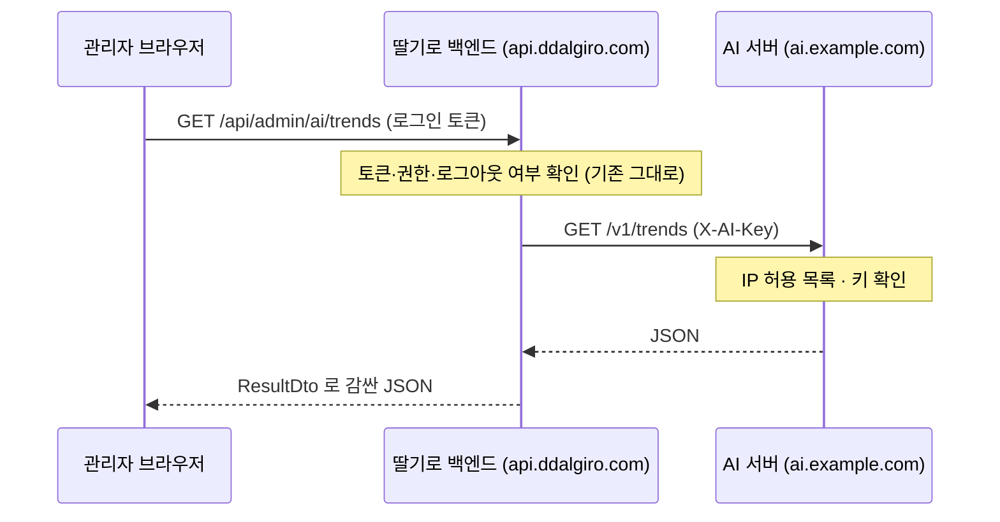

# 백엔드 중계와 관리자 화면

> **이 문서는 언제 보나요?** AI 서버가 바깥에서 열린 뒤, 딸기로 관리자 화면에 "트렌드 분석"과 "업체 추천 문의" 메뉴를 붙일 때. `ddalgiro-backend`와 `ddalgiro-admin-front` 저장소에서 할 일을 순서대로 적었습니다.
>
> 앞 단계: [보안 그룹과 HTTPS](../05-외부-공개/01-보안-그룹과-HTTPS.md).
>
> ⚠️ **두 저장소 반영은 추후 진행할 예정입니다. 이 문서의 코드는 아직 반영하지 않은 설계 예시이며, 컴파일·실행해 보지 않았습니다.** 두 저장소의 현재 코드(2026-11-14 기준)를 읽고 그 형식에 맞춰 썼습니다. 실제로 넣을 때는 각 저장소의 `CLAUDE.md`(주석·검사·문서 규칙)를 따르고, 딸기로 가이드의 [변경 대응표](../../../ddalgiro-guide/docs/99-가이드-관리/01-가이드-고치는-법.md)에 맞춰 가이드도 함께 고칩니다.

---

## 1. 왜 백엔드를 거치나

브라우저가 AI 서버를 직접 부르지 않고, **백엔드가 대신 부릅니다.**



| 방식 | 판단 |
|---|---|
| **백엔드 중계 (채택)** | 관리자 로그인·권한 확인을 그대로 씁니다. AI 서버는 백엔드 서버 IP 하나만 허용하면 되고, 키가 브라우저에 내려가지 않습니다 |
| 브라우저가 직접 호출 | AI 서버가 딸기로 로그인 토큰을 검사하려면 백엔드의 서명 키를 AI 서버에 복사해야 하고, 백엔드가 매 요청마다 하는 "DB에서 권한·로그아웃 다시 확인"을 잃습니다. 모든 관리자 PC의 IP를 허용해야 합니다 |

### 시간 제한에 대해

| 구간 | 제한 | 근거 |
|---|---|---|
| 브라우저 → 백엔드 | 60초 | 관리자 프론트의 axios 기본값, `api.ddalgiro.com`의 nginx 기본 대기 시간 |
| 백엔드 → AI 서버 | **전체 호출 55초**로 설정 | 연결·응답 처리를 합쳐 위 60초 안에 실패를 알려 주기 위해. 아래 예시의 `block(Duration)`이 전체 대기를 제한 |

- 트렌드 랭킹·상세는 저장값을 읽고, 업체 맞춤 추천은 저장된 트렌드와 프로필로 순위를 계산합니다. 모델 호출은 없으며 실제 환경의 응답 시간은 별도로 잽니다.
- 자연어 추천과 대체 공급자 찾기는 Claude API를 부르므로 수 초~수십 초 걸립니다. 55초를 넘기면 "AI 서버 응답이 늦습니다"로 안내됩니다. 실제 응답 시간은 아직 재지 않았습니다([운영 전 평가](../02-Claude-API/01-Claude-API-키와-모델.md#6-운영-전-평가와-합격-기준)).
- 반응·납품·채택 기록, 제안서 초안, 공급 조건 확인 표시는 모델을 부르지 않아 바로 끝납니다.
- "지금 다시 분석"(`POST /v1/trends/{번호}/analyze`)은 더 오래 걸릴 수 있어 화면에 붙이지 않습니다. 필요하면 서버에서 직접 실행합니다.
- 백엔드가 55초에 기다리기를 멈춰도 AI 서버의 작업·모델 호출이 즉시 취소된다고 보장하지 않습니다. 에이전트의 모델 대기는 기본 120초이고 재시도도 있으므로, 화면에서 시간 초과 요청을 자동 반복하지 않습니다.

## 2. 백엔드 (`ddalgiro-backend`)

### 2-1. 설정 이름 추가

`src/main/resources/application.yml`의 `ddalgiro-properties` 아래에 넣습니다. 값은 비워 두고 비밀값 파일이 채웁니다.

```yaml
    ai-agent: # 딸기로 AI 에이전트(AWS의 K3s 서버) 호출 설정
        base-url: "" # AI 서버 주소 (예: https://ai.example.com) — secrets.yml 에서 채움
        api-key: "" # 요청 헤더 X-AI-Key 에 넣는 키 — secrets.yml 에서 채움
        response-timeout: 55000 # 전체 호출 대기 상한 (ms). block(Duration) 에도 적용한다
```

서버의 `/app/security/secrets.yml`(내 맥은 `~/.ddalgiro/secrets.yml`)에 실제 값을 넣습니다.

```yaml
ddalgiro-properties:
    ai-agent:
        base-url: "https://ai.example.com"
        api-key: "" # K3s 서버의 agent-secret 에 든 AI_API_KEY 값
```

- 키 값은 [외부 공개 8장](../05-외부-공개/01-보안-그룹과-HTTPS.md#8-접근-제한이-실제로-동작하는지-확인)의 명령으로 읽어 직접 옮깁니다. ⚠️ git·채팅에 붙이지 않습니다.
- 가이드의 키 이름 보기 `ddalgiro-guide/scripts/backend-server/secrets.example.yml`에도 빈 틀을 추가합니다.

`DdalgiroProperties`(`core/properties/DdalgiroProperties.java`)에 같은 모양의 클래스를 더합니다.

```java
    // 딸기로 AI 에이전트 호출 설정 (AiAgentService 가 사용)
    private AiAgent aiAgent;

    @Getter
    @Setter
    public static class AiAgent {

        private String baseUrl; // AI 서버 주소 (예: https://ai.example.com)
        private String apiKey; // 요청 헤더 X-AI-Key 값
        private int responseTimeout; // 응답 대기 (ms)
    }
```

### 2-2. AI 서버를 부르는 서비스

`api/admin/ai/service/AiAgentService.java`. 토스 결제 서비스처럼 **전용 WebClient**를 만듭니다(공용 WebClient는 응답 대기가 10초라 맞지 않습니다).

```java
/**
 * 딸기로 AI 에이전트(AWS의 K3s 서버)를 부르는 서비스.
 *
 * <p>브라우저 대신 백엔드가 AI 서버를 부른다. 주소·키는 secrets.yml 의 ddalgiro-properties.ai-agent 에서 읽는다.
 * 정해진 주소만 부른다 — 브라우저가 준 경로를 그대로 이어 붙여 넘기지 않는다.
 * 호출은 DB 트랜잭션 밖에서 한다(응답이 수십 초 걸릴 수 있어 DB 연결을 붙잡고 있으면 안 된다).</p>
 */
@Slf4j
@Service
@RequiredArgsConstructor
public class AiAgentService {

    // 응답 JSON 을 받을 모양: 객체 하나 / 객체의 목록
    private static final ParameterizedTypeReference<Map<String, Object>> JSON_OBJECT = new ParameterizedTypeReference<>() {};
    private static final ParameterizedTypeReference<List<Map<String, Object>>> JSON_LIST = new ParameterizedTypeReference<>() {};

    private final DdalgiroProperties ddalgiroProperties;

    // AI 서버 전용 WebClient (init 에서 한 번 만든다)
    private WebClient aiWebClient;

    /** 설정값으로 WebClient 를 만든다. 모든 요청에 X-AI-Key 헤더가 붙는다. */
    @PostConstruct
    void init() {
        DdalgiroProperties.AiAgent config = ddalgiroProperties.getAiAgent();
        this.aiWebClient = WebClient.builder()
            .baseUrl(config.getBaseUrl())
            .defaultHeader("X-AI-Key", config.getApiKey())
            .clientConnector(
                new ReactorClientHttpConnector(
                    HttpClient.create()
                        // 5초 안에 연결되지 않으면 실패
                        .option(ChannelOption.CONNECT_TIMEOUT_MILLIS, 5000)
                        // 요청을 보낸 뒤 response-timeout 안에 응답이 없으면 실패
                        .responseTimeout(Duration.ofMillis(config.getResponseTimeout()))
                )
            )
            .build();
    }

    /** 트렌드 랭킹. limit 은 줄 수, stage 는 확산 단계(없으면 전체). */
    public List<Map<String, Object>> getTrends(int limit, String stage) {
        return call(() ->
            aiWebClient.get()
                .uri(uri -> uri.path("/v1/trends")
                    .queryParam("limit", limit)
                    .queryParamIfPresent("stage", Optional.ofNullable(stage))
                    .build())
                .retrieve()
                .bodyToMono(JSON_LIST)
                .block(Duration.ofMillis(ddalgiroProperties.getAiAgent().getResponseTimeout()))
        );
    }

    /** 자연어 추천. text 는 문의 글(되물음에 답할 때는 원래 문의 뒤에 답을 이어 붙인 글). */
    public Map<String, Object> recommend(String text) {
        return call(() ->
            aiWebClient.post()
                .uri("/v1/recommend")
                .bodyValue(Map.of("text", text))
                .retrieve()
                .bodyToMono(JSON_OBJECT)
                .block(Duration.ofMillis(ddalgiroProperties.getAiAgent().getResponseTimeout()))
        );
    }

    /**
     * AI 서버 호출을 감싸, 실패를 화면에 보여 줄 문구로 바꾼다.
     * AI 서버가 오류 응답을 준 경우와, 연결 실패·응답 지연을 나눠 안내한다.
     */
    private <T> T call(Supplier<T> request) {
        try {
            return request.get();
        } catch (WebClientResponseException e) {
            log.warn("AI 서버 오류 응답: status={}", e.getStatusCode().value());
            throw new DdalgiroBizException("AI 서버가 요청을 처리하지 못했습니다. (" + e.getStatusCode().value() + ")");
        } catch (RuntimeException e) {
            log.warn("AI 서버 연결 실패 또는 응답 지연: {}", e.getClass().getSimpleName());
            throw new DdalgiroBizException("AI 서버에 연결하지 못했거나 응답이 늦습니다. 잠시 뒤 다시 시도해 주세요.");
        }
    }
}
```

나머지 호출도 같은 모양으로 더합니다.

| 메서드 | AI 서버 주소 | 비고 |
|---|---|---|
| `getTrendDetail(long keywordId)` | `GET /v1/trends/{keywordId}` | |
| `getVendorRecommendations(String vendor)` | `GET /v1/vendors/recommendations?vendor=…` | 아래처럼 업체명을 쿼리 변수로 넣어 인코딩합니다 |
| `saveVendorProfile(String vendor, Map<String, Object> body)` | `PUT /v1/vendors/profile?vendor=…` | 프로필 본문은 JSON |
| `saveVendorAdoption(String vendor, Map<String, Object> body)` | `POST /v1/vendors/adoptions?vendor=…` | 업체의 채택·보류·출시·판매 기록 |
| `saveRecommendFeedback(Map<String, Object> body)` | `POST /v1/recommend/feedback` | 고객 선택·공급자 수락/거절. 주문은 `order_ref`, 재전송은 `event_key` 포함 |
| `getRecommendOption(long optionId)` | `GET /v1/recommend/options/{optionId}` | 추천 당시 조건·결과·근거 재조회 |
| `rerouteRecommend(long requestId)` | `POST /v1/recommend/{requestId}/reroute` | 대체 공급자 찾기. 모델을 부릅니다 |
| `createProposal(long requestId)` | `POST /v1/recommend/{requestId}/proposal` | 제안서 초안 |
| `saveProposalOutcome(long proposalId, Map<String, Object> body)` | `POST /v1/recommend/proposals/{proposalId}/outcome` | 제안서 채택 여부 |
| `saveDelivery(Map<String, Object> body)` | `POST /v1/recommend/delivery` | 납품·클레임·재주문 의향. 확정 주문의 `order_ref`와 `event_key` 포함 |
| `confirmCapacity(Map<String, Object> body)` | `POST /v1/suppliers/capacity/confirm` | 공급 조건 확인 표시 |
| `getStatus()` · `getKpi(int days)` | `GET /v1/status` · `GET /v1/kpi?days=…` | |

업체명을 AI 서버로 넘길 때도 경로 안에 넣지 않습니다. `/`가 있는 이름도 하나의 값으로 전달되도록 URI 변수로 인코딩합니다.

```java
// 조회: vendor 에 한글·/·& 가 들어 있어도 한 개의 쿼리 값으로 보낸다
.uri(uri -> uri.path("/v1/vendors/recommendations")
    .queryParam("vendor", "{vendor}").build(vendor))
// 저장: 같은 방식으로 주소를 만들고 bodyValue(body) 로 프로필 JSON 을 붙인다
.uri(uri -> uri.path("/v1/vendors/profile")
    .queryParam("vendor", "{vendor}").build(vendor))
```

### 2-3. 관리자 API

`api/admin/ai/controller/AdminAiController.java`. 주소가 `/api/admin/**`라서 기존 보안 설정이 **관리자(ADMIN)·CS 상담원 토큰만** 통과시킵니다.

```java
/**
 * 관리자 "AI 인사이트" API — 트렌드 랭킹·상세, 업체 맞춤 추천, 자연어 추천.
 *
 * <p>모두 AI 서버로 전달한다(AiAgentService). /api/admin/** 라 관리자(ADMIN)·CS 상담원 토큰만 부를 수 있다.
 * 업체 프로필 저장은 ADMIN 만 할 수 있다.</p>
 */
@RestController
@RequestMapping("/api/admin/ai")
@RequiredArgsConstructor
@Tag(name = "어드민 AI 인사이트", description = "트렌드 랭킹·상세, 업체 맞춤 추천, 자연어 추천")
public class AdminAiController {

    private final AiAgentService aiAgentService;

    @Operation(summary = "트렌드 랭킹", description = "키워드별 최신 트렌드 점수. 점수 높은 순")
    @GetMapping("/trends")
    public ResponseEntity<ResultDto<List<Map<String, Object>>>> getAiTrends(
        @Parameter(description = "줄 수", example = "20") @RequestParam(defaultValue = "20") int limit,
        @Parameter(description = "확산 단계 (없으면 전체)", example = "성장기") @RequestParam(required = false) String stage
    ) {
        return ResponseEntity.ok(ResultDto.ok(aiAgentService.getTrends(limit, stage)));
    }

    @Operation(summary = "자연어 추천", description = "문의 글에 맞는 업체를 순위와 추천 사유와 함께")
    @PostMapping("/recommend")
    public ResponseEntity<ResultDto<Map<String, Object>>> requestAiRecommend(@RequestBody @Valid ReqAiRecommendDto req) {
        return ResponseEntity.ok(ResultDto.ok(aiAgentService.recommend(req.getText())));
    }
}
```

| 관리자 API | 서비스 메서드 | 권한 |
|---|---|---|
| `GET /api/admin/ai/trends` | `getTrends` | ADMIN·CS |
| `GET /api/admin/ai/trends/{keywordId}` | `getTrendDetail` | ADMIN·CS |
| `GET /api/admin/ai/vendors/recommendations?vendor=` | `getVendorRecommendations` | ADMIN·CS |
| `PUT /api/admin/ai/vendors/profile?vendor=` | `saveVendorProfile` | **ADMIN** (`CoreUtils.assertAdminRole`) |
| `POST /api/admin/ai/vendors/adoptions?vendor=` | `saveVendorAdoption` | ADMIN·CS |
| `POST /api/admin/ai/recommend` | `recommend` | ADMIN·CS |
| `GET /api/admin/ai/recommend/options/{optionId}` | `getRecommendOption` | ADMIN·CS |
| `POST /api/admin/ai/recommend/{requestId}/reroute` | `rerouteRecommend` | ADMIN·CS |
| `POST /api/admin/ai/recommend/{requestId}/proposal` | `createProposal` | ADMIN·CS |
| `POST /api/admin/ai/recommend/proposals/{proposalId}/outcome` | `saveProposalOutcome` | ADMIN·CS |
| `POST /api/admin/ai/recommend/feedback` | `saveRecommendFeedback` | ADMIN·CS |
| `POST /api/admin/ai/recommend/delivery` | `saveDelivery` | ADMIN·CS |
| `POST /api/admin/ai/suppliers/capacity/confirm` | `confirmCapacity` | **ADMIN** (`CoreUtils.assertAdminRole`) |
| `GET /api/admin/ai/kpi?days=` | `getKpi` | **ADMIN** |

- 업체명은 주소 경로가 아니라 `?vendor=`로 받습니다(기존 "업체별 판매 내역" API와 같은 방식). 업체명에 `/`가 들어 있어도 안전합니다.
- `ReqAiRecommendDto`는 `text` 한 칸(2~1000자)을 가진 요청 DTO입니다.
- 응답을 `Map`으로 그대로 넘기면 Swagger 문서에 칸 이름이 나오지 않습니다. 화면에서 타입을 쓰려면 AI 서버 응답 모양대로 응답 DTO를 만들어 `Map` 자리에 넣습니다.

### 2-4. 확인

내 맥에서 백엔드를 띄우고([가이드: 백엔드 실행](../../../ddalgiro-guide/docs/02-내-맥-개발환경/02-백엔드-실행.md)), 관리자 토큰으로 부릅니다.

```bash
./mvnw compile
curl -s "http://localhost:8080/api/admin/ai/trends?limit=5" -H "Authorization: Bearer <관리자 토큰>"
```

- 첫 줄이 오류 없이 끝나고, 둘째 줄에서 `"resultCode":"ok"`와 트렌드 목록이 오면 성공입니다.
- ⚠️ 내 맥의 공인 IP를 아직 허용하지 않았다면 연결 오류가 납니다. 시험 전에 그 IP를 보안 그룹의 443 규칙과 `ALLOW_IP_2` **두 곳**에서 확인합니다([외부 공개 — 허용 IP를 바꿀 때](../05-외부-공개/01-보안-그룹과-HTTPS.md#허용-ip를-바꿀-때)).

## 3. 관리자 프론트 (`ddalgiro-admin-front`)

### 3-1. API 함수 만들기 (Orval)

백엔드를 내 맥에서 띄운 상태(8080)에서 실행합니다.

```bash
npx orval
```

- `orval/api/__generated__/client.ts`에 `getAiTrends`·`requestAiRecommend` 같은 함수가 생깁니다. 이 파일은 손으로 고치지 않습니다.

### 3-2. 메뉴와 화면 파일

| 파일 | 내용 |
|---|---|
| `components/sidebar-data.ts` | 새 묶음 **AI 인사이트** — `트렌드 분석`(`/ai/trend`), `업체 추천 문의`(`/ai/recommend`). 아이콘은 lucide에서 고릅니다 |
| `app/(admin-biz)/ai/trend/page.tsx` | 입구(제목 정하고 본문 불러오기) — `statistics/product-analysis/vendor-rank/page.tsx`와 같은 모양 |
| `app/(admin-biz)/ai/trend/trend.tsx` + `components/` | 본문(`'use client'`) |
| `app/(admin-biz)/ai/recommend/page.tsx` · `recommend.tsx` + `components/` | 자연어 추천 화면 |

`(admin-biz)` 아래에 두면 로그인 확인과 사이드바·머리말이 자동으로 붙습니다.

### 3-3. 화면에 담을 것

**트렌드 분석**

| 영역 | 내용 | 쓰는 API |
|---|---|---|
| 랭킹 표 | 키워드·분류·점수·확산 단계·증가율·7일 언급 수. 단계 고르기. 교차검증(`signal_check`)이 `불일치`면 "더 지켜보기" 표시 | `getAiTrends` |
| 상세(줄을 누르면) | 30일 추이 그래프(`series`), 약 3개월 흐름의 단계(`score.windows.3m`), 브리핑(문장마다 `[출처:…]`를 누르면 근거 원문과 글 주소), 최근 글(광고·체험단 글은 `is_ad` 표시) | `getAiTrendDetail` |
| 업체 맞춤 추천 | 업체를 고르면 그 업체에 맞는 아이템 순위와 권고 문구. 업체 목록은 기존 `getStatisticsProductVendorRank`(업체 순위)의 업체 이름을 씁니다 | `getAiVendorRecommendations` |
| 채택 기록 | 추천 아이템마다 [채택]·[보류]·[출시함] 버튼 | `saveAiVendorAdoption` |
| 업체 프로필 | 만드는 분류·지역·메모 저장(ADMIN만 — `AdminOnly`로 감쌈) | `saveAiVendorProfile` |

- 샘플 키워드(`is_sample`이 참)에는 "샘플" 표시를 붙입니다.
- 브리핑의 `generated_by`가 `template`이면 "자동 정리" 같은 표시로 구분합니다.
- 확산 단계가 `자료부족`인 키워드는 점수를 `-`로 보여 줍니다.

**업체 추천 문의**

| 영역 | 내용 |
|---|---|
| 문의 입력 | 글 상자와 [추천받기]. 글 상자 아래에 "이름·전화번호·회사명은 적지 말고 조건만 적어 주세요" 안내를 둡니다 — 문의 글이 Claude API로 전달되기 때문입니다([Claude API 문서 5장](../02-Claude-API/01-Claude-API-키와-모델.md#5-무엇이-서버-밖으로-나가나)) |
| 이렇게 이해했습니다 | 응답의 `slots`를 조건 카드로. 잘못 이해했으면 직원이 문의를 고쳐 다시 보냅니다 |
| 되묻기 | `status`가 `reask`면 `question`을 보여 주고 답을 받아, **원래 문의 + " " + 답**을 다시 보냅니다(서버는 대화를 기억하지 않습니다) |
| 결과 카드 | 순위, 업체·메뉴·가격·식이 표시, 입점사 배지, 추천 사유(출처 펼치기), 점수 내역(`score_detail`) |
| 견적 줄 | `quote`가 있으면 "200개 × 3,500원 = 700,000원"과 총예산 안에 드는지. `null`이면 "담당자 확인 필요" |
| 공급 조건 표시 | `capacity_check.status`가 `reconfirm`이면 "공급자 재확인", `confirm`이면 "견적 전 공급자 확인" 배지와 안내 문장. 확인을 마치면 [확인 완료] → `confirmAiCapacity`(ADMIN) |
| 지역 표시 | `region_match`가 `local`이 아니면 "배송으로 받는 업체" 표시 |
| 넓혀 찾음 안내 | `broadened`가 참이면 "요청한 종류가 없어 다른 종류까지 찾았습니다" |
| 반응 버튼 | [고름]·[버림]·[공급자 수락]·[공급자 거절]·[주문 확정] → `saveAiRecommendFeedback` (`quote_option_id`) |
| 대체 공급자 | 공급자 거절을 기록한 뒤 [다른 공급자 찾기] → `rerouteAiRecommend`(`request_id`). 응답은 추천과 같은 모양이고 `round`가 늘어납니다 |
| 제안서 | [제안서 초안] → `createAiProposal`의 `body`를 글 상자에 보여 주고, 보낸 뒤 [채택]·[미채택] → `saveAiProposalOutcome` |
| 납품 기록 | 주문 확정한 옵션에 [납품 완료]·[지연]·[클레임]·[재주문 의향] → `saveAiDelivery` |
| 결과 없음 | `status`가 `empty`면 "조건을 모두 지키는 업체가 없습니다"와 `blockers`("날짜 조건만 풀면 1곳")를 함께 |

주문 확정에는 `order_ref`를 보내고, 납품 기록에는 **같은 주문 번호**를 보냅니다. 반응·납품 요청의 `event_key`는 사건마다 하나를 만들어 네트워크 재전송 때 그대로 재사용합니다. 공급자 최종 수락이 없거나 순서가 틀린 `409`는 직원에게 안내하고 자동 재시도하지 않습니다.

호출은 기존 화면과 같은 방식으로 합니다.

```tsx
const res = await getDdalgiroAPI().requestAiRecommend({ text })
// 업무 오류(예: AI 서버 연결 실패)는 HTTP 200 에 오류 본문으로 온다 → 문구를 꺼내 알림으로 보여 준다
const errorMessage = getApiErrorMessage(res)
if (errorMessage) {
  toast.error(errorMessage)
  return
}
```

- 조회 화면은 `statistics/product-analysis/_shared/use-statistics-query.ts`의 훅(조회 중 표시·늦게 온 응답 무시·오류 알림)을 그대로 쓸 수 있습니다.

### 3-4. 확인

```bash
npm run lint && npm run lint:jsdoc && npm run type-check && npm run build
```

- 네 가지(코드 규칙, 함수 설명 주석, 타입, 빌드)가 오류 없이 끝나고, 브라우저(`http://localhost:3001`)에서 두 메뉴가 열리면 성공입니다.

## 4. 배포 순서

1. AI 서버의 `ALLOW_IP_1`이 **운영 백엔드 서버의 공인 IP**인지 확인합니다.
2. 운영 서버 `/app/security/secrets.yml`에 `ai-agent` 값을 넣습니다.
3. 백엔드를 먼저 배포합니다([가이드: 배포 흐름](../../../ddalgiro-guide/docs/04-배포/01-배포-흐름.md)).
4. 운영 서버에서 AI 서버에 닿는지 확인합니다.

   ```bash
   curl -s -o /dev/null -w '%{http_code}\n' -m 10 https://ai.example.com/v1/whoami
   ```

   - `401`이면 성공입니다(IP는 통과했고 키가 없어 거절). `403`이면 `ALLOW_IP_1`이, 시간 초과면 보안 그룹의 443 규칙(백엔드 서버 IP)이나 AI 서버의 상태가 문제입니다.

5. 관리자 프론트를 배포합니다.

## 5. 입점업체가 직접 로그인하게 될 때

지금 설계는 **직원용**입니다. 직원이 화면에서 업체를 고르면 그 이름을 `?vendor=`로 보냅니다. 입점업체가 직접 로그인해 보게 할 때(추후 진행 예정) 아래를 함께 바꿉니다. AI 서버 쪽은 고칠 것이 거의 없고, 바뀌는 곳은 백엔드와 화면입니다.

| 바꿀 것 | 이유 |
|---|---|
| 업체 계정과 "이 계정이 어느 업체인가"를 백엔드가 알게 하기 | 지금은 업체가 상품명 앞 `[업체명]`으로만 있고 계정·업체 DB 테이블이 없습니다 |
| 업체 계정의 요청에서는 업체명을 **요청 값이 아니라 로그인한 계정에서** 꺼내 AI 서버에 넘기기 | 요청 값(`?vendor=`)을 그대로 믿으면 다른 업체의 프로필과 추천을 볼 수 있습니다 |
| 업체 계정에 열 API 를 따로 정하기 | 아래 표 |
| AI 서버의 업체 키와 계정의 업체 식별을 맞추기 | AI 서버는 업체명을 그대로 `vendor_profiles`의 키로 씁니다. 업체를 번호로 식별하게 되면 이 키를 옮겨야 합니다 |
| 화면에 "AI가 정리한 내용"임과 근거를 함께 보이기 | 지금은 직원이 읽어 보고 전달하지만, 업체가 직접 보면 그 확인 단계가 없어집니다. 근거 문장 그대로 선택하는 검사와 당시 출처 보존을 적용하지만 원자료의 오류까지 보장하지는 않습니다 |
| 호출 제한 값 다시 보기 | AI 서버는 백엔드 서버 IP 하나를 기준으로 1분 평균 60회까지 받습니다. 업체 수가 늘면 올립니다(`k8s/41-ingress.yaml`의 `rate-limit`) |

| API | 업체 계정에 | 이유 |
|---|---|---|
| 트렌드 랭킹·상세 | 열 수 있음 | 공개 자료를 모아 계산한 것이라 업체마다 다르지 않습니다 |
| 업체 맞춤 추천 | **자기 업체 것만** | 위 표의 둘째 줄 |
| 업체 프로필 저장 | 자기 업체 것만, 또는 직원만 | 프로필이 추천 순위를 바꿉니다 |
| 자연어 추천·반응 기록 | 닫아 둠(직원 전용) | 결과에 **다른 업체의 메뉴·가격·공급 조건·점수 내역**이 나옵니다 |
| 상태(`status`) | 닫아 둠 | 운영 정보 |

- 위 구분은 지금의 응답 내용을 기준으로 한 것입니다. 업체에게 자연어 추천을 열려면 다른 업체의 공급 조건과 점수 내역을 응답에서 빼는 작업이 먼저입니다.
- 주소가 `/api/admin/**`이면 기존 보안 설정이 관리자·CS 토큰만 통과시키므로, 업체용 API는 다른 주소 묶음과 권한 규칙이 필요합니다.

## 6. 문제 해결

| 화면의 문구 | 원인과 해결 |
|---|---|
| "AI 서버가 요청을 처리하지 못했습니다. (403)" | Traefik의 허용 목록에 백엔드 서버의 IP가 없습니다. `site.env`의 `ALLOW_IP_1` 확인([외부 공개 8장](../05-외부-공개/01-보안-그룹과-HTTPS.md#허용-ip를-바꿀-때)) |
| "… (401)" | 백엔드의 `api-key`가 AI 서버의 `AI_API_KEY`와 다릅니다 |
| "… (429)" | 호출 제한에 걸렸습니다. 화면이 같은 요청을 반복해 보내는지 확인 |
| "… (502)" | AI 서버가 문의를 이해하지 못했습니다. 문의를 바꿔 다시 시도합니다. 계속되면 Claude API 쪽 문제일 수 있습니다([Claude API 문서 8장](../02-Claude-API/01-Claude-API-키와-모델.md#8-문제-해결)) |
| "AI 서버에 연결하지 못했거나 응답이 늦습니다" | 보안 그룹이 백엔드 서버의 IP를 막고 있거나, K3s 서버가 멈췄거나, Claude API의 응답이 늦어 55초를 넘겼습니다. [운영 문서](../07-운영/01-점검-백업-문제-해결.md#2-ai-기능이-안-된다고-할-때--바깥에서-안쪽으로)의 점검 순서를 봅니다 |
| 메뉴는 보이는데 내용이 비어 있음 | 수집·분석이 아직 돌지 않았습니다. AI 서버의 `GET /v1/status` 확인 |

다음: [점검·백업·문제 해결](../07-운영/01-점검-백업-문제-해결.md)
