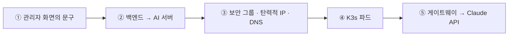

# 점검·백업·문제 해결

> **이 문서는 언제 보나요?** 설치를 마친 뒤 매일·매주 무엇을 볼지 정할 때, "AI 기능이 안 된다"는 말을 들었을 때, 백업을 옮기거나 되살릴 때, 버전을 올릴 때.
>
> 명령은 따로 적지 않으면 **K3s 서버**에서 실행합니다(내 맥에서 `ssh ddalgiro-ai`).
>
> ⚠️ AWS 콘솔의 절차(디스크 스냅샷·인스턴스 중지/시작·스냅샷으로 되살리기)와 Claude Console의 화면은 실제 계정에서 확인하지 못했습니다.

---

## 1. 매일 한 번 보는 것

```bash
kubectl get pods -A
kubectl -n ai-app get jobs --sort-by=.status.startTime | tail -8
kubectl -n ai-data get jobs --sort-by=.status.startTime | tail -2
sudo ls -la /var/backups/ddalgiro-ai/ | tail -4
df -h / | tail -1
```

| 줄 | 정상 |
|---|---|
| 1 | 서비스 파드는 `Running`이고 `READY`의 두 숫자가 같음(예: `1/1`), 작업 파드는 `Completed`. `Running`이어도 `0/1`이면 준비되지 않은 상태 |
| 2 | 어제 새벽의 `collect-instagram-…`·`collect-naver-…`·`collect-rss-…`·`run-trend-…`·`embed-catalog-…`가 `Complete`. 인스타그램·RSS는 설정을 넣지 않았어도 "건너뜁니다"로 끝나 `Complete`입니다 |
| 3 | `pg-backup-…`이 `Complete` |
| 4 | 오늘 날짜의 `agent-….dump`·`litellm-….dump` |
| 5 | `Use%`가 80% 아래 |

작업이 `Failed`면 로그를 봅니다.

```bash
kubectl -n ai-app logs 'job/<작업 이름>' | tail -20
```

### 주마다 보는 요금

Claude API는 쓴 만큼 요금이 나옵니다. 주에 한 번 두 곳을 봅니다.

| 어디서 | 무엇을 | 살필 때 |
|---|---|---|
| Claude Console의 사용량·결제 화면 | 이번 달 쓴 금액, 남은 크레딧, 월 지출 한도 | [월 비용 계산](../00-개요/04-월-비용-계산.md#4-합계)의 내 사용량 금액보다 크게 늘었으면 [원인을 찾습니다](../00-개요/04-월-비용-계산.md#7-요금이-예상과-다를-때). 크레딧이 떨어지면 자연어 추천이 멈춥니다 |
| 게이트웨이 관리 화면([6장](#6-자주-쓰는-명령)) | 이름표별(`chat-fast`·`chat-smart`) 호출 수와 금액 | 어느 일이 요금을 쓰는지 봅니다. 새벽 분석은 키워드 수에, 자연어 추천은 문의 수에 비례합니다 |
| AWS 콘솔의 결제(Billing) 화면 | EC2·디스크·스냅샷 요금 | 스냅샷이 계속 쌓이는지(보관 기간 설정) 확인합니다 |

- 쓰지 않은 호출이 보이면 API 키가 샌 것일 수 있습니다. Claude Console에서 그 키를 지우고 새 키를 `bash scripts/k3s-server/create-secrets.sh --anthropic`으로 넣습니다.

### 주마다 보는 지표

쌓인 기록으로 계산한 운영 지표입니다. 모델을 부르지 않고 DB만 읽습니다. [API 확인용 연결](../04-에이전트/01-에이전트-구조와-배포.md#api-확인용-연결)을 첫 서버 터미널에 켜 두고, 둘째 서버 터미널에서 실행합니다.

```bash
AIKEY=$(kubectl -n ai-app get secret agent-secret -o jsonpath='{.data.AI_API_KEY}' | base64 -d)
curl -s "localhost:8000/v1/kpi?days=30" -H "X-AI-Key: $AIKEY" | python3 -m json.tool
unset AIKEY
```

| 칸 | 뜻 | 살필 때 |
|---|---|---|
| `reco.requests` | 추천 요청의 결과별 수(`ok`·`reask`·`empty`) | `empty`가 많으면 카탈로그나 공급 조건이 모자란 것입니다 |
| `reco.reason_llm_rate` | 추천 사유 가운데 모델의 글이 근거 검사를 통과한 비율 | 낮아지면 게이트웨이 로그에서 Claude API 오류(크레딧·호출 한도·시간 초과)를 봅니다 |
| `reco.preservation_avg` | 입점사 가산 뒤에도 가산 전 상위 결과가 남은 비율의 평균 | 계획서의 목표는 0.95 이상. 낮으면 `PARTNER_BOOST_CAP`을 줄입니다 |
| `reco.capacity_check` | 제안 옵션의 공급 조건 확인 상태별 수 | `reconfirm`이 많으면 공급자 확인이 밀린 것입니다([자연어 추천 문서](../04-에이전트/03-자연어-추천-랭킹.md#공급-조건의-최신성)) |
| `reco.outcomes` · `supplier_accept_rate` · `request_to_order_rate` | 선택·공급자 수락/거절·주문·납품 수와 비율 | 반응을 기록해야 채워집니다 |
| `trend.adoptions` · `adoption_rate` | 업체의 채택·보류·출시 수와 채택률 | 〃 |
| `nodes` | 그래프 단계별 실행 수·성공 수·평균 시간(ms) | 실패가 몰린 단계가 원인입니다 |

- 비율의 분모가 0이면 `null`입니다. 기록이 적을 때의 비율은 참고만 합니다.
- 끝나면 첫 터미널의 `Ctrl+C`로 연결을 닫습니다. `reason_llm_rate`는 최종 결과의 작성 방식 비율이며, 재시도 횟수나 정답률은 아닙니다.
- 계획서의 목표 지표와 이 값의 관계는 [연구개발계획서와 구현 대응 7장](../00-개요/03-연구개발계획서-구현-대응.md#7-단계별-지표와-재는-곳-20쪽)에 있습니다.

## 2. "AI 기능이 안 된다"고 할 때 — 바깥에서 안쪽으로

위에서부터 차례로 확인하고, 처음 실패하는 곳이 원인입니다.



| # | 확인 | 명령 | 실패하면 |
|---|---|---|---|
| ① | 화면의 오류 문구 | — | 문구별 원인은 [연동 문서 6장](../06-관리자-화면-연동/01-백엔드-중계와-관리자-화면.md#6-문제-해결) |
| ② | 백엔드 서버에서 AI 서버로 | 백엔드 서버에서 `curl -s -o /dev/null -w '%{http_code}\n' -m 10 https://ai.example.com/v1/whoami` | `401`이 정상. `403`은 Traefik의 허용 IP, 시간 초과는 ③ |
| ③ | 인스턴스·IP·DNS·보안 그룹 | EC2 콘솔에서 `ddalgiro-ai`가 `실행 중`인지, 서버에서 `curl -s https://checkip.amazonaws.com` 과 `dig +short ai.example.com` 비교 | 다르면 탄력적 IP 연결이 풀렸거나 DNS가 바뀐 것([외부 공개 3장](../05-외부-공개/01-보안-그룹과-HTTPS.md#3-도메인-연결)). 같으면 보안 그룹의 443 규칙에 백엔드 서버 IP가 있는지 확인 |
| ④ | 파드 상태 | `kubectl get pods -A \| grep ai-` | `Running`이 아닌 파드를 `kubectl -n <칸> describe pod <이름>`·`logs`로 확인 |
| ⑤ | Claude API | `kubectl -n ai-llm logs deployment/litellm --tail=50` | 오류의 종류(`401`·`credit balance`·`429`·`529`)를 [Claude API 문서 8장](../02-Claude-API/01-Claude-API-키와-모델.md#8-문제-해결)에서 찾습니다 |

- 트렌드 랭킹은 보이는데 자연어 추천만 안 되면 ⑤(Claude API)부터 봅니다. 랭킹은 저장해 둔 값을 읽기만 하기 때문입니다.
- 브리핑·추천 사유가 모두 `template`(코드가 만든 글)으로 나오는 것도 ⑤의 신호입니다. 화면은 멈추지 않으므로 [1장의 지표](#주마다-보는-지표)로 알아챕니다.
- 인증서 만료가 의심되면 `kubectl -n ai-app get certificate`(`READY`가 `True`, 만료일은 `kubectl -n ai-app describe certificate agent-api-tls | grep 'Not After'`).

## 3. 서버를 껐다 켤 때

| 하려는 일 | 방법 | 켠 뒤 |
|---|---|---|
| 다시 시작 | 서버에서 `sudo reboot` | K3s와 모든 파드가 스스로 뜹니다. 1장의 첫 명령으로 확인 |
| 잠시 끄기 | EC2 콘솔 → 인스턴스 상태 → **인스턴스 중지** | **인스턴스 시작** 뒤 같은 확인. 탄력적 IP와 디스크는 그대로입니다 |
| 사양 바꾸기 | 중지 → 작업 → 인스턴스 설정 → 인스턴스 유형 변경 → 시작 | 같은 확인 |

- 중지한 동안에는 EC2 사용료가 나오지 않지만 디스크·탄력적 IP 요금은 나옵니다.
- ❌ **인스턴스 종료(terminate)**는 서버와 디스크를 지웁니다. [K3s 서버 문서 1장](../01-K3s-서버/01-EC2-인스턴스와-K3s.md#1-ec2-인스턴스-만들기)에서 켠 종료 방지가 막아 주지만, 메뉴를 고를 때 다시 확인합니다.
- 서버가 꺼져 있는 동안 정기 작업은 돌지 않습니다. 인스타그램은 놓친 날을 다시 받을 수 없으므로([트렌드 문서 5장](../04-에이전트/02-트렌드-분석-추천.md#5-수집-출처-넓히기--인스타그램rss크롤링)) 오래 꺼 두지 않습니다.

## 4. 백업

### 4-1. 무엇이 어디에 있나

| 대상 | 방법 | 위치 |
|---|---|---|
| DB(`agent`·`litellm`) | 매일 02:00 자동(`pg-backup`), 14일 보관 | K3s 서버 `/var/backups/ddalgiro-ai/` |
| 서버 디스크 전체(DB·백업 파일·Secret·K3s 상태) | 매일 디스크 스냅샷(4-2) | AWS(서버 밖) |
| 비밀값(Secret 3개, Langflow를 넣었으면 4개) | 아래 4-3을 손으로 | 딸기로의 비밀값 보관 매체 |
| (Langflow를 넣었을 때) 흐름·전역 변수·대화 기록 | 디스크 스냅샷(4-2)에 함께 담김. 흐름은 화면에서 내보내기(JSON)로도 보관 | AWS(서버 밖), 내 맥 |
| 매니페스트·코드·값 파일 | git 저장소 + 내 맥의 `site.env` | GitHub, 내 맥 |
| 임베딩 모델 파일 | 백업하지 않음 | 다시 내려받으면 됩니다 |

### 4-2. 백업을 서버 밖에 두기 — 디스크 스냅샷

⚠️ DB 백업 파일이 DB와 **같은 디스크**에 있습니다. 디스크가 망가지면 함께 잃으므로, 디스크 전체를 매일 **스냅샷**(그 시점의 디스크 사본)으로 떠 둡니다. AWS가 서버 밖에 보관합니다.

1. EC2 콘솔 → 볼륨에서 `ddalgiro-ai`에 붙은 볼륨을 찾아 태그 `Backup` = `ddalgiro-ai`를 답니다.
2. EC2 콘솔 → **수명 주기 관리자**(Lifecycle Manager) → 수명 주기 정책 생성 → **EBS 스냅샷 정책**을 고릅니다.

   | 칸 | 값 |
   |---|---|
   | 대상 리소스 | 볼륨, 태그 `Backup` = `ddalgiro-ai` |
   | 일정 | 매일 한 번, 03:00 이후 한국 시각(02:00의 DB 백업이 끝난 뒤 — 화면의 시각이 UTC면 9시간을 뺀 값) |
   | 보관 | 14개 |

3. 다음 날 EC2 콘솔 → 스냅샷에 새 스냅샷이 생겼는지 봅니다.

- 스냅샷에는 그 시각의 DB 백업 파일(`/var/backups/ddalgiro-ai/`)이 들어 있습니다. 되살릴 때는 이 파일을 씁니다(4-4).
- 화면의 이름과 순서는 AWS가 바꿀 수 있습니다([수명 주기 관리자 설명](https://docs.aws.amazon.com/ebs/latest/userguide/snapshot-lifecycle.html)).

AWS 밖에도 한 벌 두려면 내 맥으로 내려받습니다(월 1회 이상).

```bash
mkdir -p ~/ddalgiro-ai-backup
chmod 700 ~/ddalgiro-ai-backup
ssh -t ddalgiro-ai 'sudo sh -c "umask 077; tar czf /tmp/ai-backup.tgz -C /var/backups ddalgiro-ai" && sudo chown ubuntu /tmp/ai-backup.tgz'
scp ddalgiro-ai:/tmp/ai-backup.tgz ~/ddalgiro-ai-backup/ai-backup-$(date +%Y%m%d).tgz
ssh ddalgiro-ai 'rm /tmp/ai-backup.tgz'
```

- 앞의 두 줄은 내 맥의 보관 폴더를 만들고 본인만 접근하게 합니다. SSH 명령은 서버에서 백업 폴더를 본인만 읽는 파일로 묶습니다.
- `scp`로 내 맥에 가져온 뒤 마지막 줄로 서버의 임시 파일을 지웁니다.
- ⚠️ 이 파일과 스냅샷에는 DB 내용(입점사 공급 조건 포함)이 그대로 들어 있습니다. 내려받은 파일은 암호화된 디스크에 두고 공유하지 않습니다. 스냅샷을 다른 계정과 공유하거나 공개로 바꾸지 않습니다.

### 4-3. 비밀값 따로 보관하기

서버의 디스크가 망가지면 Secret도 사라집니다. 디스크 스냅샷에도 들어 있지만, 스냅샷 없이도 되살릴 수 있게 따로 둡니다. 처음 설치한 직후와 값을 바꿨을 때 한 번씩 합니다.

```bash
umask 077
for item in ai-data/postgres-secret ai-llm/litellm-secret ai-app/agent-secret ai-app/langflow-secret; do
  kubectl -n "${item%/*}" get secret "${item#*/}" -o yaml --ignore-not-found
  echo '---'
done > ~/ai-secrets-backup.yaml
```

- Secret들을 한 파일에 담습니다. Langflow를 넣지 않았으면 `langflow-secret`은 없으므로 건너뜁니다(`--ignore-not-found`). `umask 077`은 이 파일을 본인만 읽게 만듭니다.
- ⚠️ **이 파일은 모든 비밀번호와 키(Claude API 키 포함)가 들어 있는 파일입니다.** 암호화된 보관 매체(딸기로의 비밀값 보관 규칙 — [계정과 비밀값 관리](../../../ddalgiro-guide/docs/00-개요/04-계정과-비밀값-관리.md))로 옮긴 뒤 서버에서 지웁니다: `rm ~/ai-secrets-backup.yaml`. git·메일·메신저에 올리지 않습니다.

### 4-4. 되살리기

**기존 서버의 PostgreSQL DB를 복원하는 절차**입니다. 새 서버를 만드는 경우는 [4-5](#4-5-새-서버에-복원하기)의 준비 순서를 먼저 따릅니다. ⚠️ **지금 DB의 내용을 백업 시점으로 덮어씁니다.** 먼저 백업 파일의 날짜를 확인합니다. Langflow의 SQLite 자료는 이 DB 덤프에 들어 있지 않습니다.

먼저 예약 작업을 멈춥니다. `suspend`는 새 실행만 막으므로 이미 실행 중인 작업은 끝날 때까지 기다립니다.

```bash
sudo ls -la /var/backups/ddalgiro-ai/
for job in collect-instagram collect-naver collect-rss run-trend embed-catalog; do
  kubectl -n ai-app patch cronjob "$job" --type merge -p '{"spec":{"suspend":true}}'
done
kubectl -n ai-data patch cronjob pg-backup --type merge -p '{"spec":{"suspend":true}}'
kubectl -n ai-app get jobs -o custom-columns=NAME:.metadata.name,ACTIVE:.status.active
kubectl -n ai-data get jobs -o custom-columns=NAME:.metadata.name,ACTIVE:.status.active
```

- 두 목록의 `ACTIVE`가 모두 `0` 또는 `<none>`이 될 때까지 기다립니다. 실행 중인 작업이 있으면 복원하지 않습니다.
- 이미 중지해 둔 예약 작업이 있다면 이름을 기록하고, 마지막 단계에서 그 작업은 계속 중지해 둡니다.

API와 게이트웨이, 설치했다면 Langflow를 내립니다. **원래 실행 중이던 부품만 기록해 두었다가 다시 켭니다.** `scale` 명령 직후에는 파드가 아직 종료 중일 수 있어 삭제가 끝날 때까지 기다립니다.

```bash
kubectl -n ai-app scale deployment/agent-api --replicas=0
kubectl -n ai-llm scale deployment/litellm --replicas=0
if kubectl -n ai-app get deployment langflow >/dev/null 2>&1; then
  kubectl -n ai-app scale deployment/langflow --replicas=0
  kubectl -n ai-app wait --for=delete pod -l app=langflow --timeout=5m
fi
kubectl -n ai-app wait --for=delete pod -l app=agent-api --timeout=5m
kubectl -n ai-llm wait --for=delete pod -l app=litellm --timeout=5m
```

❌ 기다리기가 실패하면 복원하지 않습니다. 별도로 실행한 `kubectl exec` 작업이나 DB 도구 연결도 종료합니다.

`agent` DB를 복원합니다. 파일 이름의 `<날짜-시각>`을 목록에서 확인한 실제 값으로 바꿉니다. 아래 묶음은 실패하면 즉시 끝나며, `pg_restore` 도중의 변경은 전부 되돌립니다. 복원 뒤의 행 수 확인은 별도 단계이므로, 여기서 발견한 자료 불일치는 자동 롤백되지 않습니다.

```bash
(
  set -euo pipefail
  sudo cat '/var/backups/ddalgiro-ai/agent-<날짜-시각>.dump' | \
    kubectl -n ai-data exec -i postgres-0 -- pg_restore -U postgres -d agent \
      --clean --if-exists --single-transaction --exit-on-error
  kubectl -n ai-data exec postgres-0 -- psql -U agent -d agent -v ON_ERROR_STOP=1 -c \
    'SELECT (SELECT count(*) FROM keywords) AS keywords, (SELECT count(*) FROM shops) AS shops;'
)
```

- `postgres` 관리자로 복원하고 **백업에 기록된 소유권을 유지**합니다. 일반 DB 테이블은 `agent`, `vector` 확장은 `postgres` 소유입니다. `--no-owner`나 `--role=agent`는 붙이지 않습니다.
- `--single-transaction`은 삭제·생성·자료 넣기를 한 번에 저장합니다. `--exit-on-error`는 오류를 무시하고 다음으로 넘어가지 않게 합니다([PostgreSQL 공식 설명](https://www.postgresql.org/docs/18/app-pgrestore.html)).
- 종료 코드가 `0`이고 확인한 키워드·업체 수가 백업 시점과 맞아야 성공입니다. ❌ 오류가 나거나 자료 수가 다르면 API·게이트웨이·예약 작업을 계속 멈춰 두고 원인을 확인합니다.
- `litellm` DB도 복원한다면 같은 `pg_restore` 명령에서 파일 이름과 `-d litellm`만 바꿉니다. 그 뒤 `psql -U litellm -d litellm -v ON_ERROR_STOP=1 -c '\dt'`로 DB 테이블을 확인합니다. 두 DB는 각각 하나의 트랜잭션으로 복원됩니다.

필요한 DB의 복원과 자료 확인이 **모두 성공했을 때만**, 별도로 다시 시작합니다. 원래부터 중지해 둔 작업은 아래 재시작 목록에서 뺍니다.

```bash
kubectl -n ai-llm scale deployment/litellm --replicas=1
kubectl -n ai-llm rollout status deployment/litellm --timeout=10m
kubectl -n ai-app scale deployment/agent-api --replicas=1
kubectl -n ai-app rollout status deployment/agent-api --timeout=5m
for job in collect-instagram collect-naver collect-rss run-trend embed-catalog; do
  kubectl -n ai-app patch cronjob "$job" --type merge -p '{"spec":{"suspend":false}}'
done
kubectl -n ai-data patch cronjob pg-backup --type merge -p '{"spec":{"suspend":false}}'
```

- 재시작할 때 에이전트가 현재 버전의 스키마 변경도 적용합니다. 이전 버전의 백업이라 수집 완료 표시가 없으면, 다시 수집하고 분석해야 점수가 나옵니다([에이전트 갱신](../04-에이전트/01-에이전트-구조와-배포.md#5-코드를-고쳤을-때)).
- Langflow를 원래 실행 중이었다면 게이트웨이·에이전트가 준비된 뒤 `kubectl -n ai-app scale deployment/langflow --replicas=1`로 켭니다. `litellm` DB를 과거 시점으로 돌렸다면 그 이후 만든 전용 키는 사라질 수 있으므로 Langflow의 모델 호출도 확인합니다.
- ⚠️ 실제 서버에서의 복원과 작업 중지·재시작, 스냅샷에서 꺼내기는 아직 확인하지 못했습니다. 로컬에서 확인한 범위는 [버전 고정표](../00-개요/02-준비물과-정할-값.md#5-버전-고정표)에 있습니다. 실제 자료가 쌓이기 전에 연습합니다.

### 4-5. 새 서버에 복원하기

1. [EC2 인스턴스와 K3s](../01-K3s-서버/01-EC2-인스턴스와-K3s.md)의 설치·저장소 복사·네임스페이스 생성을 마칩니다. `site.env`도 내 맥의 보관본으로 복구합니다. 아직 API·게이트웨이·예약 작업은 올리지 않습니다.
2. 4-3에서 보관한 Secret을 서버로 안전하게 옮겨 `kubectl apply -f ~/ai-secrets-backup.yaml`로 넣고 임시 파일을 지웁니다. **새 비밀번호를 만드는 스크립트로 대체하지 않습니다.** [플랫폼 3장](../03-플랫폼/01-데이터베이스-임베딩-LLM-게이트웨이.md#3-postgresql)의 PostgreSQL만 올려 계정·빈 DB·확장을 준비합니다.
3. 백업 덤프를 `/var/backups/ddalgiro-ai/`에 본인·관리자만 읽게 둡니다. 스냅샷에서 꺼낼 때는 아래 절차를 씁니다.
4. 4-4의 **`pg_restore`와 자료 확인 부분만** 실행해 필요한 두 DB를 복원합니다. 아직 없는 CronJob·Deployment의 중지·재시작 명령은 실행하지 않습니다.
5. [플랫폼 4장부터](../03-플랫폼/01-데이터베이스-임베딩-LLM-게이트웨이.md#4-임베딩-서버) 임베딩 서버·게이트웨이·백업을 올리고, [에이전트 배포](../04-에이전트/01-에이전트-구조와-배포.md)로 이미지 반입·API·정기 작업을 복구합니다. **샘플 넣기는 건너뜁니다.** Langflow는 별도 자료 복구 또는 흐름 재등록이 필요합니다([Langflow 운영](../04-에이전트/05-노코드-도구-Langflow.md#8-운영)).
6. 서버 내부에서 자료·API를 확인한 뒤 탄력적 IP를 새 인스턴스로 옮기고 [인증서·외부 접근](../05-외부-공개/01-보안-그룹과-HTTPS.md)을 다시 확인합니다. 검증 전에는 원본 스냅샷·옛 볼륨을 지우지 않습니다.

**스냅샷에서 파일 꺼내기**: EC2 콘솔에서 스냅샷으로 **새 인스턴스와 같은 가용 영역**에 볼륨을 생성해 연결합니다. 서버의 `lsblk -f`로 새 장치의 파일시스템을 확인하고, 빈 전용 폴더를 만들어 읽기 전용으로 연결합니다. 장치 이름은 실제 결과로 바꾸며 **포맷하지 않습니다**.

```bash
sudo mkdir -p /mnt/ai-recovery
sudo mount -o ro '/dev/<확인한-파티션>' /mnt/ai-recovery
sudo ls -la /mnt/ai-recovery/var/backups/ddalgiro-ai/
```

확인한 `.dump` 파일을 새 서버의 백업 폴더로 복사해 4번에서 씁니다. 끝나면 `sudo umount /mnt/ai-recovery`로 연결을 해제하고, AWS 콘솔에서 임시 복구 볼륨을 분리합니다. **DB 덤프만 옮기는 이 절차는 K3s 상태·Langflow 자료를 통째로 복원하지 않습니다.** 실행 중 EBS 스냅샷은 메모리의 미기록 자료를 포함하지 않으므로, 완성된 DB 덤프를 우선 사용합니다([AWS 스냅샷 주의 사항](https://docs.aws.amazon.com/ebs/latest/userguide/ebs-creating-snapshot.html)).

## 5. 버전 올리기

올리기 전에 [버전 고정표](../00-개요/02-준비물과-정할-값.md#5-버전-고정표)를 먼저 고치고, 4장의 디스크 스냅샷이 오늘 것으로 있는지 확인합니다(없으면 EC2 콘솔 → 볼륨 → 작업 → 스냅샷 생성으로 하나 뜹니다).

| 대상 | 방법 | 주의 |
|---|---|---|
| 우분투 보안 업데이트 | `sudo apt update && sudo apt -y full-upgrade` 후 필요하면 `sudo reboot` | 월 1회 |
| K3s | 설치 때와 같은 명령(`--node-name k3s-ai` 포함)에서 `INSTALL_K3S_VERSION`만 바꿔 다시 실행 | 마이너 버전(1.37 → 1.38)은 하나씩만 올립니다. 실행 중 파드는 유지되고 K3s만 다시 시작합니다 |
| cert-manager | 새 버전의 `cert-manager.yaml`을 `kubectl apply` | 버전별 올리기 안내를 먼저 읽습니다 |
| LiteLLM · 임베딩 서버 · PostgreSQL | `k8s/`의 이미지 태그를 바꾸고 `render.sh` → `kubectl apply` | PostgreSQL의 **큰 버전**(18 → 19)은 이미지만 바꾸면 안 됩니다. 백업 → 새 DB → 되살리기 순서가 필요합니다 |
| 에이전트 | [배포 문서 5장](../04-에이전트/01-에이전트-구조와-배포.md#5-코드를-고쳤을-때) | 태그를 올립니다 |
| Langflow (넣었을 때) | [Langflow 문서 8장](../04-에이전트/05-노코드-도구-Langflow.md#8-운영) | 올리기 전에 흐름을 내보내 두고, 막아 둔 설정의 이름이 바뀌지 않았는지 봅니다 |
| Claude 모델 | [Claude API 문서 7장](../02-Claude-API/01-Claude-API-키와-모델.md#7-모델을-바꿀-때) | Anthropic이 모델 종료를 예고하면 메일이 옵니다. 바꾼 뒤 평가를 다시 합니다 |

## 6. 자주 쓰는 명령

| 하려는 일 | 명령 |
|---|---|
| 파드 전체 상태 | `kubectl get pods -A` |
| 파드 로그 | `kubectl -n ai-app logs deployment/agent-api --tail=50` |
| 파드가 안 뜨는 이유 | `kubectl -n <칸> describe pod <이름>` (맨 아래 Events) |
| 다시 시작 | `kubectl -n ai-app rollout restart deployment/agent-api` |
| 메모리·CPU 사용량 | `kubectl top pod -A` |
| 정기 작업 지금 돌리기 | `kubectl -n ai-app create job --from=cronjob/run-trend trend-manual` |
| 에이전트 상태 요약 | [배포 문서 4장](../04-에이전트/01-에이전트-구조와-배포.md#4-샘플-데이터로-처음부터-끝까지-확인)의 포트 연결 뒤 `curl -s localhost:8000/v1/status -H "X-AI-Key: $AIKEY"` |
| DB에 직접 들어가기 | `kubectl -n ai-data exec -it postgres-0 -- psql -U postgres -d agent` |
| 게이트웨이 관리 화면 | `kubectl -n ai-llm port-forward service/litellm 4000:4000` 후 내 맥에서 `ssh -L 4000:localhost:4000 ddalgiro-ai`, 브라우저 `http://localhost:4000/ui` (비밀번호는 `LITELLM_MASTER_KEY`). 이름표별 호출 수·토큰·금액이 보입니다 |
| Langflow 화면 (넣었을 때) | [Langflow 문서 3장](../04-에이전트/05-노코드-도구-Langflow.md#3-접속하고-로그인하기)의 두 명령으로 길을 내고 브라우저 `http://localhost:7860` |
| 게이트웨이 로그 (Claude API 오류 확인) | `kubectl -n ai-llm logs deployment/litellm --tail=50` |

## 7. 지켜야 할 것

- ❌ 보안 그룹에서 22·443을 `0.0.0.0/0`으로 열지 않습니다. 6443·5432·4000 포트는 넣지 않습니다.
- ❌ Claude API 키를 문서·채팅·git·화면 캡처에 남기지 않습니다. 샜다고 의심되면 Claude Console에서 바로 지웁니다.
- ❌ EC2 콘솔에서 **인스턴스 종료**를 누르지 않습니다(끌 때는 중지).
- ❌ Langflow를 인터넷에 열지 않고(Ingress를 만들지 않음), Langflow가 만든 글을 업체·고객에게 그대로 내보내지 않습니다.
- ⚠️ 자연어 추천의 문의 입력란에 이름·전화번호·회사명을 넣지 않습니다. 문의 글이 Claude API로 전달됩니다([Claude API 문서 5장](../02-Claude-API/01-Claude-API-키와-모델.md#5-무엇이-서버-밖으로-나가나)).
- ❌ `postgres-secret`을 지우고 다시 만들지 않습니다(DB 비밀번호와 어긋납니다).
- ❌ `/usr/local/bin/k3s-uninstall.sh`를 백업 없이 실행하지 않습니다(DB를 포함해 모두 지워집니다).
- ❌ 샘플 데이터(`(샘플)`로 시작)를 실제 운영에 남겨 두지 않습니다.
- ⚠️ 허용 IP(`ALLOW_IP_*`)에 넓은 대역(`0.0.0.0/0` 등)을 넣지 않습니다.
- ⚠️ 브리핑과 추천 사유는 업체·고객에게 전달하기 전에 직원이 근거와 함께 읽습니다. 근거 원문 일치 검사를 통과해도 원자료 자체의 오류는 직원이 확인해야 합니다.
