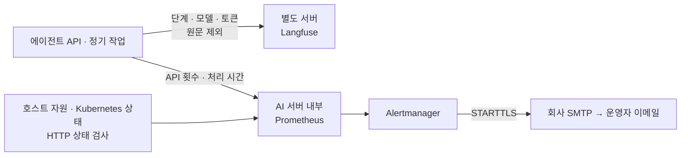

# 모니터링과 AI 추적

> **이 문서는 언제 보나요?** AI 서버의 장애·자원 부족·정기 작업 실패를 알림으로 받고, 추천 한 건이 어느 단계·모델에서 시간을 쓰는지 보고 싶을 때.
>
> **기본 설치 문서입니다.** 새 설치는 K3s 서버를 만든 뒤 **4장의 별도 Langfuse 서버를 먼저 설치**합니다. 2·3장의 지표·알림 설치와 수신함 확인은 [에이전트 배포](../04-에이전트/01-에이전트-구조와-배포.md) 뒤에 합니다. 5장은 기존 설치를 연결하거나 프로젝트 키를 바꿀 때만 봅니다. 운영 지표·알림은 AI 서버의 K3s에, Langfuse는 별도 서버의 Docker Compose에 둡니다. Langflow(흐름을 만드는 도구)와 Langfuse(처리를 추적하는 도구)는 서로 다릅니다.
>
> ⚠️ 실제 AWS·SMTP 수신함·HTTPS 발급·실제 Claude에서는 확인하지 못했습니다. 로컬 확인 범위는 [버전 고정표](../00-개요/02-준비물과-정할-값.md#5-버전-고정표)를 봅니다. 화면 경로는 버전에 따라 다를 수 있습니다.

## 1. 두 가지를 나눠 본다



| 구성 | 맡는 일 | 위치 |
|---|---|---|
| Prometheus | 30초마다 지표를 읽고 경보 조건 판단 | `ai-observe` |
| Alertmanager | 경보 묶기·반복 간격·해제 이메일 | `ai-observe` |
| Node Exporter | 두 서버의 메모리·디스크 지표 | AI 서버 노드·별도 Compose |
| kube-state-metrics | 파드·Deployment·정기 작업 상태 | `ai-observe`, 조회 권한만 |
| Blackbox Exporter | API의 DB 준비 상태·TEI·LiteLLM과 별도 Langfuse(HTTPS)의 상태 확인 | `ai-observe` |
| Langfuse v4 | 추천·분석의 부모/자식 단계, 모델·토큰·오류 종류 추적 | 별도 서버의 Docker Compose |

Jaeger·EFK는 현재 설치하지 않습니다. 여러 서비스 사이의 상세 추적이나 로그 장기 통합 검색이 필요해지면 추가합니다. 일반 애플리케이션 로그는 당분간 `kubectl logs`, 업무 기록은 기존 DB로 확인합니다.

## 2. AI 서버에 지표·알림 올리기

내 맥의 현재 저장소를 [서버 복사 절차](../01-K3s-서버/01-EC2-인스턴스와-K3s.md#4-1-내-맥에서-저장소-폴더-보내기)로 보냅니다. 기존 설치는 에이전트 **0.4.0** 이미지를 반입·배포해야 `/metrics/`가 생깁니다. 아래 명령은 **AI 서버**의 `~/ddalgiro-ai-agent`에서 실행합니다.

```bash
bash scripts/render.sh
kubectl apply -f rendered/00-namespaces.yaml
python3 scripts/observability/create-secrets.py --alerts
kubectl apply -f rendered/70-monitoring.yaml
kubectl -n ai-observe rollout status statefulset/prometheus --timeout=10m
kubectl -n ai-observe rollout status statefulset/alertmanager --timeout=10m
kubectl -n ai-observe rollout status deployment/kube-state-metrics --timeout=5m
kubectl -n ai-observe rollout status deployment/blackbox-exporter --timeout=5m
kubectl -n ai-observe rollout status daemonset/node-exporter --timeout=5m
kubectl -n ai-observe get pods,pvc
```

- 첫 두 줄은 값을 채우고 새 칸 `ai-observe`를 만듭니다.
- 세 번째 줄에서 회사 SMTP의 `호스트:587`, 발신·수신 이메일, 사용자 이름, 비밀번호를 넣습니다. **STARTTLS를 지원하는 SMTP**를 준비합니다. 비밀번호는 숨겨 받고 `ai-observe/alertmanager-config` Secret으로만 전달합니다. 이 명령 자체는 이메일을 보내지 않습니다.
- 준비된 파드는 `READY`가 `1/1`, PVC 두 개는 `Bound`여야 합니다. SMTP Secret이 없으면 Alertmanager가 시작하지 않습니다. 수신 설정 없이 운영 준비가 끝났다고 판단하지 않습니다.
- 지표는 **7일 또는 8GB** 중 먼저 닿는 조건까지 보관합니다(PVC 10GiB, 별도 여유 공간). Alertmanager의 중복 알림·일시 중지 상태는 PVC 1GiB에 보관합니다.
- 포트 9090·9093·9100·8080·9115를 보안 그룹에 추가하지 않습니다. Ingress도 만들지 않습니다.

### 수집 확인

내 맥에서 다음으로 접속하고, 열린 **서버 셸**에서 뒤의 명령을 실행합니다.

```bash
ssh -L 9090:localhost:9090 ddalgiro-ai
```

```bash
kubectl -n ai-observe port-forward service/prometheus 9090:9090
```

`Forwarding from 127.0.0.1:9090`을 확인한 뒤 내 맥의 브라우저에서 엽니다.

- `http://localhost:9090/targets`: 대상이 모두 `UP`. 별도 서버를 보는 `langfuse`·`langfuse-node` 대상도 `UP`이어야 합니다. `site.env`의 `LANGFUSE_ENABLED`가 `false`인 기존 설치에서만 이 두 대상이 비어 있습니다.
- `http://localhost:9090/alerts`: 지금 발생한 경보.
- 조회 식 `ddalgiro_http_requests_total`: API 요청을 한 번 이상 보낸 뒤 경로별 횟수. 정해진 경로 틀만 라벨에 들어갑니다.
- `node_memory_MemAvailable_bytes`, `node_filesystem_avail_bytes{mountpoint="/"}`: **호스트** 메모리·디스크. 파드의 메모리 사용량을 세부적으로 모으는 구성은 아니며, 필요할 때 `kubectl top pod -A`도 확인합니다.

각 서버의 실제 루트 파일시스템 지표가 있어야 합니다. 수집 주소가 `UP`이어도 실제 호스트 지표가 없으면 설치 확인이 끝난 것이 아닙니다. Docker Desktop 같은 중첩 환경은 루트가 가상 파일시스템이라 제외될 수 있습니다. EC2에서는 실제 ext4·XFS 루트 지표를 확인하며, 누락이 이어지면 `NodeHostMetricsMissing` 경보가 납니다.

확인이 끝나면 서버에서 `Ctrl+C`로 포트 연결을 닫고 SSH 접속을 끝냅니다. `/metrics/`는 내부 전용이며 외부 HTTPS의 `/v1` 공개 규칙에 포함되지 않습니다.

### 수신함까지 확인

메일 설정을 바꿨다면 Secret을 다시 만든 뒤 `kubectl -n ai-observe rollout restart statefulset/alertmanager`를 실행합니다. Prometheus의 경보 표시만으로 이메일 전송까지 확인된 것은 아닙니다.

새 SSH 접속에서 `-L 9093:localhost:9093`을 쓰고 서버에서 `kubectl -n ai-observe port-forward service/alertmanager 9093:9093`을 켭니다. **내 맥의 다른 터미널**에서 아래를 실행합니다. 이 단계는 설정한 수신자에게 설치 확인 이메일을 보냅니다.

```bash
curl -sS -X POST http://localhost:9093/api/v2/alerts \
  -H 'Content-Type: application/json' \
  -d '[{"labels":{"alertname":"InstallationMailTest","severity":"info"},"annotations":{"summary":"딸기로 AI 장애 알림 설치 확인"}}]'
```

- 그룹 대기 약 30초 뒤 수신함·스팸함을 확인합니다. 받지 못했으면 `kubectl -n ai-observe logs statefulset/alertmanager --tail=30`으로 TLS·인증·발신 권한을 봅니다.
- 같은 경보는 묶어 보내고, 계속 발생하면 기본 4시간마다 반복합니다. 경보가 끝나면 해제 알림도 보냅니다.
- 테스트 뒤 포트 연결을 닫습니다. 운영자 변경 시 수신 주소도 Secret에서 갱신합니다.

## 3. 무엇이 경보가 되나

| 조건 | 대기 | 살필 것 |
|---|---|---|
| API DB 준비·TEI·LiteLLM·별도 Langfuse(HTTPS)의 상태 검사 실패 | 2분 | 해당 부품·DB 로그, Langfuse 서버와 그 보안 그룹 |
| 지표 수집 대상 연결 실패 | 3분 | 해당 파드·Service·수집 설정 |
| 여유 메모리·루트 디스크 15% 미만 | 10분 | 임베딩·모델 기록·백업·지표 보관량 |
| 호스트 메모리·루트 디스크 지표가 들어오지 않음 | 10분 | Node Exporter의 호스트 마운트, 별도 서버의 `/internal/metrics` |
| Deployment의 준비된 파드 수가 필요한 수보다 적음 | 10분 | 시작 실패·메모리 부족·이미지 반입 |
| CronJob이 만든 **최신 실행**의 최종 실패 | 1분 | 해당 작업 로그. 새 실행이 성공하면 옛 실패는 계속 경보가 되지 않음 |
| 최근 실행에 2시간 넘게 성공 기록이 없음 | 추가 10분 | 멈춘 수집·분석·백업. 중지(`suspend`)한 작업은 제외 |
| 예정된 정기 실행이 15분 이상 늦음 | 추가 10분 | 스케줄러·앞 실행 지연. 중지한 작업은 제외 |
| API 서버 오류 비율 5% 초과 | 5분 | 최근 10분 요청이 5건 이상일 때만 판단 |
| API 95백분위 처리 시간 45초 초과 | 5분 | 최근 10분 요청이 10건 이상일 때만 판단 |
| 추적 초기화·기록 오류, 알림 전송 오류 | 규칙별 1~5분 | Langfuse 주소·키, SMTP, 각 로그 |

수집기가 키·피드 미설정으로 **건너뛰고 성공**한 경우는 실패 경보가 아닙니다. 키워드별 자료 완성도도 이 경보만으로 판단하지 않습니다([수집 확인](../04-에이전트/02-트렌드-분석-추천.md#4-네이버-키-넣고-수집-돌리기)). 정식 운영에서는 출처를 활성화하고 실제 자료 날짜·완료 표시를 함께 봅니다.

임계값은 `k8s/70-monitoring.yaml`의 `alerts.yaml`이 원본입니다. 키워드가 많아 정상 분석이 2시간을 넘는다면 실제 실행 시간을 잰 뒤 기준을 늘립니다. 원본을 고쳐 서버로 보내고 렌더링·적용한 다음 Prometheus를 재시작합니다.

```bash
bash scripts/render.sh
kubectl apply -f rendered/70-monitoring.yaml
kubectl -n ai-observe rollout restart statefulset/prometheus
kubectl -n ai-observe rollout status statefulset/prometheus --timeout=5m
```

**AI 서버 한 대 자체가 꺼지면 안의 Prometheus·Alertmanager도 멈춥니다.** 운영 전 AWS CloudWatch에서 두 EC2 각각의 `StatusCheckFailed` 경보와 서버 밖의 수신 경로를 별도로 설정하고 실제 수신을 확인합니다. 서버 내부 지표만으로 호스트 장애 감지까지 끝났다고 보지 않습니다([AWS 상태 검사](https://docs.aws.amazon.com/AWSEC2/latest/UserGuide/monitoring-system-instance-status-check.html)).

### 서버 밖 EC2 상태 경보 배포

[`deploy/monitoring/host-alarms.yaml`](../../deploy/monitoring/host-alarms.yaml)은 AI 서버와 Langfuse 서버 두 대의 EC2 상태 검사·지표 누락을 AWS에서 감지하는 CloudFormation 템플릿입니다. **이 파일을 배포하면 유료 경보 자원과 SNS 이메일 구독이 생성됩니다.** 실제 계정에서는 아직 적용하지 않았습니다.

1. AWS 서울 리전 → CloudFormation → 스택 생성 → 새 리소스 사용(표준) → 기존 템플릿 선택 → 템플릿 파일 업로드에서 이 파일을 올립니다. "기존 리소스 사용(가져오기)"은 고르지 않습니다.
2. `AiInstanceId`는 AI 서버 ID, `LangfuseInstanceId`는 Langfuse 서버 ID, `AlertEmail`은 실제 운영자 수신 주소를 넣습니다. **기본 두 서버 설치에서는 두 ID를 모두 채워 경보 두 개를 만듭니다.** 템플릿의 빈 값은 기존 한 서버 설치와의 호환용입니다.
3. 리소스·요금을 확인하고 스택을 생성합니다. 수신함에서 **SNS 구독 확인 링크**를 완료해야 알림이 도착합니다.
4. SNS 주제의 테스트 게시로 수신을 확인합니다. 상태 검사 실패가 1분 간격으로 두 번 이어지거나 지표가 누락되면 경보, 정상으로 돌아오면 해제 알림을 보냅니다.

계획된 인스턴스 중지에도 지표 누락 경보가 발생할 수 있으므로 점검 기간에는 CloudWatch의 해당 경보 작업을 중지하고 종료 뒤 복구합니다. 이는 **EC2 상태 검사**이며 API 요청 성공·Prometheus 프로세스의 가동 자체를 대신 확인하지는 않습니다. 외부 HTTPS 가용성 감시가 필요한 운영 기준은 별도로 정합니다([AWS 경보 리소스](https://docs.aws.amazon.com/AWSCloudFormation/latest/TemplateReference/aws-resource-cloudwatch-alarm.html)).

## 4. Langfuse 별도 서버 준비

### 4-1. 자원·접근

Langfuse는 처음부터 설치합니다. **AWS 콘솔의 서울 리전 → EC2 → 인스턴스 시작**에서 아래 값으로 새 인스턴스를 만듭니다. AI 서버와 별개 인스턴스·디스크·탄력적 IP를 쓰며, **이 서버에는 K3s를 설치하지 않습니다.** 계정·키 페어·탄력적 IP를 다루는 방법은 [EC2 준비 절차](../01-K3s-서버/01-EC2-인스턴스와-K3s.md)를 참고하되 사양은 아래 표를 따릅니다.

| 항목 | 기본값 |
|---|---|
| 이름·리전 | `ddalgiro-observe`, 서울 `ap-northeast-2`. 가능하면 AI 서버와 같은 가용 영역 |
| AMI·CPU | Ubuntu Server 24.04 LTS, **x86_64(amd64)** |
| 인스턴스 | **`m7i.xlarge` — 4 vCPU·16GiB**, CPU 크레딧 없음. GPU 불필요 |
| 루트 디스크 | **EBS gp3 100GiB**, 암호화, 기본 IOPS·처리량. Compose 볼륨도 이 디스크에 저장 |
| 키 페어·SSH 별칭 | `ddalgiro-observe.pem` · `ddalgiro-observe` |
| 공인 IP·DNS | 별도 탄력적 IP 1개(예: `203.0.113.40`), `langfuse.example.com`의 A 레코드로 연결 |
| 보안 그룹 | 22는 운영자 IP, **443은 AI 서버 탄력적 IP와 운영자 IP만**, 80은 누구나(`0.0.0.0/0`) — 인증서 발급·갱신 확인이 어느 IP에서 올지 정해져 있지 않기 때문입니다. 기본 아웃바운드 허용 |
| 외부에 열지 않을 포트 | DB·Redis·ClickHouse·MinIO·3000·9100. 관리 화면·수신·지표는 Caddy HTTPS를 경유 |
| 월 비용 | EC2 $180.89 + 디스크 $9.12 + 스냅샷 $1.25 + IPv4 $3.65 + 호스트 경보 $0.10 = **약 $195.01(약 26만 원)** |

2026-11-16 확인 기준입니다. 공식 Compose VM 권장치(최소 4코어·16GiB, 디스크 예시 100GiB)를 따르고, 저장소의 지속 작업을 고려해 CPU 크레딧이 없는 유형을 정했습니다. 현재 Compose 8개 서비스의 메모리 한도 합계는 **9GiB**이고, 나머지는 OS·Docker·파일 캐시·여유 공간에 필요합니다. 한도 합계는 실사용량이 아니며 이 사양의 처리량을 보장하지 않습니다([Langfuse VM 안내](https://langfuse.com/self-hosting/deployment/docker-compose)).

초기 한 주의 자원·자료 증가량을 확인합니다. 여유 메모리 15% 미만·OOM·처리 대기가 이어지면 부품별 한도와 `m7i.2xlarge`(8 vCPU·32GiB, 같은 디스크 조건에서 약 $375.91/월)를 검토합니다. 디스크만 부족하면 보관 자료 정리나 EBS 용량 확장을 먼저 봅니다([산식·증설 비용](../00-개요/04-월-비용-계산.md#langfuse-사양과-증설-비용)). Compose에는 이중화·자동 확장·백업 자동화가 포함돼 있지 않습니다. 7장의 별도 백업·복원 확인을 마쳐야 합니다.

키 파일을 내 맥의 `~/.ssh/ddalgiro-observe.pem`에 두고 **내 맥**에서 권한을 제한합니다.

```bash
chmod 600 ~/.ssh/ddalgiro-observe.pem
```

내 맥의 `~/.ssh/config`에 아래를 추가합니다. `HostName`은 실제 탄력적 IP로 바꿉니다.

```sshconfig
Host ddalgiro-observe
  HostName 203.0.113.40
  User ubuntu
  IdentityFile ~/.ssh/ddalgiro-observe.pem
```

```bash
ssh ddalgiro-observe
```

Ubuntu 서버 셸이 열리면 다음 단계로 갑니다. 도메인의 A 레코드가 이 서버 IP를 가리키고 80 포트가 열려 있어야 Caddy의 HTTPS 인증서 발급이 됩니다.

### 4-2. 설치와 첫 관리자

새 **Langfuse 서버**에서 Docker Engine과 Compose v2를 설치합니다. 아래는 Ubuntu 24.04의 [Compose v2 패키지](https://packages.ubuntu.com/noble/docker-compose-v2)를 쓰는 방법입니다. 기존 Docker가 있다면 중복 설치하지 않습니다([Docker 공식 설치 안내](https://docs.docker.com/engine/install/ubuntu/)).

```bash
sudo apt-get update
sudo apt-get install -y docker.io docker-compose-v2
sudo usermod -aG docker "$USER"
```

SSH를 나갔다 다시 접속한 뒤 `docker version`, `docker compose version`으로 확인합니다. 내 맥의 저장소 루트에서 소스를 보냅니다. **이미 생성한 `.env`는 덮어쓰지 않습니다.**

```bash
rsync -av --exclude .git --exclude BOX --exclude rendered --exclude site.env \
  --exclude .venv --exclude __pycache__ --exclude 'agent/.env' \
  --exclude 'scripts/dgx-spark/vllm.env' --exclude 'deploy/langfuse/.env' \
  ./ ddalgiro-observe:~/ddalgiro-ai-agent/
```

다시 **Langfuse 서버**에서 실행합니다.

```bash
cd ~/ddalgiro-ai-agent/deploy/langfuse
python3 ../../scripts/langfuse/init-env.py
docker compose --env-file .env config --quiet
docker compose --env-file .env up -d
docker compose ps
curl -sS --max-time 10 -w '\n%{http_code}\n' http://localhost:3000/api/public/health
```

- 생성기에는 실제 도메인과 관리자 이메일을 넣습니다. DB·암호화·프로젝트 키·관리자 암호는 무작위로 만들고 본인만 읽는 `.env`(600)에 둡니다. 이미 있으면 멈춥니다.
- `config --quiet`는 키를 화면에 보여 주지 않고 설정만 검사합니다. `--quiet`를 뺀 출력은 비밀값을 포함하므로 공유하지 않습니다.
- 웹·워커·PostgreSQL·Redis·ClickHouse·MinIO·Caddy·Node Exporter가 올라옵니다. 첫 기동은 DB 구조 준비로 몇 분 걸릴 수 있습니다. 마지막 명령이 상태를 담은 JSON 한 줄과 `200`을 내면 성공입니다. 연결이 거절되거나 `200`이 아니면 몇 분 뒤 다시 실행합니다.
- Node Exporter에는 호스트 포트가 없습니다. AI 서버는 보안 그룹으로 제한한 HTTPS의 `/internal/metrics`에서 별도 서버 자원도 읽습니다.
- Caddy가 HTTPS 인증서를 관리합니다. DNS·80 포트·외부 아웃바운드가 준비돼야 합니다. `https://실제-Langfuse-도메인/api/public/health`도 확인합니다. `curl -k`로 인증서 검사를 건너뛰지 않습니다.
- 보호된 `.env`에서 `LANGFUSE_INIT_USER_EMAIL`·`LANGFUSE_INIT_USER_PASSWORD`로 첫 관리자를 확인합니다. 프로젝트의 두 키는 `LANGFUSE_INIT_PROJECT_PUBLIC_KEY`·`LANGFUSE_INIT_PROJECT_SECRET_KEY`입니다. **채팅·문서에 붙이지 않습니다.** 회원 가입은 꺼 두었습니다.
- 프로젝트 키 두 개는 [에이전트 배포](../04-에이전트/01-에이전트-구조와-배포.md#3-배포) 때 AI 서버의 `create-secrets.py --langfuse`가 물으면 넣습니다. 이 서버에서 `grep LANGFUSE_INIT_PROJECT .env`로 읽어 AI 서버의 입력 칸에 직접 붙여 넣고, 파일이나 메모로 옮겨 두지 않습니다.
- 관리 화면은 보안 그룹의 443에 넣은 운영자 IP에서 `https://실제-Langfuse-도메인`으로 엽니다.
- Claude API 키나 다른 모델 제공자 키는 이 서버에 넣지 않습니다. 추가 AI 게이트웨이·유료 모델 기반 자동 평가도 켜지 않습니다.

새 설치는 여기까지 마친 뒤 [Claude API 키와 모델](../02-Claude-API/01-Claude-API-키와-모델.md)로 넘어갑니다. 2·3장은 에이전트 배포 뒤에 돌아와서 합니다.

## 5. 에이전트와 연결

**새 설치는 에이전트 배포 때 이미 연결합니다.** 아래는 기존 설치를 연결하거나 프로젝트 키를 바꿀 때의 절차입니다. AI 서버의 기본 `agent-secret`이 있어야 하며, 프로젝트 키 두 개만 넣고 기존 DB·AI 서버 키는 보존합니다. **AI 서버**에서 실행합니다.

```bash
cd ~/ddalgiro-ai-agent
python3 scripts/observability/create-secrets.py --langfuse
```

새 견본은 `LANGFUSE_ENABLED=true`입니다. 내 맥의 `site.env`에 아래처럼 **실제 도메인**을 채우고 AI 서버로 다시 보냅니다. 이전 값 파일을 쓰는 설치도 같은 값을 명시합니다. 실제 프로젝트 키는 `site.env`에 쓰지 않습니다.

```bash
LANGFUSE_ENABLED=true
LANGFUSE_BASE_URL=https://langfuse.example.com
```

**AI 서버**에서 적용합니다.

```bash
bash scripts/render.sh
kubectl apply -f rendered/30-agent-api.yaml -f rendered/70-monitoring.yaml
kubectl -n ai-app rollout restart deployment/agent-api
kubectl -n ai-app rollout status deployment/agent-api --timeout=5m
kubectl -n ai-observe rollout restart statefulset/prometheus
kubectl -n ai-app exec deployment/agent-api -- python -m app.observability --check
```

- 마지막 줄은 **모델을 부르지 않고** 프로젝트 인증 → 두 단계의 설치 확인 추적 → 실제 저장 조회를 확인합니다. `인증·저장·원문 비수집 확인`이 나오면 연결된 것입니다. API를 설치 확인용으로 여러 번 호출하거나 샘플을 운영 DB에 넣을 필요가 없습니다.
- Langfuse v4의 관측(Observations) 목록에서 `ddalgiro.installation.check`를 확인합니다. 이후 정상 추천·분석은 `ddalgiro.reco.request`·`ddalgiro.trend.keyword` 아래에 단계가 연결됩니다.
- 다음에 시작하는 정기 작업도 같은 ConfigMap·Secret을 읽고 종료 때 추적을 보냅니다. API의 Prometheus 지표에는 API 프로세스에서 처리한 호출만 담기며 정기 작업의 모델 호출 합계는 Langfuse·LiteLLM과 함께 봅니다.
- 구조화 출력과 대체 요청을 나눠 셉니다. 클라이언트 SDK·게이트웨이 내부의 모든 HTTP 재시도까지 각각 기록하는 구성은 아닙니다. 응답을 못 받은 실패 호출의 청구액도 여기서 알아낼 수 없습니다.
- 실제 모델 ID·토큰 수가 반환되면 Langfuse의 모델 단가표로 비용을 계산할 수 있습니다. 이름표만 반환되거나 단가가 없으면 비용이 비어 있을 수 있습니다. **실제 청구액은 Claude Console·LiteLLM과 대조**하고 추측한 가격을 넣지 않습니다.

## 6. 보내는 정보와 실패 처리

| 대상 | 보내는 것 | 보내지 않는 것 |
|---|---|---|
| Prometheus | 정해진 API 경로·상태 코드, 단계·모델 이름표, 횟수·시간·토큰 수, 호스트·Kubernetes 상태 | 문의·응답·실제 URL의 번호·검색 문자열·헤더 |
| 별도 Langfuse | 무작위 추적 ID, 단계·모델, DB 요청/키워드 번호, 토큰·시간, 오류 종류 | 문의·근거·모델 응답 원문, 고객·업체 이름, 공급 조건, 예외 메시지·스택·비밀값 |
| SMTP | 경보 이름·구성 요소·오류 상태 | 문의·모델 입력·AI 키 |

SDK 초기화·추적 기록 실패는 업무 요청을 중단하지 않습니다. 비활성화하거나 주소·키가 빠져도 DB·추천 처리는 계속되며, 켜 둔 상태에서 초기화에 실패하면 지표·경보로 확인합니다. 비동기 전송 오류·잘못된 인증은 로그와 설치 확인 명령으로도 봅니다. SDK가 받은 원문 속성은 내보내기 직전에도 허용 목록으로 걸러 냅니다([Langfuse 마스킹](https://langfuse.com/docs/observability/features/masking)).

원문을 보관하지 않으므로 이 화면만으로 문장 품질·정답률을 평가할 수는 없습니다. [검수한 평가 묶음](../02-Claude-API/01-Claude-API-키와-모델.md#6-운영-전-평가와-합격-기준)과 코드·모델 버전을 함께 관리합니다. 자동 평가·프롬프트 원문 저장을 추가하려면 전송 항목·접근 권한·비용을 먼저 정해야 합니다.

## 7. 자원·비용·보관

- AI 서버에 더하는 요청량은 **CPU 225m·메모리 448MiB**, 메모리 한도 합계는 **1.75GiB**, PVC 요청량은 **11GiB**입니다. 매니페스트 값이며 실제 사용량·응답 시간은 따로 잽니다. PVC는 같은 물리 디스크를 사용하므로 별도 디스크가 생긴 것이 아닙니다. PostgreSQL·모델 캐시·백업·지표가 물리 디스크 용량을 함께 씁니다.
- Langfuse의 임대료·디스크·IP·스냅샷·호스트 경보를 기본 비용에 포함합니다. 이 서버는 약 **$195.01/월**, 두 서버 고정비는 약 **$360.97/월**, 기본 Claude 사용량까지 더하면 약 **$581.40/월**입니다. 730시간·1달러=1,350원·부가세 제외·보관량 가정이며, SNS·SMTP·자료 전송 등 별도 비용은 [월 비용 계산](../00-개요/04-월-비용-계산.md)을 봅니다.
- 관측 보관 기간과 디스크 증가량을 주마다 확인합니다. [자동 보관 기간 정리](https://langfuse.com/faq/all/data-access-vs-data-retention)는 자체 설치 Enterprise 기능이며 **이 무료 구성에는 자동 삭제가 설정돼 있지 않습니다.** 운영 전에 보관·삭제 방법을 정하고 실제 정리를 검증합니다. 유료 기능을 선택하면 라이선스 비용도 별도입니다. 사용자·키·평가 기록을 무제한 보관하지 않습니다.
- 별도 서버를 백업하기 전에는 `docker compose stop`으로 전체 저장소의 쓰기를 멈추고, EBS 스냅샷과 암호화된 `.env` 보관본을 함께 만듭니다. 완료 뒤 `docker compose start`로 켭니다. 실행 중 스냅샷만으로 여러 저장소의 일관성을 보장하지 않습니다. 초기 자료로 새 서버 복원을 연습한 뒤 운영합니다.
- AI 서버의 PostgreSQL 덤프는 Prometheus·Alertmanager PVC나 **별도 Langfuse의 DB·객체 저장소**를 복구하지 않습니다. Alertmanager Secret은 [Secret 보관 절차](01-점검-백업-문제-해결.md#4-3-비밀값-따로-보관하기)에 포함합니다.
- `ENCRYPTION_KEY`·`SALT`·프로젝트 키를 새로 만들며 업그레이드하지 않습니다. 기존 `.env`와 데이터 볼륨을 보존합니다. `docker compose down -v`는 저장 자료를 지우므로 운영 갱신에 쓰지 않습니다.

## 8. 로컬 검사

**내 맥**의 저장소 폴더에서, [에이전트 문서 5장](../04-에이전트/01-에이전트-구조와-배포.md#5-코드를-고쳤을-때)의 가상환경(PyYAML·pytest 포함)을 켠 채 실행합니다. 첫 명령의 설정 검사는 Docker도 필요합니다(Prometheus·Alertmanager 이미지를 받아 검사 도구만 실행). 실제 이메일·Claude API를 부르지 않습니다.

```bash
python scripts/observability/check-configs.py
cd agent
python -m pytest tests/test_rules.py tests/test_observability.py tests/test_observability_setup.py -q
```

첫 명령은 임시 폴더에서 렌더링 → `promtool` 설정 검사 → 최신 작업 실패·성공 후 해제·중지한 작업 제외·최초 성공 누락 검사 → `amtool` 문법 검사를 합니다. 둘째 시험은 원문 비수집·병렬 추적·초기화 실패 시 업무 유지·지표 라벨·비밀값 파일 권한을 확인합니다.

## 9. 문제 해결

| 증상 | 원인과 해결 |
|---|---|
| `alertmanager-0`이 `ContainerCreating`에서 넘어가지 않음 | `ai-observe/alertmanager-config` Secret이 없습니다. 2장의 `create-secrets.py --alerts`를 실행하면 스스로 뜹니다 |
| `render.sh`가 `추적을 켜려면 LANGFUSE_BASE_URL 에 별도 서버의 HTTPS 주소가 필요합니다` | `site.env`의 `LANGFUSE_BASE_URL`이 비었거나 `https://도메인` 꼴이 아닙니다. 경로(`/api/…`)를 붙이지 않습니다 |
| `--check`가 `추적 활성화 설정·주소·프로젝트 키를 확인하세요` | `LANGFUSE_ENABLED`·`LANGFUSE_BASE_URL`이 ConfigMap에 반영됐는지(`render.sh` → `kubectl apply` → API 재시작), 프로젝트 키가 Langfuse 서버 `.env`의 값과 같은지 봅니다. AI 서버에서 `curl -sS -o /dev/null -w '%{http_code}\n' https://실제-Langfuse-도메인/api/public/health`가 `200`이 아니면 Langfuse 서버 보안 그룹의 443에 AI 서버의 탄력적 IP가 있는지 확인합니다 |
| `--check`가 `추적을 저장하지 못했습니다` | 인증은 됐지만 저장이 늦거나 실패했습니다. Langfuse 서버의 `~/ddalgiro-ai-agent/deploy/langfuse`에서 `docker compose ps`로 모든 부품이 실행 중인지 보고 `docker compose logs --tail=50 worker`를 확인합니다 |
| `init-env.py`가 `FileExistsError`로 멈춤 | `.env`가 이미 있습니다. 정상이며 덮어쓰지 않습니다. ❌ 지우고 다시 만들면 암호화 열쇠가 바뀌어 저장한 자료를 읽을 수 없습니다 |
| Prometheus의 `langfuse`·`langfuse-node` 대상이 `DOWN` | Langfuse 서버가 꺼졌거나, 보안 그룹의 443에 AI 서버의 탄력적 IP가 없거나, 인증서가 아직 발급되지 않았습니다(DNS·80 포트) |
| 설치 확인 메일이 오지 않음 | 2장 [수신함까지 확인](#수신함까지-확인)의 Alertmanager 로그에서 TLS·인증·발신 권한 오류를 봅니다. 스팸함도 확인합니다 |
