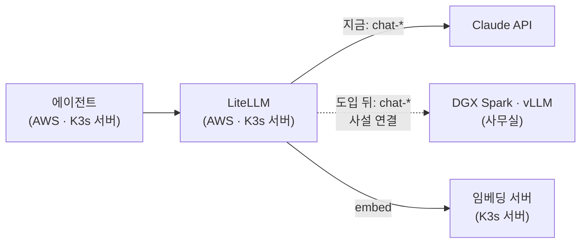

# DGX Spark 도입

> **이 문서는 언제 보나요?** 대화 모델을 Claude API 대신 **사무실에 둔 NVIDIA DGX Spark**에서 직접 돌리기로 했을 때. 지금의 설치 순서에는 들어 있지 않은 **추후 도입** 절차입니다. 끝나면 게이트웨이의 `chat-*` 이름표가 DGX Spark의 모델을 부릅니다.
>
> 지금 구성은 [전체 구성](../00-개요/01-전체-구성-한눈에-보기.md)에 있습니다. 예시 값: DGX Spark의 사무실 내부 IP `192.168.0.20`, 계정 `spark`.
>
> ⚠️ **이 문서의 절차는 실제 기기에서 확인하지 못했습니다.** 모델 실행 옵션은 NVIDIA가 공개한 [DGX Spark vLLM 플레이북](https://build.nvidia.com/spark/vllm)의 128GB용 스크립트(2026-10-19 확인분)를 그대로 따랐고, 달라진 세 군데는 [5장](#5-스크립트와-키-준비)에 적었습니다. AWS의 K3s 서버와 사무실의 DGX Spark를 잇는 방법([2장](#2-k3s-서버와-dgx-spark-잇기))은 절차 없이 고를 것만 정리했습니다.

---

## 1. 언제 들이고, 무엇이 달라지나

DGX Spark(NVIDIA GB10 · 통합 메모리 128GB · ARM64)는 대화 모델 하나를 사무실에서 직접 서빙하는 장비입니다. 아래 가운데 하나에 해당할 때 들입니다.

| 들이는 이유 | 설명 |
|---|---|
| 글을 회사 밖으로 보낼 수 없게 됨 | 입점사·고객사와의 계약이나 내부 규정이 문의 글·공급 조건을 외부 서비스에 넘기는 것을 막는 경우([무엇이 나가나](../02-Claude-API/01-Claude-API-키와-모델.md#5-무엇이-서버-밖으로-나가나)) |
| 모델을 직접 학습시킴 | 연구개발계획서의 뒤 단계인 도메인 특화 모델 |
| 평가를 같은 모델로 오래 되풀이해야 함 | 내려받은 모델 파일은 바뀌지 않습니다. Claude API의 모델은 예고 뒤 종료됩니다 |
| Claude API 요금이 장비 값을 넘어섬 | 처리량이 크게 늘었을 때. 지금 어림으로는 장비 값을 채우는 데 약 32개월이 걸립니다([월 비용 계산 5장](../00-개요/04-월-비용-계산.md#5-포함하지-않은-것과-견줄-것)) |

달라지는 것은 게이트웨이 뒤쪽뿐입니다. 에이전트는 이름표만 쓰므로 코드를 고치지 않습니다.



| 지금 (Claude API) | 도입 뒤 (DGX Spark) |
|---|---|
| 모델 운영 없음, 쓴 만큼 요금 | 장비 값 + 전기, 모델 서버를 직접 운영(업데이트·고장·정전) |
| 한국어 품질이 높은 상용 모델 | 128GB에 들어가는 공개 모델. 한국어 품질을 직접 재야 함([8장](#8-모델-고르기)) |
| 문의 글·근거가 Anthropic으로 나감 | 대화 이름표를 모두 옮기고 외부 대체 호출을 끄면 Anthropic으로 보내지 않음. 자료는 여전히 AWS의 DB·에이전트·게이트웨이를 거쳐 사무실로 전달됨 |
| 인터넷만 있으면 됨 | AWS의 K3s 서버와 사무실 장비를 잇는 연결이 필요(2장) |

- **vLLM**: 대화 모델을 메모리에 올려 두고, 여러 요청을 묶어 빠르게 답하는 모델 서버입니다. OpenAI와 같은 형식의 API(`/v1/chat/completions`)를 엽니다.
- DGX Spark는 모델 하나만 서빙합니다(NVIDIA 권장: 한 번에 모델 앱 하나). 쿠버네티스에 넣지 않고 Docker로 띄웁니다. 임베딩은 지금처럼 K3s 서버의 CPU에서 돕니다.
- 두 가지를 섞을 수도 있습니다 — 이름표 하나만 DGX Spark로 돌리거나, DGX Spark가 멈췄을 때 Claude API로 넘기는 것입니다([9장](#9-게이트웨이를-dgx-spark로-돌리기)). 이 경우 해당 호출의 글은 여전히 Anthropic으로 나갑니다. **AWS를 포함해 회사 밖 처리를 금지하는 조건이라면 대화 모델만 옮겨서는 충족되지 않습니다.**

## 2. K3s 서버와 DGX Spark 잇기

게이트웨이는 AWS에, DGX Spark는 사무실에 있습니다. 게이트웨이가 모델 서버를 부르려면 둘 사이에 길이 있어야 합니다. **이 저장소에는 아직 이 길을 만드는 절차가 없습니다.** 도입할 때 아래에서 하나를 정하고 절차를 이 문서에 더합니다.

| 방법 | 내용 | 살필 점 |
|---|---|---|
| 사설 연결(VPN) — 권장 | K3s 서버와 DGX Spark에 WireGuard 같은 사설망 프로그램을 깔아 둘만 통하는 길을 만듭니다. 게이트웨이는 DGX Spark의 사설 주소를 부릅니다 | 사무실 공유기에 들어오는 포트를 열지 않아도 됩니다(DGX Spark가 밖으로 연결을 겁니다). 사무실 회선이 끊기면 모델도 끊깁니다 |
| 공유기 포트 포워딩 | 사무실 공유기에서 포트 하나를 DGX Spark로 넘기고, K3s 서버의 탄력적 IP만 들어오게 막습니다 | 모델 서버는 평문 HTTP라 HTTPS 종료 지점과 인증서 검증이 추가로 필요합니다. 9장의 HTTP Service 예시는 이 방식에 그대로 쓸 수 없습니다 |
| 게이트웨이와 에이전트도 사무실로 | K3s 서버를 통째로 사무실 장비로 옮깁니다 | AWS를 쓰는 이점을 잃습니다. 구성을 다시 정해야 합니다 |

- 어느 방법이든 `site.env`의 `DGX_SPARK_IP`에는 **K3s 서버에서 DGX Spark로 닿는 주소**를 넣습니다. 사설 연결이면 그 연결 위의 DGX Spark 주소입니다.
- 사무실 회선·정전이 새 고장 지점이 됩니다. Claude API를 예비로 남겨 두는 방법을 함께 검토합니다(9장).

## 3. 첫 설정과 접속

1. 모니터·키보드·랜 케이블(공유기와 연결)·전원을 꽂고 켭니다.
2. 화면의 첫 설정 안내에 따라 언어·시간대(Asia/Seoul)·계정(`spark`)·기기 이름을 정합니다. 화면 구성은 [NVIDIA의 DGX Spark 시작 안내](https://build.nvidia.com/spark)를 따릅니다.
3. 설정이 끝나면 시스템 업데이트를 합니다. NVIDIA는 **DGX Dashboard**의 업데이트 메뉴를 쓰도록 안내합니다.
4. 공유기 관리 화면의 DHCP 고정 할당(ipTIME은 *고급 설정 → 네트워크 관리 → DHCP 서버 설정*의 수동 IP 할당)에서 DGX Spark의 유선 랜 카드에 `192.168.0.20`을 묶고, 기기를 다시 켭니다. 무선보다 유선을 씁니다.

사무실 안의 내 맥에서 키로 접속하게 합니다.

```bash
ssh-copy-id spark@192.168.0.20
ssh spark@192.168.0.20
```

- 비밀번호를 한 번 묻고 키를 등록합니다. 둘째 줄에서 비밀번호 없이 들어가지면 성공입니다.

## 4. Docker 와 GPU 확인

DGX Spark에서 실행합니다. DGX OS에는 Docker와 NVIDIA 컨테이너 런타임이 들어 있습니다.

```bash
docker ps
nvidia-smi
```

- 첫 줄: 빈 표(제목 줄만)가 나오면 성공입니다. `permission denied`가 나오면 아래를 실행하고 다시 해 봅니다.
- 둘째 줄: GPU 이름이 보이면 성공입니다. 메모리 칸이 `N/A`로 나오는 것은 정상입니다(CPU와 GPU가 메모리를 함께 쓰는 구조).

```bash
sudo usermod -aG docker $USER && newgrp docker
```

- 내 계정이 `sudo` 없이 Docker를 쓰게 합니다(NVIDIA 플레이북의 안내).

## 5. 스크립트와 키 준비

### 5-1. 내 맥에서 스크립트 보내기

```bash
scp -r ~/workspace/workspace-vscode/ddalgiro-ai-agent/scripts/dgx-spark spark@192.168.0.20:~/vllm
```

- 저장소의 `scripts/dgx-spark` 폴더를 DGX Spark의 `~/vllm`으로 복사합니다.

### 5-2. DGX Spark에서 값 파일 만들기

```bash
cd ~/vllm
cp vllm.env.example vllm.env
chmod 600 vllm.env
openssl rand -hex 24
nano vllm.env
```

- 넷째 줄이 출력한 무작위 글자를 복사해, 다섯째 줄에서 연 파일의 `VLLM_API_KEY=` 뒤에 붙여 넣고 저장합니다(`Ctrl+O`, `Enter`, `Ctrl+X`).
- 이 키는 9장에서 K3s 서버에도 한 번 넣습니다. ⚠️ 채팅·메일에 붙이지 않습니다.
- 나머지 값(모델·이미지·포트)은 그대로 둡니다.

### 이 저장소의 스크립트가 NVIDIA 원본과 다른 점

| 다른 점 | 이유 | 그래서 해야 하는 일 |
|---|---|---|
| `--host 0.0.0.0` (원본 `127.0.0.1`) | 다른 기계의 게이트웨이가 불러야 함 | 7장의 방화벽으로 K3s 서버만 들어오게 막기 |
| `VLLM_API_KEY` 추가 | 키 없이는 부르지 못하게 | 6장 확인의 "키 없이 → 401" |
| `--restart unless-stopped` 추가 | 기기를 껐다 켜도 다시 뜨게 | 7장의 재부팅 확인 |

## 6. 모델 서버 띄우기

⚠️ `vllm-start.sh`는 호스트 네트워크에서 모든 주소(`0.0.0.0`)를 받습니다. **실행 전에 7-1의 방화벽을 적용**하고, 사설 연결을 확인하기 전에는 공유기의 모델 포트를 공개하지 않습니다. 아래 확인은 우선 DGX Spark 자체에서만 합니다.

### 6-1. 이미지와 모델 받기

```bash
docker pull nvcr.io/nvidia/vllm:26.10.pre1-py3
hf download nvidia/Qwen3.8-27B-NVFP4
hf download z-lab/Qwen3.8-27B-DFlash2
```

- 첫 줄은 vLLM 컨테이너 이미지를 받습니다. 거부되면 <https://ngc.nvidia.com>에서 API 키를 만들어 `docker login nvcr.io`(사용자 이름 `$oauthtoken`, 비밀번호에 API 키)로 로그인한 뒤 다시 받습니다.
- 둘째·셋째 줄은 대화 모델과 초안 모델(답을 빨리 만들도록 돕는 작은 모델)을 받습니다. 수십 GB라 시간이 걸립니다.
- `hf` 명령이 없으면 이 두 줄은 건너뜁니다. 컨테이너가 처음 뜰 때 스스로 받습니다(그만큼 첫 기동이 오래 걸립니다).

### 6-2. 실행

```bash
cd ~/vllm
bash vllm-start.sh
docker logs --tail 50 --follow vllm
```

- 둘째 줄이 컨테이너를 띄웁니다. 셋째 줄로 진행을 보다가 `Application startup complete`가 보이면 `Ctrl+C`로 빠져나옵니다(컨테이너는 계속 돕니다).

### 확인

```bash
KEY=$(grep '^VLLM_API_KEY=' ~/vllm/vllm.env | cut -d= -f2)
curl -s -o /dev/null -w '%{http_code}\n' http://localhost:8000/health
curl -s -o /dev/null -w '%{http_code}\n' http://localhost:8000/v1/models
curl -s http://localhost:8000/v1/chat/completions \
  -H "Authorization: Bearer $KEY" -H "Content-Type: application/json" \
  -d '{"model":"nvidia/Qwen3.8-27B-NVFP4","messages":[{"role":"user","content":"한 문장으로 자기소개 해줘"}],"max_tokens":1024}'
```

| 줄 | 기대 결과 |
|---|---|
| 2 (`/health`) | `200` |
| 3 (키 없이 `/v1/models`) | `401`. ⚠️ **`200`이 나오면 키가 적용되지 않은 것**입니다. 다음 장으로 넘어가지 말고 [문제 해결](#10-문제-해결)의 "키 없이도 200"을 봅니다 |
| 4 (대화) | `choices` 안에 한국어 답이 든 JSON. `content`가 `null`이고 `finish_reason`이 `length`면 `max_tokens`를 더 크게 줍니다(모델이 생각 과정에 토큰을 먼저 씁니다) |

## 7. 방화벽과 K3s 서버에서 확인

### 7-1. 방화벽 (DGX Spark)

모델 서버가 모든 네트워크 카드에서 듣고 있으므로, K3s 서버만 들어오게 막습니다. 아래의 `<K3s 서버 주소>`에는 2장에서 정한 길 위에서 **K3s 서버가 들어오는 주소**를 넣습니다(사설 연결이면 그 연결 위의 K3s 서버 주소).

```bash
sudo ufw allow from 192.168.0.0/24 to any port 22 proto tcp
sudo ufw allow from <K3s 서버 주소> to any port 8000 proto tcp
sudo ufw default deny incoming
sudo ufw enable
sudo ufw status verbose
```

- 첫 줄: SSH는 사무실 내부에서만. ⚠️ 이 줄을 먼저 넣지 않고 켜면 SSH가 끊깁니다.
- 둘째 줄: 모델 서버 포트는 K3s 서버 한 대에서만.
- `ufw` 명령이 없으면 `sudo apt -y install ufw`로 설치합니다.
- 사설 연결 프로그램이 쓰는 포트는 그 프로그램의 안내대로 엽니다.

### 7-2. 확인

K3s 서버에서(`<DGX Spark 주소>`는 `site.env`의 `DGX_SPARK_IP`에 넣을 값):

```bash
curl -s -o /dev/null -w '%{http_code}\n' -m 5 http://<DGX Spark 주소>:8000/health
```

- `200`이면 성공입니다.

사무실 안의 다른 기기(내 맥)에서:

```bash
curl -s -o /dev/null -w '%{http_code}\n' -m 5 http://192.168.0.20:8000/health
```

- `000`(시간 초과)이면 성공입니다 — K3s 서버가 아닌 곳은 막혔다는 뜻입니다.

### 7-3. 껐다 켜도 다시 뜨는지

```bash
sudo reboot
# 다시 켜진 뒤 접속해서
docker ps --format '{{.Names}} {{.Status}}'
```

- `vllm Up …`이 보이면 성공입니다. 모델을 다시 올리는 몇 분 동안은 `/health`가 응답하지 않습니다.

## 8. 모델 고르기

공개 자료 확인 기준일은 **2026-11-14**입니다. `nvidia/Qwen3.8-27B-NVFP4`는 DGX Spark 128GB 한 대에서 먼저 평가할 후보입니다. 운영 모델로 정하려면 **Claude API와 같은 평가 묶음·같은 기준**([운영 전 평가와 합격 기준](../02-Claude-API/01-Claude-API-키와-모델.md#6-운영-전-평가와-합격-기준))을 통과해야 합니다.

### 8-1. 공개 자료로 알 수 있는 것과 없는 것

- [NVIDIA 실행 안내](https://build.nvidia.com/spark/vllm/advanced)는 기기에 맞는 모델·메모리·실행 옵션을 고르는 근거입니다. [NVFP4 모델 설명의 평가](https://huggingface.co/nvidia/Qwen3.8-27B-NVFP4#evaluation)는 일반 추론·코딩·지시 이행 등을 다루며 한국어 주문·브리핑 평가는 없습니다.
- 한국어 능력의 참고 자료는 있습니다. [axteam의 자체 측정](https://huggingface.co/axteam/Qwen3.8-27B-FP8-dynamic#benchmarks-measured)에서 원본 BF16 모델은 KMMLU 65.72, HAE-RAE 76.35였습니다. 한국어 지식 시험이며, 대화 형식이 아닌 입력으로 측정했습니다. 이 수치를 NVIDIA NVFP4판의 주문 이해 정확도로 쓰면 안 됩니다.
- [Qwen 공식 설명](https://huggingface.co/Qwen/Qwen3.8-27B#api-usage)에 따르면 생각 과정은 기본으로 켜집니다. 에이전트는 이를 끄지 않으며 `temperature=0`을 보냅니다(직접 서빙하는 모델에는 이 값이 그대로 전달됩니다). 공식 평가와 생성 설정이 다르고, 에이전트의 모델 대기 시간 120초도 [백엔드 응답 대기 55초](../06-관리자-화면-연동/01-백엔드-중계와-관리자-화면.md#시간-제한에-대해)보다 깁니다. 품질과 속도를 함께 재야 합니다.
- 이 저장소의 시험은 더 작은 로컬 모델(Qwen2.5 7b·14b)로 했습니다. 그때 연도·요일·예산 곱셈이 실행마다 다르게 틀려 날짜·금액 계산을 코드로 옮겼습니다.

### 8-2. DGX Spark 128GB에서 비교할 후보

아래 순서는 한국어가 최고라는 순위가 아니라 **이 프로젝트에서 시험할 우선순위**입니다. 제조사가 다른 시험에서 발표한 점수끼리 직접 순위를 매기지 않습니다. 메모리 추정은 모델 가중치만 계산한 값이며, 실행 중에는 운영체제·작업 공간·대화 캐시가 더 필요합니다.

| 순서 | 후보 | 선택 이유와 한계 |
|---|---|---|
| 1 — 현재 기준 모델 | `nvidia/Qwen3.8-27B-NVFP4` + 현재 DFlash2 | NVIDIA의 128GB 실행 조합을 유지할 수 있습니다. 한국어 조건 정확도·문체·속도가 합격하면 유지합니다. 초안 모델은 속도를 돕는 역할이며 한국어 품질을 별도로 높이는 모델이 아닙니다 |
| 2 — 첫 교체 비교 | `google/gemma-4-26B-A4B-it`, BF16 | [Google 모델](https://huggingface.co/google/gemma-4-26B-A4B-it)은 Apache 2.0이며, MoE(입력마다 모델 일부를 쓰는 구조)로 약 4B가 동작합니다. 가중치는 단순 계산으로 약 52GB라 128GB에서 시험할 여지가 있습니다. [vLLM 실행 안내](https://docs.vllm.ai/projects/recipes/en/stable/Google/Gemma4.html)가 있지만, 현재 ARM64·GB10 이미지에서의 기동·JSON 출력·한국어·실제 속도는 따로 확인해야 합니다 |
| 3 — 한국어 중심 추가 비교 | `kakaocorp/kanana-2-30b-a3b-instruct-2601`, BF16 | [카카오의 공식 평가](https://huggingface.co/kakaocorp/kanana-2-30b-a3b-instruct-2601#instruct-model-evaluation-results)에 한국어 대화·지식·지시 이행 결과와 vLLM 실행 방법이 있습니다. 약 31B 전체 가중치는 약 62GB로 추정되며, 토큰마다 약 3B를 쓰는 MoE입니다. [이용 조건](https://huggingface.co/kakaocorp/kanana-2-30b-a3b-instruct-2601/blob/main/LICENSE) 3·4절의 표시 의무와 모델 API 제공·재판매 등에 대한 별도 계약 조건을 서비스 방식에 맞춰 확인해야 합니다 |

Gemma 4 31B도 [NVIDIA가 DGX Spark 실행을 안내](https://developer.nvidia.com/blog/bringing-ai-closer-to-the-edge-and-on-device-with-gemma-4/)합니다. 다만 모든 층을 쓰는 31B 모델이 메모리에 들어간다는 사실만으로 응답이 빨라지지는 않습니다. 이 프로젝트는 짧은 조건 추출과 추천 사유가 많으므로, 교체 비교는 26B-A4B부터 시작합니다. 이는 구조와 업무 특성에 따른 판단이며, Qwen보다 빠르거나 한국어가 더 정확하다고 실측한 결과는 아닙니다.

다른 한국어 모델의 제약도 확인합니다. [EXAONE 4.5 33B 라이선스](https://huggingface.co/LGAI-EXAONE/EXAONE-4.5-33B/blob/main/LICENSE) 3.1절은 상업 이용에 별도 계약을 요구합니다. [HyperCLOVA X SEED Think 32B 라이선스](https://huggingface.co/naver-hyperclovax/HyperCLOVAX-SEED-Think-32B/blob/main/LICENSE) 4절에는 이용자 수와 NAVER 경쟁 서비스 관련 조건이 있습니다. [Raon-1 mini preview](https://github.com/krafton-ai/Raon-1-mini-preview)는 한국어 대화 평가를 공개했지만 시험판이고 vLLM 전용 분기와 생각 모드를 권장하므로, 현재 운영 후보보다 뒤에서 검토합니다.

### 8-3. 로컬 모델에서 더 재야 하는 것

평가 묶음과 합격 기준은 [Claude API 문서 6장](../02-Claude-API/01-Claude-API-키와-모델.md#6-운영-전-평가와-합격-기준)과 같습니다. 같은 묶음으로 Claude API의 결과와 나란히 놓고 봅니다. 로컬 모델에서는 아래를 더합니다.

- **생각 모드를 켠 경우와 끈 경우**를 비교합니다. 두 대화 이름표를 모두 Qwen으로 옮겼을 때는 `agent-config`에 `LLM_EXTRA_BODY: '{"chat_template_kwargs":{"enable_thinking":false}}'`를 넣고 [설정 반영·API 재시작](../04-에이전트/01-에이전트-구조와-배포.md#환경-변수-설정만-바꿀-때)을 합니다. 이 옵션은 두 이름표에 공통 적용되므로 **하나가 Claude API를 쓰는 혼합 구성에서는 비워 둡니다.** 다른 모델에도 같은 옵션을 적용할 수 있다고 가정하지 않고 실제 전달·지원 여부를 확인합니다.
- 다른 모델을 시험할 때는 입력 길이 8K~16K·동시 요청 1~2개로 기동과 정확도를 먼저 확인한 뒤 늘립니다. 사용한 모델 리비전·이미지·옵션·지시문·속도·실패율을 함께 기록합니다.
- 55초를 지키려면 출력 길이와 재시도 예산도 정해야 합니다. 추천 결과 5건의 사유를 동시에 만들 때 한 대의 장비가 버티는지 봅니다.

## 9. 게이트웨이를 DGX Spark로 돌리기

모델 서버와 길이 준비되면 게이트웨이의 이름표가 DGX Spark를 가리키게 바꿉니다. 아래 예시는 **암호화된 사설 연결 안에서 HTTP로 접근하는 경우**입니다. `DGX_SPARK_IP`에는 이름이 아닌, K3s 파드에서도 도달 가능한 IPv4 주소를 넣습니다. VPN이 호스트에서만 통하면 게이트웨이 파드에서 실패하므로 아래 확인까지 통과해야 합니다.

1. **값 파일**: 내 맥의 `site.env` 맨 아래 세 줄의 주석(`#`)을 풀고 채웁니다 — `DGX_SPARK_IP`(K3s 서버에서 닿는 주소), `DGX_SPARK_PORT`, `VLLM_MODEL`(`vllm.env`의 `VLLM_MODEL`과 같은 값).
2. **모델 표**: `k8s/22-litellm.yaml`의 `chat-fast`·`chat-smart` 항목을 아래로 바꿉니다. 한쪽만 옮기려면 그 이름표만 바꿉니다.

   ```yaml
         - model_name: chat-fast
           litellm_params:
             model: openai/${VLLM_MODEL}                    # openai/ = OpenAI 호환 규격으로 보낸다. 뒤는 vLLM 의 모델 이름
             api_base: http://dgx-spark.ai-llm.svc:8000/v1  # dgx-spark/21-dgx-spark.yaml 이 붙인 이름
             api_key: os.environ/VLLM_API_KEY               # 키는 Secret 에서 읽는다
             timeout: 120
         - model_name: chat-smart
           litellm_params:
             model: openai/${VLLM_MODEL}
             api_base: http://dgx-spark.ai-llm.svc:8000/v1
             api_key: os.environ/VLLM_API_KEY
             timeout: 180
   ```

3. [저장소를 서버로 다시 보낸](../01-K3s-서버/01-EC2-인스턴스와-K3s.md#4-1-내-맥에서-저장소-폴더-보내기) 뒤, K3s 서버에서 실행합니다.

   ```bash
   cd ~/ddalgiro-ai-agent
   bash scripts/render.sh
   bash scripts/k3s-server/create-secrets.sh --vllm
   kubectl apply -f rendered/21-dgx-spark.yaml -f rendered/22-litellm.yaml
   kubectl -n ai-llm rollout restart deployment/litellm
   ```

   - 둘째 줄: `DGX_SPARK_IP`가 있으면 `k8s/dgx-spark/`의 매니페스트까지 `만들었습니다: … (12개 파일)`로 만듭니다.
   - 셋째 줄: `vllm.env`에 넣은 `VLLM_API_KEY`를 물으면 붙여 넣습니다(게이트웨이를 다시 시작합니다).
   - 넷째 줄: 클러스터 밖의 DGX Spark에 `dgx-spark.ai-llm.svc`라는 클러스터 안 이름을 붙이고, 새 모델 표를 넣습니다.

### 확인

```bash
kubectl -n ai-llm run curl-check --rm -i --restart=Never --image=curlimages/curl:8.11.1 -- \
  curl -s -o /dev/null -w '%{http_code}\n' -m 10 http://dgx-spark.ai-llm.svc:8000/health
```

- `200`이면 클러스터 안의 이름으로 DGX Spark의 모델 서버에 닿은 것입니다. 이어서 [플랫폼 5장의 확인](../03-플랫폼/01-데이터베이스-임베딩-LLM-게이트웨이.md#5-litellm)으로 이름표 호출을 봅니다.
- 이 연결(Service와 EndpointSlice)과 이름표 호출은 시험용 클러스터에서 로컬 모델 서버로 확인했습니다. DGX Spark로는 확인하지 못했습니다.

**함께 고칠 것**

- 문서의 "Claude API" 서술([전체 구성](../00-개요/01-전체-구성-한눈에-보기.md)·[버전 고정표](../00-개요/02-준비물과-정할-값.md#5-버전-고정표)·[운영](../07-운영/01-점검-백업-문제-해결.md))을 바뀐 구성에 맞게 고칩니다.
- Claude API를 쓰지 않게 되면 Claude Console에서 키를 지웁니다. 예비로 남기려면 게이트웨이의 대체 경로(한 모델이 실패하면 다른 모델로 넘기는 기능)를 설정합니다 — 이 저장소에서는 설정하거나 확인하지 않았습니다.
- 모델을 바꿀 때는 DGX Spark의 `~/vllm/vllm.env`(`VLLM_MODEL`, 필요하면 `VLLM_IMAGE`)와 `vllm-start.sh`의 `vllm serve` 뒤 옵션을 함께 바꾸고 `bash vllm-start.sh`, 그다음 `site.env`의 `VLLM_MODEL`을 같은 값으로 바꿔 위 3번을 다시 합니다. NVIDIA 조합은 [플레이북의 모델별 스크립트](https://github.com/NVIDIA/dgx-spark-playbooks/tree/main/nvidia/playbook-vllm/assets)를 기준으로 삼습니다. Qwen용 초안 모델·`--kernel-config`·응답 해석 옵션은 다른 모델에 그대로 쓰지 않습니다.
- ⚠️ DGX Spark는 한 번에 모델 하나만 올립니다. 두 모델을 동시에 띄우면 메모리가 모자라 기기가 멈출 수 있습니다. `--gpu-memory-utilization 0.60`은 올리지 않습니다(NVIDIA 레시피 기록: 0.70·0.85에서 기기가 멈춤).

## 10. 문제 해결

| 증상 | 원인과 해결 |
|---|---|
| 키 없이도 `/v1/models`가 `200` | 이 이미지가 `VLLM_API_KEY` 환경 변수를 읽지 않는 경우. `vllm-start.sh`의 `--port "$PORT" \` 아랫줄에 `--api-key "$VLLM_API_KEY" \`를 넣고 다시 실행합니다. 그래도 `200`이면 7장의 방화벽을 먼저 켜고, 2장의 길을 열지 않습니다 |
| 컨테이너가 곧 죽음 (`docker ps`에 없음) | `docker logs vllm`의 마지막 줄을 봅니다. 모델 파일을 못 찾으면 `vllm.env`의 `HF_TOKEN`과 모델 이름, 디스크 여유(`df -h ~`)를 확인 |
| `CUDA out of memory` | 다른 모델 앱(Ollama·ComfyUI 등)이 떠 있으면 끕니다. 그래도 나면 NVIDIA 안내대로 캐시를 비웁니다: `sudo sh -c 'sync; echo 3 > /proc/sys/vm/drop_caches'` |
| 시작 중 기기가 멈춤 | `--gpu-memory-utilization`을 올렸는지 확인합니다. NVIDIA 레시피는 0.60이며 0.70·0.85에서 문제가 있었다고 기록합니다 |
| GPU 오류로 컨테이너가 뜨지 않음 | `sudo nvidia-ctk runtime configure --runtime=docker && sudo systemctl restart docker` |
| 포트 8000을 이미 쓰는 중 | `vllm.env`의 `VLLM_PORT`를 `8001`로, K3s 쪽 `site.env`의 `DGX_SPARK_PORT`와 방화벽 규칙도 `8001`로 바꿉니다 |
| K3s 서버에서 `/health`가 시간 초과 | 2장의 길(사설 연결)이 살아 있는지, DGX Spark의 IP가 바뀌었는지(`ip -br addr`), 방화벽 둘째 줄의 주소가 K3s 서버가 들어오는 주소인지 확인 |
| 답이 영어로만 나오거나 한국어가 어색함 | 모델의 한계일 수 있습니다. 8장의 후보로 바꿔 비교하거나 Claude API로 되돌립니다 |

## 11. 버전

기준일 **2026-11-14**. 지금 구성에서 쓰지 않는 부품이라 [버전 고정표](../00-개요/02-준비물과-정할-값.md#5-버전-고정표)와 따로 둡니다.

| 부품 | 버전 | 정해진 곳 | 이 저장소에서 확인한 것 |
|---|---|---|---|
| vLLM 이미지 | `nvcr.io/nvidia/vllm:26.10.pre1-py3` | `scripts/dgx-spark/vllm.env.example` | **확인하지 못함** — DGX Spark가 있어야 합니다 |
| 대화 모델 | `nvidia/Qwen3.8-27B-NVFP4` + 초안 모델 `z-lab/Qwen3.8-27B-DFlash2` | 〃 | **확인하지 못함**. NVIDIA가 DGX Spark 128GB용으로 2026-10-19에 확인한 조합입니다 |
| DGX Spark 연결 | `k8s/dgx-spark/21-dgx-spark.yaml`, 9장의 모델 표 | `site.env`의 `DGX_SPARK_IP`가 있을 때 `render.sh`가 만듦 | 시험용 클러스터(k3d)에서 클러스터 밖의 로컬 모델 서버(Ollama)로 연결·이름표 호출 확인. 값 채우기는 DGX 값이 있을 때·없을 때 모두 확인 |
